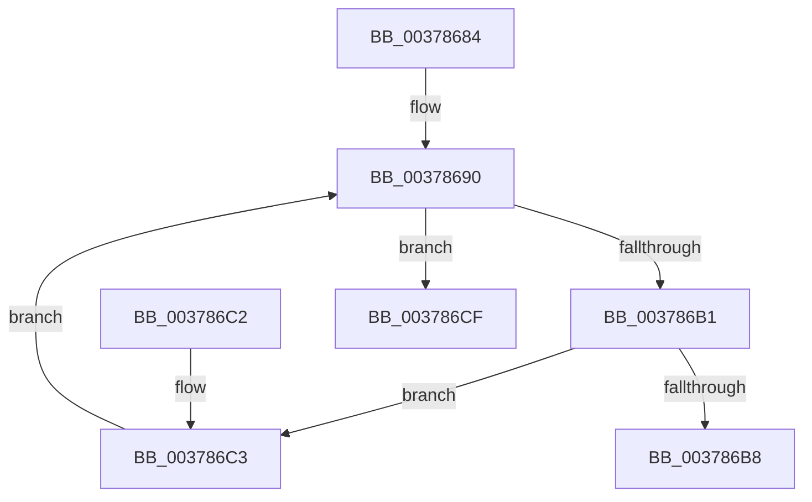

# RtlAcquireSwapReference

- RVA: `0x00378684`–`0x003786D6` (길이 `82` bytes)
- VA: `0x0000000140378684`
- 실행 섹션: `.text`
- PDB 이름 있음: `예`; PDB Function 태그: `아니요`
- unwind 정보 RVA: `0x00068D6C`
- 디코드: `25`개 명령, `82/82` bytes 표시
- 미해석 바이트: `0` (있으면 어셈블리에 `.byte`로 보존)

> 이 문서는 커널 이미지의 기계어와 PDB 기호를 분석해 생성했습니다. 4번과 5번은 함수 원형과 자료형을 바이너리 사용 방식에서 추정한 C 해석이며 원본 소스 복구 결과는 아닙니다.

## 1. Dependencies

- 직접 호출 지점: **1**; 고유 호출 대상: **1**
- 직접 호출자로 확인된 함수: **5**
- RIP 상대 이미지 참조: **0**

### Outgoing calls
- `0x003786C8` → [RtlBackoff](../20/RtlBackoff_function_00208620.md) (function, `0x00208620`)

### Direct callers
- [CmFcManagerNotifyFeatureUsage](CmFcManagerNotifyFeatureUsage_function_00378598.md) at `0x003785D9`
- [CmFcManagerRecordFeatureUsage](../49/CmFcManagerRecordFeatureUsage_function_0049C7B4.md) at `0x0049C7FD`
- [RtlpFcBufferManagerReferenceBuffers](../4A/RtlpFcBufferManagerReferenceBuffers_function_004A73B8.md) at `0x004A73D0`
- [RtlQueryFeatureConfiguration](../4B/RtlQueryFeatureConfiguration_function_004BDD10.md) at `0x004BDD74`
- [CmFcpManagerPublishFeatureUsageDataIfNearCapacity](../../page/7F/CmFcpManagerPublishFeatureUsageDataIfNearCapacity_function_007F5548.md) at `0x007F5582`

### Static image references
- 디코드된 RIP-relative 메모리 참조가 없습니다.

## 2. Other-region calls and transfers

- 다른 실행 섹션으로 향하는 call: **0**
- 별도 외부 분기/꼬리 이동을 확인하지 못했습니다.

## 3. Assembly (complete function range)

```asm
00378684  48 83 EC 28                     sub rsp, 0x28
00378688  83 64 24 30 00                  and dword ptr [rsp + 0x30], 0
0037868D  4C 8B C9                        mov r9, rcx
00378690  41 0F 0D 09                     prefetchw byte ptr [r9]
00378694  49 8B 01                        mov rax, qword ptr [r9]
00378697  48 8B C8                        mov rcx, rax
0037869A  48 8B D0                        mov rdx, rax
0037869D  48 83 E2 FE                     and rdx, 0xfffffffffffffffe
003786A1  83 E1 01                        and ecx, 1
003786A4  48 83 C2 02                     add rdx, 2
003786A8  48 0B D1                        or rdx, rcx
003786AB  48 83 FA 02                     cmp rdx, 2
003786AF  72 1E                           jb 0x1403786cf
003786B1  F0 49 0F B1 11                  lock cmpxchg qword ptr [r9], rdx
003786B6  75 0B                           jne 0x1403786c3
003786B8  83 E2 01                        and edx, 1
003786BB  8B C2                           mov eax, edx
003786BD  48 83 C4 28                     add rsp, 0x28
003786C1  C3                              ret
003786C2  CC                              int3
003786C3  48 8D 4C 24 30                  lea rcx, [rsp + 0x30]
003786C8  E8 53 FF E8 FF                  call 0x140208620
003786CD  EB C1                           jmp 0x140378690
003786CF  B9 0E 00 00 00                  mov ecx, 0xe
003786D4  CD 29                           int 0x29
```

## 4. C-style interpretation (structured pseudocode)

```c
__int64 __fastcall RtlAcquireSwapReference(__int64 a1)
{
    __int64 result;
    __int64 v_rsp;
    unsigned __int64 v_stack_p30;
    unsigned int v_stack_p8;

    v_rsp = (v_rsp) - (40);
loc_00378690:
    a2 = (*(unsigned __int64 *)(a1)) & (-2);
    a1 = (unsigned int)((*(unsigned __int64 *)(a1)) & (1));
    a2 = (a2) + (2);
    a2 = (a2) | (a1);
    if (a2 < 2) goto loc_003786CF;
    if (a2 != 2) goto loc_003786C3;
    a2 = (unsigned int)((a2) & (1));
    v_rsp = (v_rsp) + (40);
    return (unsigned int)((unsigned int)(a2));
loc_003786C3:
    result = RtlBackoff(v_stack_p30, a2, a3, a1);
    goto loc_00378690;
loc_003786CF:
    return result;
}
```

## 5. (Beta) C Style

```c
int64_t RtlAcquireSwapReference(int64_t Arg1)
{
    int64_t result;
    int64_t local_rsp;
    uint64_t v_stack_p30;
    uint32_t v_stack_p8;

    local_rsp = (local_rsp) - (40);
loc_00378690:
    a2 = (*(uint64_t *)(Arg1)) & (-2);
    Arg1 = (uint32_t)((*(uint64_t *)(Arg1)) & (1));
    a2 = (a2) + (2);
    a2 = (a2) | (Arg1);
    if (a2 < 2) goto loc_003786CF;
    if (a2 != 2) goto loc_003786C3;
    a2 = (uint32_t)((a2) & (1));
    local_rsp = (local_rsp) + (40);
    return (uint32_t)((uint32_t)(a2));
loc_003786C3:
    result = RtlBackoff(v_stack_p30, a2, a3, Arg1);
    goto loc_00378690;
loc_003786CF:
    return result;
}
```

## 6. Execution-region graph

[열기: 2D/3D 그래프와 함수 탐색 컨트롤 패널](../../../control-panel.html?section=text&rva=0x00378684&view=graph)

- 2D 그래프는 위에서 아래로 흐르고, 3D 그래프는 빈 공간을 드래그해 회전합니다. Shift+드래그는 이동, 휠은 확대·축소, 함수 노드 선택은 대상 보고서 이동입니다.

### Static fallback


