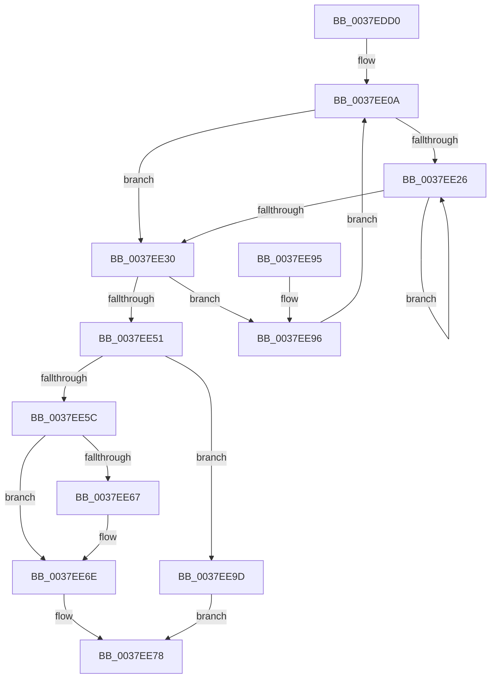

# RtlGetSystemTimePrecise

- RVA: `0x0037EDD0`–`0x0037EEA3` (길이 `211` bytes)
- VA: `0x000000014037EDD0`
- 실행 섹션: `.text`
- PDB 이름 있음: `예`; PDB Function 태그: `아니요`
- unwind 정보 RVA: `0x0007B7B0`
- 디코드: `59`개 명령, `211/211` bytes 표시
- 미해석 바이트: `0` (있으면 어셈블리에 `.byte`로 보존)

> 이 문서는 커널 이미지의 기계어와 PDB 기호를 분석해 생성했습니다. 4번과 5번은 함수 원형과 자료형을 바이너리 사용 방식에서 추정한 C 해석이며 원본 소스 복구 결과는 아닙니다.

## 1. Dependencies

- 직접 호출 지점: **1**; 고유 호출 대상: **1**
- 직접 호출자로 확인된 함수: **15**
- RIP 상대 이미지 참조: **0**

### Outgoing calls
- `0x0037EE40` → [KeQueryPerformanceCounter](KeQueryPerformanceCounter_function_0037E7E0.md) (function, `0x0037E7E0`)

### Direct callers
- [KiProcessExpiredTimerList](../23/KiProcessExpiredTimerList_function_00234200.md) at `0x002346D6`
- [KiExecuteAllDpcs](../25/KiExecuteAllDpcs_function_0025B740.md) at `0x0025C78D`
- [HvcallFastExtended](../31/HvcallFastExtended_function_003130E0.md) at `0x0031339F`
- [HvlpFastFlushAddressSpaceTb](../31/HvlpFastFlushAddressSpaceTb_function_00314AF4.md) at `0x00314C9F`
- [EtwGetKernelTraceTimestampSilo](EtwGetKernelTraceTimestampSilo_function_0037FBD0.md) at `0x0037FCCA`
- [EtwGetKernelTraceTimestamp](../39/EtwGetKernelTraceTimestamp_function_0039FC50.md) at `0x0039FD2E`
- [KeSetTimer2](../3A/KeSetTimer2_function_003A08E0.md) at `0x003A1091`
- [sub_003A3F33](../3A/Unknown_function_003A3F33.md) at `0x003A3F41`
- [HalpSetVirtualRtc](../42/HalpSetVirtualRtc_function_0042DF30.md) at `0x0042DF59`
- [WmiGetClock](../65/WmiGetClock_function_00651A60.md) at `0x00651A91`
- [SshpSessionManagerSendControlEventSlimEtl](../../page/A8/SshpSessionManagerSendControlEventSlimEtl_function_00A87200.md) at `0x00A87267`
- [PspInitPhase2](../../init/C4/PspInitPhase2_function_00C45460.md) at `0x00C4547E`
- [PspInitPhase2](../../init/C4/PspInitPhase2_function_00C45460.md) at `0x00C454FD`
- [EtwpFixBootSystemTime](../../init/C4/EtwpFixBootSystemTime_function_00C4DAF8.md) at `0x00C4DB7E`
- [EtwpInitializeBootTimeStamps](../../init/C4/EtwpInitializeBootTimeStamps_function_00C4E23C.md) at `0x00C4E300`
- [EtwpTraceSystemInitialization](../../init/C4/EtwpTraceSystemInitialization_function_00C4E720.md) at `0x00C4EC1A`

### Static image references
- 디코드된 RIP-relative 메모리 참조가 없습니다.

## 2. Other-region calls and transfers

- 다른 실행 섹션으로 향하는 call: **0**
- 별도 외부 분기/꼬리 이동을 확인하지 못했습니다.

## 3. Assembly (complete function range)

```asm
0037EDD0  48 89 5C 24 10                  mov qword ptr [rsp + 0x10], rbx
0037EDD5  48 89 6C 24 18                  mov qword ptr [rsp + 0x18], rbp
0037EDDA  48 89 74 24 20                  mov qword ptr [rsp + 0x20], rsi
0037EDDF  57                              push rdi
0037EDE0  41 54                           push r12
0037EDE2  41 55                           push r13
0037EDE4  41 56                           push r14
0037EDE6  41 57                           push r15
0037EDE8  48 83 EC 20                     sub rsp, 0x20
0037EDEC  49 BF 40 03 00 00 80 F7 FF FF   movabs r15, 0xfffff78000000340
0037EDF6  49 BD 48 03 00 00 80 F7 FF FF   movabs r13, 0xfffff78000000348
0037EE00  49 BC 58 03 00 00 80 F7 FF FF   movabs r12, 0xfffff78000000358
0037EE0A  49 8B 1F                        mov rbx, qword ptr [r15]
0037EE0D  48 B9 14 00 00 00 80 F7 FF FF   movabs rcx, 0xfffff78000000014
0037EE17  48 B8 68 03 00 00 80 F7 FF FF   movabs rax, 0xfffff78000000368
0037EE21  F6 C3 01                        test bl, 1
0037EE24  74 0A                           je 0x14037ee30
0037EE26  F3 90                           pause
0037EE28  49 8B 1F                        mov rbx, qword ptr [r15]
0037EE2B  F6 C3 01                        test bl, 1
0037EE2E  75 F6                           jne 0x14037ee26
0037EE30  48 8B 29                        mov rbp, qword ptr [rcx]
0037EE33  33 C9                           xor ecx, ecx
0037EE35  49 8B 75 00                     mov rsi, qword ptr [r13]
0037EE39  4D 8B 34 24                     mov r14, qword ptr [r12]
0037EE3D  0F B6 38                        movzx edi, byte ptr [rax]
0037EE40  E8 9B F9 FF FF                  call 0x14037e7e0
0037EE45  48 8B D0                        mov rdx, rax
0037EE48  90                              nop
0037EE49  49 8B 07                        mov rax, qword ptr [r15]
0037EE4C  48 3B C3                        cmp rax, rbx
0037EE4F  75 45                           jne 0x14037ee96
0037EE51  41 BC 00 00 00 00               mov r12d, 0
0037EE57  48 3B D6                        cmp rdx, rsi
0037EE5A  76 41                           jbe 0x14037ee9d
0037EE5C  48 2B D6                        sub rdx, rsi
0037EE5F  48 FF CA                        dec rdx
0037EE62  40 84 FF                        test dil, dil
0037EE65  74 07                           je 0x14037ee6e
0037EE67  40 0F B6 CF                     movzx ecx, dil
0037EE6B  48 D3 E2                        shl rdx, cl
0037EE6E  49 8B C6                        mov rax, r14
0037EE71  48 F7 E2                        mul rdx
0037EE74  48 8D 04 2A                     lea rax, [rdx + rbp]
0037EE78  48 8B 5C 24 58                  mov rbx, qword ptr [rsp + 0x58]
0037EE7D  48 8B 6C 24 60                  mov rbp, qword ptr [rsp + 0x60]
0037EE82  48 8B 74 24 68                  mov rsi, qword ptr [rsp + 0x68]
0037EE87  48 83 C4 20                     add rsp, 0x20
0037EE8B  41 5F                           pop r15
0037EE8D  41 5E                           pop r14
0037EE8F  41 5D                           pop r13
0037EE91  41 5C                           pop r12
0037EE93  5F                              pop rdi
0037EE94  C3                              ret
0037EE95  CC                              int3
0037EE96  F3 90                           pause
0037EE98  E9 6D FF FF FF                  jmp 0x14037ee0a
0037EE9D  49 8D 04 2C                     lea rax, [r12 + rbp]
0037EEA1  EB D5                           jmp 0x14037ee78
```

## 4. C-style interpretation (structured pseudocode)

```c
__int64 __fastcall RtlGetSystemTimePrecise(void)
{
    __int64 result;
    __int64 v_rsp;
    unsigned __int64 v_stack_p10;
    unsigned __int64 v_stack_p18;
    unsigned __int64 v_stack_p20;

    v_stack_p10 = v_rbx;
    v_stack_p18 = v_rbp;
    v_stack_p20 = v_rsi;
    v_rsp = (v_rsp) - (32);
loc_0037EE0A:
    if ((((unsigned __int8)(*(unsigned __int64 *)(v_r15))) & (1)) == 0) goto loc_0037EE30;
loc_0037EE26:
    if ((((unsigned __int8)(*(unsigned __int64 *)(v_r15))) & (1)) != 0) goto loc_0037EE26;
loc_0037EE30:
    a1 = 0;
    result = KeQueryPerformanceCounter(a1, a2, a3, a4);
    if ((*(unsigned __int64 *)(v_r15)) != (*(unsigned __int64 *)(v_r15))) goto loc_0037EE96;
    if (result <= (*(unsigned __int64 *)(v_r13))) goto loc_0037EE9D;
    a2 = (result) - (*(unsigned __int64 *)(v_r13));
    a2 = (a2) - 1;
    if ((unsigned __int8)(*(unsigned __int8 *)(result)) != 0) {
        a1 = (unsigned __int8)(*(unsigned __int8 *)(result));
        a2 = (a2) << ((unsigned __int8)(a1));
    }
loc_0037EE78:
    v_rsp = (v_rsp) + (32);
    return a2 + *(unsigned __int64 *)(a1) * 1;
loc_0037EE96:
    goto loc_0037EE0A;
loc_0037EE9D:
    goto loc_0037EE78;
}
```

## 5. (Beta) C Style

```c
void RtlGetSystemTimePrecise(void)
{
    int64_t result;
    int64_t local_rsp;
    uint64_t v_stack_p10;
    uint64_t v_stack_p18;
    uint64_t v_stack_p20;

    v_stack_p10 = local_rbx;
    v_stack_p18 = local_rbp;
    v_stack_p20 = local_rsi;
    local_rsp = (local_rsp) - (32);
loc_0037EE0A:
    if ((((uint8_t)(*(uint64_t *)(local_r15))) & (1)) == 0) goto loc_0037EE30;
loc_0037EE26:
    if ((((uint8_t)(*(uint64_t *)(local_r15))) & (1)) != 0) goto loc_0037EE26;
loc_0037EE30:
    a1 = 0;
    result = KeQueryPerformanceCounter(a1, a2, a3, a4);
    if ((*(uint64_t *)(local_r15)) != (*(uint64_t *)(local_r15))) goto loc_0037EE96;
    if (result <= (*(uint64_t *)(local_r13))) goto loc_0037EE9D;
    a2 = (result) - (*(uint64_t *)(local_r13));
    a2 = (a2) - 1;
    if ((uint8_t)(*(uint8_t *)(result)) != 0) {
        a1 = (uint8_t)(*(uint8_t *)(result));
        a2 = (a2) << ((uint8_t)(a1));
    }
loc_0037EE78:
    local_rsp = (local_rsp) + (32);
    return a2 + *(uint64_t *)(a1) * 1;
loc_0037EE96:
    goto loc_0037EE0A;
loc_0037EE9D:
    goto loc_0037EE78;
}
```

## 6. Execution-region graph

[열기: 2D/3D 그래프와 함수 탐색 컨트롤 패널](../../../control-panel.html?section=text&rva=0x0037EDD0&view=graph)

- 2D 그래프는 위에서 아래로 흐르고, 3D 그래프는 빈 공간을 드래그해 회전합니다. Shift+드래그는 이동, 휠은 확대·축소, 함수 노드 선택은 대상 보고서 이동입니다.

### Static fallback


