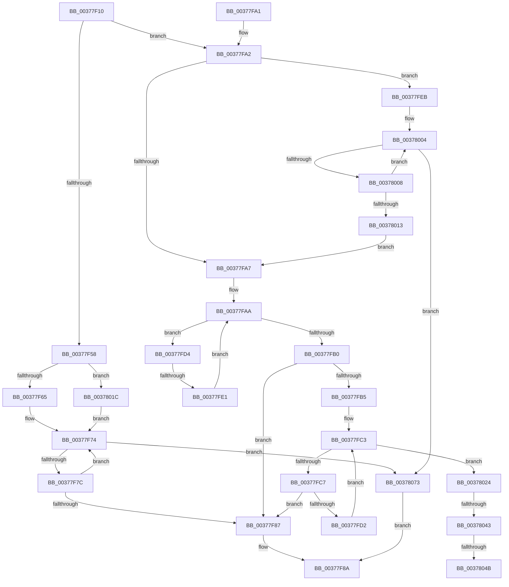

# RtlInterlockedSetClearRun

- RVA: `0x00377F10`–`0x0037807A` (길이 `362` bytes)
- VA: `0x0000000140377F10`
- 실행 섹션: `.text`
- PDB 이름 있음: `예`; PDB Function 태그: `예`
- unwind 정보 RVA: `0x0007ADE8`
- 디코드: `115`개 명령, `362/362` bytes 표시
- 미해석 바이트: `0` (있으면 어셈블리에 `.byte`로 보존)

> 이 문서는 커널 이미지의 기계어와 PDB 기호를 분석해 생성했습니다. 4번과 5번은 함수 원형과 자료형을 바이너리 사용 방식에서 추정한 C 해석이며 원본 소스 복구 결과는 아닙니다.

## 1. Dependencies

- 직접 호출 지점: **0**; 고유 호출 대상: **0**
- 직접 호출자로 확인된 함수: **5**
- RIP 상대 이미지 참조: **0**

### Outgoing calls
- 직접 디코드된 call 명령이 없습니다.

### Direct callers
- [MiQueuePinDriverAddressLog](../23/MiQueuePinDriverAddressLog_function_0023ADA4.md) at `0x0023AF00`
- [MiGetPageFromSlabEntry](MiGetPageFromSlabEntry_function_00377768.md) at `0x003778D9`
- [MiGetPageFromSlabEntry](MiGetPageFromSlabEntry_function_00377768.md) at `0x003778F3`
- [RtlpFcAddDelayedUsageReportToBuffer](RtlpFcAddDelayedUsageReportToBuffer_function_003786DC.md) at `0x003787E7`
- [sub_006E362E](../6E/Unknown_function_006E362E.md) at `0x006E37B3`
- [EtwpFindUserBufferSpace](../../page/9B/EtwpFindUserBufferSpace_function_009BFB14.md) at `0x009BFB6B`

### Static image references
- 디코드된 RIP-relative 메모리 참조가 없습니다.

## 2. Other-region calls and transfers

- 다른 실행 섹션으로 향하는 call: **0**
- call이 아닌 외부 분기/꼬리 이동: **4**
  - `0x00377FDB` → [sub_006E40BE](../6E/Unknown_function_006E40BE.md) (`tail-transfer`)
  - `0x0037803D` → [sub_006E40BE + 0x6E](../6E/Unknown_function_006E40BE.md) (`tail-transfer`)
  - `0x00378045` → [sub_006E40BE + 0x9B](../6E/Unknown_function_006E40BE.md) (`tail-transfer`)
  - `0x0037806E` → [sub_006E40BE + 0x9B](../6E/Unknown_function_006E40BE.md) (`tail-transfer`)

## 3. Assembly (complete function range)

```asm
00377F10  48 8B C4                        mov rax, rsp
00377F13  48 89 58 08                     mov qword ptr [rax + 8], rbx
00377F17  48 89 68 10                     mov qword ptr [rax + 0x10], rbp
00377F1B  48 89 70 18                     mov qword ptr [rax + 0x18], rsi
00377F1F  48 89 78 20                     mov qword ptr [rax + 0x20], rdi
00377F23  41 56                           push r14
00377F25  8B FA                           mov edi, edx
00377F27  45 8B C8                        mov r9d, r8d
00377F2A  83 E7 1F                        and edi, 0x1f
00377F2D  41 8B C0                        mov eax, r8d
00377F30  44 8B D2                        mov r10d, edx
00377F33  48 03 C7                        add rax, rdi
00377F36  49 C1 EA 03                     shr r10, 3
00377F3A  4C 8B F1                        mov r14, rcx
00377F3D  4C 03 51 08                     add r10, qword ptr [rcx + 8]
00377F41  49 83 E2 FC                     and r10, 0xfffffffffffffffc
00377F45  45 8B D8                        mov r11d, r8d
00377F48  8B F2                           mov esi, edx
00377F4A  41 B8 01 00 00 00               mov r8d, 1
00377F50  8B EA                           mov ebp, edx
00377F52  48 83 F8 20                     cmp rax, 0x20
00377F56  77 4A                           ja 0x140377fa2
00377F58  41 8B 02                        mov eax, dword ptr [r10]
00377F5B  41 83 FB 20                     cmp r11d, 0x20
00377F5F  0F 84 B7 00 00 00               je 0x14037801c
00377F65  41 8B CB                        mov ecx, r11d
00377F68  41 8B D0                        mov edx, r8d
00377F6B  D3 E2                           shl edx, cl
00377F6D  8B CF                           mov ecx, edi
00377F6F  41 2B D0                        sub edx, r8d
00377F72  D3 E2                           shl edx, cl
00377F74  85 C2                           test edx, eax
00377F76  0F 85 F7 00 00 00               jne 0x140378073
00377F7C  8B C8                           mov ecx, eax
00377F7E  0B CA                           or ecx, edx
00377F80  F0 41 0F B1 0A                  lock cmpxchg dword ptr [r10], ecx
00377F85  75 ED                           jne 0x140377f74
00377F87  41 8B C0                        mov eax, r8d
00377F8A  48 8B 5C 24 10                  mov rbx, qword ptr [rsp + 0x10]
00377F8F  48 8B 6C 24 18                  mov rbp, qword ptr [rsp + 0x18]
00377F94  48 8B 74 24 20                  mov rsi, qword ptr [rsp + 0x20]
00377F99  48 8B 7C 24 28                  mov rdi, qword ptr [rsp + 0x28]
00377F9E  41 5E                           pop r14
00377FA0  C3                              ret
00377FA1  CC                              int3
00377FA2  83 E6 1F                        and esi, 0x1f
00377FA5  75 44                           jne 0x140377feb
00377FA7  83 CB FF                        or ebx, 0xffffffff
00377FAA  41 83 FB 20                     cmp r11d, 0x20
00377FAE  73 24                           jae 0x140377fd4
00377FB0  45 85 DB                        test r11d, r11d
00377FB3  74 D2                           je 0x140377f87
00377FB5  41 8B 02                        mov eax, dword ptr [r10]
00377FB8  41 8B CB                        mov ecx, r11d
00377FBB  41 8B D0                        mov edx, r8d
00377FBE  D3 E2                           shl edx, cl
00377FC0  41 2B D0                        sub edx, r8d
00377FC3  85 C2                           test edx, eax
00377FC5  75 5D                           jne 0x140378024
00377FC7  8B C8                           mov ecx, eax
00377FC9  0B CA                           or ecx, edx
00377FCB  F0 41 0F B1 0A                  lock cmpxchg dword ptr [r10], ecx
00377FD0  74 B5                           je 0x140377f87
00377FD2  EB EF                           jmp 0x140377fc3
00377FD4  33 C0                           xor eax, eax
00377FD6  F0 41 0F B1 1A                  lock cmpxchg dword ptr [r10], ebx
00377FDB  0F 85 DD C0 36 00               jne 0x1406e40be
00377FE1  49 83 C2 04                     add r10, 4
00377FE5  41 83 C3 E0                     add r11d, -0x20
00377FE9  EB BF                           jmp 0x140377faa
00377FEB  41 8B 02                        mov eax, dword ptr [r10]
00377FEE  BB 20 00 00 00                  mov ebx, 0x20
00377FF3  2B DE                           sub ebx, esi
00377FF5  41 8B D0                        mov edx, r8d
00377FF8  8B CB                           mov ecx, ebx
00377FFA  D3 E2                           shl edx, cl
00377FFC  48 8B CF                        mov rcx, rdi
00377FFF  41 2B D0                        sub edx, r8d
00378002  D3 E2                           shl edx, cl
00378004  85 C2                           test edx, eax
00378006  75 6B                           jne 0x140378073
00378008  8B C8                           mov ecx, eax
0037800A  0B CA                           or ecx, edx
0037800C  F0 41 0F B1 0A                  lock cmpxchg dword ptr [r10], ecx
00378011  75 F1                           jne 0x140378004
00378013  44 2B DB                        sub r11d, ebx
00378016  49 83 C2 04                     add r10, 4
0037801A  EB 8B                           jmp 0x140377fa7
0037801C  83 CA FF                        or edx, 0xffffffff
0037801F  E9 50 FF FF FF                  jmp 0x140377f74
00378024  49 8B 46 08                     mov rax, qword ptr [r14 + 8]
00378028  45 2B CB                        sub r9d, r11d
0037802B  48 C1 ED 05                     shr rbp, 5
0037802F  4C 8D 14 A8                     lea r10, [rax + rbp*4]
00378033  41 8B C1                        mov eax, r9d
00378036  48 03 C7                        add rax, rdi
00378039  48 83 F8 20                     cmp rax, 0x20
0037803D  0F 86 E9 C0 36 00               jbe 0x1406e412c
00378043  85 F6                           test esi, esi
00378045  0F 84 0E C1 36 00               je 0x1406e4159
0037804B  BA 20 00 00 00                  mov edx, 0x20
00378050  41 8B C0                        mov eax, r8d
00378053  2B D6                           sub edx, esi
00378055  8B CA                           mov ecx, edx
00378057  D3 E0                           shl eax, cl
00378059  48 8B CF                        mov rcx, rdi
0037805C  41 2B C0                        sub eax, r8d
0037805F  D3 E0                           shl eax, cl
00378061  F7 D0                           not eax
00378063  F0 41 21 02                     lock and dword ptr [r10], eax
00378067  44 2B CA                        sub r9d, edx
0037806A  49 83 C2 04                     add r10, 4
0037806E  E9 E6 C0 36 00                  jmp 0x1406e4159
00378073  33 C0                           xor eax, eax
00378075  E9 10 FF FF FF                  jmp 0x140377f8a
```

## 4. C-style interpretation (structured pseudocode)

```c
__int64 __fastcall RtlInterlockedSetClearRun(__int64 a1, int a2, int a3)
{
    __int64 result;
    __int64 v_r10;
    __int64 v_r11;
    __int64 v_rbp;
    __int64 v_rbx;
    __int64 v_rdi;
    __int64 v_rsi;
    unsigned __int64 v_stack_p10;
    unsigned __int64 v_stack_p18;
    unsigned __int64 v_stack_p20;
    unsigned __int64 v_stack_p8;

    *(unsigned __int64 *)(v_rsp + 8) = v_rbx;
    *(unsigned __int64 *)(v_rsp + 16) = v_rbp;
    *(unsigned __int64 *)(v_rsp + 24) = v_rsi;
    *(unsigned __int64 *)(v_rsp + 32) = v_rdi;
    v_rdi = (unsigned int)(((unsigned int)(a2)) & (31));
    result = ((unsigned int)(a3)) + (v_rdi);
    v_r10 = ((unsigned int)(a2)) >> (3);
    v_r10 = (v_r10) + (*(unsigned __int64 *)(a1 + 8));
    v_r10 = (v_r10) & (-4);
    if (result > 32) goto loc_00377FA2;
    if (((unsigned int)((unsigned int)(a3))) == 32) goto loc_0037801C;
    a2 = (unsigned int)((1) << ((unsigned __int8)((unsigned int)((unsigned int)((unsigned int)(a3))))));
    a2 = (unsigned int)((a2) - (1));
    a2 = (unsigned int)((a2) << ((unsigned __int8)((unsigned int)((unsigned int)(v_rdi)))));
loc_00377F74:
    if (((a2) & ((unsigned int)((unsigned int)(*(unsigned int *)(v_r10))))) != 0) goto loc_00378073;
    a1 = (unsigned int)(((unsigned int)((unsigned int)((unsigned int)(*(unsigned int *)(v_r10))))) | (a2));
    if (condition_is_not_equal) goto loc_00377F74;
loc_00377F87:
loc_00377F8A:
    return 1;
loc_00377FA2:
    v_rsi = (unsigned int)((v_stack_p18) & (31));
    if (condition_is_not_equal) goto loc_00377FEB;
loc_00377FA7:
    v_rbx = (unsigned int)((v_stack_p8) | (0xFFFFFFFFULL));
loc_00377FAA:
    if (((unsigned int)((unsigned int)(a3))) >= 32) goto loc_00377FD4;
    if ((unsigned int)((unsigned int)(a3)) == 0) goto loc_00377F87;
    a2 = (unsigned int)((1) << ((unsigned __int8)((unsigned int)((unsigned int)((unsigned int)(a3))))));
    a2 = (unsigned int)((a2) - (1));
loc_00377FC3:
    if (((a2) & ((unsigned int)((unsigned int)(*(unsigned int *)(v_r10))))) != 0) goto loc_00378024;
    a1 = (unsigned int)(((unsigned int)((unsigned int)((unsigned int)(*(unsigned int *)(v_r10))))) | (a2));
    if (condition_is_equal) goto loc_00377F87;
    goto loc_00377FC3;
loc_00377FD4:
    result = 0;
    v_r10 = (v_r10) + (4);
    v_r11 = (unsigned int)(((unsigned int)(a3)) + (-32));
    goto loc_00377FAA;
loc_00377FEB:
    v_rbx = (unsigned int)((32) - ((unsigned int)(v_rsi)));
    a2 = (unsigned int)((1) << ((unsigned __int8)((unsigned int)((unsigned int)(v_rbx)))));
    a2 = (unsigned int)((a2) - (1));
    a2 = (unsigned int)((a2) << ((unsigned __int8)(v_stack_p20)));
loc_00378004:
    if (((a2) & ((unsigned int)((unsigned int)(*(unsigned int *)(v_r10))))) != 0) goto loc_00378073;
    a1 = (unsigned int)(((unsigned int)((unsigned int)((unsigned int)(*(unsigned int *)(v_r10))))) | (a2));
    if (condition_is_not_equal) goto loc_00378004;
    v_r11 = (unsigned int)((v_r11) - ((unsigned int)(v_rbx)));
    v_r10 = (v_r10) + (4);
    goto loc_00377FA7;
loc_0037801C:
    a2 = (unsigned int)((a2) | (0xFFFFFFFFULL));
    goto loc_00377F74;
loc_00378024:
    a4 = (unsigned int)(((unsigned int)(a3)) - ((unsigned int)(v_r11)));
    v_rbp = (v_stack_p10) >> (5);
    result = ((unsigned int)((unsigned int)(a4))) + (v_stack_p20);
    a2 = (unsigned int)((32) - ((unsigned int)(v_rsi)));
    result = (unsigned int)((1) << ((unsigned __int8)((unsigned int)(a2))));
    result = (unsigned int)((result) - (1));
    result = (unsigned int)((result) << ((unsigned __int8)(v_stack_p20)));
    result = (unsigned int)(~(result));
    a4 = (unsigned int)((a4) - (a2));
    v_r10 = (*(unsigned __int64 *)(a1 + 8) + v_rbp * 4) + (4);
loc_00378073:
    result = 0;
    goto loc_00377F8A;
}
```

## 5. (Beta) C Style

```c
int64_t RtlInterlockedSetClearRun(void *Arg1, int32_t Arg2, int32_t Arg3)
{
    uint8_t *arg1 = (uint8_t *)Arg1;

    int64_t result;
    int64_t local_r10;
    int64_t local_r11;
    int64_t local_rbp;
    int64_t local_rbx;
    int64_t local_rdi;
    int64_t local_rsi;
    uint64_t v_stack_p10;
    uint64_t v_stack_p18;
    uint64_t v_stack_p20;
    uint64_t v_stack_p8;

    *(uint64_t *)(local_rsp + 0x8) = local_rbx;
    *(uint64_t *)(local_rsp + 0x10) = local_rbp;
    *(uint64_t *)(local_rsp + 0x18) = local_rsi;
    *(uint64_t *)(local_rsp + 0x20) = local_rdi;
    local_rdi = (uint32_t)(((uint32_t)(Arg2)) & (31));
    result = ((uint32_t)(Arg3)) + (local_rdi);
    local_r10 = ((uint32_t)(Arg2)) >> (3);
    local_r10 = (local_r10) + (*(uint64_t *)(arg1 + 0x8));
    local_r10 = (local_r10) & (-4);
    if (result > 32) goto loc_00377FA2;
    if (((uint32_t)((uint32_t)(Arg3))) == 32) goto loc_0037801C;
    Arg2 = (uint32_t)((1) << ((uint8_t)((uint32_t)((uint32_t)((uint32_t)(Arg3))))));
    Arg2 = (uint32_t)((Arg2) - (1));
    Arg2 = (uint32_t)((Arg2) << ((uint8_t)((uint32_t)((uint32_t)(local_rdi)))));
loc_00377F74:
    if (((Arg2) & ((uint32_t)((uint32_t)(*(uint32_t *)(local_r10))))) != 0) goto loc_00378073;
    Arg1 = (uint32_t)(((uint32_t)((uint32_t)((uint32_t)(*(uint32_t *)(local_r10))))) | (Arg2));
    if (condition_is_not_equal) goto loc_00377F74;
loc_00377F87:
loc_00377F8A:
    return 1;
loc_00377FA2:
    local_rsi = (uint32_t)((v_stack_p18) & (31));
    if (condition_is_not_equal) goto loc_00377FEB;
loc_00377FA7:
    local_rbx = (uint32_t)((v_stack_p8) | (0xFFFFFFFFULL));
loc_00377FAA:
    if (((uint32_t)((uint32_t)(Arg3))) >= 32) goto loc_00377FD4;
    if ((uint32_t)((uint32_t)(Arg3)) == 0) goto loc_00377F87;
    Arg2 = (uint32_t)((1) << ((uint8_t)((uint32_t)((uint32_t)((uint32_t)(Arg3))))));
    Arg2 = (uint32_t)((Arg2) - (1));
loc_00377FC3:
    if (((Arg2) & ((uint32_t)((uint32_t)(*(uint32_t *)(local_r10))))) != 0) goto loc_00378024;
    Arg1 = (uint32_t)(((uint32_t)((uint32_t)((uint32_t)(*(uint32_t *)(local_r10))))) | (Arg2));
    if (condition_is_equal) goto loc_00377F87;
    goto loc_00377FC3;
loc_00377FD4:
    result = 0;
    local_r10 = (local_r10) + (4);
    local_r11 = (uint32_t)(((uint32_t)(Arg3)) + (-32));
    goto loc_00377FAA;
loc_00377FEB:
    local_rbx = (uint32_t)((32) - ((uint32_t)(local_rsi)));
    Arg2 = (uint32_t)((1) << ((uint8_t)((uint32_t)((uint32_t)(local_rbx)))));
    Arg2 = (uint32_t)((Arg2) - (1));
    Arg2 = (uint32_t)((Arg2) << ((uint8_t)(v_stack_p20)));
loc_00378004:
    if (((Arg2) & ((uint32_t)((uint32_t)(*(uint32_t *)(local_r10))))) != 0) goto loc_00378073;
    Arg1 = (uint32_t)(((uint32_t)((uint32_t)((uint32_t)(*(uint32_t *)(local_r10))))) | (Arg2));
    if (condition_is_not_equal) goto loc_00378004;
    local_r11 = (uint32_t)((local_r11) - ((uint32_t)(local_rbx)));
    local_r10 = (local_r10) + (4);
    goto loc_00377FA7;
loc_0037801C:
    Arg2 = (uint32_t)((Arg2) | (0xFFFFFFFFULL));
    goto loc_00377F74;
loc_00378024:
    a4 = (uint32_t)(((uint32_t)(Arg3)) - ((uint32_t)(local_r11)));
    local_rbp = (v_stack_p10) >> (5);
    result = ((uint32_t)((uint32_t)(a4))) + (v_stack_p20);
    Arg2 = (uint32_t)((32) - ((uint32_t)(local_rsi)));
    result = (uint32_t)((1) << ((uint8_t)((uint32_t)(Arg2))));
    result = (uint32_t)((result) - (1));
    result = (uint32_t)((result) << ((uint8_t)(v_stack_p20)));
    result = (uint32_t)(~(result));
    a4 = (uint32_t)((a4) - (Arg2));
    local_r10 = (*(uint64_t *)(arg1 + 0x8) + local_rbp * 4) + (4);
loc_00378073:
    result = 0;
    goto loc_00377F8A;
}
```

### 관측된 메모리 오프셋

구조체 형식이 확인되지 않은 접근은 인자 기준의 오프셋으로만 기록했습니다.

| 기준 인자 | 오프셋 표현 | 폭 (bit) | 접근 |
|---|---:|---:|---|
| `Arg1` | `+ 0x8` | `64` | `R` |

## 6. Execution-region graph

[열기: 2D/3D 그래프와 함수 탐색 컨트롤 패널](../../../control-panel.html?section=text&rva=0x00377F10&view=graph)

- 2D 그래프는 위에서 아래로 흐르고, 3D 그래프는 빈 공간을 드래그해 회전합니다. Shift+드래그는 이동, 휠은 확대·축소, 함수 노드 선택은 대상 보고서 이동입니다.

### Static fallback


