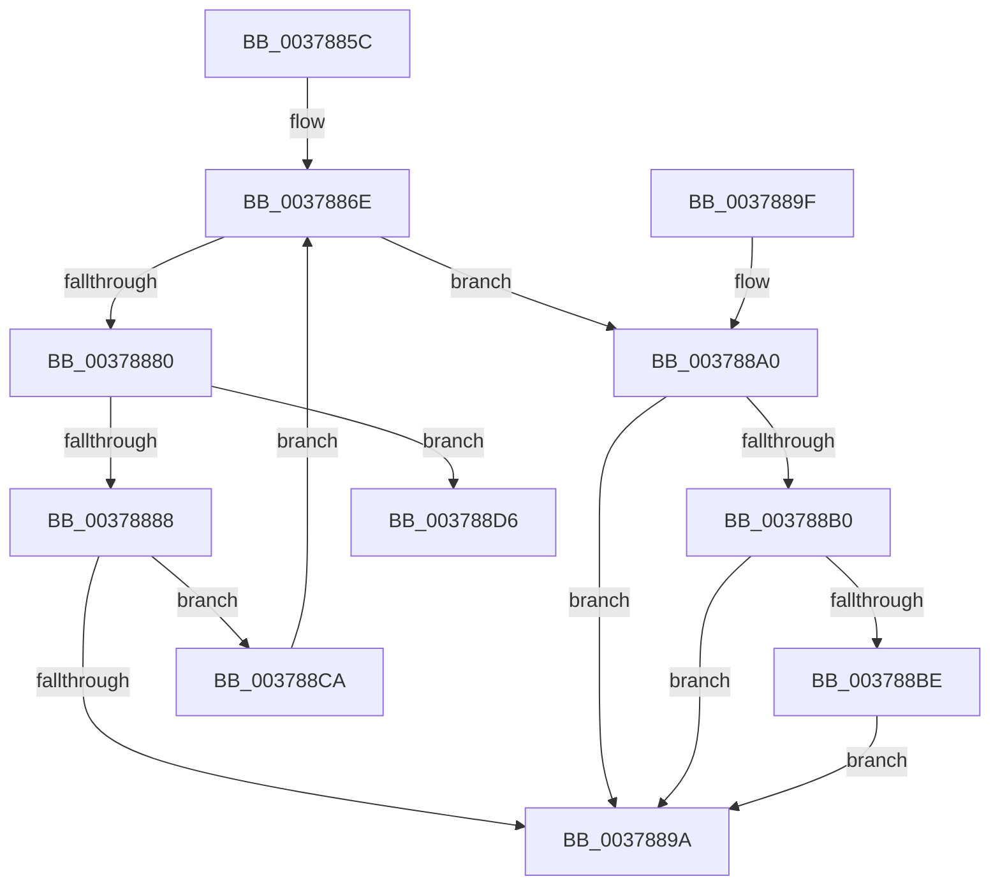

# RtlReleaseSwapReference

- RVA: `0x0037885C`–`0x003788DD` (길이 `129` bytes)
- VA: `0x000000014037885C`
- 실행 섹션: `.text`
- PDB 이름 있음: `예`; PDB Function 태그: `아니요`
- unwind 정보 RVA: `0x000760CC`
- 디코드: `38`개 명령, `129/129` bytes 표시
- 미해석 바이트: `0` (있으면 어셈블리에 `.byte`로 보존)

> 이 문서는 커널 이미지의 기계어와 PDB 기호를 분석해 생성했습니다. 4번과 5번은 함수 원형과 자료형을 바이너리 사용 방식에서 추정한 C 해석이며 원본 소스 복구 결과는 아닙니다.

## 1. Dependencies

- 직접 호출 지점: **2**; 고유 호출 대상: **2**
- 직접 호출자로 확인된 함수: **4**
- RIP 상대 이미지 참조: **0**

### Outgoing calls
- `0x003788C3` → [ExpUnblockPushLock](../2A/ExpUnblockPushLock_function_002A40FC.md) (function, `0x002A40FC`)
- `0x003788CF` → [RtlBackoff](../20/RtlBackoff_function_00208620.md) (function, `0x00208620`)

### Direct callers
- [CmFcManagerNotifyFeatureUsage](CmFcManagerNotifyFeatureUsage_function_00378598.md) at `0x00378607`
- [CmFcManagerNotifyFeatureUsage](CmFcManagerNotifyFeatureUsage_function_00378598.md) at `0x00378674`
- [RtlpFcBufferManagerDereferenceBuffers](RtlpFcBufferManagerDereferenceBuffers_function_00378D84.md) at `0x00378DAA`
- [CmFcManagerRecordFeatureUsage](../49/CmFcManagerRecordFeatureUsage_function_0049C7B4.md) at `0x0049C84A`
- [CmFcManagerRecordFeatureUsage](../49/CmFcManagerRecordFeatureUsage_function_0049C7B4.md) at `0x0049C8BE`
- [CmFcpManagerPublishFeatureUsageDataIfNearCapacity](../../page/7F/CmFcpManagerPublishFeatureUsageDataIfNearCapacity_function_007F5548.md) at `0x007F55E7`
- [CmFcpManagerPublishFeatureUsageDataIfNearCapacity](../../page/7F/CmFcpManagerPublishFeatureUsageDataIfNearCapacity_function_007F5548.md) at `0x007F563F`
- [CmFcpManagerPublishFeatureUsageDataIfNearCapacity](../../page/7F/CmFcpManagerPublishFeatureUsageDataIfNearCapacity_function_007F5548.md) at `0x007F565A`

### Static image references
- 디코드된 RIP-relative 메모리 참조가 없습니다.

## 2. Other-region calls and transfers

- 다른 실행 섹션으로 향하는 call: **0**
- 별도 외부 분기/꼬리 이동을 확인하지 못했습니다.

## 3. Assembly (complete function range)

```asm
0037885C  48 83 EC 28                     sub rsp, 0x28
00378860  45 33 DB                        xor r11d, r11d
00378863  44 8B D2                        mov r10d, edx
00378866  44 89 5C 24 38                  mov dword ptr [rsp + 0x38], r11d
0037886B  4C 8B C9                        mov r9, rcx
0037886E  41 0F 0D 09                     prefetchw byte ptr [r9]
00378872  49 8B 01                        mov rax, qword ptr [r9]
00378875  48 8B D0                        mov rdx, rax
00378878  83 E2 01                        and edx, 1
0037887B  49 3B D2                        cmp rdx, r10
0037887E  75 20                           jne 0x1403788a0
00378880  48 8B C8                        mov rcx, rax
00378883  48 D1 E9                        shr rcx, 1
00378886  74 4E                           je 0x1403788d6
00378888  48 8D 0C 4D FE FF FF FF         lea rcx, [rcx*2 - 2]
00378890  48 0B CA                        or rcx, rdx
00378893  F0 49 0F B1 09                  lock cmpxchg qword ptr [r9], rcx
00378898  75 30                           jne 0x1403788ca
0037889A  48 83 C4 28                     add rsp, 0x28
0037889E  C3                              ret
0037889F  CC                              int3
003788A0  48 83 C8 FF                     or rax, 0xffffffffffffffff
003788A4  F0 49 0F C1 41 08               lock xadd qword ptr [r9 + 8], rax
003788AA  48 83 F8 01                     cmp rax, 1
003788AE  75 EA                           jne 0x14037889a
003788B0  49 8D 49 10                     lea rcx, [r9 + 0x10]
003788B4  F0 44 09 1C 24                  lock or dword ptr [rsp], r11d
003788B9  4C 39 19                        cmp qword ptr [rcx], r11
003788BC  74 DC                           je 0x14037889a
003788BE  45 33 C0                        xor r8d, r8d
003788C1  33 D2                           xor edx, edx
003788C3  E8 34 B8 F2 FF                  call 0x1402a40fc
003788C8  EB D0                           jmp 0x14037889a
003788CA  48 8D 4C 24 38                  lea rcx, [rsp + 0x38]
003788CF  E8 4C FD E8 FF                  call 0x140208620
003788D4  EB 98                           jmp 0x14037886e
003788D6  B9 0E 00 00 00                  mov ecx, 0xe
003788DB  CD 29                           int 0x29
```

## 4. C-style interpretation (structured pseudocode)

```c
__int64 __fastcall RtlReleaseSwapReference(__int64 a1, int a2, int a3)
{
    __int64 result;
    __int64 v_r11;
    __int64 v_rsp;
    unsigned int v_stack_p0;
    unsigned int v_stack_p10;
    unsigned __int64 v_stack_p38;

    v_rsp = (v_rsp) - (40);
    v_r11 = 0;
    v_stack_p10 = 0;
loc_0037886E:
    a2 = (unsigned int)((*(unsigned __int64 *)(a1)) & (1));
    if (a2 != ((unsigned int)(a2))) goto loc_003788A0;
    a1 = (*(unsigned __int64 *)(a1)) >> (1);
    if (condition_is_equal) goto loc_003788D6;
    a1 = (a1 * 2 - 2) | (a2);
    if (condition_is_not_equal) goto loc_003788CA;
loc_0037889A:
    v_rsp = (v_rsp) + (40);
    return *(unsigned __int64 *)(a1);
loc_003788A0:
    result = (*(unsigned __int64 *)(a1)) | (-1);
    if (result != 1) goto loc_0037889A;
    if ((*(unsigned __int64 *)(a1 + 16)) == 0) goto loc_0037889A;
    a3 = 0;
    a2 = 0;
    result = ExpUnblockPushLock(a1 + 16, a2, a3, a1);
    goto loc_0037889A;
loc_003788CA:
    result = RtlBackoff(v_stack_p38, a2, a3, a1);
    goto loc_0037886E;
loc_003788D6:
    return result;
}
```

## 5. (Beta) C Style

```c
int64_t RtlReleaseSwapReference(int64_t Arg1, int32_t Arg2, int32_t Arg3)
{
    int64_t result;
    int64_t local_r11;
    int64_t local_rsp;
    uint32_t v_stack_p0;
    uint32_t v_stack_p10;
    uint64_t v_stack_p38;

    local_rsp = (local_rsp) - (40);
    local_r11 = 0;
    v_stack_p10 = 0;
loc_0037886E:
    Arg2 = (uint32_t)((*(uint64_t *)(Arg1)) & (1));
    if (Arg2 != ((uint32_t)(Arg2))) goto loc_003788A0;
    Arg1 = (*(uint64_t *)(Arg1)) >> (1);
    if (condition_is_equal) goto loc_003788D6;
    Arg1 = (Arg1 * 2 - 2) | (Arg2);
    if (condition_is_not_equal) goto loc_003788CA;
loc_0037889A:
    local_rsp = (local_rsp) + (40);
    return *(uint64_t *)(Arg1);
loc_003788A0:
    result = (*(uint64_t *)(Arg1)) | (-1);
    if (result != 1) goto loc_0037889A;
    if ((*(uint64_t *)(Arg1 + 0x10)) == 0) goto loc_0037889A;
    Arg3 = 0;
    Arg2 = 0;
    result = ExpUnblockPushLock(Arg1 + 16, Arg2, Arg3, Arg1);
    goto loc_0037889A;
loc_003788CA:
    result = RtlBackoff(v_stack_p38, Arg2, Arg3, Arg1);
    goto loc_0037886E;
loc_003788D6:
    return result;
}
```

## 6. Execution-region graph

[열기: 2D/3D 그래프와 함수 탐색 컨트롤 패널](../../../control-panel.html?section=text&rva=0x0037885C&view=graph)

- 2D 그래프는 위에서 아래로 흐르고, 3D 그래프는 빈 공간을 드래그해 회전합니다. Shift+드래그는 이동, 휠은 확대·축소, 함수 노드 선택은 대상 보고서 이동입니다.

### Static fallback


