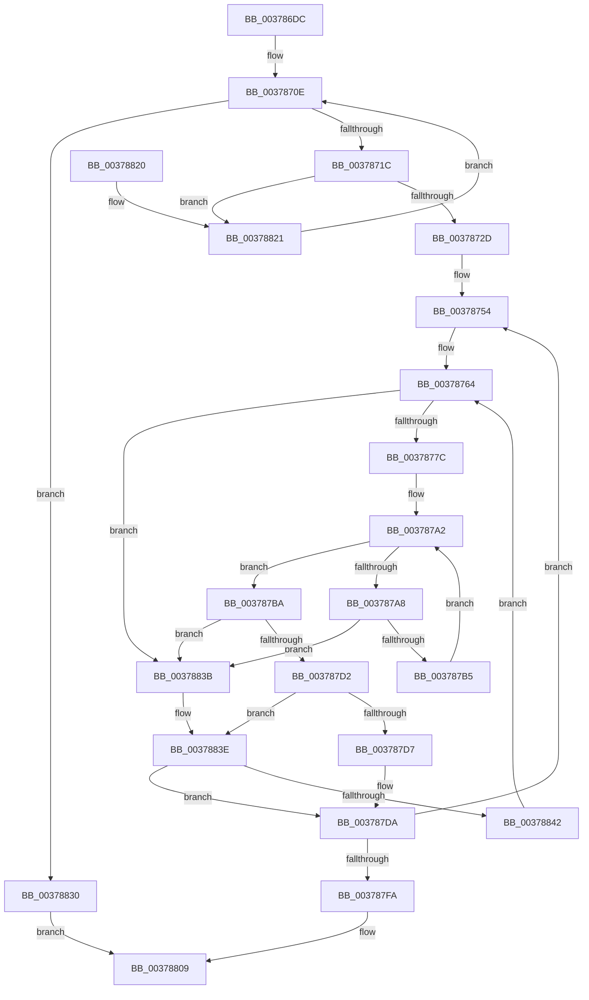

# RtlpFcAddDelayedUsageReportToBuffer

- RVA: `0x003786DC`–`0x00378856` (길이 `378` bytes)
- VA: `0x00000001403786DC`
- 실행 섹션: `.text`
- PDB 이름 있음: `예`; PDB Function 태그: `아니요`
- unwind 정보 RVA: `0x0007AE9C`
- 디코드: `115`개 명령, `378/378` bytes 표시
- 미해석 바이트: `0` (있으면 어셈블리에 `.byte`로 보존)

> 이 문서는 커널 이미지의 기계어와 PDB 기호를 분석해 생성했습니다. 4번과 5번은 함수 원형과 자료형을 바이너리 사용 방식에서 추정한 C 해석이며 원본 소스 복구 결과는 아닙니다.

## 1. Dependencies

- 직접 호출 지점: **2**; 고유 호출 대상: **2**
- 직접 호출자로 확인된 함수: **1**
- RIP 상대 이미지 참조: **0**

### Outgoing calls
- `0x003787E7` → [RtlInterlockedSetClearRun](RtlInterlockedSetClearRun_function_00377F10.md) (function, `0x00377F10`)
- `0x00378826` → [RtlBackoff](../20/RtlBackoff_function_00208620.md) (function, `0x00208620`)

### Direct callers
- [CmFcManagerNotifyFeatureUsage](CmFcManagerNotifyFeatureUsage_function_00378598.md) at `0x003785F3`

### Static image references
- 디코드된 RIP-relative 메모리 참조가 없습니다.

## 2. Other-region calls and transfers

- 다른 실행 섹션으로 향하는 call: **0**
- 별도 외부 분기/꼬리 이동을 확인하지 못했습니다.

## 3. Assembly (complete function range)

```asm
003786DC  48 89 5C 24 10                  mov qword ptr [rsp + 0x10], rbx
003786E1  55                              push rbp
003786E2  56                              push rsi
003786E3  57                              push rdi
003786E4  41 54                           push r12
003786E6  41 55                           push r13
003786E8  41 56                           push r14
003786EA  41 57                           push r15
003786EC  48 83 EC 30                     sub rsp, 0x30
003786F0  33 F6                           xor esi, esi
003786F2  48 C7 44 24 20 40 00 00 00      mov qword ptr [rsp + 0x20], 0x40
003786FB  48 8D 41 08                     lea rax, [rcx + 8]
003786FF  89 74 24 70                     mov dword ptr [rsp + 0x70], esi
00378703  48 89 44 24 28                  mov qword ptr [rsp + 0x28], rax
00378708  4C 8B EA                        mov r13, rdx
0037870B  48 8B F9                        mov rdi, rcx
0037870E  0F 0D 0F                        prefetchw byte ptr [rdi]
00378711  8B 2F                           mov ebp, dword ptr [rdi]
00378713  83 FD 40                        cmp ebp, 0x40
00378716  0F 84 14 01 00 00               je 0x140378830
0037871C  44 8D 65 01                     lea r12d, [rbp + 1]
00378720  8B C5                           mov eax, ebp
00378722  F0 44 0F B1 27                  lock cmpxchg dword ptr [rdi], r12d
00378727  0F 85 F4 00 00 00               jne 0x140378821
0037872D  4C 8B 7C 24 28                  mov r15, qword ptr [rsp + 0x28]
00378732  49 8B CF                        mov rcx, r15
00378735  83 E1 04                        and ecx, 4
00378738  8B C1                           mov eax, ecx
0037873A  48 F7 D8                        neg rax
0037873D  45 1B F6                        sbb r14d, r14d
00378740  41 83 E6 20                     and r14d, 0x20
00378744  48 F7 D9                        neg rcx
00378747  48 1B C0                        sbb rax, rax
0037874A  83 E0 04                        and eax, 4
0037874D  4C 2B F8                        sub r15, rax
00378750  41 83 CB FF                     or r11d, 0xffffffff
00378754  44 8B 44 24 20                  mov r8d, dword ptr [rsp + 0x20]
00378759  41 3B E8                        cmp ebp, r8d
0037875C  1B D2                           sbb edx, edx
0037875E  23 D5                           and edx, ebp
00378760  41 8D 40 FF                     lea eax, [r8 - 1]
00378764  45 8D 0C 06                     lea r9d, [r14 + rax]
00378768  41 8B C1                        mov eax, r9d
0037876B  41 8D 0C 16                     lea ecx, [r14 + rdx]
0037876F  2B C1                           sub eax, ecx
00378771  FF C0                           inc eax
00378773  83 F8 01                        cmp eax, 1
00378776  0F 82 BF 00 00 00               jb 0x14037883b
0037877C  41 8B C1                        mov eax, r9d
0037877F  48 C1 E8 06                     shr rax, 6
00378783  4D 8D 14 C7                     lea r10, [r15 + rax*8]
00378787  8B C1                           mov eax, ecx
00378789  48 C1 E8 06                     shr rax, 6
0037878D  80 E1 3F                        and cl, 0x3f
00378790  49 8D 1C C7                     lea rbx, [r15 + rax*8]
00378794  B8 01 00 00 00                  mov eax, 1
00378799  48 D3 E0                        shl rax, cl
0037879C  48 FF C8                        dec rax
0037879F  48 0B 03                        or rax, qword ptr [rbx]
003787A2  48 83 F8 FF                     cmp rax, -1
003787A6  75 12                           jne 0x1403787ba
003787A8  48 83 C3 08                     add rbx, 8
003787AC  49 3B DA                        cmp rbx, r10
003787AF  0F 87 86 00 00 00               ja 0x14037883b
003787B5  48 8B 03                        mov rax, qword ptr [rbx]
003787B8  EB E8                           jmp 0x1403787a2
003787BA  49 2B DF                        sub rbx, r15
003787BD  48 F7 D0                        not rax
003787C0  48 C1 FB 03                     sar rbx, 3
003787C4  48 0F BC C0                     bsf rax, rax
003787C8  C1 E3 06                        shl ebx, 6
003787CB  03 D8                           add ebx, eax
003787CD  41 3B D9                        cmp ebx, r9d
003787D0  77 69                           ja 0x14037883b
003787D2  41 3B DB                        cmp ebx, r11d
003787D5  74 67                           je 0x14037883e
003787D7  41 2B DE                        sub ebx, r14d
003787DA  41 B8 01 00 00 00               mov r8d, 1
003787E0  48 8D 4C 24 20                  lea rcx, [rsp + 0x20]
003787E5  8B D3                           mov edx, ebx
003787E7  E8 24 F7 FF FF                  call 0x140377f10
003787EC  41 BB FF FF FF FF               mov r11d, 0xffffffff
003787F2  85 C0                           test eax, eax
003787F4  0F 84 5A FF FF FF               je 0x140378754
003787FA  8B C3                           mov eax, ebx
003787FC  48 8D 0C 40                     lea rcx, [rax + rax*2]
00378800  49 8B 45 00                     mov rax, qword ptr [r13]
00378804  48 89 44 8F 14                  mov qword ptr [rdi + rcx*4 + 0x14], rax
00378809  48 8B 5C 24 78                  mov rbx, qword ptr [rsp + 0x78]
0037880E  8B C6                           mov eax, esi
00378810  48 83 C4 30                     add rsp, 0x30
00378814  41 5F                           pop r15
00378816  41 5E                           pop r14
00378818  41 5D                           pop r13
0037881A  41 5C                           pop r12
0037881C  5F                              pop rdi
0037881D  5E                              pop rsi
0037881E  5D                              pop rbp
0037881F  C3                              ret
00378820  CC                              int3
00378821  48 8D 4C 24 70                  lea rcx, [rsp + 0x70]
00378826  E8 F5 FD E8 FF                  call 0x140208620
0037882B  E9 DE FE FF FF                  jmp 0x14037870e
00378830  BE 9A 00 00 C0                  mov esi, 0xc000009a
00378835  F0 FF 47 04                     lock inc dword ptr [rdi + 4]
00378839  EB CE                           jmp 0x140378809
0037883B  41 8B DB                        mov ebx, r11d
0037883E  85 D2                           test edx, edx
00378840  74 98                           je 0x1403787da
00378842  45 3B E0                        cmp r12d, r8d
00378845  41 8B C4                        mov eax, r12d
00378848  8B D6                           mov edx, esi
0037884A  41 0F 47 C0                     cmova eax, r8d
0037884E  41 03 C3                        add eax, r11d
00378851  E9 0E FF FF FF                  jmp 0x140378764
```

## 4. C-style interpretation (structured pseudocode)

```c
__int64 __fastcall RtlpFcAddDelayedUsageReportToBuffer(__int64 a1, __int64 a2)
{
    __int64 result;
    __int64 v_r11;
    __int64 v_r14;
    __int64 v_r15;
    __int64 v_rbx;
    __int64 v_rsi;
    __int64 v_rsp;
    unsigned __int64 v_stack_m40;
    unsigned __int64 v_stack_m48;
    unsigned __int64 v_stack_p10;
    unsigned __int64 v_stack_p70;
    unsigned int v_stack_p8;

    v_stack_p10 = v_rbx;
    v_rsp = (v_rsp) - (48);
    v_rsi = 0;
    v_stack_m48 = 64;
    v_stack_p8 = 0;
    v_stack_m40 = a1 + 8;
loc_0037870E:
    if (((unsigned int)((unsigned int)(*(unsigned int *)(a1)))) == 64) goto loc_00378830;
    if (((unsigned int)((unsigned int)(*(unsigned int *)(a1)))) != 64) goto loc_00378821;
    a1 = (unsigned int)((v_stack_m40) & (4));
    result = -((unsigned int)((unsigned int)(a1)));
    v_r14 = (unsigned int)((v_r14) & (32));
    a1 = -(a1);
    result = (unsigned int)((result) & (4));
    v_r15 = (v_stack_m40) - (result);
    v_r11 = (unsigned int)((v_r11) | (0xFFFFFFFFULL));
loc_00378754:
    a2 = (unsigned int)((a2) & ((unsigned int)((unsigned int)(*(unsigned int *)(a1)))));
loc_00378764:
    result = (unsigned int)(((unsigned int)((unsigned int)(v_r14 + (unsigned int)(v_stack_m48) - 1 * 1))) - ((unsigned int)(v_r14 + a2 * 1)));
    result = (unsigned int)((result) + 1);
    if (((unsigned int)(result)) < 1) goto loc_0037883B;
    result = ((unsigned int)((unsigned int)(v_r14 + (unsigned int)(v_stack_m48) - 1 * 1))) >> (6);
    result = ((unsigned int)((unsigned int)(v_r14 + a2 * 1))) >> (6);
    a1 = (unsigned __int8)((v_r14 + a2 * 1) & (63));
    result = (1) << ((unsigned __int8)(a1));
    result = (result) - 1;
    result = (result) | (*(unsigned __int64 *)(v_r15 + result * 8));
loc_003787A2:
    if (result != -1) goto loc_003787BA;
    v_rbx = (v_r15 + result * 8) + (8);
    if (v_rbx > (v_r15 + result * 8)) goto loc_0037883B;
    goto loc_003787A2;
loc_003787BA:
    v_rbx = (v_rbx) - (v_r15);
    result = ~(*(unsigned __int64 *)(v_rbx));
    v_rbx = (v_rbx) >> (3);
    v_rbx = (unsigned int)((v_rbx) << (6));
    v_rbx = (unsigned int)((v_rbx) + ((unsigned int)(result)));
    if (((unsigned int)(v_rbx)) > ((unsigned int)(v_r14 + (unsigned int)(v_stack_m48) - 1 * 1))) goto loc_0037883B;
    if (((unsigned int)(v_rbx)) == ((unsigned int)(v_r11))) goto loc_0037883E;
    v_rbx = (unsigned int)((v_rbx) - ((unsigned int)(v_r14)));
loc_003787DA:
    result = RtlInterlockedSetClearRun(v_stack_m48, (unsigned int)((unsigned int)(v_rbx)), 1, v_r14 + (unsigned int)(v_stack_m48) - 1 * 1);
    if ((unsigned int)(result) == 0) goto loc_00378754;
    *(unsigned __int64 *)(a1 + (unsigned int)((unsigned int)(v_rbx)) + (unsigned int)((unsigned int)(v_rbx)) * 2 * 4 + 20) = *(unsigned __int64 *)(a2);
loc_00378809:
    v_rsp = (v_rsp) + (48);
    return 0;
loc_00378821:
    result = RtlBackoff(v_stack_p70, (unsigned int)((unsigned int)(v_rbx)), 1, v_r14 + (unsigned int)(v_stack_m48) - 1 * 1);
    goto loc_0037870E;
loc_00378830:
    goto loc_00378809;
loc_0037883B:
loc_0037883E:
    if ((unsigned int)((unsigned int)((unsigned int)(v_rbx))) == 0) goto loc_003787DA;
    result = (unsigned int)((unsigned int)((unsigned int)(*(unsigned int *)(a1)) + 1));
    if (((unsigned int)((unsigned int)(*(unsigned int *)(a1)) + 1)) > 1) { result = 1; }
    result = (unsigned int)((result) + ((unsigned int)((unsigned int)(0xFFFFFFFFULL))));
    goto loc_00378764;
}
```

## 5. (Beta) C Style

```c
int64_t RtlpFcAddDelayedUsageReportToBuffer(void *Arg1, void *Arg2)
{
    uint8_t *arg1 = (uint8_t *)Arg1;
    uint8_t *arg2 = (uint8_t *)Arg2;

    int64_t result;
    int64_t local_r11;
    int64_t local_r14;
    int64_t local_r15;
    int64_t local_rbx;
    int64_t local_rsi;
    int64_t local_rsp;
    uint64_t v_stack_m40;
    uint64_t v_stack_m48;
    uint64_t v_stack_p10;
    uint64_t v_stack_p70;
    uint32_t v_stack_p8;

    v_stack_p10 = local_rbx;
    local_rsp = (local_rsp) - (48);
    local_rsi = 0;
    v_stack_m48 = 64;
    v_stack_p8 = 0;
    v_stack_m40 = Arg1 + 8;
loc_0037870E:
    if (((uint32_t)((uint32_t)(*(uint32_t *)(arg1)))) == 64) goto loc_00378830;
    if (((uint32_t)((uint32_t)(*(uint32_t *)(arg1)))) != 64) goto loc_00378821;
    Arg1 = (uint32_t)((v_stack_m40) & (4));
    result = -((uint32_t)((uint32_t)(Arg1)));
    local_r14 = (uint32_t)((local_r14) & (32));
    Arg1 = -(Arg1);
    result = (uint32_t)((result) & (4));
    local_r15 = (v_stack_m40) - (result);
    local_r11 = (uint32_t)((local_r11) | (0xFFFFFFFFULL));
loc_00378754:
    Arg2 = (uint32_t)((Arg2) & ((uint32_t)((uint32_t)(*(uint32_t *)(arg1)))));
loc_00378764:
    result = (uint32_t)(((uint32_t)((uint32_t)(local_r14 + (uint32_t)(v_stack_m48) - 1 * 1))) - ((uint32_t)(local_r14 + Arg2 * 1)));
    result = (uint32_t)((result) + 1);
    if (((uint32_t)(result)) < 1) goto loc_0037883B;
    result = ((uint32_t)((uint32_t)(local_r14 + (uint32_t)(v_stack_m48) - 1 * 1))) >> (6);
    result = ((uint32_t)((uint32_t)(local_r14 + Arg2 * 1))) >> (6);
    Arg1 = (uint8_t)((local_r14 + Arg2 * 1) & (63));
    result = (1) << ((uint8_t)(Arg1));
    result = (result) - 1;
    result = (result) | (*(uint64_t *)(local_r15 + result * 8));
loc_003787A2:
    if (result != -1) goto loc_003787BA;
    local_rbx = (local_r15 + result * 8) + (8);
    if (local_rbx > (local_r15 + result * 8)) goto loc_0037883B;
    goto loc_003787A2;
loc_003787BA:
    local_rbx = (local_rbx) - (local_r15);
    result = ~(*(uint64_t *)(local_rbx));
    local_rbx = (local_rbx) >> (3);
    local_rbx = (uint32_t)((local_rbx) << (6));
    local_rbx = (uint32_t)((local_rbx) + ((uint32_t)(result)));
    if (((uint32_t)(local_rbx)) > ((uint32_t)(local_r14 + (uint32_t)(v_stack_m48) - 1 * 1))) goto loc_0037883B;
    if (((uint32_t)(local_rbx)) == ((uint32_t)(local_r11))) goto loc_0037883E;
    local_rbx = (uint32_t)((local_rbx) - ((uint32_t)(local_r14)));
loc_003787DA:
    result = RtlInterlockedSetClearRun(v_stack_m48, (uint32_t)((uint32_t)(local_rbx)), 1, local_r14 + (uint32_t)(v_stack_m48) - 1 * 1);
    if ((uint32_t)(result) == 0) goto loc_00378754;
    *(uint64_t *)(arg1 + (uint32_t)((uint32_t)(local_rbx)) + (uint32_t)((uint32_t)(local_rbx)) * 2 * 4 + 0x14) = *(uint64_t *)(arg2);
loc_00378809:
    local_rsp = (local_rsp) + (48);
    return 0;
loc_00378821:
    result = RtlBackoff(v_stack_p70, (uint32_t)((uint32_t)(local_rbx)), 1, local_r14 + (uint32_t)(v_stack_m48) - 1 * 1);
    goto loc_0037870E;
loc_00378830:
    goto loc_00378809;
loc_0037883B:
loc_0037883E:
    if ((uint32_t)((uint32_t)((uint32_t)(local_rbx))) == 0) goto loc_003787DA;
    result = (uint32_t)((uint32_t)((uint32_t)(*(uint32_t *)(arg1)) + 1));
    if (((uint32_t)((uint32_t)(*(uint32_t *)(arg1)) + 1)) > 1) { result = 1; }
    result = (uint32_t)((result) + ((uint32_t)((uint32_t)(0xFFFFFFFFULL))));
    goto loc_00378764;
}
```

### 관측된 메모리 오프셋

구조체 형식이 확인되지 않은 접근은 인자 기준의 오프셋으로만 기록했습니다.

| 기준 인자 | 오프셋 표현 | 폭 (bit) | 접근 |
|---|---:|---:|---|
| `Arg1` | `+ 0x0` | `8` | `R` |
| `Arg1` | `+ 0x0` | `32` | `R` |
| `Arg1` | `+ 0x4` | `32` | `R/W` |
| `Arg1` | `+ 0x8` | `64` | `R` |
| `Arg1` | `+ 0x14 + rcx*4` | `64` | `W` |
| `Arg2` | `+ 0x0` | `64` | `R` |

## 6. Execution-region graph

[열기: 2D/3D 그래프와 함수 탐색 컨트롤 패널](../../../control-panel.html?section=text&rva=0x003786DC&view=graph)

- 2D 그래프는 위에서 아래로 흐르고, 3D 그래프는 빈 공간을 드래그해 회전합니다. Shift+드래그는 이동, 휠은 확대·축소, 함수 노드 선택은 대상 보고서 이동입니다.

### Static fallback


