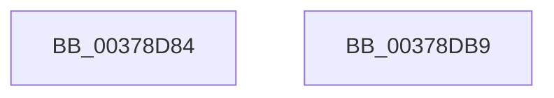

# RtlpFcBufferManagerDereferenceBuffers

- RVA: `0x00378D84`–`0x00378DBA` (길이 `54` bytes)
- VA: `0x0000000140378D84`
- 실행 섹션: `.text`
- PDB 이름 있음: `예`; PDB Function 태그: `아니요`
- unwind 정보 RVA: `0x0005C788`
- 디코드: `14`개 명령, `54/54` bytes 표시
- 미해석 바이트: `0` (있으면 어셈블리에 `.byte`로 보존)

> 이 문서는 커널 이미지의 기계어와 PDB 기호를 분석해 생성했습니다. 4번과 5번은 함수 원형과 자료형을 바이너리 사용 방식에서 추정한 C 해석이며 원본 소스 복구 결과는 아닙니다.

## 1. Dependencies

- 직접 호출 지점: **2**; 고유 호출 대상: **2**
- 직접 호출자로 확인된 함수: **11**
- RIP 상대 이미지 참조: **0**

### Outgoing calls
- `0x00378DAA` → [RtlReleaseSwapReference](RtlReleaseSwapReference_function_0037885C.md) (function, `0x0037885C`)
- `0x00378DAF` → [RtlpFcLeaveRegion](../../page/A9/RtlpFcLeaveRegion_function_00A949CC.md) (function, `0x00A949CC`)

### Direct callers
- [RtlQueryFeatureConfiguration](../4B/RtlQueryFeatureConfiguration_function_004BDD10.md) at `0x004BDDCB`
- [RtlQueryAllInternalFeatureConfigurations](../5E/RtlQueryAllInternalFeatureConfigurations_function_005E7280.md) at `0x005E72F7`
- [RtlQueryAllInternalRuntimeFeatureConfigurations](../5E/RtlQueryAllInternalRuntimeFeatureConfigurations_function_005E7320.md) at `0x005E73E7`
- [RtlQueryInternalFeatureConfiguration](../5E/RtlQueryInternalFeatureConfiguration_function_005E7500.md) at `0x005E75AE`
- [RtlQueryAllFeatureConfigurations](../../page/78/RtlQueryAllFeatureConfigurations_function_0078F510.md) at `0x0078F5C9`
- [CmFcManagerOverwriteFeatureConfigurationSection](../../page/7F/CmFcManagerOverwriteFeatureConfigurationSection_function_007F4450.md) at `0x007F4632`
- [CmFcManagerOverwriteFeatureConfigurationSection](../../page/7F/CmFcManagerOverwriteFeatureConfigurationSection_function_007F4450.md) at `0x007F478C`
- [CmFcManagerUpdateFeatureConfigurations](../../page/7F/CmFcManagerUpdateFeatureConfigurations_function_007F4CF4.md) at `0x007F5135`
- [CmFcManagerUpdateFeatureConfigurations](../../page/7F/CmFcManagerUpdateFeatureConfigurations_function_007F4CF4.md) at `0x007F5149`
- [CmFcManagerUpdateFeatureUsageSubscriptions](../../page/A4/CmFcManagerUpdateFeatureUsageSubscriptions_function_00A4490C.md) at `0x00A44A1B`
- [CmFcpManagerDrainUsageNotifications](../../page/A4/CmFcpManagerDrainUsageNotifications_function_00A451BC.md) at `0x00A45236`
- [sub_00B3AEBA](../../page/B3/Unknown_function_00B3AEBA.md) at `0x00B3AFEA`
- [CmFcManagerStartRuntimePhase](../../init/C5/CmFcManagerStartRuntimePhase_function_00C5DC70.md) at `0x00C5DE06`
- [CmFcManagerStartRuntimePhase](../../init/C5/CmFcManagerStartRuntimePhase_function_00C5DC70.md) at `0x00C5E1CB`

### Static image references
- 디코드된 RIP-relative 메모리 참조가 없습니다.

## 2. Other-region calls and transfers

- 다른 실행 섹션으로 향하는 call: **1**
  - `0x00378DAF` → [RtlpFcLeaveRegion](../../page/A9/RtlpFcLeaveRegion_function_00A949CC.md) (`.text` → `PAGE`)
- 별도 외부 분기/꼬리 이동을 확인하지 못했습니다.

## 3. Assembly (complete function range)

```asm
00378D84  48 83 EC 28                     sub rsp, 0x28
00378D88  48 2B D1                        sub rdx, rcx
00378D8B  48 B8 AB AA AA AA AA AA AA 2A   movabs rax, 0x2aaaaaaaaaaaaaab
00378D95  48 83 EA 18                     sub rdx, 0x18
00378D99  48 F7 EA                        imul rdx
00378D9C  48 C1 FA 04                     sar rdx, 4
00378DA0  48 8B C2                        mov rax, rdx
00378DA3  48 C1 E8 3F                     shr rax, 0x3f
00378DA7  48 03 D0                        add rdx, rax
00378DAA  E8 AD FA FF FF                  call 0x14037885c
00378DAF  E8 18 BC 71 00                  call 0x140a949cc
00378DB4  48 83 C4 28                     add rsp, 0x28
00378DB8  C3                              ret
00378DB9  CC                              int3
```

## 4. C-style interpretation (structured pseudocode)

```c
__int64 __fastcall RtlpFcBufferManagerDereferenceBuffers(__int64 a1, __int64 a2)
{
    __int64 result;
    __int64 v_rsp;

    v_rsp = (v_rsp) - (40);
    a2 = (a2) - (a1);
    a2 = (a2) - (24);
    a2 = (a2) >> (4);
    result = (a2) >> (63);
    a2 = (a2) + (result);
    result = RtlReleaseSwapReference(a1, a2, a3, a4);
    result = RtlpFcLeaveRegion(a1, a2, a3, a4);
    v_rsp = (v_rsp) + (40);
    return result;
}
```

## 5. (Beta) C Style

```c
int64_t RtlpFcBufferManagerDereferenceBuffers(int64_t Arg1, int64_t Arg2)
{
    int64_t result;
    int64_t local_rsp;

    local_rsp = (local_rsp) - (40);
    Arg2 = (Arg2) - (Arg1);
    Arg2 = (Arg2) - (24);
    Arg2 = (Arg2) >> (4);
    result = (Arg2) >> (63);
    Arg2 = (Arg2) + (result);
    result = RtlReleaseSwapReference(Arg1, Arg2, a3, a4);
    result = RtlpFcLeaveRegion(Arg1, Arg2, a3, a4);
    local_rsp = (local_rsp) + (40);
    return result;
}
```

## 6. Execution-region graph

[열기: 2D/3D 그래프와 함수 탐색 컨트롤 패널](../../../control-panel.html?section=text&rva=0x00378D84&view=graph)

- 2D 그래프는 위에서 아래로 흐르고, 3D 그래프는 빈 공간을 드래그해 회전합니다. Shift+드래그는 이동, 휠은 확대·축소, 함수 노드 선택은 대상 보고서 이동입니다.

### Static fallback


