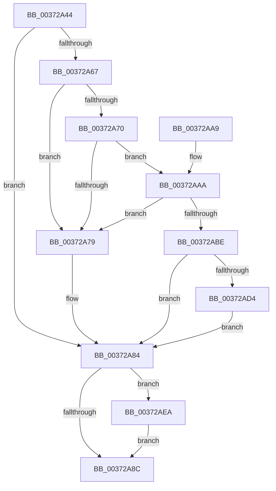

# SmKmUnlockMdl

- RVA: `0x00372A44`–`0x00372B00` (길이 `188` bytes)
- VA: `0x0000000140372A44`
- 실행 섹션: `.text`
- PDB 이름 있음: `예`; PDB Function 태그: `아니요`
- unwind 정보 RVA: `0x0007AA1C`
- 디코드: `56`개 명령, `188/188` bytes 표시
- 미해석 바이트: `0` (있으면 어셈블리에 `.byte`로 보존)

> 이 문서는 커널 이미지의 기계어와 PDB 기호를 분석해 생성했습니다. 4번과 5번은 함수 원형과 자료형을 바이너리 사용 방식에서 추정한 C 해석이며 원본 소스 복구 결과는 아닙니다.

## 1. Dependencies

- 직접 호출 지점: **6**; 고유 호출 대상: **6**
- 직접 호출자로 확인된 함수: **3**
- RIP 상대 이미지 참조: **0**

### Outgoing calls
- `0x00372A7F` → [MmUnmapLockedPages](../24/MmUnmapLockedPages_function_00246E60.md) (function, `0x00246E60`)
- `0x00372A8F` → [MiUnlockStoreLockedPages](MiUnlockStoreLockedPages_function_003735C0.md) (function, `0x003735C0`)
- `0x00372AB5` → [SmpFpReleaseResource](../4F/SmpFpReleaseResource_function_004FAC90.md) (function, `0x004FAC90`)
- `0x00372AC9` → [MmUnmapReservedMapping](../3E/MmUnmapReservedMapping_function_003E7BE0.md) (function, `0x003E7BE0`)
- `0x00372AE3` → [KeSetEvent](../33/KeSetEvent_function_0033F310.md) (function, `0x0033F310`)
- `0x00372AF5` → [SmFpFree](../43/SmFpFree_function_00436350.md) (function, `0x00436350`)

### Direct callers
- [sub_0034CD25](../34/Unknown_function_0034CD25.md) at `0x0034CD4B`
- [SmKmStoreHelperCommandProcess](../3C/SmKmStoreHelperCommandProcess_function_003C3AA4.md) at `0x003C3D35`
- [SmKmStoreHelperCommandCleanup](../4D/SmKmStoreHelperCommandCleanup_function_004D03FC.md) at `0x004D0469`

### Static image references
- 디코드된 RIP-relative 메모리 참조가 없습니다.

## 2. Other-region calls and transfers

- 다른 실행 섹션으로 향하는 call: **0**
- 별도 외부 분기/꼬리 이동을 확인하지 못했습니다.

## 3. Assembly (complete function range)

```asm
00372A44  48 89 5C 24 08                  mov qword ptr [rsp + 8], rbx
00372A49  48 89 6C 24 10                  mov qword ptr [rsp + 0x10], rbp
00372A4E  48 89 74 24 18                  mov qword ptr [rsp + 0x18], rsi
00372A53  57                              push rdi
00372A54  48 83 EC 20                     sub rsp, 0x20
00372A58  F6 41 0A 01                     test byte ptr [rcx + 0xa], 1
00372A5C  49 8B E8                        mov rbp, r8
00372A5F  48 8B FA                        mov rdi, rdx
00372A62  48 8B D9                        mov rbx, rcx
00372A65  74 1D                           je 0x140372a84
00372A67  48 8B 71 18                     mov rsi, qword ptr [rcx + 0x18]
00372A6B  48 85 D2                        test rdx, rdx
00372A6E  74 09                           je 0x140372a79
00372A70  48 8B 42 70                     mov rax, qword ptr [rdx + 0x70]
00372A74  49 3B C0                        cmp rax, r8
00372A77  74 31                           je 0x140372aaa
00372A79  48 8B D3                        mov rdx, rbx
00372A7C  48 8B CE                        mov rcx, rsi
00372A7F  E8 DC 43 ED FF                  call 0x140246e60
00372A84  4C 8B 0B                        mov r9, qword ptr [rbx]
00372A87  4D 85 C9                        test r9, r9
00372A8A  75 5E                           jne 0x140372aea
00372A8C  48 8B CB                        mov rcx, rbx
00372A8F  E8 2C 0B 00 00                  call 0x1403735c0
00372A94  48 8B 5C 24 30                  mov rbx, qword ptr [rsp + 0x30]
00372A99  48 8B 6C 24 38                  mov rbp, qword ptr [rsp + 0x38]
00372A9E  48 8B 74 24 40                  mov rsi, qword ptr [rsp + 0x40]
00372AA3  48 83 C4 20                     add rsp, 0x20
00372AA7  5F                              pop rdi
00372AA8  C3                              ret
00372AA9  CC                              int3
00372AAA  4C 8B C6                        mov r8, rsi
00372AAD  BA 05 00 00 00                  mov edx, 5
00372AB2  48 8B CF                        mov rcx, rdi
00372AB5  E8 D6 81 18 00                  call 0x1404fac90
00372ABA  85 C0                           test eax, eax
00372ABC  74 BB                           je 0x140372a79
00372ABE  4C 8B C3                        mov r8, rbx
00372AC1  BA 73 6D 52 6D                  mov edx, 0x6d526d73
00372AC6  48 8B CE                        mov rcx, rsi
00372AC9  E8 12 51 07 00                  call 0x1403e7be0
00372ACE  80 7F 5E 00                     cmp byte ptr [rdi + 0x5e], 0
00372AD2  75 B0                           jne 0x140372a84
00372AD4  33 C0                           xor eax, eax
00372AD6  48 8D 4F 08                     lea rcx, [rdi + 8]
00372ADA  48 87 47 70                     xchg qword ptr [rdi + 0x70], rax
00372ADE  45 33 C0                        xor r8d, r8d
00372AE1  33 D2                           xor edx, edx
00372AE3  E8 28 C8 FC FF                  call 0x14033f310
00372AE8  EB 9A                           jmp 0x140372a84
00372AEA  4C 8B C5                        mov r8, rbp
00372AED  BA 04 00 00 00                  mov edx, 4
00372AF2  48 8B CF                        mov rcx, rdi
00372AF5  E8 56 38 0C 00                  call 0x140436350
00372AFA  48 83 23 00                     and qword ptr [rbx], 0
00372AFE  EB 8C                           jmp 0x140372a8c
```

## 4. C-style interpretation (structured pseudocode)

```c
__int64 __fastcall SmKmUnlockMdl(__int64 a1, __int64 a2, __int64 a3)
{
    __int64 result;
    __int64 v_rsp;
    unsigned __int64 v_stack_p10;
    unsigned __int64 v_stack_p18;
    unsigned __int64 v_stack_p8;

    v_stack_p8 = v_rbx;
    v_stack_p10 = v_rbp;
    v_stack_p18 = v_rsi;
    v_rsp = (v_rsp) - (32);
    if (((*(unsigned __int8 *)(a1 + 10)) & (1)) == 0) goto loc_00372A84;
    if (a2 == 0) goto loc_00372A79;
    if ((*(unsigned __int64 *)(a2 + 112)) == a3) goto loc_00372AAA;
loc_00372A79:
    result = MmUnmapLockedPages(*(unsigned __int64 *)(a1 + 24), a1, a3, a4);
loc_00372A84:
    if (*(unsigned __int64 *)(a1) != 0) goto loc_00372AEA;
loc_00372A8C:
    result = MiUnlockStoreLockedPages(a1, a1, a3, *(unsigned __int64 *)(a1));
    v_rsp = (v_rsp) + (32);
    return result;
loc_00372AAA:
    result = SmpFpReleaseResource(a2, 5, v_stack_p18, *(unsigned __int64 *)(a1));
    if ((unsigned int)(result) == 0) goto loc_00372A79;
    result = MmUnmapReservedMapping(v_stack_p18, (unsigned int)(0x6D526D73ULL), v_stack_p8, *(unsigned __int64 *)(a1));
    if ((*(unsigned __int8 *)(a2 + 94)) != 0) goto loc_00372A84;
    result = 0;
    a3 = 0;
    a2 = 0;
    result = KeSetEvent(a2 + 8, a2, a3, *(unsigned __int64 *)(a1));
    goto loc_00372A84;
loc_00372AEA:
    result = SmFpFree(0, 4, v_stack_p10, *(unsigned __int64 *)(a1));
    goto loc_00372A8C;
}
```

## 5. (Beta) C Style

```c
int64_t SmKmUnlockMdl(void *Arg1, void *Arg2, int64_t Arg3)
{
    uint8_t *arg1 = (uint8_t *)Arg1;
    uint8_t *arg2 = (uint8_t *)Arg2;

    int64_t result;
    int64_t local_rsp;
    uint64_t v_stack_p10;
    uint64_t v_stack_p18;
    uint64_t v_stack_p8;

    v_stack_p8 = local_rbx;
    v_stack_p10 = local_rbp;
    v_stack_p18 = local_rsi;
    local_rsp = (local_rsp) - (32);
    if (((*(uint8_t *)(arg1 + 0xA)) & (1)) == 0) goto loc_00372A84;
    if (Arg2 == NULL) goto loc_00372A79;
    if ((*(uint64_t *)(arg2 + 0x70)) == Arg3) goto loc_00372AAA;
loc_00372A79:
    result = MmUnmapLockedPages(*(uint64_t *)(arg1 + 0x18), Arg1, Arg3, a4);
loc_00372A84:
    if (*(uint64_t *)(arg1) != 0) goto loc_00372AEA;
loc_00372A8C:
    result = MiUnlockStoreLockedPages(Arg1, Arg1, Arg3, *(uint64_t *)(arg1));
    local_rsp = (local_rsp) + (32);
    return result;
loc_00372AAA:
    result = SmpFpReleaseResource(Arg2, 5, v_stack_p18, *(uint64_t *)(arg1));
    if ((uint32_t)(result) == 0) goto loc_00372A79;
    result = MmUnmapReservedMapping(v_stack_p18, (uint32_t)(0x6D526D73ULL), v_stack_p8, *(uint64_t *)(arg1));
    if ((*(uint8_t *)(arg2 + 0x5E)) != 0) goto loc_00372A84;
    result = 0;
    Arg3 = 0;
    Arg2 = 0;
    result = KeSetEvent(Arg2 + 8, Arg2, Arg3, *(uint64_t *)(arg1));
    goto loc_00372A84;
loc_00372AEA:
    result = SmFpFree(0, 4, v_stack_p10, *(uint64_t *)(arg1));
    goto loc_00372A8C;
}
```

### 관측된 메모리 오프셋

구조체 형식이 확인되지 않은 접근은 인자 기준의 오프셋으로만 기록했습니다.

| 기준 인자 | 오프셋 표현 | 폭 (bit) | 접근 |
|---|---:|---:|---|
| `Arg1` | `+ 0x0` | `64` | `R` |
| `Arg1` | `+ 0x0` | `64` | `R/W` |
| `Arg1` | `+ 0xA` | `8` | `R` |
| `Arg1` | `+ 0x18` | `64` | `R` |
| `Arg2` | `+ 0x8` | `64` | `R` |
| `Arg2` | `+ 0x5E` | `8` | `R` |
| `Arg2` | `+ 0x70` | `64` | `R/W` |

## 6. Execution-region graph

[열기: 2D/3D 그래프와 함수 탐색 컨트롤 패널](../../../control-panel.html?section=text&rva=0x00372A44&view=graph)

- 2D 그래프는 위에서 아래로 흐르고, 3D 그래프는 빈 공간을 드래그해 회전합니다. Shift+드래그는 이동, 휠은 확대·축소, 함수 노드 선택은 대상 보고서 이동입니다.

### Static fallback


