# sub_003708A6

- RVA: `0x003708A6`–`0x00370B5A` (길이 `692` bytes)
- VA: `0x00000001403708A6`
- 실행 섹션: `.text`
- PDB 이름 있음: `아니요`; PDB Function 태그: `아니요`
- unwind 정보 RVA: `0x0007A704`
- 디코드: `156`개 명령, `692/692` bytes 표시
- 미해석 바이트: `0` (있으면 어셈블리에 `.byte`로 보존)

> 이 문서는 커널 이미지의 기계어와 PDB 기호를 분석해 생성했습니다. 4번과 5번은 함수 원형과 자료형을 바이너리 사용 방식에서 추정한 C 해석이며 원본 소스 복구 결과는 아닙니다.

## 1. Dependencies

- 직접 호출 지점: **2**; 고유 호출 대상: **2**
- 직접 호출자로 확인된 함수: **0**
- RIP 상대 이미지 참조: **3**

### Outgoing calls
- `0x00370969` → [MiMapPageInHyperSpaceWorker](../33/MiMapPageInHyperSpaceWorker_function_00332B10.md) (function, `0x00332B10`)
- `0x00370AE8` → [MiInsertPageInFreeOrZeroedList](../33/MiInsertPageInFreeOrZeroedList_function_00334D20.md) (function, `0x00334D20`)

### Direct callers
- 이 함수 시작 RVA로 연결되는 직접 call은 확인되지 않았습니다. 간접 호출은 완전히 역산할 수 없습니다.

### Static image references
- `0x003709B6` → RVA `0x00E2DC80` (`.data`; read)
- `0x00370A2F` → RVA `0x00010880` (`.rdata`; read)
- `0x00370A80` → RVA `0x00E30088` (`.data`; read)

## 2. Other-region calls and transfers

- 다른 실행 섹션으로 향하는 call: **0**
- call이 아닌 외부 분기/꼬리 이동: **11**
  - `0x003708EF` → [sub_00370B5B + 0x2B](Unknown_function_00370B5B.md) (`tail-transfer`)
  - `0x003709B0` → [sub_00370B5B + 0x21C](Unknown_function_00370B5B.md) (`tail-transfer`)
  - `0x003709DA` → [sub_00370B5B + 0x23](Unknown_function_00370B5B.md) (`tail-transfer`)
  - `0x003709F2` → [sub_00370B5B](Unknown_function_00370B5B.md) (`tail-transfer`)
  - `0x00370A54` → [sub_00370B5B + 0xF3](Unknown_function_00370B5B.md) (`tail-transfer`)
  - `0x00370A5C` → [sub_00370B5B + 0x3A](Unknown_function_00370B5B.md) (`tail-transfer`)
  - `0x00370A6C` → [sub_00370DAE](Unknown_function_00370DAE.md) (`tail-transfer`)
  - `0x00370AC2` → [sub_00370B5B + 0x166](Unknown_function_00370B5B.md) (`tail-transfer`)
  - `0x00370B1C` → [sub_00370B5B + 0x148](Unknown_function_00370B5B.md) (`tail-transfer`)
  - `0x00370B26` → [sub_00370B5B + 0x96](Unknown_function_00370B5B.md) (`tail-transfer`)
  - `0x00370B30` → [sub_00370B5B + 0xD1](Unknown_function_00370B5B.md) (`tail-transfer`)

## 3. Assembly (complete function range)

```asm
003708A6  49 89 7B 10                     mov qword ptr [r11 + 0x10], rdi
003708AA  48 8B D0                        mov rdx, rax
003708AD  48 23 D1                        and rdx, rcx
003708B0  4D 89 6B D8                     mov qword ptr [r11 - 0x28], r13
003708B4  48 FF CA                        dec rdx
003708B7  4D 89 73 D0                     mov qword ptr [r11 - 0x30], r14
003708BB  48 8B CA                        mov rcx, rdx
003708BE  4D 89 7B C8                     mov qword ptr [r11 - 0x38], r15
003708C2  48 33 C8                        xor rcx, rax
003708C5  45 33 ED                        xor r13d, r13d
003708C8  48 B8 00 00 00 00 00 00 00 C0   movabs rax, 0xc000000000000000
003708D2  41 BE 04 00 00 00               mov r14d, 4
003708D8  48 23 C8                        and rcx, rax
003708DB  48 33 CA                        xor rcx, rdx
003708DE  49 89 48 18                     mov qword ptr [r8 + 0x18], rcx
003708E2  48 B9 00 00 00 00 80 F6 FF FF   movabs rcx, 0xfffff68000000000
003708EC  48 85 D2                        test rdx, rdx
003708EF  0F 85 91 02 00 00               jne 0x140370b86
003708F5  41 8B 40 20                     mov eax, dword ptr [r8 + 0x20]
003708F9  89 84 24 90 00 00 00            mov dword ptr [rsp + 0x90], eax
00370900  49 8B 40 28                     mov rax, qword ptr [r8 + 0x28]
00370904  48 BF 00 00 00 00 00 DE FF FF   movabs rdi, 0xffffde0000000000
0037090E  48 85 C0                        test rax, rax
00370911  0F 89 25 01 00 00               jns 0x140370a3c
00370917  4D 8B 58 10                     mov r11, qword ptr [r8 + 0x10]
0037091B  4C 8B FB                        mov r15, rbx
0037091E  49 8B 40 28                     mov rax, qword ptr [r8 + 0x28]
00370922  45 8B CD                        mov r9d, r13d
00370925  49 C1 EB 05                     shr r11, 5
00370929  48 BA FF FF FF FF FF 00 00 00   movabs rdx, 0xffffffffff
00370933  4C 89 9C 24 A0 00 00 00         mov qword ptr [rsp + 0xa0], r11
0037093B  45 8B F5                        mov r14d, r13d
0037093E  49 83 FE 01                     cmp r14, 1
00370942  0F 83 B0 00 00 00               jae 0x1403709f8
00370948  49 8B 7F 08                     mov rdi, qword ptr [r15 + 8]
0037094C  C1 EF 03                        shr edi, 3
0037094F  81 E7 FF 01 00 00               and edi, 0x1ff
00370955  4D 85 C9                        test r9, r9
00370958  75 29                           jne 0x140370983
0037095A  49 8B 4F 28                     mov rcx, qword ptr [r15 + 0x28]
0037095E  41 B8 00 00 00 80               mov r8d, 0x80000000
00370964  48 23 CA                        and rcx, rdx
00370967  33 D2                           xor edx, edx
00370969  E8 A2 21 FC FF                  call 0x140332b10
0037096E  4C 8B 9C 24 A0 00 00 00         mov r11, qword ptr [rsp + 0xa0]
00370976  4C 8B C8                        mov r9, rax
00370979  48 BA FF FF FF FF FF 00 00 00   movabs rdx, 0xffffffffff
00370983  49 8B 0C F9                     mov rcx, qword ptr [r9 + rdi*8]
00370987  4D 8D 14 F9                     lea r10, [r9 + rdi*8]
0037098B  4C 8B C1                        mov r8, rcx
0037098E  48 BF 00 00 00 00 00 DE FF FF   movabs rdi, 0xffffde0000000000
00370998  49 C1 E8 0C                     shr r8, 0xc
0037099C  4C 23 C2                        and r8, rdx
0037099F  4B 8D 14 40                     lea rdx, [r8 + r8*2]
003709A3  48 C1 E2 04                     shl rdx, 4
003709A7  48 8B C7                        mov rax, rdi
003709AA  48 03 D0                        add rdx, rax
003709AD  49 3B D7                        cmp rdx, r15
003709B0  0F 85 C1 03 00 00               jne 0x140370d77
003709B6  48 8B 15 C3 D2 AB 00            mov rdx, qword ptr [rip + 0xabd2c3]
003709BD  41 8B C3                        mov eax, r11d
003709C0  83 E0 1F                        and eax, 0x1f
003709C3  49 C1 E0 07                     shl r8, 7
003709C7  49 0B C0                        or rax, r8
003709CA  48 83 C8 40                     or rax, 0x40
003709CE  48 C1 E0 05                     shl rax, 5
003709D2  48 85 D2                        test rdx, rdx
003709D5  74 0D                           je 0x1403709e4
003709D7  48 85 C2                        test rdx, rax
003709DA  0F 84 9E 01 00 00               je 0x140370b7e
003709E0  48 83 C8 10                     or rax, 0x10
003709E4  49 89 02                        mov qword ptr [r10], rax
003709E7  49 8D 46 01                     lea rax, [r14 + 1]
003709EB  4C 8B F0                        mov r14, rax
003709EE  48 83 F8 01                     cmp rax, 1
003709F2  0F 85 63 01 00 00               jne 0x140370b5b
003709F8  48 B8 F8 FF FF FF 7F 00 00 00   movabs rax, 0x7ffffffff8
00370A02  49 C1 E9 09                     shr r9, 9
00370A06  4C 23 C8                        and r9, rax
00370A09  48 B8 00 00 00 00 80 F6 FF FF   movabs rax, 0xfffff68000000000
00370A13  48 8B C0                        mov rax, rax
00370A16  4C 03 C8                        add r9, rax
00370A19  41 BE 04 00 00 00               mov r14d, 4
00370A1F  65 48 8B 04 25 20 00 00 00      mov rax, qword ptr gs:[0x20]
00370A28  48 8B 88 38 88 00 00            mov rcx, qword ptr [rax + 0x8838]
00370A2F  48 8B 05 4A FE C9 FF            mov rax, qword ptr [rip - 0x3601b6]
00370A36  4C 89 29                        mov qword ptr [rcx], r13
00370A39  49 89 01                        mov qword ptr [r9], rax
00370A3C  48 8B 43 18                     mov rax, qword ptr [rbx + 0x18]
00370A40  B9 FF FF 00 00                  mov ecx, 0xffff
00370A45  48 C1 E8 3E                     shr rax, 0x3e
00370A49  83 E0 01                        and eax, 1
00370A4C  66 01 8C 24 90 00 00 00         add word ptr [rsp + 0x90], cx
00370A54  0F 85 F4 01 00 00               jne 0x140370c4e
00370A5A  85 C0                           test eax, eax
00370A5C  0F 84 33 01 00 00               je 0x140370b95
00370A62  0F B6 84 24 93 00 00 00         movzx eax, byte ptr [rsp + 0x93]
00370A6A  A8 10                           test al, 0x10
00370A6C  0F 85 3C 03 00 00               jne 0x140370dae
00370A72  8B 84 24 90 00 00 00            mov eax, dword ptr [rsp + 0x90]
00370A79  89 43 20                        mov dword ptr [rbx + 0x20], eax
00370A7C  48 8B 43 28                     mov rax, qword ptr [rbx + 0x28]
00370A80  48 8B 0D 01 F6 AB 00            mov rcx, qword ptr [rip + 0xabf601]
00370A87  48 C1 E8 2B                     shr rax, 0x2b
00370A8B  25 FF 03 00 00                  and eax, 0x3ff
00370A90  48 8B 0C C1                     mov rcx, qword ptr [rcx + rax*8]
00370A94  48 8B 43 10                     mov rax, qword ptr [rbx + 0x10]
00370A98  48 89 84 24 A8 00 00 00         mov qword ptr [rsp + 0xa8], rax
00370AA0  48 0F BA E0 0A                  bt rax, 0xa
00370AA5  72 21                           jb 0x140370ac8
00370AA7  48 8B 94 24 A8 00 00 00         mov rdx, qword ptr [rsp + 0xa8]
00370AAF  C0 E8 02                        shr al, 2
00370AB2  A8 01                           test al, 1
00370AB4  75 09                           jne 0x140370abf
00370AB6  0F B6 C2                        movzx eax, dl
00370AB9  D0 E8                           shr al, 1
00370ABB  A8 01                           test al, 1
00370ABD  74 09                           je 0x140370ac8
00370ABF  48 85 D2                        test rdx, rdx
00370AC2  0F 85 F9 01 00 00               jne 0x140370cc1
00370AC8  48 8B C7                        mov rax, rdi
00370ACB  48 8B CB                        mov rcx, rbx
00370ACE  BA 02 00 00 00                  mov edx, 2
00370AD3  48 2B C8                        sub rcx, rax
00370AD6  48 B8 AB AA AA AA AA AA AA AA   movabs rax, 0xaaaaaaaaaaaaaaab
00370AE0  48 C1 F9 04                     sar rcx, 4
00370AE4  48 0F AF C8                     imul rcx, rax
00370AE8  E8 33 42 FC FF                  call 0x140334d20
00370AED  45 8B CE                        mov r9d, r14d
00370AF0  48 B9 00 00 00 00 80 F6 FF FF   movabs rcx, 0xfffff68000000000
00370AFA  8B 86 9C 00 00 00               mov eax, dword ptr [rsi + 0x9c]
00370B00  A8 20                           test al, 0x20
00370B02  74 32                           je 0x140370b36
00370B04  48 C1 E5 19                     shl rbp, 0x19
00370B08  48 8B C1                        mov rax, rcx
00370B0B  48 C1 E0 19                     shl rax, 0x19
00370B0F  48 2B E8                        sub rbp, rax
00370B12  48 C1 FD 10                     sar rbp, 0x10
00370B16  48 8B C1                        mov rax, rcx
00370B19  48 3B E8                        cmp rbp, rax
00370B1C  0F 83 81 01 00 00               jae 0x140370ca3
00370B22  41 83 F9 02                     cmp r9d, 2
00370B26  0F 84 C5 00 00 00               je 0x140370bf1
00370B2C  41 83 F9 03                     cmp r9d, 3
00370B30  0F 84 F6 00 00 00               je 0x140370c2c
00370B36  4C 8B 74 24 58                  mov r14, qword ptr [rsp + 0x58]
00370B3B  41 8B C1                        mov eax, r9d
00370B3E  4C 8B 6C 24 60                  mov r13, qword ptr [rsp + 0x60]
00370B43  48 8B BC 24 98 00 00 00         mov rdi, qword ptr [rsp + 0x98]
00370B4B  4C 8B 7C 24 50                  mov r15, qword ptr [rsp + 0x50]
00370B50  48 83 C4 68                     add rsp, 0x68
00370B54  41 5C                           pop r12
00370B56  5E                              pop rsi
00370B57  5D                              pop rbp
00370B58  5B                              pop rbx
00370B59  C3                              ret
```

## 4. C-style interpretation (structured pseudocode)

```c
__int64 __fastcall sub_003708A6(__int64 a1, __int64 a2, __int64 a3, __int64 a4, __int64 a5, __int64 a6, __int64 a7, __int64 a8, __int64 a9, __int64 a10, __int64 a11, __int64 a12, __int64 a13, __int64 a14, __int64 a15, __int64 a16, __int64 a17, unsigned __int16 a18, __int64 a19, __int64 a20, __int64 a21)
{
    __int64 result;
    __int64 v_r11;
    __int64 v_r13;
    __int64 v_rbp;
    __int64 v_rdi;
    __int64 v_rsp;
    unsigned int v_stack_p90;
    unsigned __int8 v_stack_p93;
    unsigned __int64 v_stack_pA0;
    unsigned __int64 v_stack_pA8;

    *(unsigned __int64 *)(v_r11 + 16) = v_rdi;
    a2 = (result) & (a1);
    *(unsigned __int64 *)(v_r11 - 40) = v_r13;
    a2 = (a2) - 1;
    *(unsigned __int64 *)(v_r11 - 48) = v_r14;
    *(unsigned __int64 *)(v_r11 - 56) = v_r15;
    a1 = (a2) ^ (result);
    v_r13 = 0;
    a1 = (a1) & (result);
    a1 = (a1) ^ (a2);
    *(unsigned __int64 *)(a3 + 24) = a1;
    v_stack_p90 = (unsigned int)((unsigned int)(*(unsigned int *)(a3 + 32)));
    if (!sign_flag) goto loc_00370A3C;
    v_r11 = (*(unsigned __int64 *)(a3 + 16)) >> (5);
    v_stack_pA0 = v_r11;
    if (0 >= 1) goto loc_003709F8;
    v_rdi = (unsigned int)((*(unsigned __int64 *)(v_rbx + 8)) >> (3));
    v_rdi = (unsigned int)((v_rdi) & (511));
    result = *(unsigned __int64 *)(a3 + 40);
    if (0 == 0) {
        a1 = *(unsigned __int64 *)(v_rbx + 40);
        a3 = 0x80000000ULL;
        a1 = (a1) & (a2);
        a2 = 0;
        result = MiMapPageInHyperSpaceWorker(a1, a2, a3, 0);
        v_r11 = a20;
        a4 = result;
    }
    a3 = (*(unsigned __int64 *)(a4 + v_rdi * 8)) >> (12);
    a3 = (a3) & (0);
    a2 = (a3 + a3 * 2) << (4);
    a2 = (a2) + (v_rdi);
    result = (unsigned int)(((unsigned int)((unsigned int)(v_r11))) & (31));
    a3 = (a3) << (7);
    result = (result) | (a3);
    result = (result) | (64);
    result = (result) << (5);
    if (*(unsigned __int64 *)(v_rip + 11260611) == 0) goto loc_003709E4;
    result = (result) | (16);
loc_003709E4:
    *(unsigned __int64 *)(a4 + v_rdi * 8) = result;
loc_003709F8:
    a4 = (a4) >> (9);
    a4 = (a4) & (0 + 1);
    a4 = (a4) + (0 + 1);
    *(unsigned __int64 *)(*(unsigned __int64 *)(*(unsigned __int64 *)(gs_base + (0 + 32)) + 34872)) = 0;
    *(unsigned __int64 *)(a4) = *(unsigned __int64 *)(v_rip - 3539382);
loc_00370A3C:
    result = (*(unsigned __int64 *)(v_rbx + 24)) >> (62);
    result = (unsigned int)((result) & (1));
    *(unsigned int *)(v_rbx + 32) = (unsigned int)((unsigned int)(a18));
    result = (*(unsigned __int64 *)(v_rbx + 40)) >> (43);
    result = (unsigned int)((result) & (0x3FFULL));
    v_stack_pA8 = *(unsigned __int64 *)(v_rbx + 16);
    if (condition_is_below) goto loc_00370AC8;
    result = (unsigned __int8)((*(unsigned __int64 *)(v_rbx + 16)) >> (2));
    if ((((unsigned __int8)(result)) & (1)) != 0) goto loc_00370ABF;
    result = (unsigned __int8)(((unsigned __int8)(a21)) >> (1));
    if ((((unsigned __int8)(result)) & (1)) == 0) goto loc_00370AC8;
loc_00370ABF:
loc_00370AC8:
    a1 = (v_rbx) - (v_rdi);
    a1 = (a1) >> (4);
    a1 = (a1) * (v_rdi);
    result = MiInsertPageInFreeOrZeroedList(a1, 2, a3, a4);
    if ((((unsigned __int8)((unsigned int)(*(unsigned int *)(v_rsi + 156)))) & (32)) == 0) goto loc_00370B36;
    v_rbp = (v_rbp) << (25);
    result = (a1) << (25);
    v_rbp = (v_rbp) - (result);
    v_rbp = (v_rbp) >> (16);
loc_00370B36:
    v_rsp = (v_rsp) + (104);
    return 4;
}
```

## 5. (Beta) C Style

```c
int64_t sub_003708A6(int64_t Arg1, int64_t Arg2, void *Arg3, int64_t Arg4, uint64_t Arg5, uint64_t Arg6, uint64_t Arg7, uint64_t Arg8, uint64_t Arg9, int64_t Arg10, int64_t Arg11, int64_t Arg12, uint64_t Arg13, uint64_t Arg14, uint64_t Arg15, uint64_t Arg16, uint64_t Arg17, uint16_t Arg18, int64_t Arg19, int64_t Arg20, int64_t Arg21)
{
    uint8_t *arg3 = (uint8_t *)Arg3;

    int64_t result;
    int64_t local_r11;
    int64_t local_r13;
    int64_t local_rbp;
    int64_t local_rdi;
    int64_t local_rsp;
    uint32_t v_stack_p90;
    uint8_t v_stack_p93;
    uint64_t v_stack_pA0;
    uint64_t v_stack_pA8;

    *(uint64_t *)(local_r11 + 0x10) = local_rdi;
    Arg2 = (result) & (Arg1);
    *(uint64_t *)(local_r11 - 0x28) = local_r13;
    Arg2 = (Arg2) - 1;
    *(uint64_t *)(local_r11 - 0x30) = local_r14;
    *(uint64_t *)(local_r11 - 0x38) = local_r15;
    Arg1 = (Arg2) ^ (result);
    local_r13 = 0;
    Arg1 = (Arg1) & (result);
    Arg1 = (Arg1) ^ (Arg2);
    *(uint64_t *)(arg3 + 0x18) = Arg1;
    v_stack_p90 = (uint32_t)((uint32_t)(*(uint32_t *)(arg3 + 0x20)));
    if (!sign_flag) goto loc_00370A3C;
    local_r11 = (*(uint64_t *)(arg3 + 0x10)) >> (5);
    v_stack_pA0 = local_r11;
    if (0 >= 1) goto loc_003709F8;
    local_rdi = (uint32_t)((*(uint64_t *)(local_rbx + 0x8)) >> (3));
    local_rdi = (uint32_t)((local_rdi) & (511));
    result = *(uint64_t *)(arg3 + 0x28);
    if (0 == 0) {
        Arg1 = *(uint64_t *)(local_rbx + 0x28);
        Arg3 = 0x80000000ULL;
        Arg1 = (Arg1) & (Arg2);
        Arg2 = 0;
        result = MiMapPageInHyperSpaceWorker(Arg1, Arg2, Arg3, 0);
        local_r11 = Arg20;
        Arg4 = result;
    }
    Arg3 = (*(uint64_t *)(Arg4 + local_rdi * 8)) >> (12);
    Arg3 = (Arg3) & (0);
    Arg2 = (Arg3 + Arg3 * 2) << (4);
    Arg2 = (Arg2) + (local_rdi);
    result = (uint32_t)(((uint32_t)((uint32_t)(local_r11))) & (31));
    Arg3 = (Arg3) << (7);
    result = (result) | (Arg3);
    result = (result) | (64);
    result = (result) << (5);
    if (*(uint64_t *)(v_rip + 0xABD2C3) == 0) goto loc_003709E4;
    result = (result) | (16);
loc_003709E4:
    *(uint64_t *)(Arg4 + local_rdi * 8) = result;
loc_003709F8:
    Arg4 = (Arg4) >> (9);
    Arg4 = (Arg4) & (0 + 1);
    Arg4 = (Arg4) + (0 + 1);
    *(uint64_t *)(*(uint64_t *)(*(uint64_t *)(gs_base + (0 + 0x20)) + 0x8838)) = 0;
    *(uint64_t *)(Arg4) = *(uint64_t *)(v_rip - 0x3601B6);
loc_00370A3C:
    result = (*(uint64_t *)(local_rbx + 0x18)) >> (62);
    result = (uint32_t)((result) & (1));
    *(uint32_t *)(local_rbx + 0x20) = (uint32_t)((uint32_t)(Arg18));
    result = (*(uint64_t *)(local_rbx + 0x28)) >> (43);
    result = (uint32_t)((result) & (0x3FFULL));
    v_stack_pA8 = *(uint64_t *)(local_rbx + 0x10);
    if (condition_is_below) goto loc_00370AC8;
    result = (uint8_t)((*(uint64_t *)(local_rbx + 0x10)) >> (2));
    if ((((uint8_t)(result)) & (1)) != 0) goto loc_00370ABF;
    result = (uint8_t)(((uint8_t)(Arg21)) >> (1));
    if ((((uint8_t)(result)) & (1)) == 0) goto loc_00370AC8;
loc_00370ABF:
loc_00370AC8:
    Arg1 = (local_rbx) - (local_rdi);
    Arg1 = (Arg1) >> (4);
    Arg1 = (Arg1) * (local_rdi);
    result = MiInsertPageInFreeOrZeroedList(Arg1, 2, Arg3, Arg4);
    if ((((uint8_t)((uint32_t)(*(uint32_t *)(local_rsi + 0x9C)))) & (32)) == 0) goto loc_00370B36;
    local_rbp = (local_rbp) << (25);
    result = (Arg1) << (25);
    local_rbp = (local_rbp) - (result);
    local_rbp = (local_rbp) >> (16);
loc_00370B36:
    local_rsp = (local_rsp) + (104);
    return 4;
}
```

### 관측된 메모리 오프셋

구조체 형식이 확인되지 않은 접근은 인자 기준의 오프셋으로만 기록했습니다.

| 기준 인자 | 오프셋 표현 | 폭 (bit) | 접근 |
|---|---:|---:|---|
| `Arg3` | `+ 0x10` | `64` | `R` |
| `Arg3` | `+ 0x18` | `64` | `W` |
| `Arg3` | `+ 0x20` | `32` | `R` |
| `Arg3` | `+ 0x28` | `64` | `R` |

## 6. Execution-region graph

[열기: 2D/3D 그래프와 함수 탐색 컨트롤 패널](../../../control-panel.html?section=text&rva=0x003708A6&view=graph)

- 2D 그래프는 위에서 아래로 흐르고, 3D 그래프는 빈 공간을 드래그해 회전합니다. Shift+드래그는 이동, 휠은 확대·축소, 함수 노드 선택은 대상 보고서 이동입니다.

### Static fallback

```mermaid
flowchart TD
  bb_003708A6[BB_003708A6]
  bb_003708F5[BB_003708F5]
  bb_00370917[BB_00370917]
  bb_00370948[BB_00370948]
  bb_0037095A[BB_0037095A]
  bb_00370983[BB_00370983]
  bb_003709B6[BB_003709B6]
  bb_003709D7[BB_003709D7]
  bb_003709E0[BB_003709E0]
  bb_003709E4[BB_003709E4]
  bb_003709F8[BB_003709F8]
  bb_00370A3C[BB_00370A3C]
  bb_00370A5A[BB_00370A5A]
  bb_00370A62[BB_00370A62]
  bb_00370A72[BB_00370A72]
  bb_00370AA7[BB_00370AA7]
  bb_00370AB6[BB_00370AB6]
  bb_00370ABF[BB_00370ABF]
  bb_00370AC8[BB_00370AC8]
  bb_00370B04[BB_00370B04]
  bb_00370B22[BB_00370B22]
  bb_00370B2C[BB_00370B2C]
  bb_00370B36[BB_00370B36]
  bb_003708A6 -->|fallthrough| bb_003708F5
  bb_003708F5 -->|branch| bb_00370A3C
  bb_003708F5 -->|fallthrough| bb_00370917
  bb_00370917 -->|branch| bb_003709F8
  bb_00370917 -->|fallthrough| bb_00370948
  bb_00370948 -->|branch| bb_00370983
  bb_00370948 -->|fallthrough| bb_0037095A
  bb_0037095A -->|flow| bb_00370983
  bb_00370983 -->|fallthrough| bb_003709B6
  bb_003709B6 -->|branch| bb_003709E4
  bb_003709B6 -->|fallthrough| bb_003709D7
  bb_003709D7 -->|fallthrough| bb_003709E0
  bb_003709E0 -->|flow| bb_003709E4
  bb_003709E4 -->|fallthrough| bb_003709F8
  bb_003709F8 -->|flow| bb_00370A3C
  bb_00370A3C -->|fallthrough| bb_00370A5A
  bb_00370A5A -->|fallthrough| bb_00370A62
  bb_00370A62 -->|fallthrough| bb_00370A72
  bb_00370A72 -->|branch| bb_00370AC8
  bb_00370A72 -->|fallthrough| bb_00370AA7
  bb_00370AA7 -->|branch| bb_00370ABF
  bb_00370AA7 -->|fallthrough| bb_00370AB6
  bb_00370AB6 -->|branch| bb_00370AC8
  bb_00370AB6 -->|fallthrough| bb_00370ABF
  bb_00370ABF -->|fallthrough| bb_00370AC8
  bb_00370AC8 -->|branch| bb_00370B36
  bb_00370AC8 -->|fallthrough| bb_00370B04
  bb_00370B04 -->|fallthrough| bb_00370B22
  bb_00370B22 -->|fallthrough| bb_00370B2C
  bb_00370B2C -->|fallthrough| bb_00370B36
```


