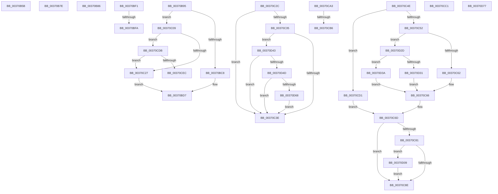

# sub_00370B5B

- RVA: `0x00370B5B`–`0x00370DA5` (길이 `586` bytes)
- VA: `0x0000000140370B5B`
- 실행 섹션: `.text`
- PDB 이름 있음: `아니요`; PDB Function 태그: `아니요`
- unwind 정보 RVA: `0x0007A738`
- 디코드: `130`개 명령, `586/586` bytes 표시
- 미해석 바이트: `0` (있으면 어셈블리에 `.byte`로 보존)

> 이 문서는 커널 이미지의 기계어와 PDB 기호를 분석해 생성했습니다. 4번과 5번은 함수 원형과 자료형을 바이너리 사용 방식에서 추정한 C 해석이며 원본 소스 복구 결과는 아닙니다.

## 1. Dependencies

- 직접 호출 지점: **8**; 고유 호출 대상: **8**
- 직접 호출자로 확인된 함수: **0**
- RIP 상대 이미지 참조: **1**

### Outgoing calls
- `0x00370B99` → [MI_READ_PTE_LOCK_FREE](../28/MI_READ_PTE_LOCK_FREE_function_002828A0.md) (function, `0x002828A0`)
- `0x00370BDA` → [MiInsertPageInList](../2B/MiInsertPageInList_function_002BA000.md) (function, `0x002BA000`)
- `0x00370C85` → [MiGetPagingFileOffset](../36/MiGetPagingFileOffset_function_0036F530.md) (function, `0x0036F530`)
- `0x00370CC7` → [MiReleasePageFileInfo](../28/MiReleasePageFileInfo_function_00283FD0.md) (function, `0x00283FD0`)
- `0x00370CDE` → [MiGetPfnPriority](../32/MiGetPfnPriority_function_003226F0.md) (function, `0x003226F0`)
- `0x00370CF2` → [MiInsertProtectedStandbyPage](../45/MiInsertProtectedStandbyPage_function_004527D8.md) (function, `0x004527D8`)
- `0x00370D50` → [MiGetLeafVa](../27/MiGetLeafVa_function_0027C0A0.md) (function, `0x0027C0A0`)
- `0x00370D9F` → [KeBugCheckEx](../4F/KeBugCheckEx_function_004FD660.md) (function, `0x004FD660`)

### Direct callers
- 이 함수 시작 RVA로 연결되는 직접 call은 확인되지 않았습니다. 간접 호출은 완전히 역산할 수 없습니다.

### Static image references
- `0x00370D0D` → RVA `0x00E30088` (`.data`; read)

## 2. Other-region calls and transfers

- 다른 실행 섹션으로 향하는 call: **0**
- call이 아닌 외부 분기/꼬리 이동: **12**
  - `0x00370B79` → [sub_003708A6 + 0x98](Unknown_function_003708A6.md) (`tail-transfer`)
  - `0x00370B81` → [sub_003708A6 + 0x13E](Unknown_function_003708A6.md) (`tail-transfer`)
  - `0x00370B90` → [sub_003708A6 + 0x254](Unknown_function_003708A6.md) (`tail-transfer`)
  - `0x00370BEC` → [sub_003708A6 + 0x254](Unknown_function_003708A6.md) (`tail-transfer`)
  - `0x00370BF4` → [sub_003708A6 + 0x290](Unknown_function_003708A6.md) (`tail-transfer`)
  - `0x00370C04` → [sub_003708A6 + 0x290](Unknown_function_003708A6.md) (`tail-transfer`)
  - `0x00370C49` → [sub_003708A6 + 0x290](Unknown_function_003708A6.md) (`tail-transfer`)
  - `0x00370C9E` → [sub_003708A6 + 0x254](Unknown_function_003708A6.md) (`tail-transfer`)
  - `0x00370CB0` → [sub_003708A6 + 0x27C](Unknown_function_003708A6.md) (`tail-transfer`)
  - `0x00370CBC` → [sub_003708A6 + 0x27C](Unknown_function_003708A6.md) (`tail-transfer`)
  - `0x00370CCC` → [sub_003708A6 + 0x222](Unknown_function_003708A6.md) (`tail-transfer`)
  - `0x00370D04` → [sub_003708A6 + 0x254](Unknown_function_003708A6.md) (`tail-transfer`)

## 3. Assembly (complete function range)

```asm
00370B5B  49 8B 07                        mov rax, qword ptr [r15]
00370B5E  48 BA FF FF FF FF FF 00 00 00   movabs rdx, 0xffffffffff
00370B68  48 23 C2                        and rax, rdx
00370B6B  4C 8D 3C 40                     lea r15, [rax + rax*2]
00370B6F  49 C1 E7 04                     shl r15, 4
00370B73  48 8B C7                        mov rax, rdi
00370B76  4C 03 F8                        add r15, rax
00370B79  E9 C0 FD FF FF                  jmp 0x14037093e
00370B7E  48 0B C2                        or rax, rdx
00370B81  E9 5E FE FF FF                  jmp 0x1403709e4
00370B86  49 8B 40 08                     mov rax, qword ptr [r8 + 8]
00370B8A  41 B9 02 00 00 00               mov r9d, 2
00370B90  E9 65 FF FF FF                  jmp 0x140370afa
00370B95  48 8D 4B 10                     lea rcx, [rbx + 0x10]
00370B99  E8 02 1D F1 FF                  call 0x1402828a0
00370B9E  48 0F BA E0 0A                  bt rax, 0xa
00370BA3  48 C7 C1 F7 FF FF FF            mov rcx, 0xfffffffffffffff7
00370BAA  48 C7 C2 FF F7 FF FF            mov rdx, 0xfffffffffffff7ff
00370BB1  48 0F 42 CA                     cmovb rcx, rdx
00370BB5  48 23 C8                        and rcx, rax
00370BB8  0F B6 84 24 92 00 00 00         movzx eax, byte ptr [rsp + 0x92]
00370BC0  48 89 4B 10                     mov qword ptr [rbx + 0x10], rcx
00370BC4  A8 10                           test al, 0x10
00370BC6  74 41                           je 0x140370c09
00370BC8  8B 84 24 90 00 00 00            mov eax, dword ptr [rsp + 0x90]
00370BCF  BA 08 00 00 00                  mov edx, 8
00370BD4  89 43 20                        mov dword ptr [rbx + 0x20], eax
00370BD7  48 8B CB                        mov rcx, rbx
00370BDA  E8 21 94 F4 FF                  call 0x1402ba000
00370BDF  45 8B CE                        mov r9d, r14d
00370BE2  48 B9 00 00 00 00 80 F6 FF FF   movabs rcx, 0xfffff68000000000
00370BEC  E9 09 FF FF FF                  jmp 0x140370afa
00370BF1  45 85 ED                        test r13d, r13d
00370BF4  0F 84 3C FF FF FF               je 0x140370b36
00370BFA  48 8B 03                        mov rax, qword ptr [rbx]
00370BFD  48 83 E0 FE                     and rax, 0xfffffffffffffffe
00370C01  48 89 03                        mov qword ptr [rbx], rax
00370C04  E9 2D FF FF FF                  jmp 0x140370b36
00370C09  24 FA                           and al, 0xfa
00370C0B  0C 02                           or al, 2
00370C0D  88 84 24 92 00 00 00            mov byte ptr [rsp + 0x92], al
00370C14  8B 84 24 90 00 00 00            mov eax, dword ptr [rsp + 0x90]
00370C1B  89 43 20                        mov dword ptr [rbx + 0x20], eax
00370C1E  4D 85 E4                        test r12, r12
00370C21  0F 85 B4 00 00 00               jne 0x140370cdb
00370C27  41 8B D6                        mov edx, r14d
00370C2A  EB AB                           jmp 0x140370bd7
00370C2C  83 BE 80 00 00 00 00            cmp dword ptr [rsi + 0x80], 0
00370C33  75 09                           jne 0x140370c3e
00370C35  45 85 ED                        test r13d, r13d
00370C38  0F 85 05 01 00 00               jne 0x140370d43
00370C3E  48 8B 4B 28                     mov rcx, qword ptr [rbx + 0x28]
00370C42  48 85 C9                        test rcx, rcx
00370C45  45 0F 48 CE                     cmovs r9d, r14d
00370C49  E9 E8 FE FF FF                  jmp 0x140370b36
00370C4E  85 C0                           test eax, eax
00370C50  75 7F                           jne 0x140370cd1
00370C52  0F B6 84 24 92 00 00 00         movzx eax, byte ptr [rsp + 0x92]
00370C5A  A8 10                           test al, 0x10
00370C5C  0F 84 CB 00 00 00               je 0x140370d2d
00370C62  24 FB                           and al, 0xfb
00370C64  0C 03                           or al, 3
00370C66  88 84 24 92 00 00 00            mov byte ptr [rsp + 0x92], al
00370C6D  8B 84 24 90 00 00 00            mov eax, dword ptr [rsp + 0x90]
00370C74  89 43 20                        mov dword ptr [rbx + 0x20], eax
00370C77  8B 43 10                        mov eax, dword ptr [rbx + 0x10]
00370C7A  48 0F BA E0 0A                  bt rax, 0xa
00370C7F  72 0D                           jb 0x140370c8e
00370C81  48 8B 4B 10                     mov rcx, qword ptr [rbx + 0x10]
00370C85  E8 A6 E8 FF FF                  call 0x14036f530
00370C8A  85 C0                           test eax, eax
00370C8C  75 7B                           jne 0x140370d09
00370C8E  41 B9 03 00 00 00               mov r9d, 3
00370C94  48 B9 00 00 00 00 80 F6 FF FF   movabs rcx, 0xfffff68000000000
00370C9E  E9 57 FE FF FF                  jmp 0x140370afa
00370CA3  48 B8 FF FF FF FF FF F6 FF FF   movabs rax, 0xfffff6ffffffffff
00370CAD  48 3B E8                        cmp rbp, rax
00370CB0  0F 87 6C FE FF FF               ja 0x140370b22
00370CB6  41 BD 01 00 00 00               mov r13d, 1
00370CBC  E9 61 FE FF FF                  jmp 0x140370b22
00370CC1  41 B8 01 00 00 00               mov r8d, 1
00370CC7  E8 04 33 F1 FF                  call 0x140283fd0
00370CCC  E9 F7 FD FF FF                  jmp 0x140370ac8
00370CD1  80 8C 24 92 00 00 00 07         or byte ptr [rsp + 0x92], 7
00370CD9  EB 92                           jmp 0x140370c6d
00370CDB  48 8B CB                        mov rcx, rbx
00370CDE  E8 0D 1A FB FF                  call 0x1403226f0
00370CE3  83 F8 05                        cmp eax, 5
00370CE6  0F 83 3B FF FF FF               jae 0x140370c27
00370CEC  48 8B D3                        mov rdx, rbx
00370CEF  49 8B CC                        mov rcx, r12
00370CF2  E8 E1 1A 0E 00                  call 0x1404527d8
00370CF7  45 8B CE                        mov r9d, r14d
00370CFA  48 B9 00 00 00 00 80 F6 FF FF   movabs rcx, 0xfffff68000000000
00370D04  E9 F1 FD FF FF                  jmp 0x140370afa
00370D09  48 8B 43 28                     mov rax, qword ptr [rbx + 0x28]
00370D0D  48 8B 0D 74 F3 AB 00            mov rcx, qword ptr [rip + 0xabf374]
00370D14  48 C1 E8 2B                     shr rax, 0x2b
00370D18  25 FF 03 00 00                  and eax, 0x3ff
00370D1D  48 8B 14 C1                     mov rdx, qword ptr [rcx + rax*8]
00370D21  C6 82 D3 02 00 00 01            mov byte ptr [rdx + 0x2d3], 1
00370D28  E9 61 FF FF FF                  jmp 0x140370c8e
00370D2D  A8 08                           test al, 8
00370D2F  75 09                           jne 0x140370d3a
00370D31  24 FA                           and al, 0xfa
00370D33  0C 02                           or al, 2
00370D35  E9 2C FF FF FF                  jmp 0x140370c66
00370D3A  24 FB                           and al, 0xfb
00370D3C  0C 03                           or al, 3
00370D3E  E9 23 FF FF FF                  jmp 0x140370c66
00370D43  83 7E 28 00                     cmp dword ptr [rsi + 0x28], 0
00370D47  0F 85 F1 FE FF FF               jne 0x140370c3e
00370D4D  48 8B CD                        mov rcx, rbp
00370D50  E8 4B B3 F0 FF                  call 0x14027c0a0
00370D55  48 B9 FF FF FE FF FF 7F 00 00   movabs rcx, 0x7ffffffeffff
00370D5F  48 3B C1                        cmp rax, rcx
00370D62  0F 87 D6 FE FF FF               ja 0x140370c3e
00370D68  C7 86 80 00 00 00 01 00 00 00   mov dword ptr [rsi + 0x80], 1
00370D72  E9 C7 FE FF FF                  jmp 0x140370c3e
00370D77  48 8B C7                        mov rax, rdi
00370D7A  4C 2B F8                        sub r15, rax
00370D7D  48 89 4C 24 20                  mov qword ptr [rsp + 0x20], rcx
00370D82  49 C1 FF 04                     sar r15, 4
00370D86  BA 06 00 00 00                  mov edx, 6
00370D8B  49 B8 AB AA AA AA AA AA AA AA   movabs r8, 0xaaaaaaaaaaaaaaab
00370D95  4D 8B CA                        mov r9, r10
00370D98  4D 0F AF C7                     imul r8, r15
00370D9C  8D 4A 48                        lea ecx, [rdx + 0x48]
00370D9F  E8 BC C8 18 00                  call 0x1404fd660
00370DA4  CC                              int3
```

## 4. C-style interpretation (structured pseudocode)

```c
__int64 __fastcall sub_00370B5B(__int64 a1, __int64 a2, __int64 a3)
{
    __int64 result;
    __int64 v_r15;
    unsigned __int64 v_stack_p20;
    unsigned int v_stack_p90;
    unsigned __int8 v_stack_p92;

    result = (*(unsigned __int64 *)(v_r15)) & (a2);
    v_r15 = (result + result * 2) << (4);
    v_r15 = (v_r15) + (v_rdi);
}
```

## 5. (Beta) C Style

```c
int64_t sub_00370B5B(int64_t Arg1, int64_t Arg2, int64_t Arg3)
{
    int64_t result;
    int64_t local_r15;
    uint64_t v_stack_p20;
    uint32_t v_stack_p90;
    uint8_t v_stack_p92;

    result = (*(uint64_t *)(local_r15)) & (Arg2);
    local_r15 = (result + result * 2) << (4);
    local_r15 = (local_r15) + (local_rdi);
}
```

## 6. Execution-region graph

[열기: 2D/3D 그래프와 함수 탐색 컨트롤 패널](../../../control-panel.html?section=text&rva=0x00370B5B&view=graph)

- 2D 그래프는 위에서 아래로 흐르고, 3D 그래프는 빈 공간을 드래그해 회전합니다. Shift+드래그는 이동, 휠은 확대·축소, 함수 노드 선택은 대상 보고서 이동입니다.

### Static fallback


