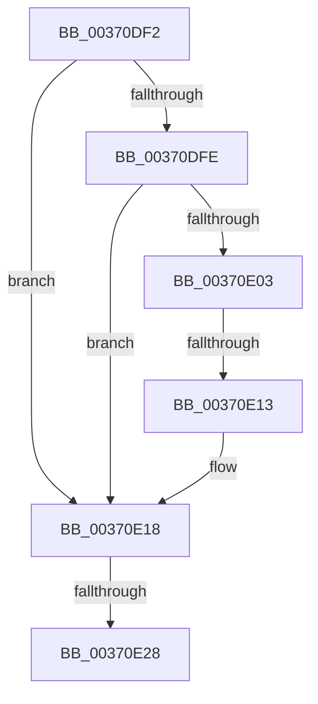

# sub_00370DF2

- RVA: `0x00370DF2`–`0x00370E3F` (길이 `77` bytes)
- VA: `0x0000000140370DF2`
- 실행 섹션: `.text`
- PDB 이름 있음: `아니요`; PDB Function 태그: `아니요`
- unwind 정보 RVA: `0x0007A794`
- 디코드: `22`개 명령, `77/77` bytes 표시
- 미해석 바이트: `0` (있으면 어셈블리에 `.byte`로 보존)

> 이 문서는 커널 이미지의 기계어와 PDB 기호를 분석해 생성했습니다. 4번과 5번은 함수 원형과 자료형을 바이너리 사용 방식에서 추정한 C 해석이며 원본 소스 복구 결과는 아닙니다.

## 1. Dependencies

- 직접 호출 지점: **0**; 고유 호출 대상: **0**
- 직접 호출자로 확인된 함수: **0**
- RIP 상대 이미지 참조: **0**

### Outgoing calls
- 직접 디코드된 call 명령이 없습니다.

### Direct callers
- 이 함수 시작 RVA로 연결되는 직접 call은 확인되지 않았습니다. 간접 호출은 완전히 역산할 수 없습니다.

### Static image references
- 디코드된 RIP-relative 메모리 참조가 없습니다.

## 2. Other-region calls and transfers

- 다른 실행 섹션으로 향하는 call: **0**
- call이 아닌 외부 분기/꼬리 이동: **3**
  - `0x00370E11` → [sub_00370E3F](Unknown_function_00370E3F.md) (`tail-transfer`)
  - `0x00370E26` → [sub_00370E3F + 0x1D](Unknown_function_00370E3F.md) (`tail-transfer`)
  - `0x00370E3D` → [MiCaptureDirtyBitToPfn + 0x15](MiCaptureDirtyBitToPfn_function_00370DD0.md) (`tail-transfer`)

## 3. Assembly (complete function range)

```asm
00370DF2  48 89 7C 24 40                  mov qword ptr [rsp + 0x40], rdi
00370DF7  48 0F BA E0 0A                  bt rax, 0xa
00370DFC  72 1A                           jb 0x140370e18
00370DFE  F6 C1 08                        test cl, 8
00370E01  75 15                           jne 0x140370e18
00370E03  48 8B 43 10                     mov rax, qword ptr [rbx + 0x10]
00370E07  48 89 44 24 38                  mov qword ptr [rsp + 0x38], rax
00370E0C  C0 E8 02                        shr al, 2
00370E0F  A8 01                           test al, 1
00370E11  75 2C                           jne 0x140370e3f
00370E13  4C 89 5C 24 38                  mov qword ptr [rsp + 0x38], r11
00370E18  8B 7B 20                        mov edi, dword ptr [rbx + 0x20]
00370E1B  89 7C 24 30                     mov dword ptr [rsp + 0x30], edi
00370E1F  C1 EF 10                        shr edi, 0x10
00370E22  40 F6 C7 08                     test dil, 8
00370E26  75 34                           jne 0x140370e5c
00370E28  40 80 CF 10                     or dil, 0x10
00370E2C  40 88 7C 24 32                  mov byte ptr [rsp + 0x32], dil
00370E31  8B 44 24 30                     mov eax, dword ptr [rsp + 0x30]
00370E35  48 8B 7C 24 40                  mov rdi, qword ptr [rsp + 0x40]
00370E3A  89 43 20                        mov dword ptr [rbx + 0x20], eax
00370E3D  EB A6                           jmp 0x140370de5
```

## 4. C-style interpretation (structured pseudocode)

```c
__int64 __fastcall sub_00370DF2(unsigned __int8 a1, __int64 a2, __int64 a3, __int64 a4, __int64 a5, unsigned int a6, __int64 a7, __int64 a8)
{
    __int64 result;
    __int64 v_rdi;
    unsigned int v_stack_p30;
    unsigned __int8 v_stack_p32;
    unsigned __int64 v_stack_p38;
    unsigned __int64 v_stack_p40;

    v_stack_p40 = v_rdi;
    if (condition_is_below) goto loc_00370E18;
    if (((a1) & (8)) != 0) goto loc_00370E18;
    v_stack_p38 = *(unsigned __int64 *)(v_rbx + 16);
    result = (unsigned __int8)((*(unsigned __int64 *)(v_rbx + 16)) >> (2));
    v_stack_p38 = v_r11;
loc_00370E18:
    v_stack_p30 = (unsigned int)((unsigned int)(*(unsigned int *)(v_rbx + 32)));
    v_rdi = (unsigned int)(((unsigned int)(*(unsigned int *)(v_rbx + 32))) >> (16));
    v_rdi = (unsigned __int8)((v_rdi) | (16));
    v_stack_p32 = (unsigned __int8)(v_rdi);
    *(unsigned int *)(v_rbx + 32) = (unsigned int)((unsigned int)(a6));
}
```

## 5. (Beta) C Style

```c
int64_t sub_00370DF2(uint8_t Arg1, int64_t Arg2, int64_t Arg3, int64_t Arg4, uint64_t Arg5, uint32_t Arg6, uint64_t Arg7, int64_t Arg8)
{
    int64_t result;
    int64_t local_rdi;
    uint32_t v_stack_p30;
    uint8_t v_stack_p32;
    uint64_t v_stack_p38;
    uint64_t v_stack_p40;

    v_stack_p40 = local_rdi;
    if (condition_is_below) goto loc_00370E18;
    if (((Arg1) & (8)) != 0) goto loc_00370E18;
    v_stack_p38 = *(uint64_t *)(local_rbx + 0x10);
    result = (uint8_t)((*(uint64_t *)(local_rbx + 0x10)) >> (2));
    v_stack_p38 = local_r11;
loc_00370E18:
    v_stack_p30 = (uint32_t)((uint32_t)(*(uint32_t *)(local_rbx + 0x20)));
    local_rdi = (uint32_t)(((uint32_t)(*(uint32_t *)(local_rbx + 0x20))) >> (16));
    local_rdi = (uint8_t)((local_rdi) | (16));
    v_stack_p32 = (uint8_t)(local_rdi);
    *(uint32_t *)(local_rbx + 0x20) = (uint32_t)((uint32_t)(Arg6));
}
```

## 6. Execution-region graph

[열기: 2D/3D 그래프와 함수 탐색 컨트롤 패널](../../../control-panel.html?section=text&rva=0x00370DF2&view=graph)

- 2D 그래프는 위에서 아래로 흐르고, 3D 그래프는 빈 공간을 드래그해 회전합니다. Shift+드래그는 이동, 휠은 확대·축소, 함수 노드 선택은 대상 보고서 이동입니다.

### Static fallback


