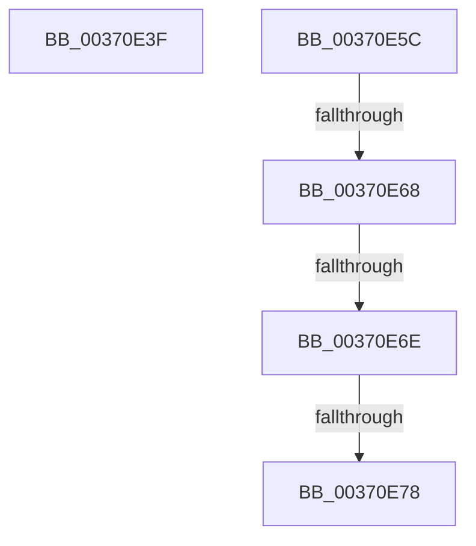

# sub_00370E3F

- RVA: `0x00370E3F`–`0x00370E86` (길이 `71` bytes)
- VA: `0x0000000140370E3F`
- 실행 섹션: `.text`
- PDB 이름 있음: `아니요`; PDB Function 태그: `아니요`
- unwind 정보 RVA: `0x0007A7A8`
- 디코드: `21`개 명령, `71/71` bytes 표시
- 미해석 바이트: `0` (있으면 어셈블리에 `.byte`로 보존)

> 이 문서는 커널 이미지의 기계어와 PDB 기호를 분석해 생성했습니다. 4번과 5번은 함수 원형과 자료형을 바이너리 사용 방식에서 추정한 C 해석이며 원본 소스 복구 결과는 아닙니다.

## 1. Dependencies

- 직접 호출 지점: **2**; 고유 호출 대상: **2**
- 직접 호출자로 확인된 함수: **0**
- RIP 상대 이미지 참조: **0**

### Outgoing calls
- `0x00370E50` → [MiClearPageFileReservation](../32/MiClearPageFileReservation_function_0032B68C.md) (function, `0x0032B68C`)
- `0x00370E5F` → [MiCanPfnOriginalPteBeLost](MiCanPfnOriginalPteBeLost_function_00373D3C.md) (function, `0x00373D3C`)

### Direct callers
- 이 함수 시작 RVA로 연결되는 직접 call은 확인되지 않았습니다. 간접 호출은 완전히 역산할 수 없습니다.

### Static image references
- 디코드된 RIP-relative 메모리 참조가 없습니다.

## 2. Other-region calls and transfers

- 다른 실행 섹션으로 향하는 call: **0**
- call이 아닌 외부 분기/꼬리 이동: **5**
  - `0x00370E5A` → [sub_00370DF2 + 0x26](Unknown_function_00370DF2.md) (`tail-transfer`)
  - `0x00370E66` → [sub_00370DF2 + 0x36](Unknown_function_00370DF2.md) (`tail-transfer`)
  - `0x00370E6C` → [sub_00370DF2 + 0x36](Unknown_function_00370DF2.md) (`tail-transfer`)
  - `0x00370E76` → [sub_00370DF2 + 0x36](Unknown_function_00370DF2.md) (`tail-transfer`)
  - `0x00370E84` → [sub_00370DF2 + 0x36](Unknown_function_00370DF2.md) (`tail-transfer`)

## 3. Assembly (complete function range)

```asm
00370E3F  48 8B 43 10                     mov rax, qword ptr [rbx + 0x10]
00370E43  48 8D 4C 24 38                  lea rcx, [rsp + 0x38]
00370E48  48 83 E0 FB                     and rax, 0xfffffffffffffffb
00370E4C  48 89 43 10                     mov qword ptr [rbx + 0x10], rax
00370E50  E8 37 A8 FB FF                  call 0x14032b68c
00370E55  4C 8B 5C 24 38                  mov r11, qword ptr [rsp + 0x38]
00370E5A  EB BC                           jmp 0x140370e18
00370E5C  48 8B CB                        mov rcx, rbx
00370E5F  E8 D8 2E 00 00                  call 0x140373d3c
00370E64  85 C0                           test eax, eax
00370E66  74 C0                           je 0x140370e28
00370E68  F6 43 22 10                     test byte ptr [rbx + 0x22], 0x10
00370E6C  75 BA                           jne 0x140370e28
00370E6E  8B 43 10                        mov eax, dword ptr [rbx + 0x10]
00370E71  C0 E8 02                        shr al, 2
00370E74  A8 01                           test al, 1
00370E76  74 B0                           je 0x140370e28
00370E78  48 8B 4B 10                     mov rcx, qword ptr [rbx + 0x10]
00370E7C  48 83 E1 FB                     and rcx, 0xfffffffffffffffb
00370E80  48 89 4B 10                     mov qword ptr [rbx + 0x10], rcx
00370E84  EB A2                           jmp 0x140370e28
```

## 4. C-style interpretation (structured pseudocode)

```c
__int64 __fastcall sub_00370E3F(__int64 a1, __int64 a2, __int64 a3, __int64 a4, __int64 a5, __int64 a6, __int64 a7)
{
    __int64 result;

    result = (*(unsigned __int64 *)(v_rbx + 16)) & (-5);
    *(unsigned __int64 *)(v_rbx + 16) = result;
    result = MiClearPageFileReservation(a7, a2, a3, a4);
}
```

## 5. (Beta) C Style

```c
int64_t sub_00370E3F(int64_t Arg1, int64_t Arg2, int64_t Arg3, int64_t Arg4, uint64_t Arg5, uint64_t Arg6, int64_t Arg7)
{
    int64_t result;

    result = (*(uint64_t *)(local_rbx + 0x10)) & (-5);
    *(uint64_t *)(local_rbx + 0x10) = result;
    result = MiClearPageFileReservation(Arg7, Arg2, Arg3, Arg4);
}
```

## 6. Execution-region graph

[열기: 2D/3D 그래프와 함수 탐색 컨트롤 패널](../../../control-panel.html?section=text&rva=0x00370E3F&view=graph)

- 2D 그래프는 위에서 아래로 흐르고, 3D 그래프는 빈 공간을 드래그해 회전합니다. Shift+드래그는 이동, 휠은 확대·축소, 함수 노드 선택은 대상 보고서 이동입니다.

### Static fallback


