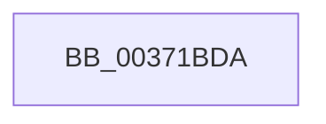

# sub_00371BDA

- RVA: `0x00371BDA`–`0x00371C01` (길이 `39` bytes)
- VA: `0x0000000140371BDA`
- 실행 섹션: `.text`
- PDB 이름 있음: `아니요`; PDB Function 태그: `아니요`
- unwind 정보 RVA: `0x0007A848`
- 디코드: `6`개 명령, `39/39` bytes 표시
- 미해석 바이트: `0` (있으면 어셈블리에 `.byte`로 보존)

> 이 문서는 커널 이미지의 기계어와 PDB 기호를 분석해 생성했습니다. 4번과 5번은 함수 원형과 자료형을 바이너리 사용 방식에서 추정한 C 해석이며 원본 소스 복구 결과는 아닙니다.

## 1. Dependencies

- 직접 호출 지점: **0**; 고유 호출 대상: **0**
- 직접 호출자로 확인된 함수: **0**
- RIP 상대 이미지 참조: **0**

### Outgoing calls
- 직접 디코드된 call 명령이 없습니다.

### Direct callers
- 이 함수 시작 RVA로 연결되는 직접 call은 확인되지 않았습니다. 간접 호출은 완전히 역산할 수 없습니다.

### Static image references
- 디코드된 RIP-relative 메모리 참조가 없습니다.

## 2. Other-region calls and transfers

- 다른 실행 섹션으로 향하는 call: **0**
- 별도 외부 분기/꼬리 이동을 확인하지 못했습니다.

## 3. Assembly (complete function range)

```asm
00371BDA  48 89 AC 24 88 00 00 00         mov qword ptr [rsp + 0x88], rbp
00371BE2  48 B8 FF FF FF FF FF 00 00 00   movabs rax, 0xffffffffff
00371BEC  48 89 B4 24 80 00 00 00         mov qword ptr [rsp + 0x80], rsi
00371BF4  48 89 7C 24 78                  mov qword ptr [rsp + 0x78], rdi
00371BF9  4C 89 64 24 70                  mov qword ptr [rsp + 0x70], r12
00371BFE  45 33 E4                        xor r12d, r12d
```

## 4. C-style interpretation (structured pseudocode)

```c
__int64 __fastcall sub_00371BDA(void)
{
    __int64 v_r12;
    unsigned __int64 v_stack_p70;
    unsigned __int64 v_stack_p78;
    unsigned __int64 v_stack_p80;
    unsigned __int64 v_stack_p88;

    v_stack_p88 = v_rbp;
    v_stack_p80 = v_rsi;
    v_stack_p78 = v_rdi;
    v_stack_p70 = v_r12;
    v_r12 = 0;
    return result;
}
```

## 5. (Beta) C Style

```c
void sub_00371BDA(void)
{
    int64_t local_r12;
    uint64_t v_stack_p70;
    uint64_t v_stack_p78;
    uint64_t v_stack_p80;
    uint64_t v_stack_p88;

    v_stack_p88 = local_rbp;
    v_stack_p80 = local_rsi;
    v_stack_p78 = local_rdi;
    v_stack_p70 = local_r12;
    local_r12 = 0;
    return result;
}
```

## 6. Execution-region graph

[열기: 2D/3D 그래프와 함수 탐색 컨트롤 패널](../../../control-panel.html?section=text&rva=0x00371BDA&view=graph)

- 2D 그래프는 위에서 아래로 흐르고, 3D 그래프는 빈 공간을 드래그해 회전합니다. Shift+드래그는 이동, 휠은 확대·축소, 함수 노드 선택은 대상 보고서 이동입니다.

### Static fallback


