# sub_00371C01

- RVA: `0x00371C01`–`0x00371DCB` (길이 `458` bytes)
- VA: `0x0000000140371C01`
- 실행 섹션: `.text`
- PDB 이름 있음: `아니요`; PDB Function 태그: `아니요`
- unwind 정보 RVA: `0x0007A868`
- 디코드: `108`개 명령, `458/458` bytes 표시
- 미해석 바이트: `0` (있으면 어셈블리에 `.byte`로 보존)

> 이 문서는 커널 이미지의 기계어와 PDB 기호를 분석해 생성했습니다. 4번과 5번은 함수 원형과 자료형을 바이너리 사용 방식에서 추정한 C 해석이며 원본 소스 복구 결과는 아닙니다.

## 1. Dependencies

- 직접 호출 지점: **5**; 고유 호출 대상: **5**
- 직접 호출자로 확인된 함수: **0**
- RIP 상대 이미지 참조: **2**

### Outgoing calls
- `0x00371C2B` → [MiUnlinkPageFromListEx](../28/MiUnlinkPageFromListEx_function_00287590.md) (function, `0x00287590`)
- `0x00371C88` → [ExAcquireSpinLockExclusiveAtDpcLevel](../24/ExAcquireSpinLockExclusiveAtDpcLevel_function_00248E80.md) (function, `0x00248E80`)
- `0x00371CAE` → [ExReleaseSpinLockExclusiveFromDpcLevel](../24/ExReleaseSpinLockExclusiveFromDpcLevel_function_002497E0.md) (function, `0x002497E0`)
- `0x00371CC1` → [MI_READ_PTE_LOCK_FREE](../28/MI_READ_PTE_LOCK_FREE_function_002828A0.md) (function, `0x002828A0`)
- `0x00371D97` → [MiInsertPageInFreeOrZeroedList](../33/MiInsertPageInFreeOrZeroedList_function_00334D20.md) (function, `0x00334D20`)

### Direct callers
- 이 함수 시작 RVA로 연결되는 직접 call은 확인되지 않았습니다. 간접 호출은 완전히 역산할 수 없습니다.

### Static image references
- `0x00371C45` → RVA `0x00E2DC80` (`.data`; read)
- `0x00371D4C` → RVA `0x00E30088` (`.data`; read)

## 2. Other-region calls and transfers

- 다른 실행 섹션으로 향하는 call: **0**
- call이 아닌 외부 분기/꼬리 이동: **8**
  - `0x00371C3F` → [sub_00371EAF + 0x16](Unknown_function_00371EAF.md) (`tail-transfer`)
  - `0x00371C71` → [sub_00371EAF + 0xE](Unknown_function_00371EAF.md) (`tail-transfer`)
  - `0x00371C7E` → [sub_00371E3A + 0x41](Unknown_function_00371E3A.md) (`tail-transfer`)
  - `0x00371C97` → [sub_00371EF8](Unknown_function_00371EF8.md) (`tail-transfer`)
  - `0x00371CA4` → [sub_00371F84](Unknown_function_00371F84.md) (`tail-transfer`)
  - `0x00371CF2` → [sub_00371EAF](Unknown_function_00371EAF.md) (`tail-transfer`)
  - `0x00371D1B` → [sub_00371E3A](Unknown_function_00371E3A.md) (`tail-transfer`)
  - `0x00371D6E` → [sub_00371F84 + 0x38](Unknown_function_00371F84.md) (`tail-transfer`)

## 3. Assembly (complete function range)

```asm
00371C01  4C 89 7C 24 68                  mov qword ptr [rsp + 0x68], r15
00371C06  41 8B F4                        mov esi, r12d
00371C09  4D 8B 7E 28                     mov r15, qword ptr [r14 + 0x28]
00371C0D  41 8B 7E 20                     mov edi, dword ptr [r14 + 0x20]
00371C11  4C 23 F8                        and r15, rax
00371C14  4C 89 64 24 40                  mov qword ptr [rsp + 0x40], r12
00371C19  4C 89 BC 24 B8 00 00 00         mov qword ptr [rsp + 0xb8], r15
00371C21  66 85 FF                        test di, di
00371C24  75 0A                           jne 0x140371c30
00371C26  33 D2                           xor edx, edx
00371C28  49 8B CE                        mov rcx, r14
00371C2B  E8 60 59 F1 FF                  call 0x140287590
00371C30  49 8B 5E 10                     mov rbx, qword ptr [r14 + 0x10]
00371C34  41 B9 FF 03 00 00               mov r9d, 0x3ff
00371C3A  48 0F BA E3 0A                  bt rbx, 0xa
00371C3F  0F 83 80 02 00 00               jae 0x140371ec5
00371C45  48 8B 05 34 C0 AB 00            mov rax, qword ptr [rip + 0xabc034]
00371C4C  48 85 C0                        test rax, rax
00371C4F  74 0B                           je 0x140371c5c
00371C51  F6 C3 10                        test bl, 0x10
00371C54  75 06                           jne 0x140371c5c
00371C56  48 F7 D0                        not rax
00371C59  48 23 D8                        and rbx, rax
00371C5C  48 C1 FB 10                     sar rbx, 0x10
00371C60  4D 8B EC                        mov r13, r12
00371C63  48 8B 2B                        mov rbp, qword ptr [rbx]
00371C66  8B 45 38                        mov eax, dword ptr [rbp + 0x38]
00371C69  A8 20                           test al, 0x20
00371C6B  75 0A                           jne 0x140371c77
00371C6D  48 39 75 40                     cmp qword ptr [rbp + 0x40], rsi
00371C71  0F 85 46 02 00 00               jne 0x140371ebd
00371C77  4D 8B FC                        mov r15, r12
00371C7A  48 39 75 40                     cmp qword ptr [rbp + 0x40], rsi
00371C7E  0F 84 F7 01 00 00               je 0x140371e7b
00371C84  48 8D 4D 48                     lea rcx, [rbp + 0x48]
00371C88  E8 F3 71 ED FF                  call 0x140248e80
00371C8D  4D 85 FF                        test r15, r15
00371C90  74 0B                           je 0x140371c9d
00371C92  41 83 47 68 FF                  add dword ptr [r15 + 0x68], -1
00371C97  0F 84 5B 02 00 00               je 0x140371ef8
00371C9D  48 FF 4D 20                     dec qword ptr [rbp + 0x20]
00371CA1  4D 85 ED                        test r13, r13
00371CA4  0F 85 DA 02 00 00               jne 0x140371f84
00371CAA  48 8D 4D 48                     lea rcx, [rbp + 0x48]
00371CAE  E8 2D 7B ED FF                  call 0x1402497e0
00371CB3  49 8B 5E 10                     mov rbx, qword ptr [r14 + 0x10]
00371CB7  48 8D 4C 24 30                  lea rcx, [rsp + 0x30]
00371CBC  48 89 5C 24 30                  mov qword ptr [rsp + 0x30], rbx
00371CC1  E8 DA 0B F1 FF                  call 0x1402828a0
00371CC6  48 0F BA E0 0A                  bt rax, 0xa
00371CCB  48 C7 C1 F7 FF FF FF            mov rcx, 0xfffffffffffffff7
00371CD2  48 C7 C2 FF F7 FF FF            mov rdx, 0xfffffffffffff7ff
00371CD9  48 0F 42 CA                     cmovb rcx, rdx
00371CDD  48 23 C8                        and rcx, rax
00371CE0  48 8D 44 24 30                  lea rax, [rsp + 0x30]
00371CE5  48 89 08                        mov qword ptr [rax], rcx
00371CE8  48 8B 4C 24 30                  mov rcx, qword ptr [rsp + 0x30]
00371CED  48 0F BA E3 0A                  bt rbx, 0xa
00371CF2  0F 83 B7 01 00 00               jae 0x140371eaf
00371CF8  4C 8B BC 24 B8 00 00 00         mov r15, qword ptr [rsp + 0xb8]
00371D00  41 B9 FF 03 00 00               mov r9d, 0x3ff
00371D06  4C 8B 6C 24 38                  mov r13, qword ptr [rsp + 0x38]
00371D0B  4C 89 64 24 38                  mov qword ptr [rsp + 0x38], r12
00371D10  BA 10 00 00 00                  mov edx, 0x10
00371D15  4D 8B C6                        mov r8, r14
00371D18  66 85 FF                        test di, di
00371D1B  0F 85 19 01 00 00               jne 0x140371e3a
00371D21  41 8B 04 16                     mov eax, dword ptr [r14 + rdx]
00371D25  48 0F BA E0 0A                  bt rax, 0xa
00371D2A  72 37                           jb 0x140371d63
00371D2C  49 8B 34 16                     mov rsi, qword ptr [r14 + rdx]
00371D30  40 0F B6 C6                     movzx eax, sil
00371D34  C0 E8 02                        shr al, 2
00371D37  A8 01                           test al, 1
00371D39  75 0D                           jne 0x140371d48
00371D3B  40 0F B6 C6                     movzx eax, sil
00371D3F  D0 E8                           shr al, 1
00371D41  A8 01                           test al, 1
00371D43  75 03                           jne 0x140371d48
00371D45  49 8B F4                        mov rsi, r12
00371D48  49 8B 46 28                     mov rax, qword ptr [r14 + 0x28]
00371D4C  48 8B 15 35 E3 AB 00            mov rdx, qword ptr [rip + 0xabe335]
00371D53  48 C1 E8 2B                     shr rax, 0x2b
00371D57  49 23 C1                        and rax, r9
00371D5A  48 8B 04 C2                     mov rax, qword ptr [rdx + rax*8]
00371D5E  48 89 44 24 40                  mov qword ptr [rsp + 0x40], rax
00371D63  BD 04 00 00 00                  mov ebp, 4
00371D68  49 0F BA 66 28 35               bt qword ptr [r14 + 0x28], 0x35
00371D6E  0F 82 48 02 00 00               jb 0x140371fbc
00371D74  48 8B 84 24 B0 00 00 00         mov rax, qword ptr [rsp + 0xb0]
00371D7C  48 89 08                        mov qword ptr [rax], rcx
00371D7F  83 FD 04                        cmp ebp, 4
00371D82  75 18                           jne 0x140371d9c
00371D84  8B 94 24 C8 00 00 00            mov edx, dword ptr [rsp + 0xc8]
00371D8B  49 8B CD                        mov rcx, r13
00371D8E  83 E2 01                        and edx, 1
00371D91  C1 E2 09                        shl edx, 9
00371D94  83 C2 02                        add edx, 2
00371D97  E8 84 2F FC FF                  call 0x140334d20
00371D9C  49 BD FF FF FF FF FF FF FF 7F   movabs r13, 0x7fffffffffffffff
00371DA6  F0 4D 21 6E 18                  lock and qword ptr [r14 + 0x18], r13
00371DAB  4B 8D 1C 7F                     lea rbx, [r15 + r15*2]
00371DAF  48 B8 00 00 00 00 00 DE FF FF   movabs rax, 0xffffde0000000000
00371DB9  48 C1 E3 04                     shl rbx, 4
00371DBD  48 8B C0                        mov rax, rax
00371DC0  4C 8B 7C 24 68                  mov r15, qword ptr [rsp + 0x68]
00371DC5  48 03 D8                        add rbx, rax
00371DC8  41 8B FC                        mov edi, r12d
```

## 4. C-style interpretation (structured pseudocode)

```c
__int64 __fastcall sub_00371C01(__int64 a1, int a2, __int64 a3, __int64 a4, __int64 a5, __int64 a6, __int64 a7, __int64 a8, __int64 a9, __int64 a10, __int64 a11, __int64 a12, __int64 a13, __int64 a14, __int64 a15, __int64 a16, __int64 a17, __int64 a18, __int64 a19, __int64 a20, __int64 a21, __int64 a22, __int64 a23, __int64 a24, unsigned int a25)
{
    __int64 result;
    __int64 v_r15;
    __int64 v_rbx;
    __int64 v_rsi;
    unsigned __int64 v_stack_p30;
    unsigned __int64 v_stack_p38;
    unsigned __int64 v_stack_p40;
    unsigned __int64 v_stack_p68;
    unsigned __int64 v_stack_pB8;

    v_stack_p68 = v_r15;
    v_r15 = (*(unsigned __int64 *)(v_r14 + 40)) & (result);
    v_stack_p40 = v_r12;
    v_stack_pB8 = v_r15;
    if ((unsigned __int16)((unsigned int)(*(unsigned int *)(v_r14 + 32))) == 0) {
        a2 = 0;
        a1 = v_r14;
        result = MiUnlinkPageFromListEx(a1, a2, a3, a4);
    }
    if (*(unsigned __int64 *)(v_rip + 11255860) == 0) goto loc_00371C5C;
    result = *(unsigned __int64 *)(v_rip + 11255860);
    v_rbx = *(unsigned __int64 *)(v_r14 + 16);
    if ((((unsigned __int8)(*(unsigned __int64 *)(v_r14 + 16))) & (16)) == 0) {
        result = ~(*(unsigned __int64 *)(v_rip + 11255860));
        v_rbx = (*(unsigned __int64 *)(v_r14 + 16)) & (result);
    }
    v_rbx = (v_rbx) >> (16);
    if ((((unsigned __int8)((unsigned int)(*(unsigned int *)(*(unsigned __int64 *)(v_rbx) + 56)))) & (32)) != 0) goto loc_00371C77;
loc_00371C77:
    result = ExAcquireSpinLockExclusiveAtDpcLevel(*(unsigned __int64 *)(v_rbx) + 72, a2, a3, (unsigned int)(0x3FFULL));
    if (v_r12 == 0) goto loc_00371C9D;
loc_00371C9D:
    result = ExReleaseSpinLockExclusiveFromDpcLevel(*(unsigned __int64 *)(v_rbx) + 72, a2, a3, (unsigned int)(0x3FFULL));
    v_stack_p30 = *(unsigned __int64 *)(v_r14 + 16);
    result = MI_READ_PTE_LOCK_FREE(a6, a2, a3, (unsigned int)(0x3FFULL));
    a1 = -9;
    if (condition_is_below) { a1 = 0xFFFFFFFFFFFFF7FFULL; }
    a1 = (a1) & (result);
    *(unsigned __int64 *)(a6) = a1;
    v_stack_p38 = v_r12;
    if (condition_is_below) goto loc_00371D63;
    result = (unsigned __int8)(((unsigned __int8)(*(unsigned __int64 *)(v_r14 + 16 * 1))) >> (2));
    if ((((unsigned __int8)(result)) & (1)) != 0) goto loc_00371D48;
    result = (unsigned __int8)(((unsigned __int8)(*(unsigned __int64 *)(v_r14 + 16 * 1))) >> (1));
    v_rsi = *(unsigned __int64 *)(v_r14 + 16 * 1);
    if ((((unsigned __int8)(result)) & (1)) == 0) {
        v_rsi = v_r12;
    }
    result = (*(unsigned __int64 *)(v_r14 + 40)) >> (43);
    result = (result) & ((unsigned int)(0x3FFULL));
    v_stack_p40 = *(unsigned __int64 *)(*(unsigned __int64 *)(v_rip + 11264821) + result * 8);
loc_00371D63:
    *(unsigned __int64 *)(a22) = a6;
    result = a22;
    if (4 == 4) {
        a2 = a25;
        a1 = a7;
        a2 = (unsigned int)((a2) & (1));
        a2 = (unsigned int)((a2) << (9));
        a2 = (unsigned int)((a2) + (2));
        result = MiInsertPageInFreeOrZeroedList(a1, a2, v_r14, (unsigned int)(0x3FFULL));
    }
    v_rbx = (a23 + a23 * 2) << (4);
    v_rbx = (v_rbx) + (result);
    return result;
}
```

## 5. (Beta) C Style

```c
int64_t sub_00371C01(int64_t Arg1, int32_t Arg2, int64_t Arg3, int64_t Arg4, uint64_t Arg5, int64_t Arg6, int64_t Arg7, uint64_t Arg8, uint64_t Arg9, uint64_t Arg10, uint64_t Arg11, uint64_t Arg12, int64_t Arg13, uint64_t Arg14, uint64_t Arg15, uint64_t Arg16, uint64_t Arg17, uint64_t Arg18, uint64_t Arg19, uint64_t Arg20, uint64_t Arg21, void *Arg22, void *Arg23, uint64_t Arg24, uint32_t Arg25)
{
    uint8_t *arg22 = (uint8_t *)Arg22;
    uint8_t *arg23 = (uint8_t *)Arg23;

    int64_t result;
    int64_t local_r15;
    int64_t local_rbx;
    int64_t local_rsi;
    uint64_t v_stack_p30;
    uint64_t v_stack_p38;
    uint64_t v_stack_p40;
    uint64_t v_stack_p68;
    uint64_t v_stack_pB8;

    v_stack_p68 = local_r15;
    local_r15 = (*(uint64_t *)(local_r14 + 0x28)) & (result);
    v_stack_p40 = local_r12;
    v_stack_pB8 = local_r15;
    if ((uint16_t)((uint32_t)(*(uint32_t *)(local_r14 + 0x20))) == 0) {
        Arg2 = 0;
        Arg1 = local_r14;
        result = MiUnlinkPageFromListEx(Arg1, Arg2, Arg3, Arg4);
    }
    if (*(uint64_t *)(v_rip + 0xABC034) == 0) goto loc_00371C5C;
    result = *(uint64_t *)(v_rip + 0xABC034);
    local_rbx = *(uint64_t *)(local_r14 + 0x10);
    if ((((uint8_t)(*(uint64_t *)(local_r14 + 0x10))) & (16)) == 0) {
        result = ~(*(uint64_t *)(v_rip + 0xABC034));
        local_rbx = (*(uint64_t *)(local_r14 + 0x10)) & (result);
    }
    local_rbx = (local_rbx) >> (16);
    if ((((uint8_t)((uint32_t)(*(uint32_t *)(*(uint64_t *)(local_rbx) + 0x38)))) & (32)) != 0) goto loc_00371C77;
loc_00371C77:
    result = ExAcquireSpinLockExclusiveAtDpcLevel(*(uint64_t *)(local_rbx) + 72, Arg2, Arg3, (uint32_t)(0x3FFULL));
    if (local_r12 == 0) goto loc_00371C9D;
loc_00371C9D:
    result = ExReleaseSpinLockExclusiveFromDpcLevel(*(uint64_t *)(local_rbx) + 72, Arg2, Arg3, (uint32_t)(0x3FFULL));
    v_stack_p30 = *(uint64_t *)(local_r14 + 0x10);
    result = MI_READ_PTE_LOCK_FREE(Arg6, Arg2, Arg3, (uint32_t)(0x3FFULL));
    Arg1 = -9;
    if (condition_is_below) { Arg1 = 0xFFFFFFFFFFFFF7FFULL; }
    Arg1 = (Arg1) & (result);
    *(uint64_t *)(Arg6) = Arg1;
    v_stack_p38 = local_r12;
    if (condition_is_below) goto loc_00371D63;
    result = (uint8_t)(((uint8_t)(*(uint64_t *)(local_r14 + 0x10 * 1))) >> (2));
    if ((((uint8_t)(result)) & (1)) != 0) goto loc_00371D48;
    result = (uint8_t)(((uint8_t)(*(uint64_t *)(local_r14 + 0x10 * 1))) >> (1));
    local_rsi = *(uint64_t *)(local_r14 + 0x10 * 1);
    if ((((uint8_t)(result)) & (1)) == 0) {
        local_rsi = local_r12;
    }
    result = (*(uint64_t *)(local_r14 + 0x28)) >> (43);
    result = (result) & ((uint32_t)(0x3FFULL));
    v_stack_p40 = *(uint64_t *)(*(uint64_t *)(v_rip + 0xABE335) + result * 8);
loc_00371D63:
    *(uint64_t *)(arg22) = Arg6;
    result = Arg22;
    if (4 == 4) {
        Arg2 = Arg25;
        Arg1 = Arg7;
        Arg2 = (uint32_t)((Arg2) & (1));
        Arg2 = (uint32_t)((Arg2) << (9));
        Arg2 = (uint32_t)((Arg2) + (2));
        result = MiInsertPageInFreeOrZeroedList(Arg1, Arg2, local_r14, (uint32_t)(0x3FFULL));
    }
    local_rbx = (Arg23 + Arg23 * 2) << (4);
    local_rbx = (local_rbx) + (result);
    return result;
}
```

### 관측된 메모리 오프셋

구조체 형식이 확인되지 않은 접근은 인자 기준의 오프셋으로만 기록했습니다.

| 기준 인자 | 오프셋 표현 | 폭 (bit) | 접근 |
|---|---:|---:|---|
| `Arg22` | `+ 0x0` | `64` | `W` |
| `Arg23` | `+ 0x0 + r15*2` | `64` | `R` |

## 6. Execution-region graph

[열기: 2D/3D 그래프와 함수 탐색 컨트롤 패널](../../../control-panel.html?section=text&rva=0x00371C01&view=graph)

- 2D 그래프는 위에서 아래로 흐르고, 3D 그래프는 빈 공간을 드래그해 회전합니다. Shift+드래그는 이동, 휠은 확대·축소, 함수 노드 선택은 대상 보고서 이동입니다.

### Static fallback

```mermaid
flowchart TD
  bb_00371C01[BB_00371C01]
  bb_00371C26[BB_00371C26]
  bb_00371C30[BB_00371C30]
  bb_00371C45[BB_00371C45]
  bb_00371C51[BB_00371C51]
  bb_00371C56[BB_00371C56]
  bb_00371C5C[BB_00371C5C]
  bb_00371C6D[BB_00371C6D]
  bb_00371C77[BB_00371C77]
  bb_00371C84[BB_00371C84]
  bb_00371C92[BB_00371C92]
  bb_00371C9D[BB_00371C9D]
  bb_00371CAA[BB_00371CAA]
  bb_00371CF8[BB_00371CF8]
  bb_00371D21[BB_00371D21]
  bb_00371D2C[BB_00371D2C]
  bb_00371D3B[BB_00371D3B]
  bb_00371D45[BB_00371D45]
  bb_00371D48[BB_00371D48]
  bb_00371D63[BB_00371D63]
  bb_00371D74[BB_00371D74]
  bb_00371D84[BB_00371D84]
  bb_00371D9C[BB_00371D9C]
  bb_00371C01 -->|branch| bb_00371C30
  bb_00371C01 -->|fallthrough| bb_00371C26
  bb_00371C26 -->|flow| bb_00371C30
  bb_00371C30 -->|fallthrough| bb_00371C45
  bb_00371C45 -->|branch| bb_00371C5C
  bb_00371C45 -->|fallthrough| bb_00371C51
  bb_00371C51 -->|branch| bb_00371C5C
  bb_00371C51 -->|fallthrough| bb_00371C56
  bb_00371C56 -->|flow| bb_00371C5C
  bb_00371C5C -->|branch| bb_00371C77
  bb_00371C5C -->|fallthrough| bb_00371C6D
  bb_00371C6D -->|fallthrough| bb_00371C77
  bb_00371C77 -->|fallthrough| bb_00371C84
  bb_00371C84 -->|branch| bb_00371C9D
  bb_00371C84 -->|fallthrough| bb_00371C92
  bb_00371C92 -->|fallthrough| bb_00371C9D
  bb_00371C9D -->|fallthrough| bb_00371CAA
  bb_00371CAA -->|fallthrough| bb_00371CF8
  bb_00371CF8 -->|fallthrough| bb_00371D21
  bb_00371D21 -->|branch| bb_00371D63
  bb_00371D21 -->|fallthrough| bb_00371D2C
  bb_00371D2C -->|branch| bb_00371D48
  bb_00371D2C -->|fallthrough| bb_00371D3B
  bb_00371D3B -->|branch| bb_00371D48
  bb_00371D3B -->|fallthrough| bb_00371D45
  bb_00371D45 -->|flow| bb_00371D48
  bb_00371D48 -->|flow| bb_00371D63
  bb_00371D63 -->|fallthrough| bb_00371D74
  bb_00371D74 -->|branch| bb_00371D9C
  bb_00371D74 -->|fallthrough| bb_00371D84
  bb_00371D84 -->|flow| bb_00371D9C
```


