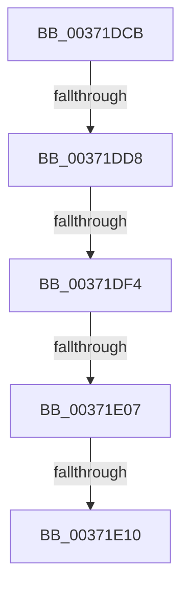

# sub_00371DCB

- RVA: `0x00371DCB`–`0x00371E39` (길이 `110` bytes)
- VA: `0x0000000140371DCB`
- 실행 섹션: `.text`
- PDB 이름 있음: `아니요`; PDB Function 태그: `아니요`
- unwind 정보 RVA: `0x0007A87C`
- 디코드: `24`개 명령, `110/110` bytes 표시
- 미해석 바이트: `0` (있으면 어셈블리에 `.byte`로 보존)

> 이 문서는 커널 이미지의 기계어와 PDB 기호를 분석해 생성했습니다. 4번과 5번은 함수 원형과 자료형을 바이너리 사용 방식에서 추정한 C 해석이며 원본 소스 복구 결과는 아닙니다.

## 1. Dependencies

- 직접 호출 지점: **1**; 고유 호출 대상: **1**
- 직접 호출자로 확인된 함수: **0**
- RIP 상대 이미지 참조: **0**

### Outgoing calls
- `0x00371DDD` → [MiDecrementShareCountEx](../33/MiDecrementShareCountEx_function_00333F70.md) (function, `0x00333F70`)

### Direct callers
- 이 함수 시작 RVA로 연결되는 직접 call은 확인되지 않았습니다. 간접 호출은 완전히 역산할 수 없습니다.

### Static image references
- 디코드된 RIP-relative 메모리 참조가 없습니다.

## 2. Other-region calls and transfers

- 다른 실행 섹션으로 향하는 call: **0**
- call이 아닌 외부 분기/꼬리 이동: **4**
  - `0x00371DD2` → [sub_00371E90](Unknown_function_00371E90.md) (`tail-transfer`)
  - `0x00371DEE` → [sub_00371F2D + 0x27](Unknown_function_00371F2D.md) (`tail-transfer`)
  - `0x00371E01` → [sub_00371FEE](Unknown_function_00371FEE.md) (`tail-transfer`)
  - `0x00371E0A` → [sub_00371ECD](Unknown_function_00371ECD.md) (`tail-transfer`)

## 3. Assembly (complete function range)

```asm
00371DCB  F0 48 0F BA 6B 18 3F            lock bts qword ptr [rbx + 0x18], 0x3f
00371DD2  0F 82 B8 00 00 00               jb 0x140371e90
00371DD8  33 D2                           xor edx, edx
00371DDA  48 8B CB                        mov rcx, rbx
00371DDD  E8 8E 21 FC FF                  call 0x140333f70
00371DE2  0F B6 BC 24 C0 00 00 00         movzx edi, byte ptr [rsp + 0xc0]
00371DEA  40 80 FF 11                     cmp dil, 0x11
00371DEE  0F 85 60 01 00 00               jne 0x140371f54
00371DF4  F0 4C 21 6B 18                  lock and qword ptr [rbx + 0x18], r13
00371DF9  48 8B 4C 24 38                  mov rcx, qword ptr [rsp + 0x38]
00371DFE  48 85 C9                        test rcx, rcx
00371E01  0F 85 E7 01 00 00               jne 0x140371fee
00371E07  48 85 F6                        test rsi, rsi
00371E0A  0F 85 BD 00 00 00               jne 0x140371ecd
00371E10  4C 8B 64 24 70                  mov r12, qword ptr [rsp + 0x70]
00371E15  8B C5                           mov eax, ebp
00371E17  48 8B AC 24 88 00 00 00         mov rbp, qword ptr [rsp + 0x88]
00371E1F  48 8B 7C 24 78                  mov rdi, qword ptr [rsp + 0x78]
00371E24  48 8B B4 24 80 00 00 00         mov rsi, qword ptr [rsp + 0x80]
00371E2C  48 81 C4 90 00 00 00            add rsp, 0x90
00371E33  41 5E                           pop r14
00371E35  41 5D                           pop r13
00371E37  5B                              pop rbx
00371E38  C3                              ret
```

## 4. C-style interpretation (structured pseudocode)

```c
__int64 __fastcall sub_00371DCB(__int64 a1, int a2, __int64 a3, __int64 a4, __int64 a5, __int64 a6, __int64 a7, __int64 a8, __int64 a9, __int64 a10, __int64 a11, __int64 a12, __int64 a13, __int64 a14, __int64 a15, __int64 a16, __int64 a17, __int64 a18, __int64 a19, __int64 a20, __int64 a21, __int64 a22, __int64 a23, unsigned __int8 a24)
{
    __int64 result;
    __int64 v_rsp;

    a2 = 0;
    result = MiDecrementShareCountEx(v_rbx, a2, a3, a4);
    v_rsp = (v_rsp) + (144);
    return (unsigned int)((unsigned int)(v_rbp));
}
```

## 5. (Beta) C Style

```c
int64_t sub_00371DCB(int64_t Arg1, int32_t Arg2, int64_t Arg3, int64_t Arg4, uint64_t Arg5, uint64_t Arg6, int64_t Arg7, uint64_t Arg8, uint64_t Arg9, uint64_t Arg10, uint64_t Arg11, uint64_t Arg12, uint64_t Arg13, int64_t Arg14, int64_t Arg15, int64_t Arg16, int64_t Arg17, uint64_t Arg18, uint64_t Arg19, uint64_t Arg20, uint64_t Arg21, uint64_t Arg22, uint64_t Arg23, uint8_t Arg24)
{
    int64_t result;
    int64_t local_rsp;

    Arg2 = 0;
    result = MiDecrementShareCountEx(local_rbx, Arg2, Arg3, Arg4);
    local_rsp = (local_rsp) + (144);
    return (uint32_t)((uint32_t)(local_rbp));
}
```

## 6. Execution-region graph

[열기: 2D/3D 그래프와 함수 탐색 컨트롤 패널](../../../control-panel.html?section=text&rva=0x00371DCB&view=graph)

- 2D 그래프는 위에서 아래로 흐르고, 3D 그래프는 빈 공간을 드래그해 회전합니다. Shift+드래그는 이동, 휠은 확대·축소, 함수 노드 선택은 대상 보고서 이동입니다.

### Static fallback


