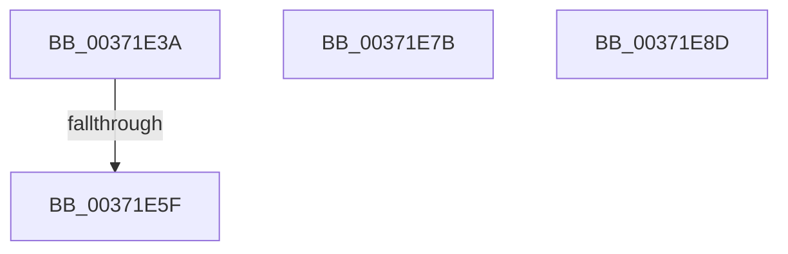

# sub_00371E3A

- RVA: `0x00371E3A`–`0x00371E90` (길이 `86` bytes)
- VA: `0x0000000140371E3A`
- 실행 섹션: `.text`
- PDB 이름 있음: `아니요`; PDB Function 태그: `아니요`
- unwind 정보 RVA: `0x0007A8A0`
- 디코드: `19`개 명령, `86/86` bytes 표시
- 미해석 바이트: `0` (있으면 어셈블리에 `.byte`로 보존)

> 이 문서는 커널 이미지의 기계어와 PDB 기호를 분석해 생성했습니다. 4번과 5번은 함수 원형과 자료형을 바이너리 사용 방식에서 추정한 C 해석이며 원본 소스 복구 결과는 아닙니다.

## 1. Dependencies

- 직접 호출 지점: **1**; 고유 호출 대상: **1**
- 직접 호출자로 확인된 함수: **0**
- RIP 상대 이미지 참조: **0**

### Outgoing calls
- `0x00371E7F` → [ExAcquireSpinLockExclusiveAtDpcLevel](../24/ExAcquireSpinLockExclusiveAtDpcLevel_function_00248E80.md) (function, `0x00248E80`)

### Direct callers
- 이 함수 시작 RVA로 연결되는 직접 call은 확인되지 않았습니다. 간접 호출은 완전히 역산할 수 없습니다.

### Static image references
- 디코드된 RIP-relative 메모리 참조가 없습니다.

## 2. Other-region calls and transfers

- 다른 실행 섹션으로 향하는 call: **0**
- call이 아닌 외부 분기/꼬리 이동: **3**
  - `0x00371E59` → [sub_00371C01 + 0x167](Unknown_function_00371C01.md) (`tail-transfer`)
  - `0x00371E76` → [sub_00371C01 + 0x167](Unknown_function_00371C01.md) (`tail-transfer`)
  - `0x00371E88` → [sub_00371C01 + 0xA9](Unknown_function_00371C01.md) (`tail-transfer`)

## 3. Assembly (complete function range)

```asm
00371E3A  49 8B 46 18                     mov rax, qword ptr [r14 + 0x18]
00371E3E  48 BA 00 00 00 00 00 00 00 40   movabs rdx, 0x4000000000000000
00371E48  48 0B C2                        or rax, rdx
00371E4B  BD 03 00 00 00                  mov ebp, 3
00371E50  49 89 46 18                     mov qword ptr [r14 + 0x18], rax
00371E54  41 F6 46 22 20                  test byte ptr [r14 + 0x22], 0x20
00371E59  0F 84 09 FF FF FF               je 0x140371d68
00371E5F  49 8B 16                        mov rdx, qword ptr [r14]
00371E62  48 83 C2 E0                     add rdx, -0x20
00371E66  48 8D 42 10                     lea rax, [rdx + 0x10]
00371E6A  48 39 00                        cmp qword ptr [rax], rax
00371E6D  49 0F 44 D4                     cmove rdx, r12
00371E71  48 89 54 24 38                  mov qword ptr [rsp + 0x38], rdx
00371E76  E9 ED FE FF FF                  jmp 0x140371d68
00371E7B  48 8D 4D 48                     lea rcx, [rbp + 0x48]
00371E7F  E8 FC 6F ED FF                  call 0x140248e80
00371E84  48 FF 4D 20                     dec qword ptr [rbp + 0x20]
00371E88  E9 1D FE FF FF                  jmp 0x140371caa
00371E8D  0F 1F 00                        nop dword ptr [rax]
```

## 4. C-style interpretation (structured pseudocode)

```c
__int64 __fastcall sub_00371E3A(void)
{
    __int64 result;
    unsigned __int64 v_stack_p38;

    result = (*(unsigned __int64 *)(v_r14 + 24)) | (a2);
    *(unsigned __int64 *)(v_r14 + 24) = result;
    a2 = (*(unsigned __int64 *)(v_r14)) + (-32);
    if ((*(unsigned __int64 *)(a2 + 16)) == (a2 + 16)) { a2 = v_r12; }
    v_stack_p38 = a2;
}
```

## 5. (Beta) C Style

```c
void sub_00371E3A(void)
{
    int64_t result;
    uint64_t v_stack_p38;

    result = (*(uint64_t *)(local_r14 + 0x18)) | (a2);
    *(uint64_t *)(local_r14 + 0x18) = result;
    a2 = (*(uint64_t *)(local_r14)) + (-32);
    if ((*(uint64_t *)(a2 + 0x10)) == (a2 + 16)) { a2 = local_r12; }
    v_stack_p38 = a2;
}
```

## 6. Execution-region graph

[열기: 2D/3D 그래프와 함수 탐색 컨트롤 패널](../../../control-panel.html?section=text&rva=0x00371E3A&view=graph)

- 2D 그래프는 위에서 아래로 흐르고, 3D 그래프는 빈 공간을 드래그해 회전합니다. Shift+드래그는 이동, 휠은 확대·축소, 함수 노드 선택은 대상 보고서 이동입니다.

### Static fallback


