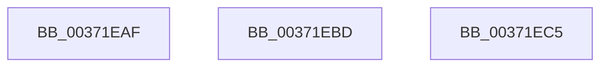

# sub_00371EAF

- RVA: `0x00371EAF`–`0x00371ECD` (길이 `30` bytes)
- VA: `0x0000000140371EAF`
- 실행 섹션: `.text`
- PDB 이름 있음: `아니요`; PDB Function 태그: `아니요`
- unwind 정보 RVA: `0x0007A8E4`
- 디코드: `7`개 명령, `30/30` bytes 표시
- 미해석 바이트: `0` (있으면 어셈블리에 `.byte`로 보존)

> 이 문서는 커널 이미지의 기계어와 PDB 기호를 분석해 생성했습니다. 4번과 5번은 함수 원형과 자료형을 바이너리 사용 방식에서 추정한 C 해석이며 원본 소스 복구 결과는 아닙니다.

## 1. Dependencies

- 직접 호출 지점: **0**; 고유 호출 대상: **0**
- 직접 호출자로 확인된 함수: **0**
- RIP 상대 이미지 참조: **0**

### Outgoing calls
- 직접 디코드된 call 명령이 없습니다.

### Direct callers
- 이 함수 시작 RVA로 연결되는 직접 call은 확인되지 않았습니다. 간접 호출은 완전히 역산할 수 없습니다.

### Static image references
- 디코드된 RIP-relative 메모리 참조가 없습니다.

## 2. Other-region calls and transfers

- 다른 실행 섹션으로 향하는 call: **0**
- call이 아닌 외부 분기/꼬리 이동: **3**
  - `0x00371EB8` → [sub_00371C01 + 0xF7](Unknown_function_00371C01.md) (`tail-transfer`)
  - `0x00371EC0` → [sub_00371C01 + 0x83](Unknown_function_00371C01.md) (`tail-transfer`)
  - `0x00371EC8` → [sub_00371C01 + 0x10A](Unknown_function_00371C01.md) (`tail-transfer`)

## 3. Assembly (complete function range)

```asm
00371EAF  48 83 E1 F9                     and rcx, 0xfffffffffffffff9
00371EB3  48 89 4C 24 30                  mov qword ptr [rsp + 0x30], rcx
00371EB8  E9 3B FE FF FF                  jmp 0x140371cf8
00371EBD  4C 8B FB                        mov r15, rbx
00371EC0  E9 BF FD FF FF                  jmp 0x140371c84
00371EC5  49 8B CC                        mov rcx, r12
00371EC8  E9 3E FE FF FF                  jmp 0x140371d0b
```

## 4. C-style interpretation (structured pseudocode)

```c
void __fastcall sub_00371EAF(__int64 a1)
{
    unsigned __int64 v_stack_p30;

    a1 = (a1) & (-7);
    v_stack_p30 = a1;
}
```

## 5. (Beta) C Style

```c
void sub_00371EAF(int64_t Arg1)
{
    uint64_t v_stack_p30;

    Arg1 = (Arg1) & (-7);
    v_stack_p30 = Arg1;
}
```

## 6. Execution-region graph

[열기: 2D/3D 그래프와 함수 탐색 컨트롤 패널](../../../control-panel.html?section=text&rva=0x00371EAF&view=graph)

- 2D 그래프는 위에서 아래로 흐르고, 3D 그래프는 빈 공간을 드래그해 회전합니다. Shift+드래그는 이동, 휠은 확대·축소, 함수 노드 선택은 대상 보고서 이동입니다.

### Static fallback


