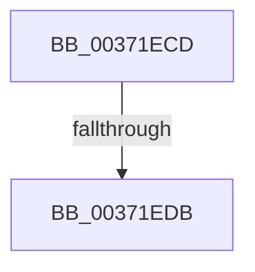

# sub_00371ECD

- RVA: `0x00371ECD`–`0x00371EF8` (길이 `43` bytes)
- VA: `0x0000000140371ECD`
- 실행 섹션: `.text`
- PDB 이름 있음: `아니요`; PDB Function 태그: `아니요`
- unwind 정보 RVA: `0x0007A908`
- 디코드: `9`개 명령, `43/43` bytes 표시
- 미해석 바이트: `0` (있으면 어셈블리에 `.byte`로 보존)

> 이 문서는 커널 이미지의 기계어와 PDB 기호를 분석해 생성했습니다. 4번과 5번은 함수 원형과 자료형을 바이너리 사용 방식에서 추정한 C 해석이며 원본 소스 복구 결과는 아닙니다.

## 1. Dependencies

- 직접 호출 지점: **1**; 고유 호출 대상: **1**
- 직접 호출자로 확인된 함수: **0**
- RIP 상대 이미지 참조: **0**

### Outgoing calls
- `0x00371EEE` → [MiReleasePageFileInfo](../28/MiReleasePageFileInfo_function_00283FD0.md) (function, `0x00283FD0`)

### Direct callers
- 이 함수 시작 RVA로 연결되는 직접 call은 확인되지 않았습니다. 간접 호출은 완전히 역산할 수 없습니다.

### Static image references
- 디코드된 RIP-relative 메모리 참조가 없습니다.

## 2. Other-region calls and transfers

- 다른 실행 섹션으로 향하는 call: **0**
- call이 아닌 외부 분기/꼬리 이동: **2**
  - `0x00371ED5` → [sub_00371DCB + 0x45](Unknown_function_00371DCB.md) (`tail-transfer`)
  - `0x00371EF3` → [sub_00371DCB + 0x45](Unknown_function_00371DCB.md) (`tail-transfer`)

## 3. Assembly (complete function range)

```asm
00371ECD  F6 84 24 C8 00 00 00 02         test byte ptr [rsp + 0xc8], 2
00371ED5  0F 85 35 FF FF FF               jne 0x140371e10
00371EDB  48 8B 4C 24 40                  mov rcx, qword ptr [rsp + 0x40]
00371EE0  40 80 FF 11                     cmp dil, 0x11
00371EE4  48 8B D6                        mov rdx, rsi
00371EE7  41 0F 94 C4                     sete r12b
00371EEB  45 8B C4                        mov r8d, r12d
00371EEE  E8 DD 20 F1 FF                  call 0x140283fd0
00371EF3  E9 18 FF FF FF                  jmp 0x140371e10
```

## 4. C-style interpretation (structured pseudocode)

```c
__int64 __fastcall sub_00371ECD(__int64 a1, __int64 a2, __int64 a3, __int64 a4, __int64 a5, __int64 a6, __int64 a7, __int64 a8, __int64 a9, __int64 a10, __int64 a11, __int64 a12, __int64 a13, __int64 a14, __int64 a15, __int64 a16, __int64 a17, __int64 a18, __int64 a19, __int64 a20, __int64 a21, __int64 a22, __int64 a23, __int64 a24, unsigned __int8 a25)
{
    __int64 result;
    __int64 v_r12;

    v_r12 = (((unsigned __int8)(v_rdi)) == 17) ? 1 : 0;
    result = MiReleasePageFileInfo(a8, v_rsi, (unsigned int)((unsigned int)(v_r12)), a4);
}
```

## 5. (Beta) C Style

```c
int64_t sub_00371ECD(int64_t Arg1, int64_t Arg2, int64_t Arg3, int64_t Arg4, uint64_t Arg5, uint64_t Arg6, uint64_t Arg7, int64_t Arg8, uint64_t Arg9, uint64_t Arg10, uint64_t Arg11, uint64_t Arg12, uint64_t Arg13, uint64_t Arg14, uint64_t Arg15, uint64_t Arg16, uint64_t Arg17, uint64_t Arg18, uint64_t Arg19, uint64_t Arg20, uint64_t Arg21, uint64_t Arg22, uint64_t Arg23, uint64_t Arg24, uint8_t Arg25)
{
    int64_t result;
    int64_t local_r12;

    local_r12 = (((uint8_t)(local_rdi)) == 17) ? 1 : 0;
    result = MiReleasePageFileInfo(Arg8, local_rsi, (uint32_t)((uint32_t)(local_r12)), Arg4);
}
```

## 6. Execution-region graph

[열기: 2D/3D 그래프와 함수 탐색 컨트롤 패널](../../../control-panel.html?section=text&rva=0x00371ECD&view=graph)

- 2D 그래프는 위에서 아래로 흐르고, 3D 그래프는 빈 공간을 드래그해 회전합니다. Shift+드래그는 이동, 휠은 확대·축소, 함수 노드 선택은 대상 보고서 이동입니다.

### Static fallback


