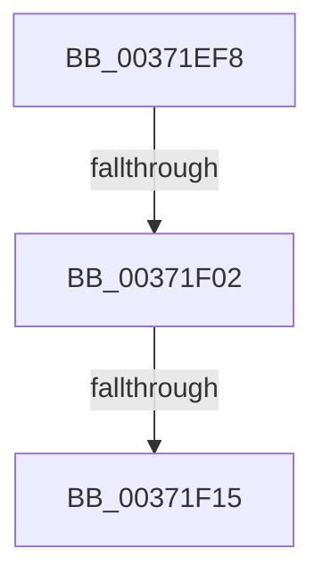

# sub_00371EF8

- RVA: `0x00371EF8`–`0x00371F2D` (길이 `53` bytes)
- VA: `0x0000000140371EF8`
- 실행 섹션: `.text`
- PDB 이름 있음: `아니요`; PDB Function 태그: `아니요`
- unwind 정보 RVA: `0x0007A928`
- 디코드: `12`개 명령, `53/53` bytes 표시
- 미해석 바이트: `0` (있으면 어셈블리에 `.byte`로 보존)

> 이 문서는 커널 이미지의 기계어와 PDB 기호를 분석해 생성했습니다. 4번과 5번은 함수 원형과 자료형을 바이너리 사용 방식에서 추정한 C 해석이며 원본 소스 복구 결과는 아닙니다.

## 1. Dependencies

- 직접 호출 지점: **2**; 고유 호출 대상: **2**
- 직접 호출자로 확인된 함수: **0**
- RIP 상대 이미지 참조: **0**

### Outgoing calls
- `0x00371F18` → [MiRemoveUnusedSubsection](../2A/MiRemoveUnusedSubsection_function_002A6194.md) (function, `0x002A6194`)
- `0x00371F20` → [MiInsertUnusedSubsection](../29/MiInsertUnusedSubsection_function_00298D50.md) (function, `0x00298D50`)

### Direct callers
- 이 함수 시작 RVA로 연결되는 직접 call은 확인되지 않았습니다. 간접 호출은 완전히 역산할 수 없습니다.

### Static image references
- 디코드된 RIP-relative 메모리 참조가 없습니다.

## 2. Other-region calls and transfers

- 다른 실행 섹션으로 향하는 call: **0**
- call이 아닌 외부 분기/꼬리 이동: **3**
  - `0x00371EFC` → [sub_00371C01 + 0x9C](Unknown_function_00371C01.md) (`tail-transfer`)
  - `0x00371F0F` → [sub_00371C01 + 0x9C](Unknown_function_00371C01.md) (`tail-transfer`)
  - `0x00371F28` → [sub_00371C01 + 0x9C](Unknown_function_00371C01.md) (`tail-transfer`)

## 3. Assembly (complete function range)

```asm
00371EF8  49 39 77 50                     cmp qword ptr [r15 + 0x50], rsi
00371EFC  0F 85 9B FD FF FF               jne 0x140371c9d
00371F02  8B 43 20                        mov eax, dword ptr [rbx + 0x20]
00371F05  25 00 00 09 00                  and eax, 0x90000
00371F0A  3D 00 00 08 00                  cmp eax, 0x80000
00371F0F  0F 85 88 FD FF FF               jne 0x140371c9d
00371F15  49 8B CF                        mov rcx, r15
00371F18  E8 77 42 F3 FF                  call 0x1402a6194
00371F1D  49 8B CF                        mov rcx, r15
00371F20  E8 2B 6E F2 FF                  call 0x140298d50
00371F25  4C 8B E8                        mov r13, rax
00371F28  E9 70 FD FF FF                  jmp 0x140371c9d
```

## 4. C-style interpretation (structured pseudocode)

```c
__int64 __fastcall sub_00371EF8(void)
{
    __int64 result;

    result = (unsigned int)(((unsigned int)(*(unsigned int *)(v_rbx + 32))) & (0x90000ULL));
    result = MiRemoveUnusedSubsection(v_r15, a2, a3, a4);
    result = MiInsertUnusedSubsection(v_r15, a2, a3, a4);
}
```

## 5. (Beta) C Style

```c
void sub_00371EF8(void)
{
    int64_t result;

    result = (uint32_t)(((uint32_t)(*(uint32_t *)(local_rbx + 0x20))) & (0x90000ULL));
    result = MiRemoveUnusedSubsection(local_r15, a2, a3, a4);
    result = MiInsertUnusedSubsection(local_r15, a2, a3, a4);
}
```

## 6. Execution-region graph

[열기: 2D/3D 그래프와 함수 탐색 컨트롤 패널](../../../control-panel.html?section=text&rva=0x00371EF8&view=graph)

- 2D 그래프는 위에서 아래로 흐르고, 3D 그래프는 빈 공간을 드래그해 회전합니다. Shift+드래그는 이동, 휠은 확대·축소, 함수 노드 선택은 대상 보고서 이동입니다.

### Static fallback


