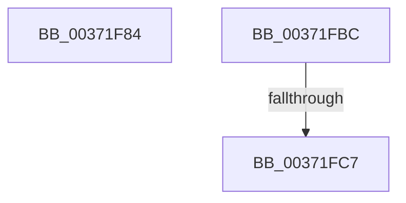

# sub_00371F84

- RVA: `0x00371F84`–`0x00371FEE` (길이 `106` bytes)
- VA: `0x0000000140371F84`
- 실행 섹션: `.text`
- PDB 이름 있음: `아니요`; PDB Function 태그: `아니요`
- unwind 정보 RVA: `0x0007A97C`
- 디코드: `23`개 명령, `106/106` bytes 표시
- 미해석 바이트: `0` (있으면 어셈블리에 `.byte`로 보존)

> 이 문서는 커널 이미지의 기계어와 PDB 기호를 분석해 생성했습니다. 4번과 5번은 함수 원형과 자료형을 바이너리 사용 방식에서 추정한 C 해석이며 원본 소스 복구 결과는 아닙니다.

## 1. Dependencies

- 직접 호출 지점: **2**; 고유 호출 대상: **2**
- 직접 호출자로 확인된 함수: **0**
- RIP 상대 이미지 참조: **1**

### Outgoing calls
- `0x00371FA2` → [ExReleaseSpinLockExclusiveFromDpcLevel](../24/ExReleaseSpinLockExclusiveFromDpcLevel_function_002497E0.md) (function, `0x002497E0`)
- `0x00371FB2` → [MiReturnCrossPartitionSectionCharges](../4B/MiReturnCrossPartitionSectionCharges_function_004BA61C.md) (function, `0x004BA61C`)

### Direct callers
- 이 함수 시작 RVA로 연결되는 직접 call은 확인되지 않았습니다. 간접 호출은 완전히 역산할 수 없습니다.

### Static image references
- `0x00371F90` → RVA `0x00E30088` (`.data`; read)

## 2. Other-region calls and transfers

- 다른 실행 섹션으로 향하는 call: **0**
- call이 아닌 외부 분기/꼬리 이동: **3**
  - `0x00371FB7` → [sub_00371C01 + 0xB2](Unknown_function_00371C01.md) (`tail-transfer`)
  - `0x00371FC1` → [sub_00371C01 + 0x173](Unknown_function_00371C01.md) (`tail-transfer`)
  - `0x00371FE9` → [sub_00371C01 + 0x173](Unknown_function_00371C01.md) (`tail-transfer`)

## 3. Assembly (complete function range)

```asm
00371F84  0F B7 4D 3C                     movzx ecx, word ptr [rbp + 0x3c]
00371F88  B8 FF 03 00 00                  mov eax, 0x3ff
00371F8D  66 23 C8                        and cx, ax
00371F90  48 8B 05 F1 E0 AB 00            mov rax, qword ptr [rip + 0xabe0f1]
00371F97  0F B7 C9                        movzx ecx, cx
00371F9A  48 8B 1C C8                     mov rbx, qword ptr [rax + rcx*8]
00371F9E  48 8D 4D 48                     lea rcx, [rbp + 0x48]
00371FA2  E8 39 78 ED FF                  call 0x1402497e0
00371FA7  4D 8B C5                        mov r8, r13
00371FAA  BA 01 00 00 00                  mov edx, 1
00371FAF  48 8B CB                        mov rcx, rbx
00371FB2  E8 65 86 14 00                  call 0x1404ba61c
00371FB7  E9 F7 FC FF FF                  jmp 0x140371cb3
00371FBC  41 F6 46 23 10                  test byte ptr [r14 + 0x23], 0x10
00371FC1  0F 85 AD FD FF FF               jne 0x140371d74
00371FC7  41 8B 46 20                     mov eax, dword ptr [r14 + 0x20]
00371FCB  89 84 24 B8 00 00 00            mov dword ptr [rsp + 0xb8], eax
00371FD2  C1 E8 18                        shr eax, 0x18
00371FD5  0C 10                           or al, 0x10
00371FD7  88 84 24 BB 00 00 00            mov byte ptr [rsp + 0xbb], al
00371FDE  8B 84 24 B8 00 00 00            mov eax, dword ptr [rsp + 0xb8]
00371FE5  41 89 46 20                     mov dword ptr [r14 + 0x20], eax
00371FE9  E9 86 FD FF FF                  jmp 0x140371d74
```

## 4. C-style interpretation (structured pseudocode)

```c
__int64 __fastcall sub_00371F84(void)
{
    __int64 result;
    unsigned int v_stack_pB8;
    unsigned __int8 v_stack_pBB;

    a1 = (unsigned __int16)((*(unsigned __int16 *)(v_rbp + 60)) & ((unsigned __int16)((unsigned int)(0x3FFULL))));
    result = ExReleaseSpinLockExclusiveFromDpcLevel(v_rbp + 72, a2, a3, a4);
    result = MiReturnCrossPartitionSectionCharges(*(unsigned __int64 *)(*(unsigned __int64 *)(v_rip + 11264241) + (unsigned __int16)(a1) * 8), 1, v_r13, a4);
}
```

## 5. (Beta) C Style

```c
void sub_00371F84(void)
{
    int64_t result;
    uint32_t v_stack_pB8;
    uint8_t v_stack_pBB;

    a1 = (uint16_t)((*(uint16_t *)(local_rbp + 0x3C)) & ((uint16_t)((uint32_t)(0x3FFULL))));
    result = ExReleaseSpinLockExclusiveFromDpcLevel(local_rbp + 72, a2, a3, a4);
    result = MiReturnCrossPartitionSectionCharges(*(uint64_t *)(*(uint64_t *)(v_rip + 0xABE0F1) + (uint16_t)(a1) * 8), 1, local_r13, a4);
}
```

## 6. Execution-region graph

[열기: 2D/3D 그래프와 함수 탐색 컨트롤 패널](../../../control-panel.html?section=text&rva=0x00371F84&view=graph)

- 2D 그래프는 위에서 아래로 흐르고, 3D 그래프는 빈 공간을 드래그해 회전합니다. Shift+드래그는 이동, 휠은 확대·축소, 함수 노드 선택은 대상 보고서 이동입니다.

### Static fallback


