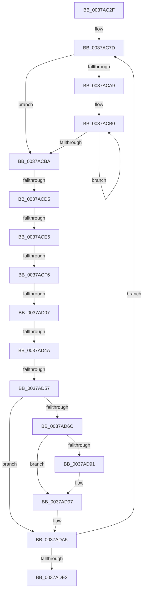

# sub_0037AC2F

- RVA: `0x0037AC2F`–`0x0037AE17` (길이 `488` bytes)
- VA: `0x000000014037AC2F`
- 실행 섹션: `.text`
- PDB 이름 있음: `아니요`; PDB Function 태그: `아니요`
- unwind 정보 RVA: `0x0007B098`
- 디코드: `99`개 명령, `488/488` bytes 표시
- 미해석 바이트: `0` (있으면 어셈블리에 `.byte`로 보존)

> 이 문서는 커널 이미지의 기계어와 PDB 기호를 분석해 생성했습니다. 4번과 5번은 함수 원형과 자료형을 바이너리 사용 방식에서 추정한 C 해석이며 원본 소스 복구 결과는 아닙니다.

## 1. Dependencies

- 직접 호출 지점: **0**; 고유 호출 대상: **0**
- 직접 호출자로 확인된 함수: **0**
- RIP 상대 이미지 참조: **5**

### Outgoing calls
- 직접 디코드된 call 명령이 없습니다.

### Direct callers
- 이 함수 시작 RVA로 연결되는 직접 call은 확인되지 않았습니다. 간접 호출은 완전히 역산할 수 없습니다.

### Static image references
- `0x0037AC33` → RVA `0x002DDBC0` (`HvlGetReferenceTimeUsingTscPage`; read)
- `0x0037AC3E` → RVA `0x0041FD10` (`HalpTscQueryCounterOrdered`; read)
- `0x0037ACBA` → RVA `0x00FC3FD0` (`.data`; read)
- `0x0037ACD5` → RVA `0x00FC40E0` (`.data`; read)
- `0x0037AD3A` → RVA `0x00FC3FC8` (`.data`; read)

## 2. Other-region calls and transfers

- 다른 실행 섹션으로 향하는 call: **0**
- call이 아닌 외부 분기/꼬리 이동: **6**
  - `0x0037ACCF` → [sub_0037AE18 + 0x25](Unknown_function_0037AE18.md) (`tail-transfer`)
  - `0x0037ACE0` → [sub_0037AE18 + 0x109](Unknown_function_0037AE18.md) (`tail-transfer`)
  - `0x0037ACF0` → [sub_0037AE18 + 0x2A9](Unknown_function_0037AE18.md) (`tail-transfer`)
  - `0x0037AD01` → [sub_0037AE18 + 0x507](Unknown_function_0037AE18.md) (`tail-transfer`)
  - `0x0037AD44` → [sub_0037AE18 + 0x1EF](Unknown_function_0037AE18.md) (`tail-transfer`)
  - `0x0037AD51` → [sub_0037AE18](Unknown_function_0037AE18.md) (`tail-transfer`)

## 3. Assembly (complete function range)

```asm
0037AC2F  48 89 58 F0                     mov qword ptr [rax - 0x10], rbx
0037AC33  4C 8D 1D 86 2F F6 FF            lea r11, [rip - 0x9d07a]
0037AC3A  48 89 68 E8                     mov qword ptr [rax - 0x18], rbp
0037AC3E  48 8D 15 CB 50 0A 00            lea rdx, [rip + 0xa50cb]
0037AC45  48 89 70 E0                     mov qword ptr [rax - 0x20], rsi
0037AC49  49 B8 B0 03 00 00 80 F7 FF FF   movabs r8, 0xfffff780000003b0
0037AC53  4C 89 60 D8                     mov qword ptr [rax - 0x28], r12
0037AC57  41 B9 80 96 98 00               mov r9d, 0x989680
0037AC5D  4C 89 68 D0                     mov qword ptr [rax - 0x30], r13
0037AC61  49 BA 94 02 00 00 80 F7 FF FF   movabs r10, 0xfffff78000000294
0037AC6B  4C 89 70 C8                     mov qword ptr [rax - 0x38], r14
0037AC6F  49 BE 40 03 00 00 80 F7 FF FF   movabs r14, 0xfffff78000000340
0037AC79  4C 89 78 C0                     mov qword ptr [rax - 0x40], r15
0037AC7D  49 8B 38                        mov rdi, qword ptr [r8]
0037AC80  45 33 ED                        xor r13d, r13d
0037AC83  4C 89 6C 24 30                  mov qword ptr [rsp + 0x30], r13
0037AC88  49 BD 50 03 00 00 80 F7 FF FF   movabs r13, 0xfffff78000000350
0037AC92  48 89 7C 24 40                  mov qword ptr [rsp + 0x40], rdi
0037AC97  49 8B 1E                        mov rbx, qword ptr [r14]
0037AC9A  48 B8 08 00 00 00 80 F7 FF FF   movabs rax, 0xfffff78000000008
0037ACA4  F6 C3 01                        test bl, 1
0037ACA7  74 11                           je 0x14037acba
0037ACA9  0F 1F 80 00 00 00 00            nop dword ptr [rax]
0037ACB0  F3 90                           pause
0037ACB2  49 8B 1E                        mov rbx, qword ptr [r14]
0037ACB5  F6 C3 01                        test bl, 1
0037ACB8  75 F6                           jne 0x14037acb0
0037ACBA  48 8B 2D 0F 93 C4 00            mov rbp, qword ptr [rip + 0xc4930f]
0037ACC1  4D 8B 7D 00                     mov r15, qword ptr [r13]
0037ACC5  4C 8B 20                        mov r12, qword ptr [rax]
0037ACC8  83 BD E4 00 00 00 05            cmp dword ptr [rbp + 0xe4], 5
0037ACCF  0F 85 68 01 00 00               jne 0x14037ae3d
0037ACD5  48 83 3D 03 94 C4 00 00         cmp qword ptr [rip + 0xc49403], 0
0037ACDD  49 8B F1                        mov rsi, r9
0037ACE0  0F 84 3B 02 00 00               je 0x14037af21
0037ACE6  F7 85 E0 00 00 00 00 00 01 00   test dword ptr [rbp + 0xe0], 0x10000
0037ACF0  0F 85 CB 03 00 00               jne 0x14037b0c1
0037ACF6  48 8B 4D 48                     mov rcx, qword ptr [rbp + 0x48]
0037ACFA  48 8B 45 70                     mov rax, qword ptr [rbp + 0x70]
0037ACFE  48 3B C2                        cmp rax, rdx
0037AD01  0F 85 18 06 00 00               jne 0x14037b31f
0037AD07  0F 01 F9                        rdtscp
0037AD0A  4C 8D 84 24 B0 00 00 00         lea r8, [rsp + 0xb0]
0037AD12  48 C1 E2 20                     shl rdx, 0x20
0037AD16  41 89 08                        mov dword ptr [r8], ecx
0037AD19  48 0B D0                        or rdx, rax
0037AD1C  48 8B 05 BD 93 C4 00            mov rax, qword ptr [rip + 0xc493bd]
0037AD23  48 B9 B8 03 00 00 80 F7 FF FF   movabs rcx, 0xfffff780000003b8
0037AD2D  48 8B 40 08                     mov rax, qword ptr [rax + 8]
0037AD31  4C 8B 19                        mov r11, qword ptr [rcx]
0037AD34  48 F7 E2                        mul rdx
0037AD37  4C 03 DA                        add r11, rdx
0037AD3A  48 8B 05 87 92 C4 00            mov rax, qword ptr [rip + 0xc49287]
0037AD41  48 3B E8                        cmp rbp, rax
0037AD44  0F 85 BD 02 00 00               jne 0x14037b007
0037AD4A  90                              nop
0037AD4B  49 8B 06                        mov rax, qword ptr [r14]
0037AD4E  48 3B C3                        cmp rax, rbx
0037AD51  0F 85 C1 00 00 00               jne 0x14037ae18
0037AD57  48 8B 84 24 A0 00 00 00         mov rax, qword ptr [rsp + 0xa0]
0037AD5F  4C 8B 6C 24 30                  mov r13, qword ptr [rsp + 0x30]
0037AD64  4C 89 18                        mov qword ptr [rax], r11
0037AD67  4D 3B DF                        cmp r11, r15
0037AD6A  76 39                           jbe 0x14037ada5
0037AD6C  48 B8 60 03 00 00 80 F7 FF FF   movabs rax, 0xfffff78000000360
0037AD76  4C 89 6C 24 38                  mov qword ptr [rsp + 0x38], r13
0037AD7B  4D 2B DF                        sub r11, r15
0037AD7E  49 FF CB                        dec r11
0037AD81  48 8B 10                        mov rdx, qword ptr [rax]
0037AD84  A0 69 03 00 00 80 F7 FF FF      movabs al, byte ptr [0xfffff78000000369]
0037AD8D  84 C0                           test al, al
0037AD8F  74 06                           je 0x14037ad97
0037AD91  0F B6 C8                        movzx ecx, al
0037AD94  49 D3 E3                        shl r11, cl
0037AD97  48 8B C2                        mov rax, rdx
0037AD9A  49 F7 E3                        mul r11
0037AD9D  4C 8B EA                        mov r13, rdx
0037ADA0  48 89 54 24 38                  mov qword ptr [rsp + 0x38], rdx
0037ADA5  48 8B 7C 24 40                  mov rdi, qword ptr [rsp + 0x40]
0037ADAA  4B 8D 04 2C                     lea rax, [r12 + r13]
0037ADAE  49 B8 B0 03 00 00 80 F7 FF FF   movabs r8, 0xfffff780000003b0
0037ADB8  48 8D 15 51 4F 0A 00            lea rdx, [rip + 0xa4f51]
0037ADBF  41 B9 80 96 98 00               mov r9d, 0x989680
0037ADC5  4C 8D 1D F4 2D F6 FF            lea r11, [rip - 0x9d20c]
0037ADCC  49 BA 94 02 00 00 80 F7 FF FF   movabs r10, 0xfffff78000000294
0037ADD6  49 8B 08                        mov rcx, qword ptr [r8]
0037ADD9  48 3B F9                        cmp rdi, rcx
0037ADDC  0F 85 9B FE FF FF               jne 0x14037ac7d
0037ADE2  4C 8B 7C 24 58                  mov r15, qword ptr [rsp + 0x58]
0037ADE7  48 2B C7                        sub rax, rdi
0037ADEA  4C 8B 74 24 60                  mov r14, qword ptr [rsp + 0x60]
0037ADEF  4C 8B 6C 24 68                  mov r13, qword ptr [rsp + 0x68]
0037ADF4  4C 8B 64 24 70                  mov r12, qword ptr [rsp + 0x70]
0037ADF9  48 8B 74 24 78                  mov rsi, qword ptr [rsp + 0x78]
0037ADFE  48 8B AC 24 80 00 00 00         mov rbp, qword ptr [rsp + 0x80]
0037AE06  48 8B 9C 24 88 00 00 00         mov rbx, qword ptr [rsp + 0x88]
0037AE0E  48 81 C4 90 00 00 00            add rsp, 0x90
0037AE15  5F                              pop rdi
0037AE16  C3                              ret
```

## 4. C-style interpretation (structured pseudocode)

```c
__int64 __fastcall sub_0037AC2F(__int64 a1, __int64 a2, __int64 a3, __int64 a4, __int64 a5, __int64 a6, __int64 a7, __int64 a8, __int64 a9, __int64 a10, __int64 a11, __int64 a12, __int64 a13, __int64 a14, __int64 a15, __int64 a16, __int64 a17, __int64 a18, __int64 a19, __int64 a20, __int64 a21, __int64 a22)
{
    __int64 result;
    __int64 v_r11;
    __int64 v_r13;
    __int64 v_rsp;
    unsigned __int64 v_stack_p30;
    unsigned __int64 v_stack_p38;
    unsigned __int64 v_stack_p40;

    *(unsigned __int64 *)(result - 16) = v_rbx;
    *(unsigned __int64 *)(result - 24) = v_rbp;
    *(unsigned __int64 *)(result - 32) = v_rsi;
    *(unsigned __int64 *)(result - 40) = v_r12;
    *(unsigned __int64 *)(result - 48) = v_r13;
    *(unsigned __int64 *)(result - 56) = v_r14;
    *(unsigned __int64 *)(result - 64) = v_r15;
loc_0037AC7D:
    v_r13 = 0;
    v_stack_p30 = 0;
    v_stack_p40 = *(unsigned __int64 *)(a3);
    if ((((unsigned __int8)(*(unsigned __int64 *)(v_r14))) & (1)) == 0) goto loc_0037ACBA;
loc_0037ACB0:
    if ((((unsigned __int8)(*(unsigned __int64 *)(v_r14))) & (1)) != 0) goto loc_0037ACB0;
loc_0037ACBA:
    a2 = (v_rip + 676043) << (32);
    *(unsigned int *)(a22) = (unsigned int)(*(unsigned __int64 *)(*(unsigned __int64 *)(v_rip + 12882703) + 72));
    a2 = (a2) | (*(unsigned __int64 *)(*(unsigned __int64 *)(v_rip + 12882703) + 112));
    v_r11 = (*(unsigned __int64 *)(*(unsigned __int64 *)(*(unsigned __int64 *)(v_rip + 12882703) + 72))) + (a2);
    *(unsigned __int64 *)(a20) = v_r11;
    if (v_r11 <= (*(unsigned __int64 *)(v_r13))) goto loc_0037ADA5;
    v_stack_p38 = a6;
    v_r11 = (v_r11) - (*(unsigned __int64 *)(v_r13));
    v_r11 = (v_r11) - 1;
    if ((unsigned __int8)(a20) != 0) {
        a1 = (unsigned __int8)(a20);
        v_r11 = (v_r11) << ((unsigned __int8)(a1));
    }
    v_stack_p38 = *(unsigned __int64 *)(a20);
loc_0037ADA5:
    if (a8 != (*(unsigned __int64 *)(a22))) goto loc_0037AC7D;
    result = (*(unsigned __int64 *)(result) + *(unsigned __int64 *)(a20) * 1) - (a8);
    v_rsp = (v_rsp) + (144);
    return result;
}
```

## 5. (Beta) C Style

```c
int64_t sub_0037AC2F(int64_t Arg1, int64_t Arg2, int64_t Arg3, int64_t Arg4, uint64_t Arg5, int64_t Arg6, uint64_t Arg7, int64_t Arg8, uint64_t Arg9, uint64_t Arg10, int64_t Arg11, int64_t Arg12, int64_t Arg13, int64_t Arg14, int64_t Arg15, int64_t Arg16, int64_t Arg17, uint64_t Arg18, uint64_t Arg19, void *Arg20, uint64_t Arg21, int64_t Arg22)
{
    uint8_t *arg20 = (uint8_t *)Arg20;

    int64_t result;
    int64_t local_r11;
    int64_t local_r13;
    int64_t local_rsp;
    uint64_t v_stack_p30;
    uint64_t v_stack_p38;
    uint64_t v_stack_p40;

    *(uint64_t *)(result - 0x10) = local_rbx;
    *(uint64_t *)(result - 0x18) = local_rbp;
    *(uint64_t *)(result - 0x20) = local_rsi;
    *(uint64_t *)(result - 0x28) = local_r12;
    *(uint64_t *)(result - 0x30) = local_r13;
    *(uint64_t *)(result - 0x38) = local_r14;
    *(uint64_t *)(result - 0x40) = local_r15;
loc_0037AC7D:
    local_r13 = 0;
    v_stack_p30 = 0;
    v_stack_p40 = *(uint64_t *)(Arg3);
    if ((((uint8_t)(*(uint64_t *)(local_r14))) & (1)) == 0) goto loc_0037ACBA;
loc_0037ACB0:
    if ((((uint8_t)(*(uint64_t *)(local_r14))) & (1)) != 0) goto loc_0037ACB0;
loc_0037ACBA:
    Arg2 = (v_rip + 676043) << (32);
    *(uint32_t *)(Arg22) = (uint32_t)(*(uint64_t *)(*(uint64_t *)(v_rip + 0xC4930F) + 0x48));
    Arg2 = (Arg2) | (*(uint64_t *)(*(uint64_t *)(v_rip + 0xC4930F) + 0x70));
    local_r11 = (*(uint64_t *)(*(uint64_t *)(*(uint64_t *)(v_rip + 0xC4930F) + 0x48))) + (Arg2);
    *(uint64_t *)(arg20) = local_r11;
    if (local_r11 <= (*(uint64_t *)(local_r13))) goto loc_0037ADA5;
    v_stack_p38 = Arg6;
    local_r11 = (local_r11) - (*(uint64_t *)(local_r13));
    local_r11 = (local_r11) - 1;
    if ((uint8_t)(Arg20) != 0) {
        Arg1 = (uint8_t)(Arg20);
        local_r11 = (local_r11) << ((uint8_t)(Arg1));
    }
    v_stack_p38 = *(uint64_t *)(arg20);
loc_0037ADA5:
    if (Arg8 != (*(uint64_t *)(Arg22))) goto loc_0037AC7D;
    result = (*(uint64_t *)(result) + *(uint64_t *)(arg20) * 1) - (Arg8);
    local_rsp = (local_rsp) + (144);
    return result;
}
```

### 관측된 메모리 오프셋

구조체 형식이 확인되지 않은 접근은 인자 기준의 오프셋으로만 기록했습니다.

| 기준 인자 | 오프셋 표현 | 폭 (bit) | 접근 |
|---|---:|---:|---|
| `Arg20` | `+ 0x0` | `64` | `W` |

## 6. Execution-region graph

[열기: 2D/3D 그래프와 함수 탐색 컨트롤 패널](../../../control-panel.html?section=text&rva=0x0037AC2F&view=graph)

- 2D 그래프는 위에서 아래로 흐르고, 3D 그래프는 빈 공간을 드래그해 회전합니다. Shift+드래그는 이동, 휠은 확대·축소, 함수 노드 선택은 대상 보고서 이동입니다.

### Static fallback


