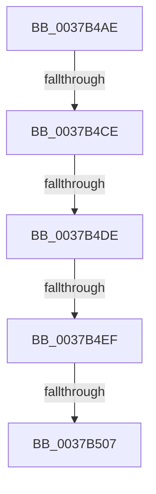

# sub_0037B4AE

- RVA: `0x0037B4AE`–`0x0037B54F` (길이 `161` bytes)
- VA: `0x000000014037B4AE`
- 실행 섹션: `.text`
- PDB 이름 있음: `아니요`; PDB Function 태그: `아니요`
- unwind 정보 RVA: `0x0007B128`
- 디코드: `31`개 명령, `161/161` bytes 표시
- 미해석 바이트: `0` (있으면 어셈블리에 `.byte`로 보존)

> 이 문서는 커널 이미지의 기계어와 PDB 기호를 분석해 생성했습니다. 4번과 5번은 함수 원형과 자료형을 바이너리 사용 방식에서 추정한 C 해석이며 원본 소스 복구 결과는 아닙니다.

## 1. Dependencies

- 직접 호출 지점: **0**; 고유 호출 대상: **0**
- 직접 호출자로 확인된 함수: **0**
- RIP 상대 이미지 참조: **4**

### Outgoing calls
- 직접 디코드된 call 명령이 없습니다.

### Direct callers
- 이 함수 시작 RVA로 연결되는 직접 call은 확인되지 않았습니다. 간접 호출은 완전히 역산할 수 없습니다.

### Static image references
- `0x0037B4B9` → RVA `0x00FC3FD0` (`.data`; read)
- `0x0037B4CE` → RVA `0x00FC40E0` (`.data`; read)
- `0x0037B4F7` → RVA `0x0041FD10` (`HalpTscQueryCounterOrdered`; read)
- `0x0037B53A` → RVA `0x00FC3FC8` (`.data`; read)

## 2. Other-region calls and transfers

- 다른 실행 섹션으로 향하는 call: **0**
- call이 아닌 외부 분기/꼬리 이동: **5**
  - `0x0037B4C8` → [sub_0037B90B](Unknown_function_0037B90B.md) (`tail-transfer`)
  - `0x0037B4D8` → [sub_0037BB03](Unknown_function_0037BB03.md) (`tail-transfer`)
  - `0x0037B4E9` → [sub_0037BC17 + 0x8E](Unknown_function_0037BC17.md) (`tail-transfer`)
  - `0x0037B501` → [sub_0037BFA1 + 0x14](Unknown_function_0037BFA1.md) (`tail-transfer`)
  - `0x0037B549` → [sub_0037BBE9](Unknown_function_0037BBE9.md) (`tail-transfer`)

## 3. Assembly (complete function range)

```asm
0037B4AE  4C 89 6C 24 58                  mov qword ptr [rsp + 0x58], r13
0037B4B3  41 B9 80 96 98 00               mov r9d, 0x989680
0037B4B9  4C 8B 2D 10 8B C4 00            mov r13, qword ptr [rip + 0xc48b10]
0037B4C0  41 83 BD E4 00 00 00 05         cmp dword ptr [r13 + 0xe4], 5
0037B4C8  0F 85 3D 04 00 00               jne 0x14037b90b
0037B4CE  4C 39 3D 0B 8C C4 00            cmp qword ptr [rip + 0xc48c0b], r15
0037B4D5  41 8B D9                        mov ebx, r9d
0037B4D8  0F 84 25 06 00 00               je 0x14037bb03
0037B4DE  41 F7 85 E0 00 00 00 00 00 01 00  test dword ptr [r13 + 0xe0], 0x10000
0037B4E9  0F 85 B6 07 00 00               jne 0x14037bca5
0037B4EF  49 8B 4D 48                     mov rcx, qword ptr [r13 + 0x48]
0037B4F3  49 8B 45 70                     mov rax, qword ptr [r13 + 0x70]
0037B4F7  48 8D 15 12 48 0A 00            lea rdx, [rip + 0xa4812]
0037B4FE  48 3B C2                        cmp rax, rdx
0037B501  0F 85 AE 0A 00 00               jne 0x14037bfb5
0037B507  44 89 7D 40                     mov dword ptr [rbp + 0x40], r15d
0037B50B  0F 01 F9                        rdtscp
0037B50E  4C 8D 45 40                     lea r8, [rbp + 0x40]
0037B512  48 C1 E2 20                     shl rdx, 0x20
0037B516  41 89 08                        mov dword ptr [r8], ecx
0037B519  48 0B D0                        or rdx, rax
0037B51C  48 8B 05 BD 8B C4 00            mov rax, qword ptr [rip + 0xc48bbd]
0037B523  48 B9 B8 03 00 00 80 F7 FF FF   movabs rcx, 0xfffff780000003b8
0037B52D  48 8B 40 08                     mov rax, qword ptr [rax + 8]
0037B531  4C 8B 19                        mov r11, qword ptr [rcx]
0037B534  48 F7 E2                        mul rdx
0037B537  4C 03 DA                        add r11, rdx
0037B53A  48 8B 05 87 8A C4 00            mov rax, qword ptr [rip + 0xc48a87]
0037B541  4C 3B E8                        cmp r13, rax
0037B544  4C 8B 6C 24 58                  mov r13, qword ptr [rsp + 0x58]
0037B549  0F 85 9A 06 00 00               jne 0x14037bbe9
```

## 4. C-style interpretation (structured pseudocode)

```c
__int64 __fastcall sub_0037B4AE(__int64 a1, __int64 a2, __int64 a3, __int64 a4, __int64 a5, __int64 a6, __int64 a7, __int64 a8, __int64 a9, __int64 a10, __int64 a11)
{
    __int64 v_r11;
    unsigned __int64 v_stack_p58;

    v_stack_p58 = v_r13;
    *(unsigned int *)(v_rbp + 64) = (unsigned int)(v_r15);
    a2 = (v_rip + 673810) << (32);
    *(unsigned int *)(v_rbp + 64) = (unsigned int)(*(unsigned __int64 *)(*(unsigned __int64 *)(v_rip + 12880656) + 72));
    a2 = (a2) | (*(unsigned __int64 *)(*(unsigned __int64 *)(v_rip + 12880656) + 112));
    v_r11 = (*(unsigned __int64 *)(*(unsigned __int64 *)(*(unsigned __int64 *)(v_rip + 12880656) + 72))) + (a2);
}
```

## 5. (Beta) C Style

```c
int64_t sub_0037B4AE(int64_t Arg1, int64_t Arg2, int64_t Arg3, int64_t Arg4, uint64_t Arg5, uint64_t Arg6, uint64_t Arg7, uint64_t Arg8, uint64_t Arg9, uint64_t Arg10, int64_t Arg11)
{
    int64_t local_r11;
    uint64_t v_stack_p58;

    v_stack_p58 = local_r13;
    *(uint32_t *)(local_rbp + 0x40) = (uint32_t)(local_r15);
    Arg2 = (v_rip + 673810) << (32);
    *(uint32_t *)(local_rbp + 0x40) = (uint32_t)(*(uint64_t *)(*(uint64_t *)(v_rip + 0xC48B10) + 0x48));
    Arg2 = (Arg2) | (*(uint64_t *)(*(uint64_t *)(v_rip + 0xC48B10) + 0x70));
    local_r11 = (*(uint64_t *)(*(uint64_t *)(*(uint64_t *)(v_rip + 0xC48B10) + 0x48))) + (Arg2);
}
```

## 6. Execution-region graph

[열기: 2D/3D 그래프와 함수 탐색 컨트롤 패널](../../../control-panel.html?section=text&rva=0x0037B4AE&view=graph)

- 2D 그래프는 위에서 아래로 흐르고, 3D 그래프는 빈 공간을 드래그해 회전합니다. Shift+드래그는 이동, 휠은 확대·축소, 함수 노드 선택은 대상 보고서 이동입니다.

### Static fallback


