# sub_0037B54F

- RVA: `0x0037B54F`–`0x0037B90B` (길이 `956` bytes)
- VA: `0x000000014037B54F`
- 실행 섹션: `.text`
- PDB 이름 있음: `아니요`; PDB Function 태그: `아니요`
- unwind 정보 RVA: `0x0007B13C`
- 디코드: `234`개 명령, `956/956` bytes 표시
- 미해석 바이트: `0` (있으면 어셈블리에 `.byte`로 보존)

> 이 문서는 커널 이미지의 기계어와 PDB 기호를 분석해 생성했습니다. 4번과 5번은 함수 원형과 자료형을 바이너리 사용 방식에서 추정한 C 해석이며 원본 소스 복구 결과는 아닙니다.

## 1. Dependencies

- 직접 호출 지점: **2**; 고유 호출 대상: **2**
- 직접 호출자로 확인된 함수: **0**
- RIP 상대 이미지 참조: **7**

### Outgoing calls
- `0x0037B838` → [KiUpdateThreadHgsFeedback](KiUpdateThreadHgsFeedback_function_0037D790.md) (function, `0x0037D790`)
- `0x0037B8B1` → [KiEndCounterAccumulation](KiEndCounterAccumulation_function_0037EEAC.md) (function, `0x0037EEAC`)

### Direct callers
- 이 함수 시작 RVA로 연결되는 직접 call은 확인되지 않았습니다. 간접 호출은 완전히 역산할 수 없습니다.

### Static image references
- `0x0037B57F` → RVA `0x00FC6A95` (`ALMOSTRO`; read)
- `0x0037B5DA` → RVA `0x00FC6BC6` (`ALMOSTRO`; read)
- `0x0037B5EE` → RVA `0x00FC7318` (`ALMOSTRO`; read)
- `0x0037B76C` → RVA `0x00F10A44` (`.data`; read)
- `0x0037B792` → RVA `0x00FC6D60` (`ALMOSTRO`; read)
- `0x0037B823` → RVA `0x00FC6ADE` (`ALMOSTRO`; read)
- `0x0037B83D` → RVA `0x00FCFF00` (`CACHEALI`; read)

## 2. Other-region calls and transfers

- 다른 실행 섹션으로 향하는 call: **0**
- call이 아닌 외부 분기/꼬리 이동: **7**
  - `0x0037B5CB` → [sub_0037B9F4 + 0x107](Unknown_function_0037B9F4.md) (`tail-transfer`)
  - `0x0037B618` → [sub_0037B9F4](Unknown_function_0037B9F4.md) (`tail-transfer`)
  - `0x0037B6F9` → [sub_0037BFDC](Unknown_function_0037BFDC.md) (`tail-transfer`)
  - `0x0037B702` → [sub_0037BFDC](Unknown_function_0037BFDC.md) (`tail-transfer`)
  - `0x0037B77B` → [sub_0037B9F4 + 0xD4](Unknown_function_0037B9F4.md) (`tail-transfer`)
  - `0x0037B854` → [sub_0037BF15](Unknown_function_0037BF15.md) (`tail-transfer`)
  - `0x0037B89E` → [sub_0037BF15 + 0x4F](Unknown_function_0037BF15.md) (`tail-transfer`)

## 3. Assembly (complete function range)

```asm
0037B54F  0F B6 8E AC 00 00 00            movzx ecx, byte ptr [rsi + 0xac]
0037B556  49 8B D3                        mov rdx, r11
0037B559  48 8B 86 B0 00 00 00            mov rax, qword ptr [rsi + 0xb0]
0037B560  4C 89 7D E8                     mov qword ptr [rbp - 0x18], r15
0037B564  84 C9                           test cl, cl
0037B566  74 03                           je 0x14037b56b
0037B568  48 D3 E2                        shl rdx, cl
0037B56B  48 F7 E2                        mul rdx
0037B56E  48 8B FA                        mov rdi, rdx
0037B571  48 89 55 E8                     mov qword ptr [rbp - 0x18], rdx
0037B575  48 2B BE 80 86 00 00            sub rdi, qword ptr [rsi + 0x8680]
0037B57C  48 8B DA                        mov rbx, rdx
0037B57F  44 38 3D 0F B5 C4 00            cmp byte ptr [rip + 0xc4b50f], r15b
0037B586  0F 84 92 00 00 00               je 0x14037b61e
0037B58C  48 8B 96 F8 86 00 00            mov rdx, qword ptr [rsi + 0x86f8]
0037B593  48 B8 00 03 00 00 80 F7 FF FF   movabs rax, 0xfffff78000000300
0037B59D  4C 39 38                        cmp qword ptr [rax], r15
0037B5A0  74 7C                           je 0x14037b61e
0037B5A2  A0 69 03 00 00 80 F7 FF FF      movabs al, byte ptr [0xfffff78000000369]
0037B5AB  49 B9 60 03 00 00 80 F7 FF FF   movabs r9, 0xfffff78000000360
0037B5B5  0F B6 C8                        movzx ecx, al
0037B5B8  4C 89 7D D8                     mov qword ptr [rbp - 0x28], r15
0037B5BC  84 C0                           test al, al
0037B5BE  4C 89 7D E0                     mov qword ptr [rbp - 0x20], r15
0037B5C2  4D 8B C3                        mov r8, r11
0037B5C5  4D 8B 09                        mov r9, qword ptr [r9]
0037B5C8  49 8B C1                        mov rax, r9
0037B5CB  0F 84 2A 05 00 00               je 0x14037bafb
0037B5D1  48 D3 E2                        shl rdx, cl
0037B5D4  48 F7 E2                        mul rdx
0037B5D7  49 D3 E0                        shl r8, cl
0037B5DA  0F BE 0D E5 B5 C4 00            movsx ecx, byte ptr [rip + 0xc4b5e5]
0037B5E1  4C 8B D2                        mov r10, rdx
0037B5E4  48 89 55 D8                     mov qword ptr [rbp - 0x28], rdx
0037B5E8  49 8B C1                        mov rax, r9
0037B5EB  49 F7 E0                        mul r8
0037B5EE  48 8B 05 23 BD C4 00            mov rax, qword ptr [rip + 0xc4bd23]
0037B5F5  4C 8B CA                        mov r9, rdx
0037B5F8  48 89 55 E0                     mov qword ptr [rbp - 0x20], rdx
0037B5FC  49 F7 E2                        mul r10
0037B5FF  48 8B 05 12 BD C4 00            mov rax, qword ptr [rip + 0xc4bd12]
0037B606  4C 8B D2                        mov r10, rdx
0037B609  49 F7 E1                        mul r9
0037B60C  49 D3 EA                        shr r10, cl
0037B60F  4C 8B C2                        mov r8, rdx
0037B612  49 D3 E8                        shr r8, cl
0037B615  45 2B C2                        sub r8d, r10d
0037B618  0F 85 D6 03 00 00               jne 0x14037b9f4
0037B61E  4C 89 9E F8 86 00 00            mov qword ptr [rsi + 0x86f8], r11
0037B625  48 89 9E 80 86 00 00            mov qword ptr [rsi + 0x8680], rbx
0037B62C  49 8B 4E 48                     mov rcx, qword ptr [r14 + 0x48]
0037B630  48 03 CF                        add rcx, rdi
0037B633  49 89 4E 48                     mov qword ptr [r14 + 0x48], rcx
0037B637  4C 3B 76 18                     cmp r14, qword ptr [rsi + 0x18]
0037B63B  74 25                           je 0x14037b662
0037B63D  8B 86 B8 86 00 00               mov eax, dword ptr [rsi + 0x86b8]
0037B643  41 8B 4E 50                     mov ecx, dword ptr [r14 + 0x50]
0037B647  48 0F AF C7                     imul rax, rdi
0037B64B  48 C1 E8 10                     shr rax, 0x10
0037B64F  48 03 C8                        add rcx, rax
0037B652  B8 FF FF FF FF                  mov eax, 0xffffffff
0037B657  48 3B C8                        cmp rcx, rax
0037B65A  48 0F 47 C8                     cmova rcx, rax
0037B65E  41 89 4E 50                     mov dword ptr [r14 + 0x50], ecx
0037B662  41 0F B6 5E 02                  movzx ebx, byte ptr [r14 + 2]
0037B667  F6 C3 BE                        test bl, 0xbe
0037B66A  0F 84 EF 01 00 00               je 0x14037b85f
0037B670  84 DB                           test bl, bl
0037B672  79 52                           jns 0x14037b6c6
0037B674  49 8B 86 20 02 00 00            mov rax, qword ptr [r14 + 0x220]
0037B67B  41 8B D4                        mov edx, r12d
0037B67E  4C 8B 86 B0 8B 00 00            mov r8, qword ptr [rsi + 0x8bb0]
0037B685  44 8B 88 90 01 00 00            mov r9d, dword ptr [rax + 0x190]
0037B68C  41 8B C1                        mov eax, r9d
0037B68F  C1 E8 0D                        shr eax, 0xd
0037B692  25 FF FF 03 00                  and eax, 0x3ffff
0037B697  49 C1 E9 04                     shr r9, 4
0037B69B  0F BD C8                        bsr ecx, eax
0037B69E  41 81 E1 FF 01 00 00            and r9d, 0x1ff
0037B6A5  D3 E2                           shl edx, cl
0037B6A7  83 C1 FE                        add ecx, -2
0037B6AA  33 D0                           xor edx, eax
0037B6AC  89 4D 58                        mov dword ptr [rbp + 0x58], ecx
0037B6AF  49 8B 0C C8                     mov rcx, qword ptr [r8 + rcx*8]
0037B6B3  48 8B 54 D1 08                  mov rdx, qword ptr [rcx + rdx*8 + 8]
0037B6B8  4A 8B 04 CA                     mov rax, qword ptr [rdx + r9*8]
0037B6BC  48 03 C7                        add rax, rdi
0037B6BF  4A 89 04 CA                     mov qword ptr [rdx + r9*8], rax
0037B6C3  80 E3 7F                        and bl, 0x7f
0037B6C6  F6 C3 10                        test bl, 0x10
0037B6C9  0F 85 01 02 00 00               jne 0x14037b8d0
0037B6CF  F6 C3 20                        test bl, 0x20
0037B6D2  0F 84 42 01 00 00               je 0x14037b81a
0037B6D8  4D 8B 86 88 06 00 00            mov r8, qword ptr [r14 + 0x688]
0037B6DF  4D 85 C0                        test r8, r8
0037B6E2  0F 84 2F 01 00 00               je 0x14037b817
0037B6E8  48 8B 86 B0 89 00 00            mov rax, qword ptr [rsi + 0x89b0]
0037B6EF  48 8B 96 B8 89 00 00            mov rdx, qword ptr [rsi + 0x89b8]
0037B6F6  48 85 C0                        test rax, rax
0037B6F9  0F 84 DD 08 00 00               je 0x14037bfdc
0037B6FF  48 85 D2                        test rdx, rdx
0037B702  0F 84 D4 08 00 00               je 0x14037bfdc
0037B708  44 38 7A 70                     cmp byte ptr [rdx + 0x70], r15b
0037B70C  75 11                           jne 0x14037b71f
0037B70E  8B 52 50                        mov edx, dword ptr [rdx + 0x50]
0037B711  8B 88 10 02 00 00               mov ecx, dword ptr [rax + 0x210]
0037B717  3B D1                           cmp edx, ecx
0037B719  72 0A                           jb 0x14037b725
0037B71B  8B D1                           mov edx, ecx
0037B71D  EB 06                           jmp 0x14037b725
0037B71F  8B 92 84 00 00 00               mov edx, dword ptr [rdx + 0x84]
0037B725  45 8B CF                        mov r9d, r15d
0037B728  48 8D 8E 6A 8A 00 00            lea rcx, [rsi + 0x8a6a]
0037B72F  0F B7 01                        movzx eax, word ptr [rcx]
0037B732  3B D0                           cmp edx, eax
0037B734  76 0D                           jbe 0x14037b743
0037B736  41 FF C1                        inc r9d
0037B739  48 83 C1 02                     add rcx, 2
0037B73D  41 83 F9 03                     cmp r9d, 3
0037B741  72 EC                           jb 0x14037b72f
0037B743  44 0F B6 96 08 8A 00 00         movzx r10d, byte ptr [rsi + 0x8a08]
0037B74B  41 0F B6 C2                     movzx eax, r10b
0037B74F  41 8B C9                        mov ecx, r9d
0037B752  48 03 C9                        add rcx, rcx
0037B755  F6 D8                           neg al
0037B757  48 1B D2                        sbb rdx, rdx
0037B75A  49 8D 04 C8                     lea rax, [r8 + rcx*8]
0037B75E  83 E2 08                        and edx, 8
0037B761  48 8B 0C 02                     mov rcx, qword ptr [rdx + rax]
0037B765  48 03 CF                        add rcx, rdi
0037B768  48 89 0C 02                     mov qword ptr [rdx + rax], rcx
0037B76C  8B 05 D2 52 B9 00               mov eax, dword ptr [rip + 0xb952d2]
0037B772  41 8B 88 C0 00 00 00            mov ecx, dword ptr [r8 + 0xc0]
0037B779  3B C1                           cmp eax, ecx
0037B77B  0F 87 47 03 00 00               ja 0x14037bac8
0037B781  2B C8                           sub ecx, eax
0037B783  83 F9 20                        cmp ecx, 0x20
0037B786  73 0A                           jae 0x14037b792
0037B788  41 D3 E4                        shl r12d, cl
0037B78B  45 09 A0 C4 00 00 00            or dword ptr [r8 + 0xc4], r12d
0037B792  44 39 3D C7 B5 C4 00            cmp dword ptr [rip + 0xc4b5c7], r15d
0037B799  75 1F                           jne 0x14037b7ba
0037B79B  41 0F B6 8E 04 02 00 00         movzx ecx, byte ptr [r14 + 0x204]
0037B7A3  8D 41 FE                        lea eax, [rcx - 2]
0037B7A6  A9 FB FF FF FF                  test eax, 0xfffffffb
0037B7AB  0F 84 07 01 00 00               je 0x14037b8b8
0037B7B1  80 F9 05                        cmp cl, 5
0037B7B4  0F 84 FE 00 00 00               je 0x14037b8b8
0037B7BA  4D 39 BE 50 06 00 00            cmp qword ptr [r14 + 0x650], r15
0037B7C1  74 54                           je 0x14037b817
0037B7C3  41 0F B6 C2                     movzx eax, r10b
0037B7C7  41 8B C9                        mov ecx, r9d
0037B7CA  48 83 C1 08                     add rcx, 8
0037B7CE  48 03 C9                        add rcx, rcx
0037B7D1  F6 D8                           neg al
0037B7D3  48 1B D2                        sbb rdx, rdx
0037B7D6  83 E2 08                        and edx, 8
0037B7D9  49 8D 04 C8                     lea rax, [r8 + rcx*8]
0037B7DD  41 B8 48 00 00 00               mov r8d, 0x48
0037B7E3  48 8B 0C 02                     mov rcx, qword ptr [rdx + rax]
0037B7E7  48 03 CF                        add rcx, rdi
0037B7EA  48 89 0C 02                     mov qword ptr [rdx + rax], rcx
0037B7EE  BA 40 00 00 00                  mov edx, 0x40
0037B7F3  49 8B 86 50 06 00 00            mov rax, qword ptr [r14 + 0x650]
0037B7FA  48 8B 88 88 06 00 00            mov rcx, qword ptr [rax + 0x688]
0037B801  41 8B C1                        mov eax, r9d
0037B804  48 C1 E0 04                     shl rax, 4
0037B808  45 84 D2                        test r10b, r10b
0037B80B  41 0F 45 D0                     cmovne edx, r8d
0037B80F  48 03 C1                        add rax, rcx
0037B812  F0 48 01 3C 02                  lock add qword ptr [rdx + rax], rdi
0037B817  80 E3 DF                        and bl, 0xdf
0037B81A  F6 C3 40                        test bl, 0x40
0037B81D  0F 85 CF 00 00 00               jne 0x14037b8f2
0037B823  44 38 3D B4 B2 C4 00            cmp byte ptr [rip + 0xc4b2b4], r15b
0037B82A  74 11                           je 0x14037b83d
0037B82C  45 33 C9                        xor r9d, r9d
0037B82F  4C 8B C7                        mov r8, rdi
0037B832  49 8B D6                        mov rdx, r14
0037B835  48 8B CE                        mov rcx, rsi
0037B838  E8 53 1F 00 00                  call 0x14037d790
0037B83D  4C 8D 05 BC 46 C5 00            lea r8, [rip + 0xc546bc]
0037B844  4C 39 BE B0 86 00 00            cmp qword ptr [rsi + 0x86b0], r15
0037B84B  74 0D                           je 0x14037b85a
0037B84D  4D 39 86 20 02 00 00            cmp qword ptr [r14 + 0x220], r8
0037B854  0F 85 BB 06 00 00               jne 0x14037bf15
0037B85A  F6 C3 BE                        test bl, 0xbe
0037B85D  75 10                           jne 0x14037b86f
0037B85F  48 83 C4 60                     add rsp, 0x60
0037B863  41 5F                           pop r15
0037B865  41 5E                           pop r14
0037B867  41 5C                           pop r12
0037B869  5F                              pop rdi
0037B86A  5E                              pop rsi
0037B86B  5B                              pop rbx
0037B86C  5D                              pop rbp
0037B86D  C3                              ret
0037B86E  CC                              int3
0037B86F  49 8B 4E 68                     mov rcx, qword ptr [r14 + 0x68]
0037B873  48 85 C9                        test rcx, rcx
0037B876  74 18                           je 0x14037b890
0037B878  8B 86 D8 00 00 00               mov eax, dword ptr [rsi + 0xd8]
0037B87E  48 03 C1                        add rax, rcx
0037B881  48 01 38                        add qword ptr [rax], rdi
0037B884  48 8B 80 A0 01 00 00            mov rax, qword ptr [rax + 0x1a0]
0037B88B  48 85 C0                        test rax, rax
0037B88E  75 F1                           jne 0x14037b881
0037B890  41 F6 46 02 08                  test byte ptr [r14 + 2], 8
0037B895  74 0D                           je 0x14037b8a4
0037B897  4D 39 86 20 02 00 00            cmp qword ptr [r14 + 0x220], r8
0037B89E  0F 85 C0 06 00 00               jne 0x14037bf64
0037B8A4  49 83 BE 68 01 00 00 00         cmp qword ptr [r14 + 0x168], 0
0037B8AC  74 B1                           je 0x14037b85f
0037B8AE  49 8B CE                        mov rcx, r14
0037B8B1  E8 F6 35 00 00                  call 0x14037eeac
0037B8B6  EB A7                           jmp 0x14037b85f
0037B8B8  41 8B D1                        mov edx, r9d
0037B8BB  48 03 D2                        add rdx, rdx
0037B8BE  49 8B 4C D0 08                  mov rcx, qword ptr [r8 + rdx*8 + 8]
0037B8C3  48 03 CF                        add rcx, rdi
0037B8C6  49 89 4C D0 08                  mov qword ptr [r8 + rdx*8 + 8], rcx
0037B8CB  E9 EA FE FF FF                  jmp 0x14037b7ba
0037B8D0  41 0F B6 46 7C                  movzx eax, byte ptr [r14 + 0x7c]
0037B8D5  48 8D 14 C6                     lea rdx, [rsi + rax*8]
0037B8D9  48 8B 8A 88 86 00 00            mov rcx, qword ptr [rdx + 0x8688]
0037B8E0  48 03 CF                        add rcx, rdi
0037B8E3  48 89 8A 88 86 00 00            mov qword ptr [rdx + 0x8688], rcx
0037B8EA  80 E3 EF                        and bl, 0xef
0037B8ED  E9 DD FD FF FF                  jmp 0x14037b6cf
0037B8F2  49 8B 86 C8 03 00 00            mov rax, qword ptr [r14 + 0x3c8]
0037B8F9  48 85 C0                        test rax, rax
0037B8FC  0F 84 21 FF FF FF               je 0x14037b823
0037B902  44 88 78 40                     mov byte ptr [rax + 0x40], r15b
0037B906  E9 18 FF FF FF                  jmp 0x14037b823
```

## 4. C-style interpretation (structured pseudocode)

```c
__int64 __fastcall sub_0037B54F(void)
{
    __int64 result;
    __int64 v_r10;
    __int64 v_r12;
    __int64 v_rbx;
    __int64 v_rdi;
    __int64 v_rsp;

    *(unsigned __int64 *)(v_rbp - 24) = v_r15;
    if ((unsigned __int8)(*(unsigned __int8 *)(v_rsi + 172)) != 0) {
        a2 = (v_r11) << ((unsigned __int8)(*(unsigned __int8 *)(v_rsi + 172)));
    }
    *(unsigned __int64 *)(v_rbp - 24) = a2;
    v_rdi = (a2) - (*(unsigned __int64 *)(v_rsi + 34432));
    if ((*(unsigned __int8 *)(v_rip + 12891407)) == ((unsigned __int8)(v_r15))) goto loc_0037B61E;
    if ((*(unsigned __int64 *)(*(unsigned __int64 *)(v_rsi + 176))) == v_r15) goto loc_0037B61E;
    *(unsigned __int64 *)(v_rbp - 40) = v_r15;
    *(unsigned __int64 *)(v_rbp - 32) = v_r15;
    a2 = (*(unsigned __int64 *)(v_rsi + 34552)) << ((unsigned __int8)((unsigned __int8)(*(unsigned __int64 *)(v_rsi + 176))));
    a3 = (v_r11) << ((unsigned __int8)((unsigned __int8)(*(unsigned __int64 *)(v_rsi + 176))));
    *(unsigned __int64 *)(v_rbp - 40) = a2;
    *(unsigned __int64 *)(v_rbp - 32) = a2;
    v_r10 = (a2) >> ((unsigned __int8)((__int8)(*(unsigned __int8 *)(v_rip + 12891621))));
    a3 = (a2) >> ((unsigned __int8)((__int8)(*(unsigned __int8 *)(v_rip + 12891621))));
    a3 = (unsigned int)((a3) - ((unsigned int)(v_r10)));
loc_0037B61E:
    *(unsigned __int64 *)(v_rsi + 34552) = v_r11;
    *(unsigned __int64 *)(v_rsi + 34432) = a2;
    a1 = (*(unsigned __int64 *)(v_r14 + 72)) + (v_rdi);
    *(unsigned __int64 *)(v_r14 + 72) = a1;
    result = *(unsigned __int64 *)(v_rip + 12893458);
    if (v_r14 != (*(unsigned __int64 *)(v_rsi + 24))) {
        result = *(unsigned int *)(v_rsi + 34488);
        a1 = *(unsigned int *)(v_r14 + 80);
        result = (result) * (v_rdi);
        result = (result) >> (16);
        a1 = (a1) + (result);
        result = 0xFFFFFFFFULL;
        if (a1 > result) { a1 = result; }
        *(unsigned int *)(v_r14 + 80) = (unsigned int)(a1);
    }
    if ((((unsigned __int8)(*(unsigned __int8 *)(v_r14 + 2))) & (190)) == 0) goto loc_0037B85F;
    v_rbx = *(unsigned __int8 *)(v_r14 + 2);
    if (sign_flag) {
        result = *(unsigned __int64 *)(v_r14 + 544);
        a2 = (unsigned int)(v_r12);
        a3 = *(unsigned __int64 *)(v_rsi + 35760);
        a4 = *(unsigned int *)(result + 400);
        result = (unsigned int)(a4);
        result = (unsigned int)((result) >> (13));
        result = (unsigned int)((result) & (0x3FFFFULL));
        a4 = (a4) >> (4);
        a4 = (unsigned int)((a4) & (511));
        a2 = (unsigned int)((a2) << ((unsigned __int8)(a1)));
        a1 = (unsigned int)((a1) + (-2));
        a2 = (unsigned int)((a2) ^ ((unsigned int)(result)));
        *(unsigned int *)(v_rbp + 88) = (unsigned int)(a1);
        a1 = *(unsigned __int64 *)(a3 + a1 * 8);
        a2 = *(unsigned __int64 *)(a1 + a2 * 8 + 8);
        result = *(unsigned __int64 *)(a2 + a4 * 8);
        result = (result) + (v_rdi);
        *(unsigned __int64 *)(a2 + a4 * 8) = result;
        v_rbx = (unsigned __int8)((*(unsigned __int8 *)(v_r14 + 2)) & (127));
    }
    if ((((unsigned __int8)(v_rbx)) & (16)) != 0) goto loc_0037B8D0;
loc_0037B6CF:
    if ((((unsigned __int8)(v_rbx)) & (32)) == 0) goto loc_0037B81A;
    if (*(unsigned __int64 *)(v_r14 + 1672) == 0) goto loc_0037B817;
    if ((*(unsigned __int8 *)(*(unsigned __int64 *)(v_rsi + 35256) + 112)) != ((unsigned __int8)(v_r15))) goto loc_0037B71F;
    if (((unsigned int)((unsigned int)(*(unsigned int *)(*(unsigned __int64 *)(v_rsi + 35256) + 80)))) < ((unsigned int)((unsigned int)(*(unsigned int *)(*(unsigned __int64 *)(v_rsi + 35248) + 528))))) goto loc_0037B725;
    goto loc_0037B725;
loc_0037B71F:
loc_0037B725:
loc_0037B72F:
    if (((unsigned int)((unsigned int)(*(unsigned int *)((unsigned int)((unsigned int)((unsigned int)(*(unsigned int *)(*(unsigned __int64 *)(v_rsi + 35248) + 528)))) + 132)))) <= ((unsigned int)(*(unsigned __int16 *)(v_rsi + 35434)))) goto loc_0037B743;
    a4 = (unsigned int)(((unsigned int)((unsigned int)(v_r15))) + 1);
    a1 = (v_rsi + 35434) + (2);
    if (((unsigned int)(a4)) < 3) goto loc_0037B72F;
loc_0037B743:
    a1 = ((unsigned int)((unsigned int)(a4))) + ((unsigned int)((unsigned int)(a4)));
    result = (unsigned __int8)(-((unsigned __int8)(*(unsigned __int8 *)(v_rsi + 35336))));
    a2 = (unsigned int)(((unsigned int)(*(unsigned int *)((unsigned int)((unsigned int)((unsigned int)(*(unsigned int *)(*(unsigned __int64 *)(v_rsi + 35248) + 528)))) + 132))) & (8));
    a1 = (*(unsigned __int64 *)(a2 + *(unsigned __int64 *)(v_r14 + 1672) + a1 * 8 * 1)) + (v_rdi);
    *(unsigned __int64 *)(a2 + *(unsigned __int64 *)(v_r14 + 1672) + a1 * 8 * 1) = a1;
    a1 = (unsigned int)(((unsigned int)(*(unsigned int *)(*(unsigned __int64 *)(v_r14 + 1672) + 192))) - ((unsigned int)((unsigned int)(*(unsigned int *)(v_rip + 12145362)))));
    if (((unsigned int)(a1)) < 32) {
        v_r12 = (unsigned int)((v_r12) << ((unsigned __int8)(a1)));
    }
    if ((*(unsigned int *)(v_rip + 12891591)) != ((unsigned int)(v_r15))) goto loc_0037B7BA;
    if ((((unsigned int)(*(unsigned __int8 *)(v_r14 + 516) - 2)) & (0xFFFFFFFBULL)) == 0) goto loc_0037B8B8;
    if (((unsigned __int8)(*(unsigned __int8 *)(v_r14 + 516))) == 5) goto loc_0037B8B8;
loc_0037B7BA:
    result = *(unsigned __int8 *)(v_r14 + 516) - 2;
    if ((*(unsigned __int64 *)(v_r14 + 1616)) != v_r15) {
        result = (unsigned __int8)(*(unsigned __int8 *)(v_rsi + 35336));
        a1 = (unsigned int)(a4);
        a1 = (a1) + (8);
        a1 = (a1) + (a1);
        result = (unsigned __int8)(-(result));
        a2 = (unsigned int)((a2) & (8));
        result = *(unsigned __int64 *)(v_r14 + 1672) + a1 * 8;
        a3 = 72;
        a1 = *(unsigned __int64 *)(a2 + result * 1);
        a1 = (a1) + (v_rdi);
        *(unsigned __int64 *)(a2 + result * 1) = a1;
        a2 = 64;
        result = *(unsigned __int64 *)(v_r14 + 1616);
        a1 = *(unsigned __int64 *)(result + 1672);
        result = (unsigned int)(a4);
        result = (result) << (4);
        if ((unsigned __int8)(*(unsigned __int8 *)(v_rsi + 35336)) != 0) { a2 = (unsigned int)(a3); }
        result = (result) + (a1);
    }
    v_rbx = (unsigned __int8)((v_rbx) & (223));
loc_0037B81A:
    if ((((unsigned __int8)(v_rbx)) & (64)) != 0) goto loc_0037B8F2;
loc_0037B823:
    if ((*(unsigned __int8 *)(v_rip + 12890804)) != ((unsigned __int8)(v_r15))) {
        a4 = 0;
        a3 = v_rdi;
        a2 = v_r14;
        a1 = v_rsi;
        result = KiUpdateThreadHgsFeedback(a1, a2, a3, a4);
    }
    if ((*(unsigned __int64 *)(v_rsi + 34480)) == v_r15) goto loc_0037B85A;
loc_0037B85A:
    if ((((unsigned __int8)(v_rbx)) & (190)) != 0) goto loc_0037B86F;
loc_0037B85F:
    v_rsp = (v_rsp) + (96);
    return result;
loc_0037B86F:
    if (*(unsigned __int64 *)(v_r14 + 104) == 0) goto loc_0037B890;
    result = ((unsigned int)(*(unsigned int *)(v_rsi + 216))) + (*(unsigned __int64 *)(v_r14 + 104));
loc_0037B881:
    if (*(unsigned __int64 *)(result + 416) != 0) goto loc_0037B881;
loc_0037B890:
    if (((*(unsigned __int8 *)(v_r14 + 2)) & (8)) == 0) goto loc_0037B8A4;
loc_0037B8A4:
    if ((*(unsigned __int64 *)(v_r14 + 360)) == 0) goto loc_0037B85F;
    result = KiEndCounterAccumulation(v_r14, a2, v_rip + 12928700, a4);
    goto loc_0037B85F;
loc_0037B8B8:
    a2 = (0) + (0);
    a1 = (*(unsigned __int64 *)(v_rip + 12928700 + a2 * 8 + 8)) + (v_rdi);
    *(unsigned __int64 *)(v_rip + 12928700 + a2 * 8 + 8) = a1;
    goto loc_0037B7BA;
loc_0037B8D0:
    a1 = (*(unsigned __int64 *)(v_rsi + *(unsigned __int8 *)(v_r14 + 124) * 8 + 34440)) + (v_rdi);
    *(unsigned __int64 *)(v_rsi + *(unsigned __int8 *)(v_r14 + 124) * 8 + 34440) = a1;
    v_rbx = (unsigned __int8)((v_rbx) & (239));
    goto loc_0037B6CF;
loc_0037B8F2:
    if (*(unsigned __int64 *)(v_r14 + 968) == 0) goto loc_0037B823;
    *(unsigned __int8 *)(*(unsigned __int64 *)(v_r14 + 968) + 64) = (unsigned __int8)(v_r15);
    goto loc_0037B823;
}
```

## 5. (Beta) C Style

```c
void sub_0037B54F(void)
{
    int64_t result;
    int64_t local_r10;
    int64_t local_r12;
    int64_t local_rbx;
    int64_t local_rdi;
    int64_t local_rsp;

    *(uint64_t *)(local_rbp - 0x18) = local_r15;
    if ((uint8_t)(*(uint8_t *)(local_rsi + 0xAC)) != 0) {
        a2 = (local_r11) << ((uint8_t)(*(uint8_t *)(local_rsi + 0xAC)));
    }
    *(uint64_t *)(local_rbp - 0x18) = a2;
    local_rdi = (a2) - (*(uint64_t *)(local_rsi + 0x8680));
    if ((*(uint8_t *)(v_rip + 0xC4B50F)) == ((uint8_t)(local_r15))) goto loc_0037B61E;
    if ((*(uint64_t *)(*(uint64_t *)(local_rsi + 0xB0))) == local_r15) goto loc_0037B61E;
    *(uint64_t *)(local_rbp - 0x28) = local_r15;
    *(uint64_t *)(local_rbp - 0x20) = local_r15;
    a2 = (*(uint64_t *)(local_rsi + 0x86F8)) << ((uint8_t)((uint8_t)(*(uint64_t *)(local_rsi + 0xB0))));
    a3 = (local_r11) << ((uint8_t)((uint8_t)(*(uint64_t *)(local_rsi + 0xB0))));
    *(uint64_t *)(local_rbp - 0x28) = a2;
    *(uint64_t *)(local_rbp - 0x20) = a2;
    local_r10 = (a2) >> ((uint8_t)((int8_t)(*(uint8_t *)(v_rip + 0xC4B5E5))));
    a3 = (a2) >> ((uint8_t)((int8_t)(*(uint8_t *)(v_rip + 0xC4B5E5))));
    a3 = (uint32_t)((a3) - ((uint32_t)(local_r10)));
loc_0037B61E:
    *(uint64_t *)(local_rsi + 0x86F8) = local_r11;
    *(uint64_t *)(local_rsi + 0x8680) = a2;
    a1 = (*(uint64_t *)(local_r14 + 0x48)) + (local_rdi);
    *(uint64_t *)(local_r14 + 0x48) = a1;
    result = *(uint64_t *)(v_rip + 0xC4BD12);
    if (local_r14 != (*(uint64_t *)(local_rsi + 0x18))) {
        result = *(uint32_t *)(local_rsi + 0x86B8);
        a1 = *(uint32_t *)(local_r14 + 0x50);
        result = (result) * (local_rdi);
        result = (result) >> (16);
        a1 = (a1) + (result);
        result = 0xFFFFFFFFULL;
        if (a1 > result) { a1 = result; }
        *(uint32_t *)(local_r14 + 0x50) = (uint32_t)(a1);
    }
    if ((((uint8_t)(*(uint8_t *)(local_r14 + 0x2))) & (190)) == 0) goto loc_0037B85F;
    local_rbx = *(uint8_t *)(local_r14 + 0x2);
    if (sign_flag) {
        result = *(uint64_t *)(local_r14 + 0x220);
        a2 = (uint32_t)(local_r12);
        a3 = *(uint64_t *)(local_rsi + 0x8BB0);
        a4 = *(uint32_t *)(result + 0x190);
        result = (uint32_t)(a4);
        result = (uint32_t)((result) >> (13));
        result = (uint32_t)((result) & (0x3FFFFULL));
        a4 = (a4) >> (4);
        a4 = (uint32_t)((a4) & (511));
        a2 = (uint32_t)((a2) << ((uint8_t)(a1)));
        a1 = (uint32_t)((a1) + (-2));
        a2 = (uint32_t)((a2) ^ ((uint32_t)(result)));
        *(uint32_t *)(local_rbp + 0x58) = (uint32_t)(a1);
        a1 = *(uint64_t *)(a3 + a1 * 8);
        a2 = *(uint64_t *)(a1 + a2 * 8 + 0x8);
        result = *(uint64_t *)(a2 + a4 * 8);
        result = (result) + (local_rdi);
        *(uint64_t *)(a2 + a4 * 8) = result;
        local_rbx = (uint8_t)((*(uint8_t *)(local_r14 + 0x2)) & (127));
    }
    if ((((uint8_t)(local_rbx)) & (16)) != 0) goto loc_0037B8D0;
loc_0037B6CF:
    if ((((uint8_t)(local_rbx)) & (32)) == 0) goto loc_0037B81A;
    if (*(uint64_t *)(local_r14 + 0x688) == 0) goto loc_0037B817;
    if ((*(uint8_t *)(*(uint64_t *)(local_rsi + 0x89B8) + 0x70)) != ((uint8_t)(local_r15))) goto loc_0037B71F;
    if (((uint32_t)((uint32_t)(*(uint32_t *)(*(uint64_t *)(local_rsi + 0x89B8) + 0x50)))) < ((uint32_t)((uint32_t)(*(uint32_t *)(*(uint64_t *)(local_rsi + 0x89B0) + 0x210))))) goto loc_0037B725;
    goto loc_0037B725;
loc_0037B71F:
loc_0037B725:
loc_0037B72F:
    if (((uint32_t)((uint32_t)(*(uint32_t *)((uint32_t)((uint32_t)((uint32_t)(*(uint32_t *)(*(uint64_t *)(local_rsi + 0x89B0) + 0x210)))) + 0x84)))) <= ((uint32_t)(*(uint16_t *)(local_rsi + 0x8A6A)))) goto loc_0037B743;
    a4 = (uint32_t)(((uint32_t)((uint32_t)(local_r15))) + 1);
    a1 = (local_rsi + 35434) + (2);
    if (((uint32_t)(a4)) < 3) goto loc_0037B72F;
loc_0037B743:
    a1 = ((uint32_t)((uint32_t)(a4))) + ((uint32_t)((uint32_t)(a4)));
    result = (uint8_t)(-((uint8_t)(*(uint8_t *)(local_rsi + 0x8A08))));
    a2 = (uint32_t)(((uint32_t)(*(uint32_t *)((uint32_t)((uint32_t)((uint32_t)(*(uint32_t *)(*(uint64_t *)(local_rsi + 0x89B0) + 0x210)))) + 0x84))) & (8));
    a1 = (*(uint64_t *)(a2 + *(uint64_t *)(local_r14 + 0x688) + a1 * 8 * 1)) + (local_rdi);
    *(uint64_t *)(a2 + *(uint64_t *)(local_r14 + 0x688) + a1 * 8 * 1) = a1;
    a1 = (uint32_t)(((uint32_t)(*(uint32_t *)(*(uint64_t *)(local_r14 + 0x688) + 0xC0))) - ((uint32_t)((uint32_t)(*(uint32_t *)(v_rip + 0xB952D2)))));
    if (((uint32_t)(a1)) < 32) {
        local_r12 = (uint32_t)((local_r12) << ((uint8_t)(a1)));
    }
    if ((*(uint32_t *)(v_rip + 0xC4B5C7)) != ((uint32_t)(local_r15))) goto loc_0037B7BA;
    if ((((uint32_t)(*(uint8_t *)(local_r14 + 0x204) - 2)) & (0xFFFFFFFBULL)) == 0) goto loc_0037B8B8;
    if (((uint8_t)(*(uint8_t *)(local_r14 + 0x204))) == 5) goto loc_0037B8B8;
loc_0037B7BA:
    result = *(uint8_t *)(local_r14 + 0x204) - 2;
    if ((*(uint64_t *)(local_r14 + 0x650)) != local_r15) {
        result = (uint8_t)(*(uint8_t *)(local_rsi + 0x8A08));
        a1 = (uint32_t)(a4);
        a1 = (a1) + (8);
        a1 = (a1) + (a1);
        result = (uint8_t)(-(result));
        a2 = (uint32_t)((a2) & (8));
        result = *(uint64_t *)(local_r14 + 0x688) + a1 * 8;
        a3 = 72;
        a1 = *(uint64_t *)(a2 + result * 1);
        a1 = (a1) + (local_rdi);
        *(uint64_t *)(a2 + result * 1) = a1;
        a2 = 64;
        result = *(uint64_t *)(local_r14 + 0x650);
        a1 = *(uint64_t *)(result + 0x688);
        result = (uint32_t)(a4);
        result = (result) << (4);
        if ((uint8_t)(*(uint8_t *)(local_rsi + 0x8A08)) != 0) { a2 = (uint32_t)(a3); }
        result = (result) + (a1);
    }
    local_rbx = (uint8_t)((local_rbx) & (223));
loc_0037B81A:
    if ((((uint8_t)(local_rbx)) & (64)) != 0) goto loc_0037B8F2;
loc_0037B823:
    if ((*(uint8_t *)(v_rip + 0xC4B2B4)) != ((uint8_t)(local_r15))) {
        a4 = 0;
        a3 = local_rdi;
        a2 = local_r14;
        a1 = local_rsi;
        result = KiUpdateThreadHgsFeedback(a1, a2, a3, a4);
    }
    if ((*(uint64_t *)(local_rsi + 0x86B0)) == local_r15) goto loc_0037B85A;
loc_0037B85A:
    if ((((uint8_t)(local_rbx)) & (190)) != 0) goto loc_0037B86F;
loc_0037B85F:
    local_rsp = (local_rsp) + (96);
    return result;
loc_0037B86F:
    if (*(uint64_t *)(local_r14 + 0x68) == 0) goto loc_0037B890;
    result = ((uint32_t)(*(uint32_t *)(local_rsi + 0xD8))) + (*(uint64_t *)(local_r14 + 0x68));
loc_0037B881:
    if (*(uint64_t *)(result + 0x1A0) != 0) goto loc_0037B881;
loc_0037B890:
    if (((*(uint8_t *)(local_r14 + 0x2)) & (8)) == 0) goto loc_0037B8A4;
loc_0037B8A4:
    if ((*(uint64_t *)(local_r14 + 0x168)) == 0) goto loc_0037B85F;
    result = KiEndCounterAccumulation(local_r14, a2, v_rip + 12928700, a4);
    goto loc_0037B85F;
loc_0037B8B8:
    a2 = (0) + (0);
    a1 = (*(uint64_t *)(v_rip + 0xC546BC + a2 * 8 + 0x8)) + (local_rdi);
    *(uint64_t *)(v_rip + 0xC546BC + a2 * 8 + 0x8) = a1;
    goto loc_0037B7BA;
loc_0037B8D0:
    a1 = (*(uint64_t *)(local_rsi + *(uint8_t *)(local_r14 + 0x7C) * 8 + 0x8688)) + (local_rdi);
    *(uint64_t *)(local_rsi + *(uint8_t *)(local_r14 + 0x7C) * 8 + 0x8688) = a1;
    local_rbx = (uint8_t)((local_rbx) & (239));
    goto loc_0037B6CF;
loc_0037B8F2:
    if (*(uint64_t *)(local_r14 + 0x3C8) == 0) goto loc_0037B823;
    *(uint8_t *)(*(uint64_t *)(local_r14 + 0x3C8) + 0x40) = (uint8_t)(local_r15);
    goto loc_0037B823;
}
```

## 6. Execution-region graph

[열기: 2D/3D 그래프와 함수 탐색 컨트롤 패널](../../../control-panel.html?section=text&rva=0x0037B54F&view=graph)

- 2D 그래프는 위에서 아래로 흐르고, 3D 그래프는 빈 공간을 드래그해 회전합니다. Shift+드래그는 이동, 휠은 확대·축소, 함수 노드 선택은 대상 보고서 이동입니다.

### Static fallback

```mermaid
flowchart TD
  bb_0037B54F[BB_0037B54F]
  bb_0037B568[BB_0037B568]
  bb_0037B56B[BB_0037B56B]
  bb_0037B58C[BB_0037B58C]
  bb_0037B5A2[BB_0037B5A2]
  bb_0037B5D1[BB_0037B5D1]
  bb_0037B61E[BB_0037B61E]
  bb_0037B63D[BB_0037B63D]
  bb_0037B662[BB_0037B662]
  bb_0037B670[BB_0037B670]
  bb_0037B674[BB_0037B674]
  bb_0037B6C6[BB_0037B6C6]
  bb_0037B6CF[BB_0037B6CF]
  bb_0037B6D8[BB_0037B6D8]
  bb_0037B6E8[BB_0037B6E8]
  bb_0037B6FF[BB_0037B6FF]
  bb_0037B708[BB_0037B708]
  bb_0037B70E[BB_0037B70E]
  bb_0037B71B[BB_0037B71B]
  bb_0037B71F[BB_0037B71F]
  bb_0037B725[BB_0037B725]
  bb_0037B72F[BB_0037B72F]
  bb_0037B736[BB_0037B736]
  bb_0037B743[BB_0037B743]
  bb_0037B781[BB_0037B781]
  bb_0037B788[BB_0037B788]
  bb_0037B792[BB_0037B792]
  bb_0037B79B[BB_0037B79B]
  bb_0037B7B1[BB_0037B7B1]
  bb_0037B7BA[BB_0037B7BA]
  bb_0037B7C3[BB_0037B7C3]
  bb_0037B817[BB_0037B817]
  bb_0037B81A[BB_0037B81A]
  bb_0037B823[BB_0037B823]
  bb_0037B82C[BB_0037B82C]
  bb_0037B83D[BB_0037B83D]
  bb_0037B84D[BB_0037B84D]
  bb_0037B85A[BB_0037B85A]
  bb_0037B85F[BB_0037B85F]
  bb_0037B86E[BB_0037B86E]
  bb_0037B86F[BB_0037B86F]
  bb_0037B878[BB_0037B878]
  bb_0037B881[BB_0037B881]
  bb_0037B890[BB_0037B890]
  bb_0037B897[BB_0037B897]
  bb_0037B8A4[BB_0037B8A4]
  bb_0037B8AE[BB_0037B8AE]
  bb_0037B8B8[BB_0037B8B8]
  bb_0037B8D0[BB_0037B8D0]
  bb_0037B8F2[BB_0037B8F2]
  bb_0037B902[BB_0037B902]
  bb_0037B54F -->|branch| bb_0037B56B
  bb_0037B54F -->|fallthrough| bb_0037B568
  bb_0037B568 -->|flow| bb_0037B56B
  bb_0037B56B -->|branch| bb_0037B61E
  bb_0037B56B -->|fallthrough| bb_0037B58C
  bb_0037B58C -->|branch| bb_0037B61E
  bb_0037B58C -->|fallthrough| bb_0037B5A2
  bb_0037B5A2 -->|fallthrough| bb_0037B5D1
  bb_0037B5D1 -->|fallthrough| bb_0037B61E
  bb_0037B61E -->|branch| bb_0037B662
  bb_0037B61E -->|fallthrough| bb_0037B63D
  bb_0037B63D -->|flow| bb_0037B662
  bb_0037B662 -->|branch| bb_0037B85F
  bb_0037B662 -->|fallthrough| bb_0037B670
  bb_0037B670 -->|branch| bb_0037B6C6
  bb_0037B670 -->|fallthrough| bb_0037B674
  bb_0037B674 -->|flow| bb_0037B6C6
  bb_0037B6C6 -->|branch| bb_0037B8D0
  bb_0037B6C6 -->|fallthrough| bb_0037B6CF
  bb_0037B6CF -->|branch| bb_0037B81A
  bb_0037B6CF -->|fallthrough| bb_0037B6D8
  bb_0037B6D8 -->|branch| bb_0037B817
  bb_0037B6D8 -->|fallthrough| bb_0037B6E8
  bb_0037B6E8 -->|fallthrough| bb_0037B6FF
  bb_0037B6FF -->|fallthrough| bb_0037B708
  bb_0037B708 -->|branch| bb_0037B71F
  bb_0037B708 -->|fallthrough| bb_0037B70E
  bb_0037B70E -->|branch| bb_0037B725
  bb_0037B70E -->|fallthrough| bb_0037B71B
  bb_0037B71B -->|branch| bb_0037B725
  bb_0037B71F -->|flow| bb_0037B725
  bb_0037B725 -->|flow| bb_0037B72F
  bb_0037B72F -->|branch| bb_0037B743
  bb_0037B72F -->|fallthrough| bb_0037B736
  bb_0037B736 -->|branch| bb_0037B72F
  bb_0037B736 -->|fallthrough| bb_0037B743
  bb_0037B743 -->|fallthrough| bb_0037B781
  bb_0037B781 -->|branch| bb_0037B792
  bb_0037B781 -->|fallthrough| bb_0037B788
  bb_0037B788 -->|flow| bb_0037B792
  bb_0037B792 -->|branch| bb_0037B7BA
  bb_0037B792 -->|fallthrough| bb_0037B79B
  bb_0037B79B -->|branch| bb_0037B8B8
  bb_0037B79B -->|fallthrough| bb_0037B7B1
  bb_0037B7B1 -->|branch| bb_0037B8B8
  bb_0037B7B1 -->|fallthrough| bb_0037B7BA
  bb_0037B7BA -->|branch| bb_0037B817
  bb_0037B7BA -->|fallthrough| bb_0037B7C3
  bb_0037B7C3 -->|flow| bb_0037B817
  bb_0037B817 -->|flow| bb_0037B81A
  bb_0037B81A -->|branch| bb_0037B8F2
  bb_0037B81A -->|fallthrough| bb_0037B823
  bb_0037B823 -->|branch| bb_0037B83D
  bb_0037B823 -->|fallthrough| bb_0037B82C
  bb_0037B82C -->|flow| bb_0037B83D
  bb_0037B83D -->|branch| bb_0037B85A
  bb_0037B83D -->|fallthrough| bb_0037B84D
  bb_0037B84D -->|fallthrough| bb_0037B85A
  bb_0037B85A -->|branch| bb_0037B86F
  bb_0037B85A -->|fallthrough| bb_0037B85F
  bb_0037B86E -->|flow| bb_0037B86F
  bb_0037B86F -->|branch| bb_0037B890
  bb_0037B86F -->|fallthrough| bb_0037B878
  bb_0037B878 -->|flow| bb_0037B881
  bb_0037B881 -->|branch| bb_0037B881
  bb_0037B881 -->|fallthrough| bb_0037B890
  bb_0037B890 -->|branch| bb_0037B8A4
  bb_0037B890 -->|fallthrough| bb_0037B897
  bb_0037B897 -->|fallthrough| bb_0037B8A4
  bb_0037B8A4 -->|branch| bb_0037B85F
  bb_0037B8A4 -->|fallthrough| bb_0037B8AE
  bb_0037B8AE -->|branch| bb_0037B85F
  bb_0037B8B8 -->|branch| bb_0037B7BA
  bb_0037B8D0 -->|branch| bb_0037B6CF
  bb_0037B8F2 -->|branch| bb_0037B823
  bb_0037B8F2 -->|fallthrough| bb_0037B902
  bb_0037B902 -->|branch| bb_0037B823
```


