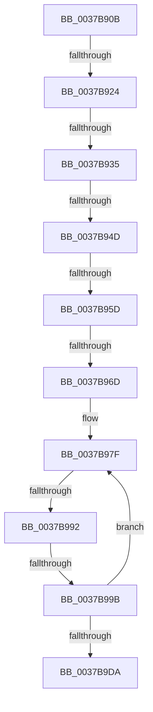

# sub_0037B90B

- RVA: `0x0037B90B`–`0x0037B9F4` (길이 `233` bytes)
- VA: `0x000000014037B90B`
- 실행 섹션: `.text`
- PDB 이름 있음: `아니요`; PDB Function 태그: `아니요`
- unwind 정보 RVA: `0x0007B150`
- 디코드: `47`개 명령, `233/233` bytes 표시
- 미해석 바이트: `0` (있으면 어셈블리에 `.byte`로 보존)

> 이 문서는 커널 이미지의 기계어와 PDB 기호를 분석해 생성했습니다. 4번과 5번은 함수 원형과 자료형을 바이너리 사용 방식에서 추정한 C 해석이며 원본 소스 복구 결과는 아닙니다.

## 1. Dependencies

- 직접 호출 지점: **0**; 고유 호출 대상: **0**
- 직접 호출자로 확인된 함수: **0**
- RIP 상대 이미지 참조: **4**

### Outgoing calls
- 직접 디코드된 call 명령이 없습니다.

### Direct callers
- 이 함수 시작 RVA로 연결되는 직접 call은 확인되지 않았습니다. 간접 호출은 완전히 역산할 수 없습니다.

### Static image references
- `0x0037B93D` → RVA `0x00378F50` (`HalpHvCounterQueryCounter`; read)
- `0x0037B94D` → RVA `0x00E11760` (`.data`; read)
- `0x0037B95D` → RVA `0x002DDBC0` (`HvlGetReferenceTimeUsingTscPage`; read)
- `0x0037B97F` → RVA `0x00FC6D88` (`ALMOSTRO`; read)

## 2. Other-region calls and transfers

- 다른 실행 섹션으로 향하는 call: **0**
- call이 아닌 외부 분기/꼬리 이동: **8**
  - `0x0037B91E` → [sub_0037BC17](Unknown_function_0037BC17.md) (`tail-transfer`)
  - `0x0037B92F` → [sub_0037BC17 + 0x120](Unknown_function_0037BC17.md) (`tail-transfer`)
  - `0x0037B947` → [sub_0037BC17 + 0x285](Unknown_function_0037BC17.md) (`tail-transfer`)
  - `0x0037B957` → [sub_0037BC17 + 0x17E](Unknown_function_0037BC17.md) (`tail-transfer`)
  - `0x0037B967` → [sub_0037BFA1 + 0x34](Unknown_function_0037BFA1.md) (`tail-transfer`)
  - `0x0037B98C` → [sub_0037BC17 + 0x154](Unknown_function_0037BC17.md) (`tail-transfer`)
  - `0x0037B995` → [sub_0037BC17 + 0x138](Unknown_function_0037BC17.md) (`tail-transfer`)
  - `0x0037B9EF` → [sub_0037B4AE + 0x8C](Unknown_function_0037B4AE.md) (`tail-transfer`)

## 3. Assembly (complete function range)

```asm
0037B90B  41 83 BD DC 00 00 00 40         cmp dword ptr [r13 + 0xdc], 0x40
0037B913  49 8B 9D C0 00 00 00            mov rbx, qword ptr [r13 + 0xc0]
0037B91A  48 89 5D 48                     mov qword ptr [rbp + 0x48], rbx
0037B91E  0F 85 F3 02 00 00               jne 0x14037bc17
0037B924  41 F7 85 E0 00 00 00 00 00 01 00  test dword ptr [r13 + 0xe0], 0x10000
0037B92F  0F 85 02 04 00 00               jne 0x14037bd37
0037B935  49 8B 4D 48                     mov rcx, qword ptr [r13 + 0x48]
0037B939  49 8B 55 70                     mov rdx, qword ptr [r13 + 0x70]
0037B93D  48 8D 05 0C D6 FF FF            lea rax, [rip - 0x29f4]
0037B944  48 3B D0                        cmp rdx, rax
0037B947  0F 85 4F 05 00 00               jne 0x14037be9c
0037B94D  48 8B 05 0C 5E A9 00            mov rax, qword ptr [rip + 0xa95e0c]
0037B954  48 85 C0                        test rax, rax
0037B957  0F 84 38 04 00 00               je 0x14037bd95
0037B95D  48 8D 0D 5C 22 F6 FF            lea rcx, [rip - 0x9dda4]
0037B964  48 3B C1                        cmp rax, rcx
0037B967  0F 85 68 06 00 00               jne 0x14037bfd5
0037B96D  4C 89 7D C8                     mov qword ptr [rbp - 0x38], r15
0037B971  49 BA 94 02 00 00 80 F7 FF FF   movabs r10, 0xfffff78000000294
0037B97B  44 89 7D 50                     mov dword ptr [rbp + 0x50], r15d
0037B97F  48 8B 05 02 B4 C4 00            mov rax, qword ptr [rip + 0xc4b402]
0037B986  44 8B 08                        mov r9d, dword ptr [rax]
0037B989  45 85 C9                        test r9d, r9d
0037B98C  0F 84 D9 03 00 00               je 0x14037bd6b
0037B992  41 38 3A                        cmp byte ptr [r10], dil
0037B995  0F 84 B4 03 00 00               je 0x14037bd4f
0037B99B  0F 01 F9                        rdtscp
0037B99E  4C 8D 45 50                     lea r8, [rbp + 0x50]
0037B9A2  41 89 08                        mov dword ptr [r8], ecx
0037B9A5  48 C1 E2 20                     shl rdx, 0x20
0037B9A9  48 0B D0                        or rdx, rax
0037B9AC  48 8B 05 D5 B3 C4 00            mov rax, qword ptr [rip + 0xc4b3d5]
0037B9B3  48 8B 40 08                     mov rax, qword ptr [rax + 8]
0037B9B7  48 8B 0D CA B3 C4 00            mov rcx, qword ptr [rip + 0xc4b3ca]
0037B9BE  48 F7 E2                        mul rdx
0037B9C1  4C 8B 41 10                     mov r8, qword ptr [rcx + 0x10]
0037B9C5  48 8B 05 BC B3 C4 00            mov rax, qword ptr [rip + 0xc4b3bc]
0037B9CC  49 03 D0                        add rdx, r8
0037B9CF  48 89 55 C8                     mov qword ptr [rbp - 0x38], rdx
0037B9D3  8B 08                           mov ecx, dword ptr [rax]
0037B9D5  41 3B C9                        cmp ecx, r9d
0037B9D8  75 A5                           jne 0x14037b97f
0037B9DA  48 8B 55 C8                     mov rdx, qword ptr [rbp - 0x38]
0037B9DE  4D 8B 85 D0 00 00 00            mov r8, qword ptr [r13 + 0xd0]
0037B9E5  41 B9 80 96 98 00               mov r9d, 0x989680
0037B9EB  4D 8D 1C 10                     lea r11, [r8 + rdx]
0037B9EF  E9 46 FB FF FF                  jmp 0x14037b53a
```

## 4. C-style interpretation (structured pseudocode)

```c
__int64 __fastcall sub_0037B90B(void)
{
    *(unsigned __int64 *)(v_rbp + 72) = *(unsigned __int64 *)(v_r13 + 192);
    *(unsigned __int64 *)(v_rbp - 56) = v_r15;
    *(unsigned int *)(v_rbp + 80) = (unsigned int)(v_r15);
loc_0037B97F:
    *(unsigned int *)(v_rbp + 80) = (unsigned int)(v_rip - 646564);
    a2 = (*(unsigned __int64 *)(v_r13 + 112)) << (32);
    a2 = (a2) | (*(unsigned __int64 *)(v_rip + 12891138));
    a2 = (a2) + (*(unsigned __int64 *)(*(unsigned __int64 *)(v_rip + 12891082) + 16));
    *(unsigned __int64 *)(v_rbp - 56) = a2;
    if (((unsigned int)((unsigned int)(*(unsigned int *)(*(unsigned __int64 *)(v_rip + 12891068))))) != ((unsigned int)((unsigned int)(*(unsigned int *)(*(unsigned __int64 *)(v_rip + 12891138)))))) goto loc_0037B97F;
}
```

## 5. (Beta) C Style

```c
void sub_0037B90B(void)
{
    *(uint64_t *)(local_rbp + 0x48) = *(uint64_t *)(local_r13 + 0xC0);
    *(uint64_t *)(local_rbp - 0x38) = local_r15;
    *(uint32_t *)(local_rbp + 0x50) = (uint32_t)(local_r15);
loc_0037B97F:
    *(uint32_t *)(local_rbp + 0x50) = (uint32_t)(v_rip - 646564);
    a2 = (*(uint64_t *)(local_r13 + 0x70)) << (32);
    a2 = (a2) | (*(uint64_t *)(v_rip + 0xC4B402));
    a2 = (a2) + (*(uint64_t *)(*(uint64_t *)(v_rip + 0xC4B3CA) + 0x10));
    *(uint64_t *)(local_rbp - 0x38) = a2;
    if (((uint32_t)((uint32_t)(*(uint32_t *)(*(uint64_t *)(v_rip + 0xC4B3BC))))) != ((uint32_t)((uint32_t)(*(uint32_t *)(*(uint64_t *)(v_rip + 0xC4B402)))))) goto loc_0037B97F;
}
```

## 6. Execution-region graph

[열기: 2D/3D 그래프와 함수 탐색 컨트롤 패널](../../../control-panel.html?section=text&rva=0x0037B90B&view=graph)

- 2D 그래프는 위에서 아래로 흐르고, 3D 그래프는 빈 공간을 드래그해 회전합니다. Shift+드래그는 이동, 휠은 확대·축소, 함수 노드 선택은 대상 보고서 이동입니다.

### Static fallback


