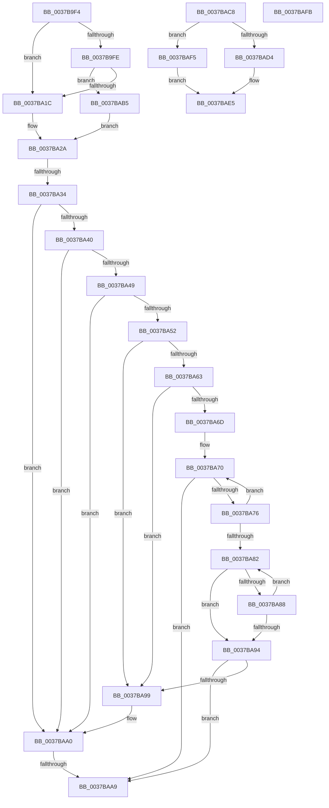

# sub_0037B9F4

- RVA: `0x0037B9F4`–`0x0037BB03` (길이 `271` bytes)
- VA: `0x000000014037B9F4`
- 실행 섹션: `.text`
- PDB 이름 있음: `아니요`; PDB Function 태그: `아니요`
- unwind 정보 RVA: `0x0007B164`
- 디코드: `67`개 명령, `271/271` bytes 표시
- 미해석 바이트: `0` (있으면 어셈블리에 `.byte`로 보존)

> 이 문서는 커널 이미지의 기계어와 PDB 기호를 분석해 생성했습니다. 4번과 5번은 함수 원형과 자료형을 바이너리 사용 방식에서 추정한 C 해석이며 원본 소스 복구 결과는 아닙니다.

## 1. Dependencies

- 직접 호출 지점: **0**; 고유 호출 대상: **0**
- 직접 호출자로 확인된 함수: **0**
- RIP 상대 이미지 참조: **0**

### Outgoing calls
- 직접 디코드된 call 명령이 없습니다.

### Direct callers
- 이 함수 시작 RVA로 연결되는 직접 call은 확인되지 않았습니다. 간접 호출은 완전히 역산할 수 없습니다.

### Static image references
- 디코드된 RIP-relative 메모리 참조가 없습니다.

## 2. Other-region calls and transfers

- 다른 실행 섹션으로 향하는 call: **0**
- call이 아닌 외부 분기/꼬리 이동: **5**
  - `0x0037BA2E` → [sub_0037B54F + 0xCF](Unknown_function_0037B54F.md) (`tail-transfer`)
  - `0x0037BAA3` → [sub_0037B54F + 0xCF](Unknown_function_0037B54F.md) (`tail-transfer`)
  - `0x0037BAB0` → [sub_0037B54F + 0xCF](Unknown_function_0037B54F.md) (`tail-transfer`)
  - `0x0037BAF0` → [sub_0037B54F + 0x243](Unknown_function_0037B54F.md) (`tail-transfer`)
  - `0x0037BAFE` → [sub_0037B54F + 0x8B](Unknown_function_0037B54F.md) (`tail-transfer`)

## 3. Assembly (complete function range)

```asm
0037B9F4  41 F7 46 74 00 04 00 00         test dword ptr [r14 + 0x74], 0x400
0037B9FC  75 1E                           jne 0x14037ba1c
0037B9FE  41 8B 86 4C 04 00 00            mov eax, dword ptr [r14 + 0x44c]
0037BA05  F3 48 0F B8 D0                  popcnt rdx, rax
0037BA0A  49 8B C3                        mov rax, r11
0037BA0D  48 C1 E8 04                     shr rax, 4
0037BA11  83 E0 1F                        and eax, 0x1f
0037BA14  3B C2                           cmp eax, edx
0037BA16  0F 82 99 00 00 00               jb 0x14037bab5
0037BA1C  44 01 86 44 86 00 00            add dword ptr [rsi + 0x8644], r8d
0037BA23  45 01 86 8C 02 00 00            add dword ptr [r14 + 0x28c], r8d
0037BA2A  4C 3B 76 18                     cmp r14, qword ptr [rsi + 0x18]
0037BA2E  0F 84 EA FB FF FF               je 0x14037b61e
0037BA34  49 8D 96 C3 00 00 00            lea rdx, [r14 + 0xc3]
0037BA3B  80 3A 10                        cmp byte ptr [rdx], 0x10
0037BA3E  7D 60                           jge 0x14037baa0
0037BA40  49 8B 46 68                     mov rax, qword ptr [r14 + 0x68]
0037BA44  48 85 C0                        test rax, rax
0037BA47  74 57                           je 0x14037baa0
0037BA49  49 8B 46 68                     mov rax, qword ptr [r14 + 0x68]
0037BA4D  48 85 C0                        test rax, rax
0037BA50  74 4E                           je 0x14037baa0
0037BA52  8B 8E D8 00 00 00               mov ecx, dword ptr [rsi + 0xd8]
0037BA58  45 8B CF                        mov r9d, r15d
0037BA5B  48 03 C8                        add rcx, rax
0037BA5E  80 3A 10                        cmp byte ptr [rdx], 0x10
0037BA61  7D 36                           jge 0x14037ba99
0037BA63  41 F7 46 78 00 02 00 00         test dword ptr [r14 + 0x78], 0x200
0037BA6B  75 2C                           jne 0x14037ba99
0037BA6D  48 8B D1                        mov rdx, rcx
0037BA70  F6 42 70 02                     test byte ptr [rdx + 0x70], 2
0037BA74  75 33                           jne 0x14037baa9
0037BA76  48 8B 92 A0 01 00 00            mov rdx, qword ptr [rdx + 0x1a0]
0037BA7D  48 85 D2                        test rdx, rdx
0037BA80  75 EE                           jne 0x14037ba70
0037BA82  44 03 49 7C                     add r9d, dword ptr [rcx + 0x7c]
0037BA86  75 0C                           jne 0x14037ba94
0037BA88  48 8B 89 A0 01 00 00            mov rcx, qword ptr [rcx + 0x1a0]
0037BA8F  48 85 C9                        test rcx, rcx
0037BA92  75 EE                           jne 0x14037ba82
0037BA94  45 85 C9                        test r9d, r9d
0037BA97  75 10                           jne 0x14037baa9
0037BA99  49 8D 96 C3 00 00 00            lea rdx, [r14 + 0xc3]
0037BAA0  80 3A 08                        cmp byte ptr [rdx], 8
0037BAA3  0F 8D 75 FB FF FF               jge 0x14037b61e
0037BAA9  44 01 86 6C 86 00 00            add dword ptr [rsi + 0x866c], r8d
0037BAB0  E9 69 FB FF FF                  jmp 0x14037b61e
0037BAB5  44 01 86 48 86 00 00            add dword ptr [rsi + 0x8648], r8d
0037BABC  45 01 86 DC 02 00 00            add dword ptr [r14 + 0x2dc], r8d
0037BAC3  E9 62 FF FF FF                  jmp 0x14037ba2a
0037BAC8  8B D0                           mov edx, eax
0037BACA  89 45 D0                        mov dword ptr [rbp - 0x30], eax
0037BACD  2B D1                           sub edx, ecx
0037BACF  83 FA 20                        cmp edx, 0x20
0037BAD2  73 21                           jae 0x14037baf5
0037BAD4  41 8B 80 C4 00 00 00            mov eax, dword ptr [r8 + 0xc4]
0037BADB  8B CA                           mov ecx, edx
0037BADD  D3 E0                           shl eax, cl
0037BADF  41 0B C4                        or eax, r12d
0037BAE2  89 45 D4                        mov dword ptr [rbp - 0x2c], eax
0037BAE5  48 8B 45 D0                     mov rax, qword ptr [rbp - 0x30]
0037BAE9  49 89 80 C0 00 00 00            mov qword ptr [r8 + 0xc0], rax
0037BAF0  E9 9D FC FF FF                  jmp 0x14037b792
0037BAF5  44 89 65 D4                     mov dword ptr [rbp - 0x2c], r12d
0037BAF9  EB EA                           jmp 0x14037bae5
0037BAFB  48 F7 E2                        mul rdx
0037BAFE  E9 D7 FA FF FF                  jmp 0x14037b5da
```

## 4. C-style interpretation (structured pseudocode)

```c
__int64 __fastcall sub_0037B9F4(__int64 a1, __int64 a2, __int64 a3)
{
    __int64 result;

    if (((*(unsigned int *)(v_r14 + 116)) & (0x400ULL)) != 0) goto loc_0037BA1C;
    result = (v_r11) >> (4);
    result = (unsigned int)((result) & (31));
    if (((unsigned int)(result)) < ((unsigned int)(a2))) goto loc_0037BAB5;
loc_0037BA1C:
loc_0037BA2A:
    if ((*(unsigned __int8 *)(v_r14 + 195)) >= 16) goto loc_0037BAA0;
    if (*(unsigned __int64 *)(v_r14 + 104) == 0) goto loc_0037BAA0;
    if (*(unsigned __int64 *)(v_r14 + 104) == 0) goto loc_0037BAA0;
    a1 = ((unsigned int)(*(unsigned int *)(v_rsi + 216))) + (*(unsigned __int64 *)(v_r14 + 104));
    if ((*(unsigned __int8 *)(v_r14 + 195)) >= 16) goto loc_0037BA99;
    if (((*(unsigned int *)(v_r14 + 120)) & (512)) != 0) goto loc_0037BA99;
loc_0037BA70:
    if (((*(unsigned __int8 *)(a1 + 112)) & (2)) != 0) goto loc_0037BAA9;
    if (*(unsigned __int64 *)(a1 + 416) != 0) goto loc_0037BA70;
loc_0037BA82:
    a4 = (unsigned int)(((unsigned int)((unsigned int)(v_r15))) + (*(unsigned int *)(a1 + 124)));
    if (condition_is_not_equal) goto loc_0037BA94;
    if (*(unsigned __int64 *)(a1 + 416) != 0) goto loc_0037BA82;
loc_0037BA94:
    if ((unsigned int)(a4) != 0) goto loc_0037BAA9;
loc_0037BA99:
loc_0037BAA0:
loc_0037BAA9:
loc_0037BAB5:
    goto loc_0037BA2A;
}
```

## 5. (Beta) C Style

```c
int64_t sub_0037B9F4(int64_t Arg1, int64_t Arg2, int64_t Arg3)
{
    int64_t result;

    if (((*(uint32_t *)(local_r14 + 0x74)) & (0x400ULL)) != 0) goto loc_0037BA1C;
    result = (local_r11) >> (4);
    result = (uint32_t)((result) & (31));
    if (((uint32_t)(result)) < ((uint32_t)(Arg2))) goto loc_0037BAB5;
loc_0037BA1C:
loc_0037BA2A:
    if ((*(uint8_t *)(local_r14 + 0xC3)) >= 16) goto loc_0037BAA0;
    if (*(uint64_t *)(local_r14 + 0x68) == 0) goto loc_0037BAA0;
    if (*(uint64_t *)(local_r14 + 0x68) == 0) goto loc_0037BAA0;
    Arg1 = ((uint32_t)(*(uint32_t *)(local_rsi + 0xD8))) + (*(uint64_t *)(local_r14 + 0x68));
    if ((*(uint8_t *)(local_r14 + 0xC3)) >= 16) goto loc_0037BA99;
    if (((*(uint32_t *)(local_r14 + 0x78)) & (512)) != 0) goto loc_0037BA99;
loc_0037BA70:
    if (((*(uint8_t *)(Arg1 + 0x70)) & (2)) != 0) goto loc_0037BAA9;
    if (*(uint64_t *)(Arg1 + 0x1A0) != 0) goto loc_0037BA70;
loc_0037BA82:
    a4 = (uint32_t)(((uint32_t)((uint32_t)(local_r15))) + (*(uint32_t *)(Arg1 + 0x7C)));
    if (condition_is_not_equal) goto loc_0037BA94;
    if (*(uint64_t *)(Arg1 + 0x1A0) != 0) goto loc_0037BA82;
loc_0037BA94:
    if ((uint32_t)(a4) != 0) goto loc_0037BAA9;
loc_0037BA99:
loc_0037BAA0:
loc_0037BAA9:
loc_0037BAB5:
    goto loc_0037BA2A;
}
```

## 6. Execution-region graph

[열기: 2D/3D 그래프와 함수 탐색 컨트롤 패널](../../../control-panel.html?section=text&rva=0x0037B9F4&view=graph)

- 2D 그래프는 위에서 아래로 흐르고, 3D 그래프는 빈 공간을 드래그해 회전합니다. Shift+드래그는 이동, 휠은 확대·축소, 함수 노드 선택은 대상 보고서 이동입니다.

### Static fallback


