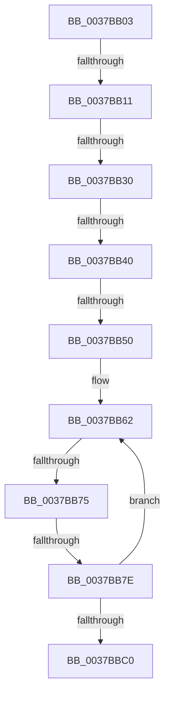

# sub_0037BB03

- RVA: `0x0037BB03`–`0x0037BBE9` (길이 `230` bytes)
- VA: `0x000000014037BB03`
- 실행 섹션: `.text`
- PDB 이름 있음: `아니요`; PDB Function 태그: `아니요`
- unwind 정보 RVA: `0x0007B174`
- 디코드: `50`개 명령, `230/230` bytes 표시
- 미해석 바이트: `0` (있으면 어셈블리에 `.byte`로 보존)

> 이 문서는 커널 이미지의 기계어와 PDB 기호를 분석해 생성했습니다. 4번과 5번은 함수 원형과 자료형을 바이너리 사용 방식에서 추정한 C 해석이며 원본 소스 복구 결과는 아닙니다.

## 1. Dependencies

- 직접 호출 지점: **2**; 고유 호출 대상: **2**
- 직접 호출자로 확인된 함수: **0**
- RIP 상대 이미지 참조: **4**

### Outgoing calls
- `0x0037BB14` → [HalpTimerGetInternalData](../20/HalpTimerGetInternalData_function_00209500.md) (function, `0x00209500`)
- `0x0037BBD9` → [HalpTimerScaleCounter](HalpTimerScaleCounter_function_0037B354.md) (function, `0x0037B354`)

### Direct callers
- 이 함수 시작 RVA로 연결되는 직접 call은 확인되지 않았습니다. 간접 호출은 완전히 역산할 수 없습니다.

### Static image references
- `0x0037BB20` → RVA `0x00378F50` (`HalpHvCounterQueryCounter`; read)
- `0x0037BB30` → RVA `0x00E11760` (`.data`; read)
- `0x0037BB40` → RVA `0x002DDBC0` (`HvlGetReferenceTimeUsingTscPage`; read)
- `0x0037BB62` → RVA `0x00FC6D88` (`ALMOSTRO`; read)

## 2. Other-region calls and transfers

- 다른 실행 섹션으로 향하는 call: **0**
- call이 아닌 외부 분기/꼬리 이동: **7**
  - `0x0037BB0B` → [sub_0037BC17 + 0x191](Unknown_function_0037BC17.md) (`tail-transfer`)
  - `0x0037BB2A` → [sub_0037BC17 + 0x2EE](Unknown_function_0037BC17.md) (`tail-transfer`)
  - `0x0037BB3A` → [sub_0037BC17 + 0x2DB](Unknown_function_0037BC17.md) (`tail-transfer`)
  - `0x0037BB4A` → [sub_0037BFA1 + 0xD](Unknown_function_0037BFA1.md) (`tail-transfer`)
  - `0x0037BB6F` → [sub_0037BC17 + 0x2C8](Unknown_function_0037BC17.md) (`tail-transfer`)
  - `0x0037BB78` → [sub_0037BC17 + 0x295](Unknown_function_0037BC17.md) (`tail-transfer`)
  - `0x0037BBE4` → [sub_0037B4AE + 0x8C](Unknown_function_0037B4AE.md) (`tail-transfer`)

## 3. Assembly (complete function range)

```asm
0037BB03  41 83 BD DC 00 00 00 40         cmp dword ptr [r13 + 0xdc], 0x40
0037BB0B  0F 85 97 02 00 00               jne 0x14037bda8
0037BB11  49 8B CD                        mov rcx, r13
0037BB14  E8 E7 D9 E8 FF                  call 0x140209500
0037BB19  49 8B 55 70                     mov rdx, qword ptr [r13 + 0x70]
0037BB1D  48 8B C8                        mov rcx, rax
0037BB20  48 8D 05 29 D4 FF FF            lea rax, [rip - 0x2bd7]
0037BB27  48 3B D0                        cmp rdx, rax
0037BB2A  0F 85 D5 03 00 00               jne 0x14037bf05
0037BB30  48 8B 05 29 5C A9 00            mov rax, qword ptr [rip + 0xa95c29]
0037BB37  48 85 C0                        test rax, rax
0037BB3A  0F 84 B2 03 00 00               je 0x14037bef2
0037BB40  48 8D 0D 79 20 F6 FF            lea rcx, [rip - 0x9df87]
0037BB47  48 3B C1                        cmp rax, rcx
0037BB4A  0F 85 5E 04 00 00               jne 0x14037bfae
0037BB50  4C 89 7D C0                     mov qword ptr [rbp - 0x40], r15
0037BB54  49 BA 94 02 00 00 80 F7 FF FF   movabs r10, 0xfffff78000000294
0037BB5E  44 89 7D 48                     mov dword ptr [rbp + 0x48], r15d
0037BB62  48 8B 05 1F B2 C4 00            mov rax, qword ptr [rip + 0xc4b21f]
0037BB69  44 8B 08                        mov r9d, dword ptr [rax]
0037BB6C  45 85 C9                        test r9d, r9d
0037BB6F  0F 84 6A 03 00 00               je 0x14037bedf
0037BB75  41 38 3A                        cmp byte ptr [r10], dil
0037BB78  0F 84 2E 03 00 00               je 0x14037beac
0037BB7E  0F 01 F9                        rdtscp
0037BB81  4C 8D 45 48                     lea r8, [rbp + 0x48]
0037BB85  41 89 08                        mov dword ptr [r8], ecx
0037BB88  48 C1 E2 20                     shl rdx, 0x20
0037BB8C  48 0B D0                        or rdx, rax
0037BB8F  48 8B 05 F2 B1 C4 00            mov rax, qword ptr [rip + 0xc4b1f2]
0037BB96  48 8B 48 08                     mov rcx, qword ptr [rax + 8]
0037BB9A  48 8B 05 E7 B1 C4 00            mov rax, qword ptr [rip + 0xc4b1e7]
0037BBA1  4C 8B 40 10                     mov r8, qword ptr [rax + 0x10]
0037BBA5  48 8B C1                        mov rax, rcx
0037BBA8  48 F7 E2                        mul rdx
0037BBAB  48 8B 05 D6 B1 C4 00            mov rax, qword ptr [rip + 0xc4b1d6]
0037BBB2  49 03 D0                        add rdx, r8
0037BBB5  48 89 55 C0                     mov qword ptr [rbp - 0x40], rdx
0037BBB9  8B 08                           mov ecx, dword ptr [rax]
0037BBBB  41 3B C9                        cmp ecx, r9d
0037BBBE  75 A2                           jne 0x14037bb62
0037BBC0  48 8B 55 C0                     mov rdx, qword ptr [rbp - 0x40]
0037BBC4  4D 8B 9D D0 00 00 00            mov r11, qword ptr [r13 + 0xd0]
0037BBCB  49 8D 0C 13                     lea rcx, [r11 + rdx]
0037BBCF  4C 8B C3                        mov r8, rbx
0037BBD2  49 8B 95 C0 00 00 00            mov rdx, qword ptr [r13 + 0xc0]
0037BBD9  E8 76 F7 FF FF                  call 0x14037b354
0037BBDE  4C 8B D8                        mov r11, rax
0037BBE1  4C 8B CB                        mov r9, rbx
0037BBE4  E9 51 F9 FF FF                  jmp 0x14037b53a
```

## 4. C-style interpretation (structured pseudocode)

```c
__int64 __fastcall sub_0037BB03(void)
{
    __int64 result;

    result = HalpTimerGetInternalData(v_r13, a2, a3, a4);
    *(unsigned __int64 *)(v_rbp - 64) = v_r15;
    *(unsigned int *)(v_rbp + 72) = (unsigned int)(v_r15);
loc_0037BB62:
    *(unsigned int *)(v_rbp + 72) = (unsigned int)(v_rip - 647047);
    a2 = (*(unsigned __int64 *)(v_r13 + 112)) << (32);
    a2 = (a2) | (*(unsigned __int64 *)(v_rip + 12890655));
    a2 = (a2) + (*(unsigned __int64 *)(*(unsigned __int64 *)(v_rip + 12890599) + 16));
    *(unsigned __int64 *)(v_rbp - 64) = a2;
    if (((unsigned int)((unsigned int)(*(unsigned int *)(*(unsigned __int64 *)(v_rip + 12890582))))) != ((unsigned int)((unsigned int)(*(unsigned int *)(*(unsigned __int64 *)(v_rip + 12890655)))))) goto loc_0037BB62;
    result = HalpTimerScaleCounter(*(unsigned __int64 *)(v_r13 + 208) + *(unsigned __int64 *)(v_rbp - 64) * 1, *(unsigned __int64 *)(v_r13 + 192), v_rbx, (unsigned int)(*(unsigned int *)(*(unsigned __int64 *)(v_rip + 12890655))));
}
```

## 5. (Beta) C Style

```c
void sub_0037BB03(void)
{
    int64_t result;

    result = HalpTimerGetInternalData(local_r13, a2, a3, a4);
    *(uint64_t *)(local_rbp - 0x40) = local_r15;
    *(uint32_t *)(local_rbp + 0x48) = (uint32_t)(local_r15);
loc_0037BB62:
    *(uint32_t *)(local_rbp + 0x48) = (uint32_t)(v_rip - 647047);
    a2 = (*(uint64_t *)(local_r13 + 0x70)) << (32);
    a2 = (a2) | (*(uint64_t *)(v_rip + 0xC4B21F));
    a2 = (a2) + (*(uint64_t *)(*(uint64_t *)(v_rip + 0xC4B1E7) + 0x10));
    *(uint64_t *)(local_rbp - 0x40) = a2;
    if (((uint32_t)((uint32_t)(*(uint32_t *)(*(uint64_t *)(v_rip + 0xC4B1D6))))) != ((uint32_t)((uint32_t)(*(uint32_t *)(*(uint64_t *)(v_rip + 0xC4B21F)))))) goto loc_0037BB62;
    result = HalpTimerScaleCounter(*(uint64_t *)(local_r13 + 0xD0) + *(uint64_t *)(local_rbp - 0x40) * 1, *(uint64_t *)(local_r13 + 0xC0), local_rbx, (uint32_t)(*(uint32_t *)(*(uint64_t *)(v_rip + 0xC4B21F))));
}
```

## 6. Execution-region graph

[열기: 2D/3D 그래프와 함수 탐색 컨트롤 패널](../../../control-panel.html?section=text&rva=0x0037BB03&view=graph)

- 2D 그래프는 위에서 아래로 흐르고, 3D 그래프는 빈 공간을 드래그해 회전합니다. Shift+드래그는 이동, 휠은 확대·축소, 함수 노드 선택은 대상 보고서 이동입니다.

### Static fallback


