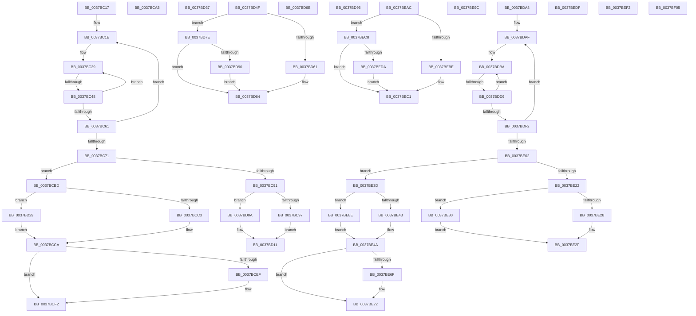

# sub_0037BC17

- RVA: `0x0037BC17`–`0x0037BF15` (길이 `766` bytes)
- VA: `0x000000014037BC17`
- 실행 섹션: `.text`
- PDB 이름 있음: `아니요`; PDB Function 태그: `아니요`
- unwind 정보 RVA: `0x0007B198`
- 디코드: `190`개 명령, `766/766` bytes 표시
- 미해석 바이트: `0` (있으면 어셈블리에 `.byte`로 보존)

> 이 문서는 커널 이미지의 기계어와 PDB 기호를 분석해 생성했습니다. 4번과 5번은 함수 원형과 자료형을 바이너리 사용 방식에서 추정한 C 해석이며 원본 소스 복구 결과는 아닙니다.

## 1. Dependencies

- 직접 호출 지점: **8**; 고유 호출 대상: **4**
- 직접 호출자로 확인된 함수: **0**
- RIP 상대 이미지 참조: **1**

### Outgoing calls
- `0x0037BC33` → [HalpTimerGetInternalData](../20/HalpTimerGetInternalData_function_00209500.md) (function, `0x00209500`)
- `0x0037BC48` → [HalpHpetQueryCounter](HalpHpetQueryCounter_function_00379660.md) (function, `0x00379660`)
- `0x0037BD74` → [HvlpGetRegister64](HvlpGetRegister64_function_00379050.md) (function, `0x00379050`)
- `0x0037BDC4` → [HalpTimerGetInternalData](../20/HalpTimerGetInternalData_function_00209500.md) (function, `0x00209500`)
- `0x0037BDD9` → [HalpHpetQueryCounter](HalpHpetQueryCounter_function_00379660.md) (function, `0x00379660`)
- `0x0037BE9F` → [guard_dispatch_icall](../6B/guard_dispatch_icall_function_006BAAD0.md) (function, `0x006BAAD0`)
- `0x0037BEE8` → [HvlpGetRegister64](HvlpGetRegister64_function_00379050.md) (function, `0x00379050`)
- `0x0037BF08` → [guard_dispatch_icall](../6B/guard_dispatch_icall_function_006BAAD0.md) (function, `0x006BAAD0`)

### Direct callers
- 이 함수 시작 RVA로 연결되는 직접 call은 확인되지 않았습니다. 간접 호출은 완전히 역산할 수 없습니다.

### Static image references
- `0x0037BC17` → RVA `0x00379660` (`HalpHpetQueryCounter`; read)

## 2. Other-region calls and transfers

- 다른 실행 섹션으로 향하는 call: **0**
- call이 아닌 외부 분기/꼬리 이동: **16**
  - `0x0037BC42` → [sub_0037BFA1 + 0x27](Unknown_function_0037BFA1.md) (`tail-transfer`)
  - `0x0037BCB8` → [sub_0037B4AE + 0x45](Unknown_function_0037B4AE.md) (`tail-transfer`)
  - `0x0037BD05` → [sub_0037B4AE + 0x8C](Unknown_function_0037B4AE.md) (`tail-transfer`)
  - `0x0037BD24` → [sub_0037B4AE + 0x8C](Unknown_function_0037B4AE.md) (`tail-transfer`)
  - `0x0037BD4A` → [sub_0037B90B + 0x2E](Unknown_function_0037B90B.md) (`tail-transfer`)
  - `0x0037BD66` → [sub_0037B90B + 0x9A](Unknown_function_0037B90B.md) (`tail-transfer`)
  - `0x0037BD79` → [sub_0037B90B + 0xCF](Unknown_function_0037B90B.md) (`tail-transfer`)
  - `0x0037BDA3` → [sub_0037B90B + 0xD3](Unknown_function_0037B90B.md) (`tail-transfer`)
  - `0x0037BDD3` → [sub_0037BFA1](Unknown_function_0037BFA1.md) (`tail-transfer`)
  - `0x0037BE38` → [sub_0037BB03 + 0xC8](Unknown_function_0037BB03.md) (`tail-transfer`)
  - `0x0037BE7B` → [sub_0037BB03 + 0xC8](Unknown_function_0037BB03.md) (`tail-transfer`)
  - `0x0037BEA7` → [sub_0037B90B + 0xD3](Unknown_function_0037B90B.md) (`tail-transfer`)
  - `0x0037BEC3` → [sub_0037BB03 + 0x85](Unknown_function_0037BB03.md) (`tail-transfer`)
  - `0x0037BEED` → [sub_0037BB03 + 0xBD](Unknown_function_0037BB03.md) (`tail-transfer`)
  - `0x0037BF00` → [sub_0037BB03 + 0xC1](Unknown_function_0037BB03.md) (`tail-transfer`)
  - `0x0037BF10` → [sub_0037BB03 + 0xC1](Unknown_function_0037BB03.md) (`tail-transfer`)

## 3. Assembly (complete function range)

```asm
0037BC17  48 8D 1D 42 DA FF FF            lea rbx, [rip - 0x25be]
0037BC1E  49 8B 85 D0 00 00 00            mov rax, qword ptr [r13 + 0xd0]
0037BC25  48 89 45 D0                     mov qword ptr [rbp - 0x30], rax
0037BC29  49 8B BD C8 00 00 00            mov rdi, qword ptr [r13 + 0xc8]
0037BC30  49 8B CD                        mov rcx, r13
0037BC33  E8 C8 D8 E8 FF                  call 0x140209500
0037BC38  49 8B 55 70                     mov rdx, qword ptr [r13 + 0x70]
0037BC3C  48 8B C8                        mov rcx, rax
0037BC3F  48 3B D3                        cmp rdx, rbx
0037BC42  0F 85 80 03 00 00               jne 0x14037bfc8
0037BC48  E8 13 DA FF FF                  call 0x140379660
0037BC4D  4C 8B D8                        mov r11, rax
0037BC50  F0 44 09 3C 24                  lock or dword ptr [rsp], r15d
0037BC55  49 8B 85 C8 00 00 00            mov rax, qword ptr [r13 + 0xc8]
0037BC5C  48 3B F8                        cmp rdi, rax
0037BC5F  75 C8                           jne 0x14037bc29
0037BC61  49 8B 8D D0 00 00 00            mov rcx, qword ptr [r13 + 0xd0]
0037BC68  4C 8B 45 D0                     mov r8, qword ptr [rbp - 0x30]
0037BC6C  4C 3B C1                        cmp r8, rcx
0037BC6F  75 AD                           jne 0x14037bc1e
0037BC71  45 8B 95 DC 00 00 00            mov r10d, dword ptr [r13 + 0xdc]
0037BC78  49 8B D4                        mov rdx, r12
0037BC7B  48 8B 5D 48                     mov rbx, qword ptr [rbp + 0x48]
0037BC7F  41 8D 4A FF                     lea ecx, [r10 - 1]
0037BC83  48 D3 E2                        shl rdx, cl
0037BC86  49 8B CB                        mov rcx, r11
0037BC89  48 33 CF                        xor rcx, rdi
0037BC8C  48 85 CA                        test rdx, rcx
0037BC8F  75 2C                           jne 0x14037bcbd
0037BC91  41 83 FA 40                     cmp r10d, 0x40
0037BC95  74 73                           je 0x14037bd0a
0037BC97  41 8B CA                        mov ecx, r10d
0037BC9A  49 8B D4                        mov rdx, r12
0037BC9D  48 D3 E2                        shl rdx, cl
0037BCA0  48 FF CA                        dec rdx
0037BCA3  EB 6C                           jmp 0x14037bd11
0037BCA5  65 8B 04 25 A4 01 00 00         mov eax, dword ptr gs:[0x1a4]
0037BCAD  41 0F AF 45 50                  imul eax, dword ptr [r13 + 0x50]
0037BCB2  8B C8                           mov ecx, eax
0037BCB4  49 03 4D 48                     add rcx, qword ptr [r13 + 0x48]
0037BCB8  E9 36 F8 FF FF                  jmp 0x14037b4f3
0037BCBD  41 83 FA 40                     cmp r10d, 0x40
0037BCC1  75 66                           jne 0x14037bd29
0037BCC3  49 C7 C1 FF FF FF FF            mov r9, 0xffffffffffffffff
0037BCCA  41 8B CA                        mov ecx, r10d
0037BCCD  49 8B D4                        mov rdx, r12
0037BCD0  48 D3 E2                        shl rdx, cl
0037BCD3  49 8B CF                        mov rcx, r15
0037BCD6  41 83 FA 40                     cmp r10d, 0x40
0037BCDA  48 0F 45 CA                     cmovne rcx, rdx
0037BCDE  4C 23 CF                        and r9, rdi
0037BCE1  49 8B D1                        mov rdx, r9
0037BCE4  48 33 D7                        xor rdx, rdi
0037BCE7  49 0B D3                        or rdx, r11
0037BCEA  4D 3B D9                        cmp r11, r9
0037BCED  73 03                           jae 0x14037bcf2
0037BCEF  48 03 D1                        add rdx, rcx
0037BCF2  F0 49 0F B1 95 C8 00 00 00      lock cmpxchg qword ptr [r13 + 0xc8], rdx
0037BCFB  4D 8D 1C 10                     lea r11, [r8 + rdx]
0037BCFF  41 B9 80 96 98 00               mov r9d, 0x989680
0037BD05  E9 30 F8 FF FF                  jmp 0x14037b53a
0037BD0A  48 C7 C2 FF FF FF FF            mov rdx, 0xffffffffffffffff
0037BD11  48 F7 D2                        not rdx
0037BD14  41 B9 80 96 98 00               mov r9d, 0x989680
0037BD1A  48 23 D7                        and rdx, rdi
0037BD1D  49 0B D3                        or rdx, r11
0037BD20  4D 8D 1C 10                     lea r11, [r8 + rdx]
0037BD24  E9 11 F8 FF FF                  jmp 0x14037b53a
0037BD29  41 8B CA                        mov ecx, r10d
0037BD2C  4D 8B CC                        mov r9, r12
0037BD2F  49 D3 E1                        shl r9, cl
0037BD32  49 FF C9                        dec r9
0037BD35  EB 93                           jmp 0x14037bcca
0037BD37  65 8B 04 25 A4 01 00 00         mov eax, dword ptr gs:[0x1a4]
0037BD3F  41 0F AF 45 50                  imul eax, dword ptr [r13 + 0x50]
0037BD44  8B C8                           mov ecx, eax
0037BD46  49 03 4D 48                     add rcx, qword ptr [r13 + 0x48]
0037BD4A  E9 EA FB FF FF                  jmp 0x14037b939
0037BD4F  65 48 8B 04 25 20 00 00 00      mov rax, qword ptr gs:[0x20]
0037BD58  80 B8 8D 00 00 00 02            cmp byte ptr [rax + 0x8d], 2
0037BD5F  75 1D                           jne 0x14037bd7e
0037BD61  0F AE E8                        lfence
0037BD64  0F 31                           rdtsc
0037BD66  E9 3A FC FF FF                  jmp 0x14037b9a5
0037BD6B  48 8D 55 C8                     lea rdx, [rbp - 0x38]
0037BD6F  B9 04 00 09 00                  mov ecx, 0x90004
0037BD74  E8 D7 D2 FF FF                  call 0x140379050
0037BD79  E9 5C FC FF FF                  jmp 0x14037b9da
0037BD7E  65 48 8B 04 25 20 00 00 00      mov rax, qword ptr gs:[0x20]
0037BD87  44 38 A0 8D 00 00 00            cmp byte ptr [rax + 0x8d], r12b
0037BD8E  75 D4                           jne 0x14037bd64
0037BD90  0F AE F0                        mfence
0037BD93  EB CF                           jmp 0x14037bd64
0037BD95  B9 20 00 00 40                  mov ecx, 0x40000020
0037BD9A  0F 32                           rdmsr
0037BD9C  48 C1 E2 20                     shl rdx, 0x20
0037BDA0  48 0B D0                        or rdx, rax
0037BDA3  E9 36 FC FF FF                  jmp 0x14037b9de
0037BDA8  4C 8D 35 B1 D8 FF FF            lea r14, [rip - 0x274f]
0037BDAF  49 8B 85 D0 00 00 00            mov rax, qword ptr [r13 + 0xd0]
0037BDB6  48 89 45 D0                     mov qword ptr [rbp - 0x30], rax
0037BDBA  49 8B BD C8 00 00 00            mov rdi, qword ptr [r13 + 0xc8]
0037BDC1  49 8B CD                        mov rcx, r13
0037BDC4  E8 37 D7 E8 FF                  call 0x140209500
0037BDC9  49 8B 55 70                     mov rdx, qword ptr [r13 + 0x70]
0037BDCD  48 8B C8                        mov rcx, rax
0037BDD0  49 3B D6                        cmp rdx, r14
0037BDD3  0F 85 C8 01 00 00               jne 0x14037bfa1
0037BDD9  E8 82 D8 FF FF                  call 0x140379660
0037BDDE  4C 8B D0                        mov r10, rax
0037BDE1  F0 44 09 3C 24                  lock or dword ptr [rsp], r15d
0037BDE6  49 8B 85 C8 00 00 00            mov rax, qword ptr [r13 + 0xc8]
0037BDED  48 3B F8                        cmp rdi, rax
0037BDF0  75 C8                           jne 0x14037bdba
0037BDF2  49 8B 8D D0 00 00 00            mov rcx, qword ptr [r13 + 0xd0]
0037BDF9  4C 8B 5D D0                     mov r11, qword ptr [rbp - 0x30]
0037BDFD  4C 3B D9                        cmp r11, rcx
0037BE00  75 AD                           jne 0x14037bdaf
0037BE02  45 8B 85 DC 00 00 00            mov r8d, dword ptr [r13 + 0xdc]
0037BE09  49 8B D4                        mov rdx, r12
0037BE0C  4C 8B 75 48                     mov r14, qword ptr [rbp + 0x48]
0037BE10  41 8D 48 FF                     lea ecx, [r8 - 1]
0037BE14  48 D3 E2                        shl rdx, cl
0037BE17  49 8B CA                        mov rcx, r10
0037BE1A  48 33 CF                        xor rcx, rdi
0037BE1D  48 85 CA                        test rdx, rcx
0037BE20  75 1B                           jne 0x14037be3d
0037BE22  41 83 F8 40                     cmp r8d, 0x40
0037BE26  75 58                           jne 0x14037be80
0037BE28  48 C7 C2 FF FF FF FF            mov rdx, 0xffffffffffffffff
0037BE2F  48 F7 D2                        not rdx
0037BE32  48 23 D7                        and rdx, rdi
0037BE35  49 0B D2                        or rdx, r10
0037BE38  E9 8E FD FF FF                  jmp 0x14037bbcb
0037BE3D  41 83 F8 40                     cmp r8d, 0x40
0037BE41  75 4B                           jne 0x14037be8e
0037BE43  49 C7 C1 FF FF FF FF            mov r9, 0xffffffffffffffff
0037BE4A  41 8B C8                        mov ecx, r8d
0037BE4D  49 8B D4                        mov rdx, r12
0037BE50  48 D3 E2                        shl rdx, cl
0037BE53  49 8B CF                        mov rcx, r15
0037BE56  41 83 F8 40                     cmp r8d, 0x40
0037BE5A  48 0F 45 CA                     cmovne rcx, rdx
0037BE5E  4C 23 CF                        and r9, rdi
0037BE61  49 8B D1                        mov rdx, r9
0037BE64  48 33 D7                        xor rdx, rdi
0037BE67  49 0B D2                        or rdx, r10
0037BE6A  4D 3B D1                        cmp r10, r9
0037BE6D  73 03                           jae 0x14037be72
0037BE6F  48 03 D1                        add rdx, rcx
0037BE72  F0 49 0F B1 95 C8 00 00 00      lock cmpxchg qword ptr [r13 + 0xc8], rdx
0037BE7B  E9 4B FD FF FF                  jmp 0x14037bbcb
0037BE80  41 8B C8                        mov ecx, r8d
0037BE83  49 8B D4                        mov rdx, r12
0037BE86  48 D3 E2                        shl rdx, cl
0037BE89  48 FF CA                        dec rdx
0037BE8C  EB A1                           jmp 0x14037be2f
0037BE8E  41 8B C8                        mov ecx, r8d
0037BE91  4D 8B CC                        mov r9, r12
0037BE94  49 D3 E1                        shl r9, cl
0037BE97  49 FF C9                        dec r9
0037BE9A  EB AE                           jmp 0x14037be4a
0037BE9C  48 8B C2                        mov rax, rdx
0037BE9F  E8 2C EC 33 00                  call 0x1406baad0
0037BEA4  48 8B D0                        mov rdx, rax
0037BEA7  E9 32 FB FF FF                  jmp 0x14037b9de
0037BEAC  65 48 8B 04 25 20 00 00 00      mov rax, qword ptr gs:[0x20]
0037BEB5  80 B8 8D 00 00 00 02            cmp byte ptr [rax + 0x8d], 2
0037BEBC  75 0A                           jne 0x14037bec8
0037BEBE  0F AE E8                        lfence
0037BEC1  0F 31                           rdtsc
0037BEC3  E9 C0 FC FF FF                  jmp 0x14037bb88
0037BEC8  65 48 8B 04 25 20 00 00 00      mov rax, qword ptr gs:[0x20]
0037BED1  44 38 A0 8D 00 00 00            cmp byte ptr [rax + 0x8d], r12b
0037BED8  75 E7                           jne 0x14037bec1
0037BEDA  0F AE F0                        mfence
0037BEDD  EB E2                           jmp 0x14037bec1
0037BEDF  48 8D 55 C0                     lea rdx, [rbp - 0x40]
0037BEE3  B9 04 00 09 00                  mov ecx, 0x90004
0037BEE8  E8 63 D1 FF FF                  call 0x140379050
0037BEED  E9 CE FC FF FF                  jmp 0x14037bbc0
0037BEF2  B9 20 00 00 40                  mov ecx, 0x40000020
0037BEF7  0F 32                           rdmsr
0037BEF9  48 C1 E2 20                     shl rdx, 0x20
0037BEFD  48 0B D0                        or rdx, rax
0037BF00  E9 BF FC FF FF                  jmp 0x14037bbc4
0037BF05  48 8B C2                        mov rax, rdx
0037BF08  E8 C3 EB 33 00                  call 0x1406baad0
0037BF0D  48 8B D0                        mov rdx, rax
0037BF10  E9 AF FC FF FF                  jmp 0x14037bbc4
```

## 4. C-style interpretation (structured pseudocode)

```c
__int64 __fastcall sub_0037BC17(void)
{
    __int64 result;
    unsigned int v_stack_p0;

loc_0037BC1E:
    *(unsigned __int64 *)(v_rbp - 48) = *(unsigned __int64 *)(v_r13 + 208);
loc_0037BC29:
    result = HalpTimerGetInternalData(v_r13, a2, a3, a4);
    result = HalpHpetQueryCounter(result, *(unsigned __int64 *)(v_r13 + 112), a3, a4);
    if ((*(unsigned __int64 *)(v_r13 + 200)) != (*(unsigned __int64 *)(v_r13 + 200))) goto loc_0037BC29;
    if ((*(unsigned __int64 *)(v_rbp - 48)) != (*(unsigned __int64 *)(v_r13 + 208))) goto loc_0037BC1E;
    a2 = (v_r12) << ((unsigned __int8)((unsigned int)(*(unsigned int *)(v_r13 + 220)) - 1));
    a1 = (result) ^ (*(unsigned __int64 *)(v_r13 + 200));
    if (((a2) & (a1)) != 0) goto loc_0037BCBD;
    if (((unsigned int)((unsigned int)(*(unsigned int *)(v_r13 + 220)))) == 64) goto loc_0037BD0A;
    a2 = (v_r12) << ((unsigned __int8)((unsigned int)((unsigned int)((unsigned int)(*(unsigned int *)(v_r13 + 220))))));
    a2 = (a2) - 1;
    goto loc_0037BD11;
loc_0037BCBD:
    if (((unsigned int)((unsigned int)(*(unsigned int *)(v_r13 + 220)))) != 64) goto loc_0037BD29;
loc_0037BCCA:
    a2 = (v_r12) << ((unsigned __int8)((unsigned int)((unsigned int)((unsigned int)(*(unsigned int *)(v_r13 + 220))))));
    a1 = v_r15;
    if (((unsigned int)((unsigned int)(*(unsigned int *)(v_r13 + 220)))) != 64) { a1 = a2; }
    a4 = (-1) & (*(unsigned __int64 *)(v_r13 + 200));
    a2 = (a4) ^ (*(unsigned __int64 *)(v_r13 + 200));
    a2 = (a2) | (result);
    if (result < a4) {
        a2 = (a2) + (a1);
    }
loc_0037BD0A:
loc_0037BD11:
    a2 = ~(-1);
    a2 = (a2) & (*(unsigned __int64 *)(v_r13 + 200));
    a2 = (a2) | (*(unsigned __int64 *)(v_rbp - 48) + a2 * 1);
loc_0037BD29:
    a4 = (v_r12) << ((unsigned __int8)((unsigned int)((unsigned int)((unsigned int)(*(unsigned int *)(v_r13 + 220))))));
    a4 = (a4) - 1;
    goto loc_0037BCCA;
}
```

## 5. (Beta) C Style

```c
void sub_0037BC17(void)
{
    int64_t result;
    uint32_t v_stack_p0;

loc_0037BC1E:
    *(uint64_t *)(local_rbp - 0x30) = *(uint64_t *)(local_r13 + 0xD0);
loc_0037BC29:
    result = HalpTimerGetInternalData(local_r13, a2, a3, a4);
    result = HalpHpetQueryCounter(result, *(uint64_t *)(local_r13 + 0x70), a3, a4);
    if ((*(uint64_t *)(local_r13 + 0xC8)) != (*(uint64_t *)(local_r13 + 0xC8))) goto loc_0037BC29;
    if ((*(uint64_t *)(local_rbp - 0x30)) != (*(uint64_t *)(local_r13 + 0xD0))) goto loc_0037BC1E;
    a2 = (local_r12) << ((uint8_t)((uint32_t)(*(uint32_t *)(local_r13 + 0xDC)) - 1));
    a1 = (result) ^ (*(uint64_t *)(local_r13 + 0xC8));
    if (((a2) & (a1)) != 0) goto loc_0037BCBD;
    if (((uint32_t)((uint32_t)(*(uint32_t *)(local_r13 + 0xDC)))) == 64) goto loc_0037BD0A;
    a2 = (local_r12) << ((uint8_t)((uint32_t)((uint32_t)((uint32_t)(*(uint32_t *)(local_r13 + 0xDC))))));
    a2 = (a2) - 1;
    goto loc_0037BD11;
loc_0037BCBD:
    if (((uint32_t)((uint32_t)(*(uint32_t *)(local_r13 + 0xDC)))) != 64) goto loc_0037BD29;
loc_0037BCCA:
    a2 = (local_r12) << ((uint8_t)((uint32_t)((uint32_t)((uint32_t)(*(uint32_t *)(local_r13 + 0xDC))))));
    a1 = local_r15;
    if (((uint32_t)((uint32_t)(*(uint32_t *)(local_r13 + 0xDC)))) != 64) { a1 = a2; }
    a4 = (-1) & (*(uint64_t *)(local_r13 + 0xC8));
    a2 = (a4) ^ (*(uint64_t *)(local_r13 + 0xC8));
    a2 = (a2) | (result);
    if (result < a4) {
        a2 = (a2) + (a1);
    }
loc_0037BD0A:
loc_0037BD11:
    a2 = ~(-1);
    a2 = (a2) & (*(uint64_t *)(local_r13 + 0xC8));
    a2 = (a2) | (*(uint64_t *)(local_rbp - 0x30) + a2 * 1);
loc_0037BD29:
    a4 = (local_r12) << ((uint8_t)((uint32_t)((uint32_t)((uint32_t)(*(uint32_t *)(local_r13 + 0xDC))))));
    a4 = (a4) - 1;
    goto loc_0037BCCA;
}
```

## 6. Execution-region graph

[열기: 2D/3D 그래프와 함수 탐색 컨트롤 패널](../../../control-panel.html?section=text&rva=0x0037BC17&view=graph)

- 2D 그래프는 위에서 아래로 흐르고, 3D 그래프는 빈 공간을 드래그해 회전합니다. Shift+드래그는 이동, 휠은 확대·축소, 함수 노드 선택은 대상 보고서 이동입니다.

### Static fallback


