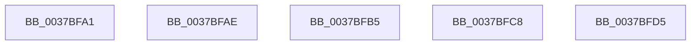

# sub_0037BFA1

- RVA: `0x0037BFA1`–`0x0037BFDC` (길이 `59` bytes)
- VA: `0x000000014037BFA1`
- 실행 섹션: `.text`
- PDB 이름 있음: `아니요`; PDB Function 태그: `아니요`
- unwind 정보 RVA: `0x0007B1BC`
- 디코드: `14`개 명령, `59/59` bytes 표시
- 미해석 바이트: `0` (있으면 어셈블리에 `.byte`로 보존)

> 이 문서는 커널 이미지의 기계어와 PDB 기호를 분석해 생성했습니다. 4번과 5번은 함수 원형과 자료형을 바이너리 사용 방식에서 추정한 C 해석이며 원본 소스 복구 결과는 아닙니다.

## 1. Dependencies

- 직접 호출 지점: **3**; 고유 호출 대상: **1**
- 직접 호출자로 확인된 함수: **0**
- RIP 상대 이미지 참조: **0**

### Outgoing calls
- `0x0037BFA4` → [guard_dispatch_icall](../6B/guard_dispatch_icall_function_006BAAD0.md) (function, `0x006BAAD0`)
- `0x0037BFB5` → [guard_dispatch_icall](../6B/guard_dispatch_icall_function_006BAAD0.md) (function, `0x006BAAD0`)
- `0x0037BFCB` → [guard_dispatch_icall](../6B/guard_dispatch_icall_function_006BAAD0.md) (function, `0x006BAAD0`)

### Direct callers
- 이 함수 시작 RVA로 연결되는 직접 call은 확인되지 않았습니다. 간접 호출은 완전히 역산할 수 없습니다.

### Static image references
- 디코드된 RIP-relative 메모리 참조가 없습니다.

## 2. Other-region calls and transfers

- 다른 실행 섹션으로 향하는 call: **0**
- call이 아닌 외부 분기/꼬리 이동: **5**
  - `0x0037BFA9` → [sub_0037BC17 + 0x1C7](Unknown_function_0037BC17.md) (`tail-transfer`)
  - `0x0037BFB0` → [sub_0037BC17 + 0x2F1](Unknown_function_0037BC17.md) (`tail-transfer`)
  - `0x0037BFC3` → [sub_0037B4AE + 0x6E](Unknown_function_0037B4AE.md) (`tail-transfer`)
  - `0x0037BFD0` → [sub_0037BC17 + 0x36](Unknown_function_0037BC17.md) (`tail-transfer`)
  - `0x0037BFD7` → [sub_0037BC17 + 0x288](Unknown_function_0037BC17.md) (`tail-transfer`)

## 3. Assembly (complete function range)

```asm
0037BFA1  48 8B C2                        mov rax, rdx
0037BFA4  E8 27 EB 33 00                  call 0x1406baad0
0037BFA9  E9 30 FE FF FF                  jmp 0x14037bdde
0037BFAE  33 C9                           xor ecx, ecx
0037BFB0  E9 53 FF FF FF                  jmp 0x14037bf08
0037BFB5  E8 16 EB 33 00                  call 0x1406baad0
0037BFBA  48 8B D0                        mov rdx, rax
0037BFBD  41 B9 80 96 98 00               mov r9d, 0x989680
0037BFC3  E9 54 F5 FF FF                  jmp 0x14037b51c
0037BFC8  48 8B C2                        mov rax, rdx
0037BFCB  E8 00 EB 33 00                  call 0x1406baad0
0037BFD0  E9 78 FC FF FF                  jmp 0x14037bc4d
0037BFD5  33 C9                           xor ecx, ecx
0037BFD7  E9 C3 FE FF FF                  jmp 0x14037be9f
```

## 4. C-style interpretation (structured pseudocode)

```c
__int64 __fastcall sub_0037BFA1(int a1, __int64 a2)
{
    __int64 result;

    result = guard_dispatch_icall(a1, a2, a3, a4);
}
```

## 5. (Beta) C Style

```c
int64_t sub_0037BFA1(int32_t Arg1, int64_t Arg2)
{
    int64_t result;

    result = guard_dispatch_icall(Arg1, Arg2, a3, a4);
}
```

## 6. Execution-region graph

[열기: 2D/3D 그래프와 함수 탐색 컨트롤 패널](../../../control-panel.html?section=text&rva=0x0037BFA1&view=graph)

- 2D 그래프는 위에서 아래로 흐르고, 3D 그래프는 빈 공간을 드래그해 회전합니다. Shift+드래그는 이동, 휠은 확대·축소, 함수 노드 선택은 대상 보고서 이동입니다.

### Static fallback


