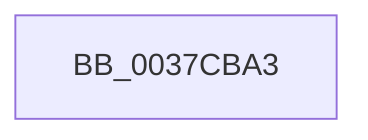

# sub_0037CBA3

- RVA: `0x0037CBA3`–`0x0037CBE4` (길이 `65` bytes)
- VA: `0x000000014037CBA3`
- 실행 섹션: `.text`
- PDB 이름 있음: `아니요`; PDB Function 태그: `아니요`
- unwind 정보 RVA: `0x0007B208`
- 디코드: `18`개 명령, `65/65` bytes 표시
- 미해석 바이트: `0` (있으면 어셈블리에 `.byte`로 보존)

> 이 문서는 커널 이미지의 기계어와 PDB 기호를 분석해 생성했습니다. 4번과 5번은 함수 원형과 자료형을 바이너리 사용 방식에서 추정한 C 해석이며 원본 소스 복구 결과는 아닙니다.

## 1. Dependencies

- 직접 호출 지점: **0**; 고유 호출 대상: **0**
- 직접 호출자로 확인된 함수: **0**
- RIP 상대 이미지 참조: **0**

### Outgoing calls
- 직접 디코드된 call 명령이 없습니다.

### Direct callers
- 이 함수 시작 RVA로 연결되는 직접 call은 확인되지 않았습니다. 간접 호출은 완전히 역산할 수 없습니다.

### Static image references
- 디코드된 RIP-relative 메모리 참조가 없습니다.

## 2. Other-region calls and transfers

- 다른 실행 섹션으로 향하는 call: **0**
- call이 아닌 외부 분기/꼬리 이동: **1**
  - `0x0037CBDE` → [sub_0037CC84 + 0xCF](Unknown_function_0037CC84.md) (`tail-transfer`)

## 3. Assembly (complete function range)

```asm
0037CBA3  48 89 58 F0                     mov qword ptr [rax - 0x10], rbx
0037CBA7  48 89 70 E8                     mov qword ptr [rax - 0x18], rsi
0037CBAB  48 8B F1                        mov rsi, rcx
0037CBAE  48 89 78 E0                     mov qword ptr [rax - 0x20], rdi
0037CBB2  4C 89 60 D8                     mov qword ptr [rax - 0x28], r12
0037CBB6  4C 89 70 C8                     mov qword ptr [rax - 0x38], r14
0037CBBA  4C 8B F2                        mov r14, rdx
0037CBBD  4C 89 78 C0                     mov qword ptr [rax - 0x40], r15
0037CBC1  FA                              cli
0037CBC2  45 33 FF                        xor r15d, r15d
0037CBC5  C6 41 20 01                     mov byte ptr [rcx + 0x20], 1
0037CBC9  90                              nop
0037CBCA  45 8B DF                        mov r11d, r15d
0037CBCD  41 8B DF                        mov ebx, r15d
0037CBD0  41 8B FF                        mov edi, r15d
0037CBD3  45 8D 67 01                     lea r12d, [r15 + 1]
0037CBD7  44 38 B9 DC 86 00 00            cmp byte ptr [rcx + 0x86dc], r15b
0037CBDE  0F 84 6F 01 00 00               je 0x14037cd53
```

## 4. C-style interpretation (structured pseudocode)

```c
void __fastcall sub_0037CBA3(__int64 a1, __int64 a2)
{
    __int64 v_r15;

    *(unsigned __int64 *)(result - 16) = v_rbx;
    *(unsigned __int64 *)(result - 24) = v_rsi;
    *(unsigned __int64 *)(result - 32) = v_rdi;
    *(unsigned __int64 *)(result - 40) = v_r12;
    *(unsigned __int64 *)(result - 56) = v_r14;
    *(unsigned __int64 *)(result - 64) = v_r15;
    v_r15 = 0;
    *(unsigned __int8 *)(a1 + 32) = 1;
}
```

## 5. (Beta) C Style

```c
void sub_0037CBA3(void *Arg1, int64_t Arg2)
{
    uint8_t *arg1 = (uint8_t *)Arg1;

    int64_t local_r15;

    *(uint64_t *)(result - 0x10) = local_rbx;
    *(uint64_t *)(result - 0x18) = local_rsi;
    *(uint64_t *)(result - 0x20) = local_rdi;
    *(uint64_t *)(result - 0x28) = local_r12;
    *(uint64_t *)(result - 0x38) = local_r14;
    *(uint64_t *)(result - 0x40) = local_r15;
    local_r15 = 0;
    *(uint8_t *)(arg1 + 0x20) = 1;
}
```

### 관측된 메모리 오프셋

구조체 형식이 확인되지 않은 접근은 인자 기준의 오프셋으로만 기록했습니다.

| 기준 인자 | 오프셋 표현 | 폭 (bit) | 접근 |
|---|---:|---:|---|
| `Arg1` | `+ 0x20` | `8` | `W` |
| `Arg1` | `+ 0x86DC` | `8` | `R` |

## 6. Execution-region graph

[열기: 2D/3D 그래프와 함수 탐색 컨트롤 패널](../../../control-panel.html?section=text&rva=0x0037CBA3&view=graph)

- 2D 그래프는 위에서 아래로 흐르고, 3D 그래프는 빈 공간을 드래그해 회전합니다. Shift+드래그는 이동, 휠은 확대·축소, 함수 노드 선택은 대상 보고서 이동입니다.

### Static fallback


