# sub_0037CC84

- RVA: `0x0037CC84`–`0x0037CFD1` (길이 `845` bytes)
- VA: `0x000000014037CC84`
- 실행 섹션: `.text`
- PDB 이름 있음: `아니요`; PDB Function 태그: `아니요`
- unwind 정보 RVA: `0x0007B244`
- 디코드: `198`개 명령, `845/845` bytes 표시
- 미해석 바이트: `0` (있으면 어셈블리에 `.byte`로 보존)

> 이 문서는 커널 이미지의 기계어와 PDB 기호를 분석해 생성했습니다. 4번과 5번은 함수 원형과 자료형을 바이너리 사용 방식에서 추정한 C 해석이며 원본 소스 복구 결과는 아닙니다.

## 1. Dependencies

- 직접 호출 지점: **1**; 고유 호출 대상: **1**
- 직접 호출자로 확인된 함수: **0**
- RIP 상대 이미지 참조: **7**

### Outgoing calls
- `0x0037CF6D` → [KiUpdateThreadHgsFeedback](KiUpdateThreadHgsFeedback_function_0037D790.md) (function, `0x0037D790`)

### Direct callers
- 이 함수 시작 RVA로 연결되는 직접 call은 확인되지 않았습니다. 간접 호출은 완전히 역산할 수 없습니다.

### Static image references
- `0x0037CCB4` → RVA `0x00FC6A95` (`ALMOSTRO`; read)
- `0x0037CD0F` → RVA `0x00FC6BC6` (`ALMOSTRO`; read)
- `0x0037CD23` → RVA `0x00FC7318` (`ALMOSTRO`; read)
- `0x0037CEA1` → RVA `0x00F10A44` (`.data`; read)
- `0x0037CEC7` → RVA `0x00FC6D60` (`ALMOSTRO`; read)
- `0x0037CF58` → RVA `0x00FC6ADE` (`ALMOSTRO`; read)
- `0x0037CF72` → RVA `0x00FCFF00` (`CACHEALI`; read)

## 2. Other-region calls and transfers

- 다른 실행 섹션으로 향하는 call: **0**
- call이 아닌 외부 분기/꼬리 이동: **12**
  - `0x0037CD00` → [sub_0037D1C4 + 0xCC](Unknown_function_0037D1C4.md) (`tail-transfer`)
  - `0x0037CD4D` → [sub_0037D168](Unknown_function_0037D168.md) (`tail-transfer`)
  - `0x0037CDFE` → [sub_0037CFDC + 0x68](Unknown_function_0037CFDC.md) (`tail-transfer`)
  - `0x0037CE2E` → [sub_0037D778](Unknown_function_0037D778.md) (`tail-transfer`)
  - `0x0037CE37` → [sub_0037D778](Unknown_function_0037D778.md) (`tail-transfer`)
  - `0x0037CEB0` → [sub_0037D1C4 + 0x99](Unknown_function_0037D1C4.md) (`tail-transfer`)
  - `0x0037CEE0` → [sub_0037CFDC + 0x50](Unknown_function_0037CFDC.md) (`tail-transfer`)
  - `0x0037CEE9` → [sub_0037CFDC + 0x50](Unknown_function_0037CFDC.md) (`tail-transfer`)
  - `0x0037CF52` → [sub_0037CFDC + 0x8A](Unknown_function_0037CFDC.md) (`tail-transfer`)
  - `0x0037CF89` → [sub_0037D6B1](Unknown_function_0037D6B1.md) (`tail-transfer`)
  - `0x0037CF92` → [sub_0037CFDC](Unknown_function_0037CFDC.md) (`tail-transfer`)
  - `0x0037CFCB` → [sub_0037D19C](Unknown_function_0037D19C.md) (`tail-transfer`)

## 3. Assembly (complete function range)

```asm
0037CC84  0F B6 8E AC 00 00 00            movzx ecx, byte ptr [rsi + 0xac]
0037CC8B  49 8B D3                        mov rdx, r11
0037CC8E  48 8B 86 B0 00 00 00            mov rax, qword ptr [rsi + 0xb0]
0037CC95  4C 89 7D 0F                     mov qword ptr [rbp + 0xf], r15
0037CC99  84 C9                           test cl, cl
0037CC9B  74 03                           je 0x14037cca0
0037CC9D  48 D3 E2                        shl rdx, cl
0037CCA0  48 F7 E2                        mul rdx
0037CCA3  48 8B FA                        mov rdi, rdx
0037CCA6  48 89 55 0F                     mov qword ptr [rbp + 0xf], rdx
0037CCAA  48 2B BE 80 86 00 00            sub rdi, qword ptr [rsi + 0x8680]
0037CCB1  48 8B DA                        mov rbx, rdx
0037CCB4  44 38 3D DA 9D C4 00            cmp byte ptr [rip + 0xc49dda], r15b
0037CCBB  0F 84 92 00 00 00               je 0x14037cd53
0037CCC1  48 8B 96 F8 86 00 00            mov rdx, qword ptr [rsi + 0x86f8]
0037CCC8  48 B8 00 03 00 00 80 F7 FF FF   movabs rax, 0xfffff78000000300
0037CCD2  4C 39 38                        cmp qword ptr [rax], r15
0037CCD5  74 7C                           je 0x14037cd53
0037CCD7  A0 69 03 00 00 80 F7 FF FF      movabs al, byte ptr [0xfffff78000000369]
0037CCE0  49 B9 60 03 00 00 80 F7 FF FF   movabs r9, 0xfffff78000000360
0037CCEA  0F B6 C8                        movzx ecx, al
0037CCED  4C 89 7D FF                     mov qword ptr [rbp - 1], r15
0037CCF1  84 C0                           test al, al
0037CCF3  4C 89 7D 07                     mov qword ptr [rbp + 7], r15
0037CCF7  4D 8B C3                        mov r8, r11
0037CCFA  4D 8B 09                        mov r9, qword ptr [r9]
0037CCFD  49 8B C1                        mov rax, r9
0037CD00  0F 84 8A 05 00 00               je 0x14037d290
0037CD06  48 D3 E2                        shl rdx, cl
0037CD09  48 F7 E2                        mul rdx
0037CD0C  49 D3 E0                        shl r8, cl
0037CD0F  0F BE 0D B0 9E C4 00            movsx ecx, byte ptr [rip + 0xc49eb0]
0037CD16  4C 8B D2                        mov r10, rdx
0037CD19  48 89 55 FF                     mov qword ptr [rbp - 1], rdx
0037CD1D  49 8B C1                        mov rax, r9
0037CD20  49 F7 E0                        mul r8
0037CD23  48 8B 05 EE A5 C4 00            mov rax, qword ptr [rip + 0xc4a5ee]
0037CD2A  4C 8B CA                        mov r9, rdx
0037CD2D  48 89 55 07                     mov qword ptr [rbp + 7], rdx
0037CD31  49 F7 E2                        mul r10
0037CD34  48 8B 05 DD A5 C4 00            mov rax, qword ptr [rip + 0xc4a5dd]
0037CD3B  4C 8B D2                        mov r10, rdx
0037CD3E  49 F7 E1                        mul r9
0037CD41  49 D3 EA                        shr r10, cl
0037CD44  4C 8B C2                        mov r8, rdx
0037CD47  49 D3 E8                        shr r8, cl
0037CD4A  45 2B C2                        sub r8d, r10d
0037CD4D  0F 85 15 04 00 00               jne 0x14037d168
0037CD53  4C 89 9E F8 86 00 00            mov qword ptr [rsi + 0x86f8], r11
0037CD5A  48 89 9E 80 86 00 00            mov qword ptr [rsi + 0x8680], rbx
0037CD61  49 8B 4E 48                     mov rcx, qword ptr [r14 + 0x48]
0037CD65  48 03 CF                        add rcx, rdi
0037CD68  49 89 4E 48                     mov qword ptr [r14 + 0x48], rcx
0037CD6C  4C 3B 76 18                     cmp r14, qword ptr [rsi + 0x18]
0037CD70  74 25                           je 0x14037cd97
0037CD72  8B 86 B8 86 00 00               mov eax, dword ptr [rsi + 0x86b8]
0037CD78  41 8B 4E 50                     mov ecx, dword ptr [r14 + 0x50]
0037CD7C  48 0F AF C7                     imul rax, rdi
0037CD80  48 C1 E8 10                     shr rax, 0x10
0037CD84  48 03 C8                        add rcx, rax
0037CD87  B8 FF FF FF FF                  mov eax, 0xffffffff
0037CD8C  48 3B C8                        cmp rcx, rax
0037CD8F  48 0F 47 C8                     cmova rcx, rax
0037CD93  41 89 4E 50                     mov dword ptr [r14 + 0x50], ecx
0037CD97  41 0F B6 5E 02                  movzx ebx, byte ptr [r14 + 2]
0037CD9C  F6 C3 BE                        test bl, 0xbe
0037CD9F  0F 84 EF 01 00 00               je 0x14037cf94
0037CDA5  84 DB                           test bl, bl
0037CDA7  79 52                           jns 0x14037cdfb
0037CDA9  49 8B 86 20 02 00 00            mov rax, qword ptr [r14 + 0x220]
0037CDB0  41 8B D4                        mov edx, r12d
0037CDB3  4C 8B 86 B0 8B 00 00            mov r8, qword ptr [rsi + 0x8bb0]
0037CDBA  44 8B 88 90 01 00 00            mov r9d, dword ptr [rax + 0x190]
0037CDC1  41 8B C1                        mov eax, r9d
0037CDC4  C1 E8 0D                        shr eax, 0xd
0037CDC7  25 FF FF 03 00                  and eax, 0x3ffff
0037CDCC  49 C1 E9 04                     shr r9, 4
0037CDD0  0F BD C8                        bsr ecx, eax
0037CDD3  41 81 E1 FF 01 00 00            and r9d, 0x1ff
0037CDDA  D3 E2                           shl edx, cl
0037CDDC  83 C1 FE                        add ecx, -2
0037CDDF  33 D0                           xor edx, eax
0037CDE1  89 4D 7F                        mov dword ptr [rbp + 0x7f], ecx
0037CDE4  49 8B 0C C8                     mov rcx, qword ptr [r8 + rcx*8]
0037CDE8  48 8B 54 D1 08                  mov rdx, qword ptr [rcx + rdx*8 + 8]
0037CDED  4A 8B 04 CA                     mov rax, qword ptr [rdx + r9*8]
0037CDF1  48 03 C7                        add rax, rdi
0037CDF4  4A 89 04 CA                     mov qword ptr [rdx + r9*8], rax
0037CDF8  80 E3 7F                        and bl, 0x7f
0037CDFB  F6 C3 10                        test bl, 0x10
0037CDFE  0F 85 40 02 00 00               jne 0x14037d044
0037CE04  F6 C3 20                        test bl, 0x20
0037CE07  0F 84 42 01 00 00               je 0x14037cf4f
0037CE0D  4D 8B 86 88 06 00 00            mov r8, qword ptr [r14 + 0x688]
0037CE14  4D 85 C0                        test r8, r8
0037CE17  0F 84 2F 01 00 00               je 0x14037cf4c
0037CE1D  48 8B 86 B0 89 00 00            mov rax, qword ptr [rsi + 0x89b0]
0037CE24  48 8B 96 B8 89 00 00            mov rdx, qword ptr [rsi + 0x89b8]
0037CE2B  48 85 C0                        test rax, rax
0037CE2E  0F 84 44 09 00 00               je 0x14037d778
0037CE34  48 85 D2                        test rdx, rdx
0037CE37  0F 84 3B 09 00 00               je 0x14037d778
0037CE3D  44 38 7A 70                     cmp byte ptr [rdx + 0x70], r15b
0037CE41  75 11                           jne 0x14037ce54
0037CE43  8B 52 50                        mov edx, dword ptr [rdx + 0x50]
0037CE46  8B 88 10 02 00 00               mov ecx, dword ptr [rax + 0x210]
0037CE4C  3B D1                           cmp edx, ecx
0037CE4E  72 0A                           jb 0x14037ce5a
0037CE50  8B D1                           mov edx, ecx
0037CE52  EB 06                           jmp 0x14037ce5a
0037CE54  8B 92 84 00 00 00               mov edx, dword ptr [rdx + 0x84]
0037CE5A  45 8B CF                        mov r9d, r15d
0037CE5D  48 8D 8E 6A 8A 00 00            lea rcx, [rsi + 0x8a6a]
0037CE64  0F B7 01                        movzx eax, word ptr [rcx]
0037CE67  3B D0                           cmp edx, eax
0037CE69  76 0D                           jbe 0x14037ce78
0037CE6B  41 FF C1                        inc r9d
0037CE6E  48 83 C1 02                     add rcx, 2
0037CE72  41 83 F9 03                     cmp r9d, 3
0037CE76  72 EC                           jb 0x14037ce64
0037CE78  44 0F B6 96 08 8A 00 00         movzx r10d, byte ptr [rsi + 0x8a08]
0037CE80  41 0F B6 C2                     movzx eax, r10b
0037CE84  41 8B C9                        mov ecx, r9d
0037CE87  48 03 C9                        add rcx, rcx
0037CE8A  F6 D8                           neg al
0037CE8C  48 1B D2                        sbb rdx, rdx
0037CE8F  49 8D 04 C8                     lea rax, [r8 + rcx*8]
0037CE93  83 E2 08                        and edx, 8
0037CE96  48 8B 0C 02                     mov rcx, qword ptr [rdx + rax]
0037CE9A  48 03 CF                        add rcx, rdi
0037CE9D  48 89 0C 02                     mov qword ptr [rdx + rax], rcx
0037CEA1  8B 05 9D 3B B9 00               mov eax, dword ptr [rip + 0xb93b9d]
0037CEA7  41 8B 88 C0 00 00 00            mov ecx, dword ptr [r8 + 0xc0]
0037CEAE  3B C1                           cmp eax, ecx
0037CEB0  0F 87 A7 03 00 00               ja 0x14037d25d
0037CEB6  2B C8                           sub ecx, eax
0037CEB8  83 F9 20                        cmp ecx, 0x20
0037CEBB  73 0A                           jae 0x14037cec7
0037CEBD  41 D3 E4                        shl r12d, cl
0037CEC0  45 09 A0 C4 00 00 00            or dword ptr [r8 + 0xc4], r12d
0037CEC7  44 39 3D 92 9E C4 00            cmp dword ptr [rip + 0xc49e92], r15d
0037CECE  75 1F                           jne 0x14037ceef
0037CED0  41 0F B6 8E 04 02 00 00         movzx ecx, byte ptr [r14 + 0x204]
0037CED8  8D 41 FE                        lea eax, [rcx - 2]
0037CEDB  A9 FB FF FF FF                  test eax, 0xfffffffb
0037CEE0  0F 84 46 01 00 00               je 0x14037d02c
0037CEE6  80 F9 05                        cmp cl, 5
0037CEE9  0F 84 3D 01 00 00               je 0x14037d02c
0037CEEF  4D 39 BE 50 06 00 00            cmp qword ptr [r14 + 0x650], r15
0037CEF6  74 54                           je 0x14037cf4c
0037CEF8  41 0F B6 C2                     movzx eax, r10b
0037CEFC  41 8B C9                        mov ecx, r9d
0037CEFF  48 83 C1 08                     add rcx, 8
0037CF03  48 03 C9                        add rcx, rcx
0037CF06  F6 D8                           neg al
0037CF08  48 1B D2                        sbb rdx, rdx
0037CF0B  83 E2 08                        and edx, 8
0037CF0E  49 8D 04 C8                     lea rax, [r8 + rcx*8]
0037CF12  41 B8 48 00 00 00               mov r8d, 0x48
0037CF18  48 8B 0C 02                     mov rcx, qword ptr [rdx + rax]
0037CF1C  48 03 CF                        add rcx, rdi
0037CF1F  48 89 0C 02                     mov qword ptr [rdx + rax], rcx
0037CF23  BA 40 00 00 00                  mov edx, 0x40
0037CF28  49 8B 86 50 06 00 00            mov rax, qword ptr [r14 + 0x650]
0037CF2F  48 8B 88 88 06 00 00            mov rcx, qword ptr [rax + 0x688]
0037CF36  41 8B C1                        mov eax, r9d
0037CF39  48 C1 E0 04                     shl rax, 4
0037CF3D  45 84 D2                        test r10b, r10b
0037CF40  41 0F 45 D0                     cmovne edx, r8d
0037CF44  48 03 C1                        add rax, rcx
0037CF47  F0 48 01 3C 02                  lock add qword ptr [rdx + rax], rdi
0037CF4C  80 E3 DF                        and bl, 0xdf
0037CF4F  F6 C3 40                        test bl, 0x40
0037CF52  0F 85 0E 01 00 00               jne 0x14037d066
0037CF58  44 38 3D 7F 9B C4 00            cmp byte ptr [rip + 0xc49b7f], r15b
0037CF5F  74 11                           je 0x14037cf72
0037CF61  41 B1 01                        mov r9b, 1
0037CF64  4C 8B C7                        mov r8, rdi
0037CF67  49 8B D6                        mov rdx, r14
0037CF6A  48 8B CE                        mov rcx, rsi
0037CF6D  E8 1E 08 00 00                  call 0x14037d790
0037CF72  4C 8D 05 87 2F C5 00            lea r8, [rip + 0xc52f87]
0037CF79  4C 39 BE B0 86 00 00            cmp qword ptr [rsi + 0x86b0], r15
0037CF80  74 0D                           je 0x14037cf8f
0037CF82  4D 39 86 20 02 00 00            cmp qword ptr [r14 + 0x220], r8
0037CF89  0F 85 22 07 00 00               jne 0x14037d6b1
0037CF8F  F6 C3 BE                        test bl, 0xbe
0037CF92  75 48                           jne 0x14037cfdc
0037CF94  65 48 8B 0C 25 20 00 00 00      mov rcx, qword ptr gs:[0x20]
0037CF9D  4C 8B 7C 24 58                  mov r15, qword ptr [rsp + 0x58]
0037CFA2  4C 8B 74 24 60                  mov r14, qword ptr [rsp + 0x60]
0037CFA7  4C 8B 64 24 70                  mov r12, qword ptr [rsp + 0x70]
0037CFAC  4C 8B 81 B8 8E 00 00            mov r8, qword ptr [rcx + 0x8eb8]
0037CFB3  48 8B 7C 24 78                  mov rdi, qword ptr [rsp + 0x78]
0037CFB8  48 8B B4 24 80 00 00 00         mov rsi, qword ptr [rsp + 0x80]
0037CFC0  48 8B 9C 24 88 00 00 00         mov rbx, qword ptr [rsp + 0x88]
0037CFC8  4D 85 C0                        test r8, r8
0037CFCB  0F 85 CB 01 00 00               jne 0x14037d19c
```

## 4. C-style interpretation (structured pseudocode)

```c
__int64 __fastcall sub_0037CC84(__int64 a1, __int64 a2, __int64 a3, __int64 a4, __int64 a5, __int64 a6, __int64 a7, __int64 a8, __int64 a9, __int64 a10, __int64 a11, __int64 a12, __int64 a13, __int64 a14, __int64 a15, __int64 a16, __int64 a17)
{
    __int64 result;
    __int64 v_r10;
    __int64 v_r12;
    __int64 v_rbx;
    __int64 v_rdi;

    *(unsigned __int64 *)(v_rbp + 15) = v_r15;
    if ((unsigned __int8)(*(unsigned __int8 *)(v_rsi + 172)) != 0) {
        a2 = (v_r11) << ((unsigned __int8)(*(unsigned __int8 *)(v_rsi + 172)));
    }
    *(unsigned __int64 *)(v_rbp + 15) = a2;
    v_rdi = (a2) - (*(unsigned __int64 *)(v_rsi + 34432));
    if ((*(unsigned __int8 *)(v_rip + 12885466)) == ((unsigned __int8)(v_r15))) goto loc_0037CD53;
    if ((*(unsigned __int64 *)(*(unsigned __int64 *)(v_rsi + 176))) == v_r15) goto loc_0037CD53;
    *(unsigned __int64 *)(v_rbp - 1) = v_r15;
    *(unsigned __int64 *)(v_rbp + 7) = v_r15;
    a2 = (*(unsigned __int64 *)(v_rsi + 34552)) << ((unsigned __int8)((unsigned __int8)(*(unsigned __int64 *)(v_rsi + 176))));
    a3 = (v_r11) << ((unsigned __int8)((unsigned __int8)(*(unsigned __int64 *)(v_rsi + 176))));
    *(unsigned __int64 *)(v_rbp - 1) = a2;
    *(unsigned __int64 *)(v_rbp + 7) = a2;
    v_r10 = (a2) >> ((unsigned __int8)((__int8)(*(unsigned __int8 *)(v_rip + 12885680))));
    a3 = (a2) >> ((unsigned __int8)((__int8)(*(unsigned __int8 *)(v_rip + 12885680))));
    a3 = (unsigned int)((a3) - ((unsigned int)(v_r10)));
loc_0037CD53:
    *(unsigned __int64 *)(v_rsi + 34552) = v_r11;
    *(unsigned __int64 *)(v_rsi + 34432) = a2;
    a1 = (*(unsigned __int64 *)(v_r14 + 72)) + (v_rdi);
    *(unsigned __int64 *)(v_r14 + 72) = a1;
    result = *(unsigned __int64 *)(v_rip + 12887517);
    if (v_r14 != (*(unsigned __int64 *)(v_rsi + 24))) {
        result = *(unsigned int *)(v_rsi + 34488);
        a1 = *(unsigned int *)(v_r14 + 80);
        result = (result) * (v_rdi);
        result = (result) >> (16);
        a1 = (a1) + (result);
        result = 0xFFFFFFFFULL;
        if (a1 > result) { a1 = result; }
        *(unsigned int *)(v_r14 + 80) = (unsigned int)(a1);
    }
    if ((((unsigned __int8)(*(unsigned __int8 *)(v_r14 + 2))) & (190)) == 0) goto loc_0037CF94;
    v_rbx = *(unsigned __int8 *)(v_r14 + 2);
    if (sign_flag) {
        result = *(unsigned __int64 *)(v_r14 + 544);
        a2 = (unsigned int)(v_r12);
        a3 = *(unsigned __int64 *)(v_rsi + 35760);
        a4 = *(unsigned int *)(result + 400);
        result = (unsigned int)(a4);
        result = (unsigned int)((result) >> (13));
        result = (unsigned int)((result) & (0x3FFFFULL));
        a4 = (a4) >> (4);
        a4 = (unsigned int)((a4) & (511));
        a2 = (unsigned int)((a2) << ((unsigned __int8)(a1)));
        a1 = (unsigned int)((a1) + (-2));
        a2 = (unsigned int)((a2) ^ ((unsigned int)(result)));
        *(unsigned int *)(v_rbp + 127) = (unsigned int)(a1);
        a1 = *(unsigned __int64 *)(a3 + a1 * 8);
        a2 = *(unsigned __int64 *)(a1 + a2 * 8 + 8);
        result = *(unsigned __int64 *)(a2 + a4 * 8);
        result = (result) + (v_rdi);
        *(unsigned __int64 *)(a2 + a4 * 8) = result;
        v_rbx = (unsigned __int8)((*(unsigned __int8 *)(v_r14 + 2)) & (127));
    }
    if ((((unsigned __int8)(v_rbx)) & (32)) == 0) goto loc_0037CF4F;
    if (*(unsigned __int64 *)(v_r14 + 1672) == 0) goto loc_0037CF4C;
    if ((*(unsigned __int8 *)(*(unsigned __int64 *)(v_rsi + 35256) + 112)) != ((unsigned __int8)(v_r15))) goto loc_0037CE54;
    if (((unsigned int)((unsigned int)(*(unsigned int *)(*(unsigned __int64 *)(v_rsi + 35256) + 80)))) < ((unsigned int)((unsigned int)(*(unsigned int *)(*(unsigned __int64 *)(v_rsi + 35248) + 528))))) goto loc_0037CE5A;
    goto loc_0037CE5A;
loc_0037CE54:
loc_0037CE5A:
loc_0037CE64:
    if (((unsigned int)((unsigned int)(*(unsigned int *)((unsigned int)((unsigned int)((unsigned int)(*(unsigned int *)(*(unsigned __int64 *)(v_rsi + 35248) + 528)))) + 132)))) <= ((unsigned int)(*(unsigned __int16 *)(v_rsi + 35434)))) goto loc_0037CE78;
    a4 = (unsigned int)(((unsigned int)((unsigned int)(v_r15))) + 1);
    a1 = (v_rsi + 35434) + (2);
    if (((unsigned int)(a4)) < 3) goto loc_0037CE64;
loc_0037CE78:
    a1 = ((unsigned int)((unsigned int)(a4))) + ((unsigned int)((unsigned int)(a4)));
    result = (unsigned __int8)(-((unsigned __int8)(*(unsigned __int8 *)(v_rsi + 35336))));
    a2 = (unsigned int)(((unsigned int)(*(unsigned int *)((unsigned int)((unsigned int)((unsigned int)(*(unsigned int *)(*(unsigned __int64 *)(v_rsi + 35248) + 528)))) + 132))) & (8));
    a1 = (*(unsigned __int64 *)(a2 + *(unsigned __int64 *)(v_r14 + 1672) + a1 * 8 * 1)) + (v_rdi);
    *(unsigned __int64 *)(a2 + *(unsigned __int64 *)(v_r14 + 1672) + a1 * 8 * 1) = a1;
    a1 = (unsigned int)(((unsigned int)(*(unsigned int *)(*(unsigned __int64 *)(v_r14 + 1672) + 192))) - ((unsigned int)((unsigned int)(*(unsigned int *)(v_rip + 12139421)))));
    if (((unsigned int)(a1)) < 32) {
        v_r12 = (unsigned int)((v_r12) << ((unsigned __int8)(a1)));
    }
    if ((*(unsigned int *)(v_rip + 12885650)) != ((unsigned int)(v_r15))) goto loc_0037CEEF;
loc_0037CEEF:
    result = *(unsigned __int8 *)(v_r14 + 516) - 2;
    if ((*(unsigned __int64 *)(v_r14 + 1616)) != v_r15) {
        result = (unsigned __int8)(*(unsigned __int8 *)(v_rsi + 35336));
        a1 = (unsigned int)(a4);
        a1 = (a1) + (8);
        a1 = (a1) + (a1);
        result = (unsigned __int8)(-(result));
        a2 = (unsigned int)((a2) & (8));
        result = *(unsigned __int64 *)(v_r14 + 1672) + a1 * 8;
        a3 = 72;
        a1 = *(unsigned __int64 *)(a2 + result * 1);
        a1 = (a1) + (v_rdi);
        *(unsigned __int64 *)(a2 + result * 1) = a1;
        a2 = 64;
        result = *(unsigned __int64 *)(v_r14 + 1616);
        a1 = *(unsigned __int64 *)(result + 1672);
        result = (unsigned int)(a4);
        result = (result) << (4);
        if ((unsigned __int8)(*(unsigned __int8 *)(v_rsi + 35336)) != 0) { a2 = (unsigned int)(a3); }
        result = (result) + (a1);
    }
    v_rbx = (unsigned __int8)((v_rbx) & (223));
loc_0037CF4F:
    if ((*(unsigned __int8 *)(v_rip + 12884863)) != ((unsigned __int8)(v_r15))) {
        a4 = 1;
        a3 = v_rdi;
        a2 = v_r14;
        a1 = v_rsi;
        result = KiUpdateThreadHgsFeedback(a1, a2, a3, a4);
    }
    if ((*(unsigned __int64 *)(v_rsi + 34480)) == v_r15) goto loc_0037CF8F;
loc_0037CF8F:
loc_0037CF94:
}
```

## 5. (Beta) C Style

```c
int64_t sub_0037CC84(int64_t Arg1, int64_t Arg2, int64_t Arg3, int64_t Arg4, uint64_t Arg5, uint64_t Arg6, uint64_t Arg7, uint64_t Arg8, uint64_t Arg9, uint64_t Arg10, int64_t Arg11, int64_t Arg12, uint64_t Arg13, int64_t Arg14, int64_t Arg15, int64_t Arg16, int64_t Arg17)
{
    int64_t result;
    int64_t local_r10;
    int64_t local_r12;
    int64_t local_rbx;
    int64_t local_rdi;

    *(uint64_t *)(local_rbp + 0xF) = local_r15;
    if ((uint8_t)(*(uint8_t *)(local_rsi + 0xAC)) != 0) {
        Arg2 = (local_r11) << ((uint8_t)(*(uint8_t *)(local_rsi + 0xAC)));
    }
    *(uint64_t *)(local_rbp + 0xF) = Arg2;
    local_rdi = (Arg2) - (*(uint64_t *)(local_rsi + 0x8680));
    if ((*(uint8_t *)(v_rip + 0xC49DDA)) == ((uint8_t)(local_r15))) goto loc_0037CD53;
    if ((*(uint64_t *)(*(uint64_t *)(local_rsi + 0xB0))) == local_r15) goto loc_0037CD53;
    *(uint64_t *)(local_rbp - 0x1) = local_r15;
    *(uint64_t *)(local_rbp + 0x7) = local_r15;
    Arg2 = (*(uint64_t *)(local_rsi + 0x86F8)) << ((uint8_t)((uint8_t)(*(uint64_t *)(local_rsi + 0xB0))));
    Arg3 = (local_r11) << ((uint8_t)((uint8_t)(*(uint64_t *)(local_rsi + 0xB0))));
    *(uint64_t *)(local_rbp - 0x1) = Arg2;
    *(uint64_t *)(local_rbp + 0x7) = Arg2;
    local_r10 = (Arg2) >> ((uint8_t)((int8_t)(*(uint8_t *)(v_rip + 0xC49EB0))));
    Arg3 = (Arg2) >> ((uint8_t)((int8_t)(*(uint8_t *)(v_rip + 0xC49EB0))));
    Arg3 = (uint32_t)((Arg3) - ((uint32_t)(local_r10)));
loc_0037CD53:
    *(uint64_t *)(local_rsi + 0x86F8) = local_r11;
    *(uint64_t *)(local_rsi + 0x8680) = Arg2;
    Arg1 = (*(uint64_t *)(local_r14 + 0x48)) + (local_rdi);
    *(uint64_t *)(local_r14 + 0x48) = Arg1;
    result = *(uint64_t *)(v_rip + 0xC4A5DD);
    if (local_r14 != (*(uint64_t *)(local_rsi + 0x18))) {
        result = *(uint32_t *)(local_rsi + 0x86B8);
        Arg1 = *(uint32_t *)(local_r14 + 0x50);
        result = (result) * (local_rdi);
        result = (result) >> (16);
        Arg1 = (Arg1) + (result);
        result = 0xFFFFFFFFULL;
        if (Arg1 > result) { Arg1 = result; }
        *(uint32_t *)(local_r14 + 0x50) = (uint32_t)(Arg1);
    }
    if ((((uint8_t)(*(uint8_t *)(local_r14 + 0x2))) & (190)) == 0) goto loc_0037CF94;
    local_rbx = *(uint8_t *)(local_r14 + 0x2);
    if (sign_flag) {
        result = *(uint64_t *)(local_r14 + 0x220);
        Arg2 = (uint32_t)(local_r12);
        Arg3 = *(uint64_t *)(local_rsi + 0x8BB0);
        Arg4 = *(uint32_t *)(result + 0x190);
        result = (uint32_t)(Arg4);
        result = (uint32_t)((result) >> (13));
        result = (uint32_t)((result) & (0x3FFFFULL));
        Arg4 = (Arg4) >> (4);
        Arg4 = (uint32_t)((Arg4) & (511));
        Arg2 = (uint32_t)((Arg2) << ((uint8_t)(Arg1)));
        Arg1 = (uint32_t)((Arg1) + (-2));
        Arg2 = (uint32_t)((Arg2) ^ ((uint32_t)(result)));
        *(uint32_t *)(local_rbp + 0x7F) = (uint32_t)(Arg1);
        Arg1 = *(uint64_t *)(Arg3 + Arg1 * 8);
        Arg2 = *(uint64_t *)(Arg1 + Arg2 * 8 + 0x8);
        result = *(uint64_t *)(Arg2 + Arg4 * 8);
        result = (result) + (local_rdi);
        *(uint64_t *)(Arg2 + Arg4 * 8) = result;
        local_rbx = (uint8_t)((*(uint8_t *)(local_r14 + 0x2)) & (127));
    }
    if ((((uint8_t)(local_rbx)) & (32)) == 0) goto loc_0037CF4F;
    if (*(uint64_t *)(local_r14 + 0x688) == 0) goto loc_0037CF4C;
    if ((*(uint8_t *)(*(uint64_t *)(local_rsi + 0x89B8) + 0x70)) != ((uint8_t)(local_r15))) goto loc_0037CE54;
    if (((uint32_t)((uint32_t)(*(uint32_t *)(*(uint64_t *)(local_rsi + 0x89B8) + 0x50)))) < ((uint32_t)((uint32_t)(*(uint32_t *)(*(uint64_t *)(local_rsi + 0x89B0) + 0x210))))) goto loc_0037CE5A;
    goto loc_0037CE5A;
loc_0037CE54:
loc_0037CE5A:
loc_0037CE64:
    if (((uint32_t)((uint32_t)(*(uint32_t *)((uint32_t)((uint32_t)((uint32_t)(*(uint32_t *)(*(uint64_t *)(local_rsi + 0x89B0) + 0x210)))) + 0x84)))) <= ((uint32_t)(*(uint16_t *)(local_rsi + 0x8A6A)))) goto loc_0037CE78;
    Arg4 = (uint32_t)(((uint32_t)((uint32_t)(local_r15))) + 1);
    Arg1 = (local_rsi + 35434) + (2);
    if (((uint32_t)(Arg4)) < 3) goto loc_0037CE64;
loc_0037CE78:
    Arg1 = ((uint32_t)((uint32_t)(Arg4))) + ((uint32_t)((uint32_t)(Arg4)));
    result = (uint8_t)(-((uint8_t)(*(uint8_t *)(local_rsi + 0x8A08))));
    Arg2 = (uint32_t)(((uint32_t)(*(uint32_t *)((uint32_t)((uint32_t)((uint32_t)(*(uint32_t *)(*(uint64_t *)(local_rsi + 0x89B0) + 0x210)))) + 0x84))) & (8));
    Arg1 = (*(uint64_t *)(Arg2 + *(uint64_t *)(local_r14 + 0x688) + Arg1 * 8 * 1)) + (local_rdi);
    *(uint64_t *)(Arg2 + *(uint64_t *)(local_r14 + 0x688) + Arg1 * 8 * 1) = Arg1;
    Arg1 = (uint32_t)(((uint32_t)(*(uint32_t *)(*(uint64_t *)(local_r14 + 0x688) + 0xC0))) - ((uint32_t)((uint32_t)(*(uint32_t *)(v_rip + 0xB93B9D)))));
    if (((uint32_t)(Arg1)) < 32) {
        local_r12 = (uint32_t)((local_r12) << ((uint8_t)(Arg1)));
    }
    if ((*(uint32_t *)(v_rip + 0xC49E92)) != ((uint32_t)(local_r15))) goto loc_0037CEEF;
loc_0037CEEF:
    result = *(uint8_t *)(local_r14 + 0x204) - 2;
    if ((*(uint64_t *)(local_r14 + 0x650)) != local_r15) {
        result = (uint8_t)(*(uint8_t *)(local_rsi + 0x8A08));
        Arg1 = (uint32_t)(Arg4);
        Arg1 = (Arg1) + (8);
        Arg1 = (Arg1) + (Arg1);
        result = (uint8_t)(-(result));
        Arg2 = (uint32_t)((Arg2) & (8));
        result = *(uint64_t *)(local_r14 + 0x688) + Arg1 * 8;
        Arg3 = 72;
        Arg1 = *(uint64_t *)(Arg2 + result * 1);
        Arg1 = (Arg1) + (local_rdi);
        *(uint64_t *)(Arg2 + result * 1) = Arg1;
        Arg2 = 64;
        result = *(uint64_t *)(local_r14 + 0x650);
        Arg1 = *(uint64_t *)(result + 0x688);
        result = (uint32_t)(Arg4);
        result = (result) << (4);
        if ((uint8_t)(*(uint8_t *)(local_rsi + 0x8A08)) != 0) { Arg2 = (uint32_t)(Arg3); }
        result = (result) + (Arg1);
    }
    local_rbx = (uint8_t)((local_rbx) & (223));
loc_0037CF4F:
    if ((*(uint8_t *)(v_rip + 0xC49B7F)) != ((uint8_t)(local_r15))) {
        Arg4 = 1;
        Arg3 = local_rdi;
        Arg2 = local_r14;
        Arg1 = local_rsi;
        result = KiUpdateThreadHgsFeedback(Arg1, Arg2, Arg3, Arg4);
    }
    if ((*(uint64_t *)(local_rsi + 0x86B0)) == local_r15) goto loc_0037CF8F;
loc_0037CF8F:
loc_0037CF94:
}
```

## 6. Execution-region graph

[열기: 2D/3D 그래프와 함수 탐색 컨트롤 패널](../../../control-panel.html?section=text&rva=0x0037CC84&view=graph)

- 2D 그래프는 위에서 아래로 흐르고, 3D 그래프는 빈 공간을 드래그해 회전합니다. Shift+드래그는 이동, 휠은 확대·축소, 함수 노드 선택은 대상 보고서 이동입니다.

### Static fallback

```mermaid
flowchart TD
  bb_0037CC84[BB_0037CC84]
  bb_0037CC9D[BB_0037CC9D]
  bb_0037CCA0[BB_0037CCA0]
  bb_0037CCC1[BB_0037CCC1]
  bb_0037CCD7[BB_0037CCD7]
  bb_0037CD06[BB_0037CD06]
  bb_0037CD53[BB_0037CD53]
  bb_0037CD72[BB_0037CD72]
  bb_0037CD97[BB_0037CD97]
  bb_0037CDA5[BB_0037CDA5]
  bb_0037CDA9[BB_0037CDA9]
  bb_0037CDFB[BB_0037CDFB]
  bb_0037CE04[BB_0037CE04]
  bb_0037CE0D[BB_0037CE0D]
  bb_0037CE1D[BB_0037CE1D]
  bb_0037CE34[BB_0037CE34]
  bb_0037CE3D[BB_0037CE3D]
  bb_0037CE43[BB_0037CE43]
  bb_0037CE50[BB_0037CE50]
  bb_0037CE54[BB_0037CE54]
  bb_0037CE5A[BB_0037CE5A]
  bb_0037CE64[BB_0037CE64]
  bb_0037CE6B[BB_0037CE6B]
  bb_0037CE78[BB_0037CE78]
  bb_0037CEB6[BB_0037CEB6]
  bb_0037CEBD[BB_0037CEBD]
  bb_0037CEC7[BB_0037CEC7]
  bb_0037CED0[BB_0037CED0]
  bb_0037CEE6[BB_0037CEE6]
  bb_0037CEEF[BB_0037CEEF]
  bb_0037CEF8[BB_0037CEF8]
  bb_0037CF4C[BB_0037CF4C]
  bb_0037CF4F[BB_0037CF4F]
  bb_0037CF58[BB_0037CF58]
  bb_0037CF61[BB_0037CF61]
  bb_0037CF72[BB_0037CF72]
  bb_0037CF82[BB_0037CF82]
  bb_0037CF8F[BB_0037CF8F]
  bb_0037CF94[BB_0037CF94]
  bb_0037CC84 -->|branch| bb_0037CCA0
  bb_0037CC84 -->|fallthrough| bb_0037CC9D
  bb_0037CC9D -->|flow| bb_0037CCA0
  bb_0037CCA0 -->|branch| bb_0037CD53
  bb_0037CCA0 -->|fallthrough| bb_0037CCC1
  bb_0037CCC1 -->|branch| bb_0037CD53
  bb_0037CCC1 -->|fallthrough| bb_0037CCD7
  bb_0037CCD7 -->|fallthrough| bb_0037CD06
  bb_0037CD06 -->|fallthrough| bb_0037CD53
  bb_0037CD53 -->|branch| bb_0037CD97
  bb_0037CD53 -->|fallthrough| bb_0037CD72
  bb_0037CD72 -->|flow| bb_0037CD97
  bb_0037CD97 -->|branch| bb_0037CF94
  bb_0037CD97 -->|fallthrough| bb_0037CDA5
  bb_0037CDA5 -->|branch| bb_0037CDFB
  bb_0037CDA5 -->|fallthrough| bb_0037CDA9
  bb_0037CDA9 -->|flow| bb_0037CDFB
  bb_0037CDFB -->|fallthrough| bb_0037CE04
  bb_0037CE04 -->|branch| bb_0037CF4F
  bb_0037CE04 -->|fallthrough| bb_0037CE0D
  bb_0037CE0D -->|branch| bb_0037CF4C
  bb_0037CE0D -->|fallthrough| bb_0037CE1D
  bb_0037CE1D -->|fallthrough| bb_0037CE34
  bb_0037CE34 -->|fallthrough| bb_0037CE3D
  bb_0037CE3D -->|branch| bb_0037CE54
  bb_0037CE3D -->|fallthrough| bb_0037CE43
  bb_0037CE43 -->|branch| bb_0037CE5A
  bb_0037CE43 -->|fallthrough| bb_0037CE50
  bb_0037CE50 -->|branch| bb_0037CE5A
  bb_0037CE54 -->|flow| bb_0037CE5A
  bb_0037CE5A -->|flow| bb_0037CE64
  bb_0037CE64 -->|branch| bb_0037CE78
  bb_0037CE64 -->|fallthrough| bb_0037CE6B
  bb_0037CE6B -->|branch| bb_0037CE64
  bb_0037CE6B -->|fallthrough| bb_0037CE78
  bb_0037CE78 -->|fallthrough| bb_0037CEB6
  bb_0037CEB6 -->|branch| bb_0037CEC7
  bb_0037CEB6 -->|fallthrough| bb_0037CEBD
  bb_0037CEBD -->|flow| bb_0037CEC7
  bb_0037CEC7 -->|branch| bb_0037CEEF
  bb_0037CEC7 -->|fallthrough| bb_0037CED0
  bb_0037CED0 -->|fallthrough| bb_0037CEE6
  bb_0037CEE6 -->|fallthrough| bb_0037CEEF
  bb_0037CEEF -->|branch| bb_0037CF4C
  bb_0037CEEF -->|fallthrough| bb_0037CEF8
  bb_0037CEF8 -->|flow| bb_0037CF4C
  bb_0037CF4C -->|flow| bb_0037CF4F
  bb_0037CF4F -->|fallthrough| bb_0037CF58
  bb_0037CF58 -->|branch| bb_0037CF72
  bb_0037CF58 -->|fallthrough| bb_0037CF61
  bb_0037CF61 -->|flow| bb_0037CF72
  bb_0037CF72 -->|branch| bb_0037CF8F
  bb_0037CF72 -->|fallthrough| bb_0037CF82
  bb_0037CF82 -->|fallthrough| bb_0037CF8F
  bb_0037CF8F -->|fallthrough| bb_0037CF94
```


