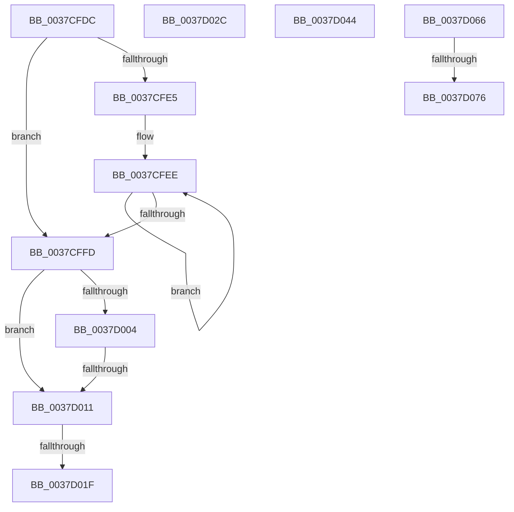

# sub_0037CFDC

- RVA: `0x0037CFDC`–`0x0037D07F` (길이 `163` bytes)
- VA: `0x000000014037CFDC`
- 실행 섹션: `.text`
- PDB 이름 있음: `아니요`; PDB Function 태그: `아니요`
- unwind 정보 RVA: `0x0007B268`
- 디코드: `36`개 명령, `163/163` bytes 표시
- 미해석 바이트: `0` (있으면 어셈블리에 `.byte`로 보존)

> 이 문서는 커널 이미지의 기계어와 PDB 기호를 분석해 생성했습니다. 4번과 5번은 함수 원형과 자료형을 바이너리 사용 방식에서 추정한 C 해석이며 원본 소스 복구 결과는 아닙니다.

## 1. Dependencies

- 직접 호출 지점: **1**; 고유 호출 대상: **1**
- 직접 호출자로 확인된 함수: **0**
- RIP 상대 이미지 참조: **0**

### Outgoing calls
- `0x0037D022` → [KiEndCounterAccumulation](KiEndCounterAccumulation_function_0037EEAC.md) (function, `0x0037EEAC`)

### Direct callers
- 이 함수 시작 RVA로 연결되는 직접 call은 확인되지 않았습니다. 간접 호출은 완전히 역산할 수 없습니다.

### Static image references
- 디코드된 RIP-relative 메모리 참조가 없습니다.

## 2. Other-region calls and transfers

- 다른 실행 섹션으로 향하는 call: **0**
- call이 아닌 외부 분기/꼬리 이동: **7**
  - `0x0037D00B` → [sub_0037D6B1 + 0x4F](Unknown_function_0037D6B1.md) (`tail-transfer`)
  - `0x0037D019` → [sub_0037CC84 + 0x310](Unknown_function_0037CC84.md) (`tail-transfer`)
  - `0x0037D027` → [sub_0037CC84 + 0x310](Unknown_function_0037CC84.md) (`tail-transfer`)
  - `0x0037D03F` → [sub_0037CC84 + 0x26B](Unknown_function_0037CC84.md) (`tail-transfer`)
  - `0x0037D061` → [sub_0037CC84 + 0x180](Unknown_function_0037CC84.md) (`tail-transfer`)
  - `0x0037D070` → [sub_0037CC84 + 0x2D4](Unknown_function_0037CC84.md) (`tail-transfer`)
  - `0x0037D07A` → [sub_0037CC84 + 0x2D4](Unknown_function_0037CC84.md) (`tail-transfer`)

## 3. Assembly (complete function range)

```asm
0037CFDC  49 8B 4E 68                     mov rcx, qword ptr [r14 + 0x68]
0037CFE0  48 85 C9                        test rcx, rcx
0037CFE3  74 18                           je 0x14037cffd
0037CFE5  8B 86 D8 00 00 00               mov eax, dword ptr [rsi + 0xd8]
0037CFEB  48 03 C1                        add rax, rcx
0037CFEE  48 01 38                        add qword ptr [rax], rdi
0037CFF1  48 8B 80 A0 01 00 00            mov rax, qword ptr [rax + 0x1a0]
0037CFF8  48 85 C0                        test rax, rax
0037CFFB  75 F1                           jne 0x14037cfee
0037CFFD  41 F6 46 02 08                  test byte ptr [r14 + 2], 8
0037D002  74 0D                           je 0x14037d011
0037D004  4D 39 86 20 02 00 00            cmp qword ptr [r14 + 0x220], r8
0037D00B  0F 85 EF 06 00 00               jne 0x14037d700
0037D011  49 83 BE 68 01 00 00 00         cmp qword ptr [r14 + 0x168], 0
0037D019  0F 84 75 FF FF FF               je 0x14037cf94
0037D01F  49 8B CE                        mov rcx, r14
0037D022  E8 85 1E 00 00                  call 0x14037eeac
0037D027  E9 68 FF FF FF                  jmp 0x14037cf94
0037D02C  41 8B D1                        mov edx, r9d
0037D02F  48 03 D2                        add rdx, rdx
0037D032  49 8B 4C D0 08                  mov rcx, qword ptr [r8 + rdx*8 + 8]
0037D037  48 03 CF                        add rcx, rdi
0037D03A  49 89 4C D0 08                  mov qword ptr [r8 + rdx*8 + 8], rcx
0037D03F  E9 AB FE FF FF                  jmp 0x14037ceef
0037D044  41 0F B6 46 7C                  movzx eax, byte ptr [r14 + 0x7c]
0037D049  48 8D 14 C6                     lea rdx, [rsi + rax*8]
0037D04D  48 8B 8A 88 86 00 00            mov rcx, qword ptr [rdx + 0x8688]
0037D054  48 03 CF                        add rcx, rdi
0037D057  48 89 8A 88 86 00 00            mov qword ptr [rdx + 0x8688], rcx
0037D05E  80 E3 EF                        and bl, 0xef
0037D061  E9 9E FD FF FF                  jmp 0x14037ce04
0037D066  49 8B 86 C8 03 00 00            mov rax, qword ptr [r14 + 0x3c8]
0037D06D  48 85 C0                        test rax, rax
0037D070  0F 84 E2 FE FF FF               je 0x14037cf58
0037D076  44 88 78 40                     mov byte ptr [rax + 0x40], r15b
0037D07A  E9 D9 FE FF FF                  jmp 0x14037cf58
```

## 4. C-style interpretation (structured pseudocode)

```c
__int64 __fastcall sub_0037CFDC(__int64 a1, __int64 a2, __int64 a3, int a4)
{
    __int64 result;

    if (*(unsigned __int64 *)(v_r14 + 104) == 0) goto loc_0037CFFD;
    result = ((unsigned int)(*(unsigned int *)(v_rsi + 216))) + (*(unsigned __int64 *)(v_r14 + 104));
loc_0037CFEE:
    if (*(unsigned __int64 *)(result + 416) != 0) goto loc_0037CFEE;
loc_0037CFFD:
    if (((*(unsigned __int8 *)(v_r14 + 2)) & (8)) == 0) goto loc_0037D011;
loc_0037D011:
    result = KiEndCounterAccumulation(v_r14, a2, a3, a4);
}
```

## 5. (Beta) C Style

```c
int64_t sub_0037CFDC(int64_t Arg1, int64_t Arg2, int64_t Arg3, int32_t Arg4)
{
    int64_t result;

    if (*(uint64_t *)(local_r14 + 0x68) == 0) goto loc_0037CFFD;
    result = ((uint32_t)(*(uint32_t *)(local_rsi + 0xD8))) + (*(uint64_t *)(local_r14 + 0x68));
loc_0037CFEE:
    if (*(uint64_t *)(result + 0x1A0) != 0) goto loc_0037CFEE;
loc_0037CFFD:
    if (((*(uint8_t *)(local_r14 + 0x2)) & (8)) == 0) goto loc_0037D011;
loc_0037D011:
    result = KiEndCounterAccumulation(local_r14, Arg2, Arg3, Arg4);
}
```

## 6. Execution-region graph

[열기: 2D/3D 그래프와 함수 탐색 컨트롤 패널](../../../control-panel.html?section=text&rva=0x0037CFDC&view=graph)

- 2D 그래프는 위에서 아래로 흐르고, 3D 그래프는 빈 공간을 드래그해 회전합니다. Shift+드래그는 이동, 휠은 확대·축소, 함수 노드 선택은 대상 보고서 이동입니다.

### Static fallback


