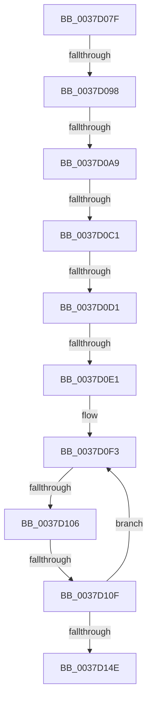

# sub_0037D07F

- RVA: `0x0037D07F`–`0x0037D168` (길이 `233` bytes)
- VA: `0x000000014037D07F`
- 실행 섹션: `.text`
- PDB 이름 있음: `아니요`; PDB Function 태그: `아니요`
- unwind 정보 RVA: `0x0007B290`
- 디코드: `47`개 명령, `233/233` bytes 표시
- 미해석 바이트: `0` (있으면 어셈블리에 `.byte`로 보존)

> 이 문서는 커널 이미지의 기계어와 PDB 기호를 분석해 생성했습니다. 4번과 5번은 함수 원형과 자료형을 바이너리 사용 방식에서 추정한 C 해석이며 원본 소스 복구 결과는 아닙니다.

## 1. Dependencies

- 직접 호출 지점: **0**; 고유 호출 대상: **0**
- 직접 호출자로 확인된 함수: **0**
- RIP 상대 이미지 참조: **4**

### Outgoing calls
- 직접 디코드된 call 명령이 없습니다.

### Direct callers
- 이 함수 시작 RVA로 연결되는 직접 call은 확인되지 않았습니다. 간접 호출은 완전히 역산할 수 없습니다.

### Static image references
- `0x0037D0B1` → RVA `0x00378F50` (`HalpHvCounterQueryCounter`; read)
- `0x0037D0C1` → RVA `0x00E11760` (`.data`; read)
- `0x0037D0D1` → RVA `0x002DDBC0` (`HvlGetReferenceTimeUsingTscPage`; read)
- `0x0037D0F3` → RVA `0x00FC6D88` (`ALMOSTRO`; read)

## 2. Other-region calls and transfers

- 다른 실행 섹션으로 향하는 call: **0**
- call이 아닌 외부 분기/꼬리 이동: **8**
  - `0x0037D092` → [sub_0037D3AC](Unknown_function_0037D3AC.md) (`tail-transfer`)
  - `0x0037D0A3` → [sub_0037D3AC + 0x127](Unknown_function_0037D3AC.md) (`tail-transfer`)
  - `0x0037D0BB` → [sub_0037D3AC + 0x28C](Unknown_function_0037D3AC.md) (`tail-transfer`)
  - `0x0037D0CB` → [sub_0037D3AC + 0x185](Unknown_function_0037D3AC.md) (`tail-transfer`)
  - `0x0037D0DB` → [sub_0037D73D + 0x34](Unknown_function_0037D73D.md) (`tail-transfer`)
  - `0x0037D100` → [sub_0037D3AC + 0x15B](Unknown_function_0037D3AC.md) (`tail-transfer`)
  - `0x0037D109` → [sub_0037D3AC + 0x13F](Unknown_function_0037D3AC.md) (`tail-transfer`)
  - `0x0037D163` → [sub_0037CBE4 + 0x8B](Unknown_function_0037CBE4.md) (`tail-transfer`)

## 3. Assembly (complete function range)

```asm
0037D07F  41 83 BD DC 00 00 00 40         cmp dword ptr [r13 + 0xdc], 0x40
0037D087  49 8B 9D C0 00 00 00            mov rbx, qword ptr [r13 + 0xc0]
0037D08E  48 89 5D 6F                     mov qword ptr [rbp + 0x6f], rbx
0037D092  0F 85 14 03 00 00               jne 0x14037d3ac
0037D098  41 F7 85 E0 00 00 00 00 00 01 00  test dword ptr [r13 + 0xe0], 0x10000
0037D0A3  0F 85 2A 04 00 00               jne 0x14037d4d3
0037D0A9  49 8B 4D 48                     mov rcx, qword ptr [r13 + 0x48]
0037D0AD  49 8B 55 70                     mov rdx, qword ptr [r13 + 0x70]
0037D0B1  48 8D 05 98 BE FF FF            lea rax, [rip - 0x4168]
0037D0B8  48 3B D0                        cmp rdx, rax
0037D0BB  0F 85 77 05 00 00               jne 0x14037d638
0037D0C1  48 8B 05 98 46 A9 00            mov rax, qword ptr [rip + 0xa94698]
0037D0C8  48 85 C0                        test rax, rax
0037D0CB  0F 84 60 04 00 00               je 0x14037d531
0037D0D1  48 8D 0D E8 0A F6 FF            lea rcx, [rip - 0x9f518]
0037D0D8  48 3B C1                        cmp rax, rcx
0037D0DB  0F 85 90 06 00 00               jne 0x14037d771
0037D0E1  4C 89 7D EF                     mov qword ptr [rbp - 0x11], r15
0037D0E5  49 BA 94 02 00 00 80 F7 FF FF   movabs r10, 0xfffff78000000294
0037D0EF  44 89 7D 77                     mov dword ptr [rbp + 0x77], r15d
0037D0F3  48 8B 05 8E 9C C4 00            mov rax, qword ptr [rip + 0xc49c8e]
0037D0FA  44 8B 08                        mov r9d, dword ptr [rax]
0037D0FD  45 85 C9                        test r9d, r9d
0037D100  0F 84 01 04 00 00               je 0x14037d507
0037D106  41 38 3A                        cmp byte ptr [r10], dil
0037D109  0F 84 DC 03 00 00               je 0x14037d4eb
0037D10F  0F 01 F9                        rdtscp
0037D112  4C 8D 45 77                     lea r8, [rbp + 0x77]
0037D116  41 89 08                        mov dword ptr [r8], ecx
0037D119  48 C1 E2 20                     shl rdx, 0x20
0037D11D  48 0B D0                        or rdx, rax
0037D120  48 8B 05 61 9C C4 00            mov rax, qword ptr [rip + 0xc49c61]
0037D127  48 8B 40 08                     mov rax, qword ptr [rax + 8]
0037D12B  48 8B 0D 56 9C C4 00            mov rcx, qword ptr [rip + 0xc49c56]
0037D132  48 F7 E2                        mul rdx
0037D135  4C 8B 41 10                     mov r8, qword ptr [rcx + 0x10]
0037D139  48 8B 05 48 9C C4 00            mov rax, qword ptr [rip + 0xc49c48]
0037D140  49 03 D0                        add rdx, r8
0037D143  48 89 55 EF                     mov qword ptr [rbp - 0x11], rdx
0037D147  8B 08                           mov ecx, dword ptr [rax]
0037D149  41 3B C9                        cmp ecx, r9d
0037D14C  75 A5                           jne 0x14037d0f3
0037D14E  48 8B 55 EF                     mov rdx, qword ptr [rbp - 0x11]
0037D152  4D 8B 85 D0 00 00 00            mov r8, qword ptr [r13 + 0xd0]
0037D159  41 B9 80 96 98 00               mov r9d, 0x989680
0037D15F  4D 8D 1C 10                     lea r11, [r8 + rdx]
0037D163  E9 07 FB FF FF                  jmp 0x14037cc6f
```

## 4. C-style interpretation (structured pseudocode)

```c
__int64 __fastcall sub_0037D07F(void)
{
    *(unsigned __int64 *)(v_rbp + 111) = *(unsigned __int64 *)(v_r13 + 192);
    *(unsigned __int64 *)(v_rbp - 17) = v_r15;
    *(unsigned int *)(v_rbp + 119) = (unsigned int)(v_r15);
loc_0037D0F3:
    *(unsigned int *)(v_rbp + 119) = (unsigned int)(v_rip - 652568);
    a2 = (*(unsigned __int64 *)(v_r13 + 112)) << (32);
    a2 = (a2) | (*(unsigned __int64 *)(v_rip + 12885134));
    a2 = (a2) + (*(unsigned __int64 *)(*(unsigned __int64 *)(v_rip + 12885078) + 16));
    *(unsigned __int64 *)(v_rbp - 17) = a2;
    if (((unsigned int)((unsigned int)(*(unsigned int *)(*(unsigned __int64 *)(v_rip + 12885064))))) != ((unsigned int)((unsigned int)(*(unsigned int *)(*(unsigned __int64 *)(v_rip + 12885134)))))) goto loc_0037D0F3;
}
```

## 5. (Beta) C Style

```c
void sub_0037D07F(void)
{
    *(uint64_t *)(local_rbp + 0x6F) = *(uint64_t *)(local_r13 + 0xC0);
    *(uint64_t *)(local_rbp - 0x11) = local_r15;
    *(uint32_t *)(local_rbp + 0x77) = (uint32_t)(local_r15);
loc_0037D0F3:
    *(uint32_t *)(local_rbp + 0x77) = (uint32_t)(v_rip - 652568);
    a2 = (*(uint64_t *)(local_r13 + 0x70)) << (32);
    a2 = (a2) | (*(uint64_t *)(v_rip + 0xC49C8E));
    a2 = (a2) + (*(uint64_t *)(*(uint64_t *)(v_rip + 0xC49C56) + 0x10));
    *(uint64_t *)(local_rbp - 0x11) = a2;
    if (((uint32_t)((uint32_t)(*(uint32_t *)(*(uint64_t *)(v_rip + 0xC49C48))))) != ((uint32_t)((uint32_t)(*(uint32_t *)(*(uint64_t *)(v_rip + 0xC49C8E)))))) goto loc_0037D0F3;
}
```

## 6. Execution-region graph

[열기: 2D/3D 그래프와 함수 탐색 컨트롤 패널](../../../control-panel.html?section=text&rva=0x0037D07F&view=graph)

- 2D 그래프는 위에서 아래로 흐르고, 3D 그래프는 빈 공간을 드래그해 회전합니다. Shift+드래그는 이동, 휠은 확대·축소, 함수 노드 선택은 대상 보고서 이동입니다.

### Static fallback


