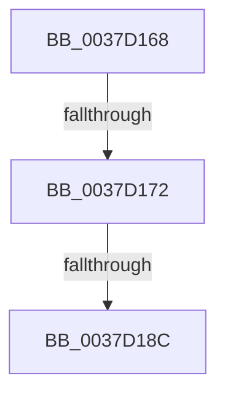

# sub_0037D168

- RVA: `0x0037D168`–`0x0037D19C` (길이 `52` bytes)
- VA: `0x000000014037D168`
- 실행 섹션: `.text`
- PDB 이름 있음: `아니요`; PDB Function 태그: `아니요`
- unwind 정보 RVA: `0x0007B2BC`
- 디코드: `12`개 명령, `52/52` bytes 표시
- 미해석 바이트: `0` (있으면 어셈블리에 `.byte`로 보존)

> 이 문서는 커널 이미지의 기계어와 PDB 기호를 분석해 생성했습니다. 4번과 5번은 함수 원형과 자료형을 바이너리 사용 방식에서 추정한 C 해석이며 원본 소스 복구 결과는 아닙니다.

## 1. Dependencies

- 직접 호출 지점: **0**; 고유 호출 대상: **0**
- 직접 호출자로 확인된 함수: **0**
- RIP 상대 이미지 참조: **0**

### Outgoing calls
- 직접 디코드된 call 명령이 없습니다.

### Direct callers
- 이 함수 시작 RVA로 연결되는 직접 call은 확인되지 않았습니다. 간접 호출은 완전히 역산할 수 없습니다.

### Static image references
- 디코드된 RIP-relative 메모리 참조가 없습니다.

## 2. Other-region calls and transfers

- 다른 실행 섹션으로 향하는 call: **0**
- call이 아닌 외부 분기/꼬리 이동: **3**
  - `0x0037D170` → [sub_0037D1C4](Unknown_function_0037D1C4.md) (`tail-transfer`)
  - `0x0037D18A` → [sub_0037D1C4](Unknown_function_0037D1C4.md) (`tail-transfer`)
  - `0x0037D19A` → [sub_0037D1C4 + 0xE](Unknown_function_0037D1C4.md) (`tail-transfer`)

## 3. Assembly (complete function range)

```asm
0037D168  41 F7 46 74 00 04 00 00         test dword ptr [r14 + 0x74], 0x400
0037D170  75 52                           jne 0x14037d1c4
0037D172  41 8B 86 4C 04 00 00            mov eax, dword ptr [r14 + 0x44c]
0037D179  F3 48 0F B8 D0                  popcnt rdx, rax
0037D17E  49 8B C3                        mov rax, r11
0037D181  48 C1 E8 04                     shr rax, 4
0037D185  83 E0 1F                        and eax, 0x1f
0037D188  3B C2                           cmp eax, edx
0037D18A  73 38                           jae 0x14037d1c4
0037D18C  44 01 86 48 86 00 00            add dword ptr [rsi + 0x8648], r8d
0037D193  45 01 86 DC 02 00 00            add dword ptr [r14 + 0x2dc], r8d
0037D19A  EB 36                           jmp 0x14037d1d2
```

## 4. C-style interpretation (structured pseudocode)

```c
__int64 __fastcall sub_0037D168(__int64 a1, __int64 a2, int a3)
{
    __int64 result;

    result = (v_r11) >> (4);
    result = (unsigned int)((result) & (31));
}
```

## 5. (Beta) C Style

```c
int64_t sub_0037D168(int64_t Arg1, int64_t Arg2, int32_t Arg3)
{
    int64_t result;

    result = (local_r11) >> (4);
    result = (uint32_t)((result) & (31));
}
```

## 6. Execution-region graph

[열기: 2D/3D 그래프와 함수 탐색 컨트롤 패널](../../../control-panel.html?section=text&rva=0x0037D168&view=graph)

- 2D 그래프는 위에서 아래로 흐르고, 3D 그래프는 빈 공간을 드래그해 회전합니다. Shift+드래그는 이동, 휠은 확대·축소, 함수 노드 선택은 대상 보고서 이동입니다.

### Static fallback


