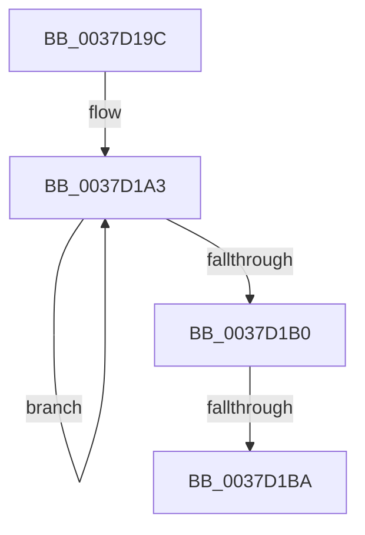

# sub_0037D19C

- RVA: `0x0037D19C`–`0x0037D1C4` (길이 `40` bytes)
- VA: `0x000000014037D19C`
- 실행 섹션: `.text`
- PDB 이름 있음: `아니요`; PDB Function 태그: `아니요`
- unwind 정보 RVA: `0x0007B2E4`
- 디코드: `10`개 명령, `40/40` bytes 표시
- 미해석 바이트: `0` (있으면 어셈블리에 `.byte`로 보존)

> 이 문서는 커널 이미지의 기계어와 PDB 기호를 분석해 생성했습니다. 4번과 5번은 함수 원형과 자료형을 바이너리 사용 방식에서 추정한 C 해석이며 원본 소스 복구 결과는 아닙니다.

## 1. Dependencies

- 직접 호출 지점: **1**; 고유 호출 대상: **1**
- 직접 호출자로 확인된 함수: **0**
- RIP 상대 이미지 참조: **0**

### Outgoing calls
- `0x0037D1BA` → [KiRemoveSystemWorkPriorityKick](../26/KiRemoveSystemWorkPriorityKick_function_002631D0.md) (function, `0x002631D0`)

### Direct callers
- 이 함수 시작 RVA로 연결되는 직접 call은 확인되지 않았습니다. 간접 호출은 완전히 역산할 수 없습니다.

### Static image references
- 디코드된 RIP-relative 메모리 참조가 없습니다.

## 2. Other-region calls and transfers

- 다른 실행 섹션으로 향하는 call: **0**
- call이 아닌 외부 분기/꼬리 이동: **2**
  - `0x0037D1B4` → [sub_0037CFD1](Unknown_function_0037CFD1.md) (`tail-transfer`)
  - `0x0037D1BF` → [sub_0037CFD1](Unknown_function_0037CFD1.md) (`tail-transfer`)

## 3. Assembly (complete function range)

```asm
0037D19C  41 0F 0D 08                     prefetchw byte ptr [r8]
0037D1A0  41 8B 00                        mov eax, dword ptr [r8]
0037D1A3  8B D0                           mov edx, eax
0037D1A5  0F BA F2 15                     btr edx, 0x15
0037D1A9  F0 41 0F B1 10                  lock cmpxchg dword ptr [r8], edx
0037D1AE  75 F3                           jne 0x14037d1a3
0037D1B0  0F BA E0 15                     bt eax, 0x15
0037D1B4  0F 83 17 FE FF FF               jae 0x14037cfd1
0037D1BA  E8 11 60 EE FF                  call 0x1402631d0
0037D1BF  E9 0D FE FF FF                  jmp 0x14037cfd1
```

## 4. C-style interpretation (structured pseudocode)

```c
__int64 __fastcall sub_0037D19C(__int64 a1, __int64 a2, __int64 a3)
{
    __int64 result;

loc_0037D1A3:
    if (condition_is_not_equal) goto loc_0037D1A3;
    result = KiRemoveSystemWorkPriorityKick(a1, (unsigned int)((unsigned int)((unsigned int)(*(unsigned int *)(a3)))), a3, a4);
}
```

## 5. (Beta) C Style

```c
int64_t sub_0037D19C(int64_t Arg1, int64_t Arg2, void *Arg3)
{
    uint8_t *arg3 = (uint8_t *)Arg3;

    int64_t result;

loc_0037D1A3:
    if (condition_is_not_equal) goto loc_0037D1A3;
    result = KiRemoveSystemWorkPriorityKick(Arg1, (uint32_t)((uint32_t)((uint32_t)(*(uint32_t *)(arg3)))), Arg3, a4);
}
```

### 관측된 메모리 오프셋

구조체 형식이 확인되지 않은 접근은 인자 기준의 오프셋으로만 기록했습니다.

| 기준 인자 | 오프셋 표현 | 폭 (bit) | 접근 |
|---|---:|---:|---|
| `Arg3` | `+ 0x0` | `8` | `R` |
| `Arg3` | `+ 0x0` | `32` | `R` |

## 6. Execution-region graph

[열기: 2D/3D 그래프와 함수 탐색 컨트롤 패널](../../../control-panel.html?section=text&rva=0x0037D19C&view=graph)

- 2D 그래프는 위에서 아래로 흐르고, 3D 그래프는 빈 공간을 드래그해 회전합니다. Shift+드래그는 이동, 휠은 확대·축소, 함수 노드 선택은 대상 보고서 이동입니다.

### Static fallback


