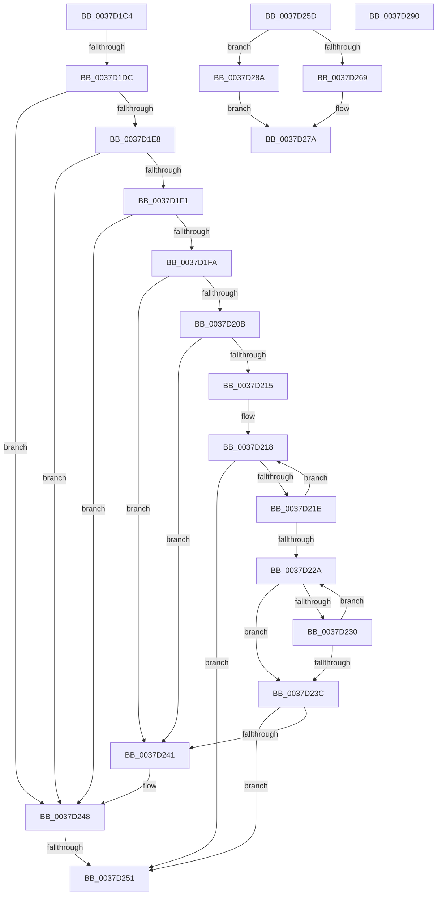

# sub_0037D1C4

- RVA: `0x0037D1C4`–`0x0037D298` (길이 `212` bytes)
- VA: `0x000000014037D1C4`
- 실행 섹션: `.text`
- PDB 이름 있음: `아니요`; PDB Function 태그: `아니요`
- unwind 정보 RVA: `0x0007B2F4`
- 디코드: `55`개 명령, `212/212` bytes 표시
- 미해석 바이트: `0` (있으면 어셈블리에 `.byte`로 보존)

> 이 문서는 커널 이미지의 기계어와 PDB 기호를 분석해 생성했습니다. 4번과 5번은 함수 원형과 자료형을 바이너리 사용 방식에서 추정한 C 해석이며 원본 소스 복구 결과는 아닙니다.

## 1. Dependencies

- 직접 호출 지점: **0**; 고유 호출 대상: **0**
- 직접 호출자로 확인된 함수: **0**
- RIP 상대 이미지 참조: **0**

### Outgoing calls
- 직접 디코드된 call 명령이 없습니다.

### Direct callers
- 이 함수 시작 RVA로 연결되는 직접 call은 확인되지 않았습니다. 간접 호출은 완전히 역산할 수 없습니다.

### Static image references
- 디코드된 RIP-relative 메모리 참조가 없습니다.

## 2. Other-region calls and transfers

- 다른 실행 섹션으로 향하는 call: **0**
- call이 아닌 외부 분기/꼬리 이동: **5**
  - `0x0037D1D6` → [sub_0037CC84 + 0xCF](Unknown_function_0037CC84.md) (`tail-transfer`)
  - `0x0037D24B` → [sub_0037CC84 + 0xCF](Unknown_function_0037CC84.md) (`tail-transfer`)
  - `0x0037D258` → [sub_0037CC84 + 0xCF](Unknown_function_0037CC84.md) (`tail-transfer`)
  - `0x0037D285` → [sub_0037CC84 + 0x243](Unknown_function_0037CC84.md) (`tail-transfer`)
  - `0x0037D293` → [sub_0037CC84 + 0x8B](Unknown_function_0037CC84.md) (`tail-transfer`)

## 3. Assembly (complete function range)

```asm
0037D1C4  44 01 86 44 86 00 00            add dword ptr [rsi + 0x8644], r8d
0037D1CB  45 01 86 8C 02 00 00            add dword ptr [r14 + 0x28c], r8d
0037D1D2  4C 3B 76 18                     cmp r14, qword ptr [rsi + 0x18]
0037D1D6  0F 84 77 FB FF FF               je 0x14037cd53
0037D1DC  49 8D 96 C3 00 00 00            lea rdx, [r14 + 0xc3]
0037D1E3  80 3A 10                        cmp byte ptr [rdx], 0x10
0037D1E6  7D 60                           jge 0x14037d248
0037D1E8  49 8B 46 68                     mov rax, qword ptr [r14 + 0x68]
0037D1EC  48 85 C0                        test rax, rax
0037D1EF  74 57                           je 0x14037d248
0037D1F1  49 8B 46 68                     mov rax, qword ptr [r14 + 0x68]
0037D1F5  48 85 C0                        test rax, rax
0037D1F8  74 4E                           je 0x14037d248
0037D1FA  8B 8E D8 00 00 00               mov ecx, dword ptr [rsi + 0xd8]
0037D200  45 8B CF                        mov r9d, r15d
0037D203  48 03 C8                        add rcx, rax
0037D206  80 3A 10                        cmp byte ptr [rdx], 0x10
0037D209  7D 36                           jge 0x14037d241
0037D20B  41 F7 46 78 00 02 00 00         test dword ptr [r14 + 0x78], 0x200
0037D213  75 2C                           jne 0x14037d241
0037D215  48 8B D1                        mov rdx, rcx
0037D218  F6 42 70 02                     test byte ptr [rdx + 0x70], 2
0037D21C  75 33                           jne 0x14037d251
0037D21E  48 8B 92 A0 01 00 00            mov rdx, qword ptr [rdx + 0x1a0]
0037D225  48 85 D2                        test rdx, rdx
0037D228  75 EE                           jne 0x14037d218
0037D22A  44 03 49 7C                     add r9d, dword ptr [rcx + 0x7c]
0037D22E  75 0C                           jne 0x14037d23c
0037D230  48 8B 89 A0 01 00 00            mov rcx, qword ptr [rcx + 0x1a0]
0037D237  48 85 C9                        test rcx, rcx
0037D23A  75 EE                           jne 0x14037d22a
0037D23C  45 85 C9                        test r9d, r9d
0037D23F  75 10                           jne 0x14037d251
0037D241  49 8D 96 C3 00 00 00            lea rdx, [r14 + 0xc3]
0037D248  80 3A 08                        cmp byte ptr [rdx], 8
0037D24B  0F 8D 02 FB FF FF               jge 0x14037cd53
0037D251  44 01 86 6C 86 00 00            add dword ptr [rsi + 0x866c], r8d
0037D258  E9 F6 FA FF FF                  jmp 0x14037cd53
0037D25D  8B D0                           mov edx, eax
0037D25F  89 45 F7                        mov dword ptr [rbp - 9], eax
0037D262  2B D1                           sub edx, ecx
0037D264  83 FA 20                        cmp edx, 0x20
0037D267  73 21                           jae 0x14037d28a
0037D269  41 8B 80 C4 00 00 00            mov eax, dword ptr [r8 + 0xc4]
0037D270  8B CA                           mov ecx, edx
0037D272  D3 E0                           shl eax, cl
0037D274  41 0B C4                        or eax, r12d
0037D277  89 45 FB                        mov dword ptr [rbp - 5], eax
0037D27A  48 8B 45 F7                     mov rax, qword ptr [rbp - 9]
0037D27E  49 89 80 C0 00 00 00            mov qword ptr [r8 + 0xc0], rax
0037D285  E9 3D FC FF FF                  jmp 0x14037cec7
0037D28A  44 89 65 FB                     mov dword ptr [rbp - 5], r12d
0037D28E  EB EA                           jmp 0x14037d27a
0037D290  48 F7 E2                        mul rdx
0037D293  E9 77 FA FF FF                  jmp 0x14037cd0f
```

## 4. C-style interpretation (structured pseudocode)

```c
__int64 __fastcall sub_0037D1C4(__int64 a1, __int64 a2, __int64 a3)
{
    if ((*(unsigned __int8 *)(v_r14 + 195)) >= 16) goto loc_0037D248;
    if (*(unsigned __int64 *)(v_r14 + 104) == 0) goto loc_0037D248;
    if (*(unsigned __int64 *)(v_r14 + 104) == 0) goto loc_0037D248;
    a1 = ((unsigned int)(*(unsigned int *)(v_rsi + 216))) + (*(unsigned __int64 *)(v_r14 + 104));
    if ((*(unsigned __int8 *)(v_r14 + 195)) >= 16) goto loc_0037D241;
    if (((*(unsigned int *)(v_r14 + 120)) & (512)) != 0) goto loc_0037D241;
loc_0037D218:
    if (((*(unsigned __int8 *)(a1 + 112)) & (2)) != 0) goto loc_0037D251;
    if (*(unsigned __int64 *)(a1 + 416) != 0) goto loc_0037D218;
loc_0037D22A:
    a4 = (unsigned int)(((unsigned int)((unsigned int)(v_r15))) + (*(unsigned int *)(a1 + 124)));
    if (condition_is_not_equal) goto loc_0037D23C;
    if (*(unsigned __int64 *)(a1 + 416) != 0) goto loc_0037D22A;
loc_0037D23C:
    if ((unsigned int)(a4) != 0) goto loc_0037D251;
loc_0037D241:
loc_0037D248:
loc_0037D251:
}
```

## 5. (Beta) C Style

```c
int64_t sub_0037D1C4(int64_t Arg1, int64_t Arg2, int64_t Arg3)
{
    if ((*(uint8_t *)(local_r14 + 0xC3)) >= 16) goto loc_0037D248;
    if (*(uint64_t *)(local_r14 + 0x68) == 0) goto loc_0037D248;
    if (*(uint64_t *)(local_r14 + 0x68) == 0) goto loc_0037D248;
    Arg1 = ((uint32_t)(*(uint32_t *)(local_rsi + 0xD8))) + (*(uint64_t *)(local_r14 + 0x68));
    if ((*(uint8_t *)(local_r14 + 0xC3)) >= 16) goto loc_0037D241;
    if (((*(uint32_t *)(local_r14 + 0x78)) & (512)) != 0) goto loc_0037D241;
loc_0037D218:
    if (((*(uint8_t *)(Arg1 + 0x70)) & (2)) != 0) goto loc_0037D251;
    if (*(uint64_t *)(Arg1 + 0x1A0) != 0) goto loc_0037D218;
loc_0037D22A:
    a4 = (uint32_t)(((uint32_t)((uint32_t)(local_r15))) + (*(uint32_t *)(Arg1 + 0x7C)));
    if (condition_is_not_equal) goto loc_0037D23C;
    if (*(uint64_t *)(Arg1 + 0x1A0) != 0) goto loc_0037D22A;
loc_0037D23C:
    if ((uint32_t)(a4) != 0) goto loc_0037D251;
loc_0037D241:
loc_0037D248:
loc_0037D251:
}
```

## 6. Execution-region graph

[열기: 2D/3D 그래프와 함수 탐색 컨트롤 패널](../../../control-panel.html?section=text&rva=0x0037D1C4&view=graph)

- 2D 그래프는 위에서 아래로 흐르고, 3D 그래프는 빈 공간을 드래그해 회전합니다. Shift+드래그는 이동, 휠은 확대·축소, 함수 노드 선택은 대상 보고서 이동입니다.

### Static fallback


