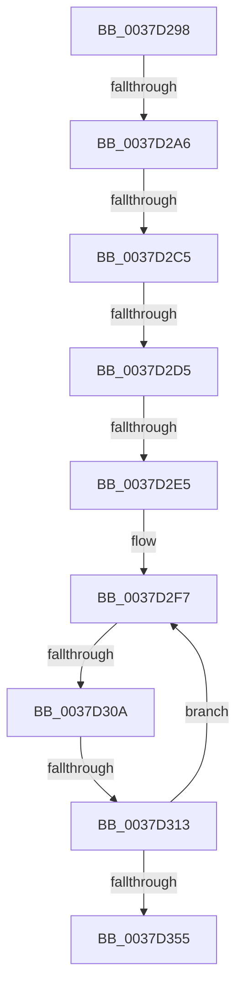

# sub_0037D298

- RVA: `0x0037D298`–`0x0037D37E` (길이 `230` bytes)
- VA: `0x000000014037D298`
- 실행 섹션: `.text`
- PDB 이름 있음: `아니요`; PDB Function 태그: `아니요`
- unwind 정보 RVA: `0x0007B31C`
- 디코드: `50`개 명령, `230/230` bytes 표시
- 미해석 바이트: `0` (있으면 어셈블리에 `.byte`로 보존)

> 이 문서는 커널 이미지의 기계어와 PDB 기호를 분석해 생성했습니다. 4번과 5번은 함수 원형과 자료형을 바이너리 사용 방식에서 추정한 C 해석이며 원본 소스 복구 결과는 아닙니다.

## 1. Dependencies

- 직접 호출 지점: **2**; 고유 호출 대상: **2**
- 직접 호출자로 확인된 함수: **0**
- RIP 상대 이미지 참조: **4**

### Outgoing calls
- `0x0037D2A9` → [HalpTimerGetInternalData](../20/HalpTimerGetInternalData_function_00209500.md) (function, `0x00209500`)
- `0x0037D36E` → [HalpTimerScaleCounter](HalpTimerScaleCounter_function_0037B354.md) (function, `0x0037B354`)

### Direct callers
- 이 함수 시작 RVA로 연결되는 직접 call은 확인되지 않았습니다. 간접 호출은 완전히 역산할 수 없습니다.

### Static image references
- `0x0037D2B5` → RVA `0x00378F50` (`HalpHvCounterQueryCounter`; read)
- `0x0037D2C5` → RVA `0x00E11760` (`.data`; read)
- `0x0037D2D5` → RVA `0x002DDBC0` (`HvlGetReferenceTimeUsingTscPage`; read)
- `0x0037D2F7` → RVA `0x00FC6D88` (`ALMOSTRO`; read)

## 2. Other-region calls and transfers

- 다른 실행 섹션으로 향하는 call: **0**
- call이 아닌 외부 분기/꼬리 이동: **7**
  - `0x0037D2A0` → [sub_0037D3AC + 0x198](Unknown_function_0037D3AC.md) (`tail-transfer`)
  - `0x0037D2BF` → [sub_0037D3AC + 0x2F5](Unknown_function_0037D3AC.md) (`tail-transfer`)
  - `0x0037D2CF` → [sub_0037D3AC + 0x2E2](Unknown_function_0037D3AC.md) (`tail-transfer`)
  - `0x0037D2DF` → [sub_0037D73D + 0xD](Unknown_function_0037D73D.md) (`tail-transfer`)
  - `0x0037D304` → [sub_0037D3AC + 0x2CF](Unknown_function_0037D3AC.md) (`tail-transfer`)
  - `0x0037D30D` → [sub_0037D3AC + 0x29C](Unknown_function_0037D3AC.md) (`tail-transfer`)
  - `0x0037D379` → [sub_0037CBE4 + 0x8B](Unknown_function_0037CBE4.md) (`tail-transfer`)

## 3. Assembly (complete function range)

```asm
0037D298  41 83 BD DC 00 00 00 40         cmp dword ptr [r13 + 0xdc], 0x40
0037D2A0  0F 85 9E 02 00 00               jne 0x14037d544
0037D2A6  49 8B CD                        mov rcx, r13
0037D2A9  E8 52 C2 E8 FF                  call 0x140209500
0037D2AE  49 8B 55 70                     mov rdx, qword ptr [r13 + 0x70]
0037D2B2  48 8B C8                        mov rcx, rax
0037D2B5  48 8D 05 94 BC FF FF            lea rax, [rip - 0x436c]
0037D2BC  48 3B D0                        cmp rdx, rax
0037D2BF  0F 85 DC 03 00 00               jne 0x14037d6a1
0037D2C5  48 8B 05 94 44 A9 00            mov rax, qword ptr [rip + 0xa94494]
0037D2CC  48 85 C0                        test rax, rax
0037D2CF  0F 84 B9 03 00 00               je 0x14037d68e
0037D2D5  48 8D 0D E4 08 F6 FF            lea rcx, [rip - 0x9f71c]
0037D2DC  48 3B C1                        cmp rax, rcx
0037D2DF  0F 85 65 04 00 00               jne 0x14037d74a
0037D2E5  4C 89 7D E7                     mov qword ptr [rbp - 0x19], r15
0037D2E9  49 BA 94 02 00 00 80 F7 FF FF   movabs r10, 0xfffff78000000294
0037D2F3  44 89 7D 6F                     mov dword ptr [rbp + 0x6f], r15d
0037D2F7  48 8B 05 8A 9A C4 00            mov rax, qword ptr [rip + 0xc49a8a]
0037D2FE  44 8B 08                        mov r9d, dword ptr [rax]
0037D301  45 85 C9                        test r9d, r9d
0037D304  0F 84 71 03 00 00               je 0x14037d67b
0037D30A  41 38 3A                        cmp byte ptr [r10], dil
0037D30D  0F 84 35 03 00 00               je 0x14037d648
0037D313  0F 01 F9                        rdtscp
0037D316  4C 8D 45 6F                     lea r8, [rbp + 0x6f]
0037D31A  41 89 08                        mov dword ptr [r8], ecx
0037D31D  48 C1 E2 20                     shl rdx, 0x20
0037D321  48 0B D0                        or rdx, rax
0037D324  48 8B 05 5D 9A C4 00            mov rax, qword ptr [rip + 0xc49a5d]
0037D32B  48 8B 48 08                     mov rcx, qword ptr [rax + 8]
0037D32F  48 8B 05 52 9A C4 00            mov rax, qword ptr [rip + 0xc49a52]
0037D336  4C 8B 40 10                     mov r8, qword ptr [rax + 0x10]
0037D33A  48 8B C1                        mov rax, rcx
0037D33D  48 F7 E2                        mul rdx
0037D340  48 8B 05 41 9A C4 00            mov rax, qword ptr [rip + 0xc49a41]
0037D347  49 03 D0                        add rdx, r8
0037D34A  48 89 55 E7                     mov qword ptr [rbp - 0x19], rdx
0037D34E  8B 08                           mov ecx, dword ptr [rax]
0037D350  41 3B C9                        cmp ecx, r9d
0037D353  75 A2                           jne 0x14037d2f7
0037D355  48 8B 55 E7                     mov rdx, qword ptr [rbp - 0x19]
0037D359  4D 8B 9D D0 00 00 00            mov r11, qword ptr [r13 + 0xd0]
0037D360  49 8D 0C 13                     lea rcx, [r11 + rdx]
0037D364  4C 8B C3                        mov r8, rbx
0037D367  49 8B 95 C0 00 00 00            mov rdx, qword ptr [r13 + 0xc0]
0037D36E  E8 E1 DF FF FF                  call 0x14037b354
0037D373  4C 8B D8                        mov r11, rax
0037D376  4C 8B CB                        mov r9, rbx
0037D379  E9 F1 F8 FF FF                  jmp 0x14037cc6f
```

## 4. C-style interpretation (structured pseudocode)

```c
__int64 __fastcall sub_0037D298(void)
{
    __int64 result;

    result = HalpTimerGetInternalData(v_r13, a2, a3, a4);
    *(unsigned __int64 *)(v_rbp - 25) = v_r15;
    *(unsigned int *)(v_rbp + 111) = (unsigned int)(v_r15);
loc_0037D2F7:
    *(unsigned int *)(v_rbp + 111) = (unsigned int)(v_rip - 653084);
    a2 = (*(unsigned __int64 *)(v_r13 + 112)) << (32);
    a2 = (a2) | (*(unsigned __int64 *)(v_rip + 12884618));
    a2 = (a2) + (*(unsigned __int64 *)(*(unsigned __int64 *)(v_rip + 12884562) + 16));
    *(unsigned __int64 *)(v_rbp - 25) = a2;
    if (((unsigned int)((unsigned int)(*(unsigned int *)(*(unsigned __int64 *)(v_rip + 12884545))))) != ((unsigned int)((unsigned int)(*(unsigned int *)(*(unsigned __int64 *)(v_rip + 12884618)))))) goto loc_0037D2F7;
    result = HalpTimerScaleCounter(*(unsigned __int64 *)(v_r13 + 208) + *(unsigned __int64 *)(v_rbp - 25) * 1, *(unsigned __int64 *)(v_r13 + 192), v_rbx, (unsigned int)(*(unsigned int *)(*(unsigned __int64 *)(v_rip + 12884618))));
}
```

## 5. (Beta) C Style

```c
void sub_0037D298(void)
{
    int64_t result;

    result = HalpTimerGetInternalData(local_r13, a2, a3, a4);
    *(uint64_t *)(local_rbp - 0x19) = local_r15;
    *(uint32_t *)(local_rbp + 0x6F) = (uint32_t)(local_r15);
loc_0037D2F7:
    *(uint32_t *)(local_rbp + 0x6F) = (uint32_t)(v_rip - 653084);
    a2 = (*(uint64_t *)(local_r13 + 0x70)) << (32);
    a2 = (a2) | (*(uint64_t *)(v_rip + 0xC49A8A));
    a2 = (a2) + (*(uint64_t *)(*(uint64_t *)(v_rip + 0xC49A52) + 0x10));
    *(uint64_t *)(local_rbp - 0x19) = a2;
    if (((uint32_t)((uint32_t)(*(uint32_t *)(*(uint64_t *)(v_rip + 0xC49A41))))) != ((uint32_t)((uint32_t)(*(uint32_t *)(*(uint64_t *)(v_rip + 0xC49A8A)))))) goto loc_0037D2F7;
    result = HalpTimerScaleCounter(*(uint64_t *)(local_r13 + 0xD0) + *(uint64_t *)(local_rbp - 0x19) * 1, *(uint64_t *)(local_r13 + 0xC0), local_rbx, (uint32_t)(*(uint32_t *)(*(uint64_t *)(v_rip + 0xC49A8A))));
}
```

## 6. Execution-region graph

[열기: 2D/3D 그래프와 함수 탐색 컨트롤 패널](../../../control-panel.html?section=text&rva=0x0037D298&view=graph)

- 2D 그래프는 위에서 아래로 흐르고, 3D 그래프는 빈 공간을 드래그해 회전합니다. Shift+드래그는 이동, 휠은 확대·축소, 함수 노드 선택은 대상 보고서 이동입니다.

### Static fallback


