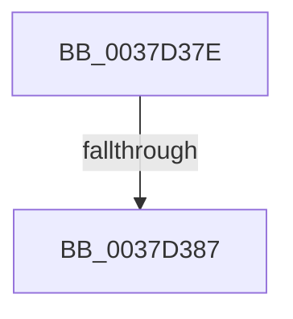

# sub_0037D37E

- RVA: `0x0037D37E`–`0x0037D3AC` (길이 `46` bytes)
- VA: `0x000000014037D37E`
- 실행 섹션: `.text`
- PDB 이름 있음: `아니요`; PDB Function 태그: `아니요`
- unwind 정보 RVA: `0x0007B348`
- 디코드: `10`개 명령, `46/46` bytes 표시
- 미해석 바이트: `0` (있으면 어셈블리에 `.byte`로 보존)

> 이 문서는 커널 이미지의 기계어와 PDB 기호를 분석해 생성했습니다. 4번과 5번은 함수 원형과 자료형을 바이너리 사용 방식에서 추정한 C 해석이며 원본 소스 복구 결과는 아닙니다.

## 1. Dependencies

- 직접 호출 지점: **1**; 고유 호출 대상: **1**
- 직접 호출자로 확인된 함수: **0**
- RIP 상대 이미지 참조: **0**

### Outgoing calls
- `0x0037D39F` → [HalpTimerScaleCounter](HalpTimerScaleCounter_function_0037B354.md) (function, `0x0037B354`)

### Direct callers
- 이 함수 시작 RVA로 연결되는 직접 call은 확인되지 않았습니다. 간접 호출은 완전히 역산할 수 없습니다.

### Static image references
- 디코드된 RIP-relative 메모리 참조가 없습니다.

## 2. Other-region calls and transfers

- 다른 실행 섹션으로 향하는 call: **0**
- call이 아닌 외부 분기/꼬리 이동: **2**
  - `0x0037D381` → [sub_0037CC84](Unknown_function_0037CC84.md) (`tail-transfer`)
  - `0x0037D3A7` → [sub_0037CC84](Unknown_function_0037CC84.md) (`tail-transfer`)

## 3. Assembly (complete function range)

```asm
0037D37E  48 85 C0                        test rax, rax
0037D381  0F 84 FD F8 FF FF               je 0x14037cc84
0037D387  83 B8 E4 00 00 00 05            cmp dword ptr [rax + 0xe4], 5
0037D38E  48 8B D3                        mov rdx, rbx
0037D391  4C 8B 80 C0 00 00 00            mov r8, qword ptr [rax + 0xc0]
0037D398  49 8B CB                        mov rcx, r11
0037D39B  4D 0F 44 C1                     cmove r8, r9
0037D39F  E8 B0 DF FF FF                  call 0x14037b354
0037D3A4  4C 8B D8                        mov r11, rax
0037D3A7  E9 D8 F8 FF FF                  jmp 0x14037cc84
```

## 4. C-style interpretation (structured pseudocode)

```c
__int64 __fastcall sub_0037D37E(__int64 a1, __int64 a2, __int64 a3, __int64 a4)
{
    __int64 result;

    a3 = *(unsigned __int64 *)(result + 192);
    if ((*(unsigned int *)(result + 228)) == 5) { a3 = a4; }
    result = HalpTimerScaleCounter(v_r11, v_rbx, a3, a4);
}
```

## 5. (Beta) C Style

```c
int64_t sub_0037D37E(int64_t Arg1, int64_t Arg2, int64_t Arg3, int64_t Arg4)
{
    int64_t result;

    Arg3 = *(uint64_t *)(result + 0xC0);
    if ((*(uint32_t *)(result + 0xE4)) == 5) { Arg3 = Arg4; }
    result = HalpTimerScaleCounter(local_r11, local_rbx, Arg3, Arg4);
}
```

## 6. Execution-region graph

[열기: 2D/3D 그래프와 함수 탐색 컨트롤 패널](../../../control-panel.html?section=text&rva=0x0037D37E&view=graph)

- 2D 그래프는 위에서 아래로 흐르고, 3D 그래프는 빈 공간을 드래그해 회전합니다. Shift+드래그는 이동, 휠은 확대·축소, 함수 노드 선택은 대상 보고서 이동입니다.

### Static fallback


