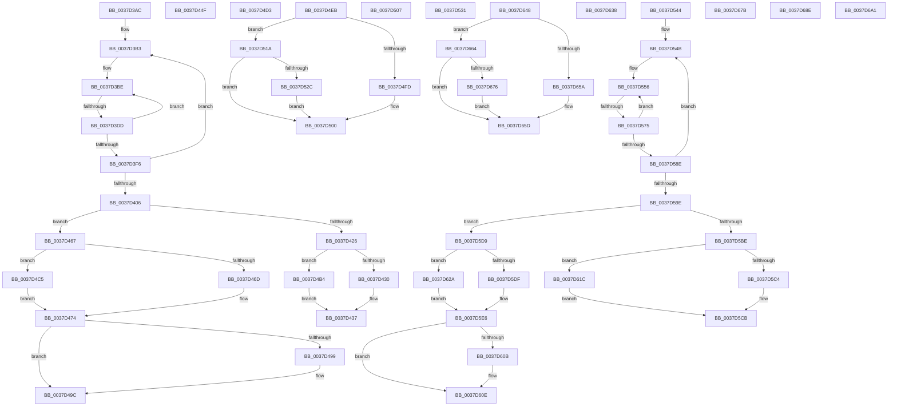

# sub_0037D3AC

- RVA: `0x0037D3AC`–`0x0037D6B1` (길이 `773` bytes)
- VA: `0x000000014037D3AC`
- 실행 섹션: `.text`
- PDB 이름 있음: `아니요`; PDB Function 태그: `아니요`
- unwind 정보 RVA: `0x0007B370`
- 디코드: `190`개 명령, `773/773` bytes 표시
- 미해석 바이트: `0` (있으면 어셈블리에 `.byte`로 보존)

> 이 문서는 커널 이미지의 기계어와 PDB 기호를 분석해 생성했습니다. 4번과 5번은 함수 원형과 자료형을 바이너리 사용 방식에서 추정한 C 해석이며 원본 소스 복구 결과는 아닙니다.

## 1. Dependencies

- 직접 호출 지점: **8**; 고유 호출 대상: **4**
- 직접 호출자로 확인된 함수: **0**
- RIP 상대 이미지 참조: **1**

### Outgoing calls
- `0x0037D3C8` → [HalpTimerGetInternalData](../20/HalpTimerGetInternalData_function_00209500.md) (function, `0x00209500`)
- `0x0037D3DD` → [HalpHpetQueryCounter](HalpHpetQueryCounter_function_00379660.md) (function, `0x00379660`)
- `0x0037D510` → [HvlpGetRegister64](HvlpGetRegister64_function_00379050.md) (function, `0x00379050`)
- `0x0037D560` → [HalpTimerGetInternalData](../20/HalpTimerGetInternalData_function_00209500.md) (function, `0x00209500`)
- `0x0037D575` → [HalpHpetQueryCounter](HalpHpetQueryCounter_function_00379660.md) (function, `0x00379660`)
- `0x0037D63B` → [guard_dispatch_icall](../6B/guard_dispatch_icall_function_006BAAD0.md) (function, `0x006BAAD0`)
- `0x0037D684` → [HvlpGetRegister64](HvlpGetRegister64_function_00379050.md) (function, `0x00379050`)
- `0x0037D6A4` → [guard_dispatch_icall](../6B/guard_dispatch_icall_function_006BAAD0.md) (function, `0x006BAAD0`)

### Direct callers
- 이 함수 시작 RVA로 연결되는 직접 call은 확인되지 않았습니다. 간접 호출은 완전히 역산할 수 없습니다.

### Static image references
- `0x0037D3AC` → RVA `0x00379660` (`HalpHpetQueryCounter`; read)

## 2. Other-region calls and transfers

- 다른 실행 섹션으로 향하는 call: **0**
- call이 아닌 외부 분기/꼬리 이동: **16**
  - `0x0037D3D7` → [sub_0037D73D + 0x27](Unknown_function_0037D73D.md) (`tail-transfer`)
  - `0x0037D44A` → [sub_0037CBE4 + 0x8B](Unknown_function_0037CBE4.md) (`tail-transfer`)
  - `0x0037D462` → [sub_0037CBE4 + 0x44](Unknown_function_0037CBE4.md) (`tail-transfer`)
  - `0x0037D4AF` → [sub_0037CBE4 + 0x8B](Unknown_function_0037CBE4.md) (`tail-transfer`)
  - `0x0037D4E6` → [sub_0037D07F + 0x2E](Unknown_function_0037D07F.md) (`tail-transfer`)
  - `0x0037D502` → [sub_0037D07F + 0x9A](Unknown_function_0037D07F.md) (`tail-transfer`)
  - `0x0037D515` → [sub_0037D07F + 0xCF](Unknown_function_0037D07F.md) (`tail-transfer`)
  - `0x0037D53F` → [sub_0037D07F + 0xD3](Unknown_function_0037D07F.md) (`tail-transfer`)
  - `0x0037D56F` → [sub_0037D73D](Unknown_function_0037D73D.md) (`tail-transfer`)
  - `0x0037D5D4` → [sub_0037D298 + 0xC8](Unknown_function_0037D298.md) (`tail-transfer`)
  - `0x0037D617` → [sub_0037D298 + 0xC8](Unknown_function_0037D298.md) (`tail-transfer`)
  - `0x0037D643` → [sub_0037D07F + 0xD3](Unknown_function_0037D07F.md) (`tail-transfer`)
  - `0x0037D65F` → [sub_0037D298 + 0x85](Unknown_function_0037D298.md) (`tail-transfer`)
  - `0x0037D689` → [sub_0037D298 + 0xBD](Unknown_function_0037D298.md) (`tail-transfer`)
  - `0x0037D69C` → [sub_0037D298 + 0xC1](Unknown_function_0037D298.md) (`tail-transfer`)
  - `0x0037D6AC` → [sub_0037D298 + 0xC1](Unknown_function_0037D298.md) (`tail-transfer`)

## 3. Assembly (complete function range)

```asm
0037D3AC  48 8D 1D AD C2 FF FF            lea rbx, [rip - 0x3d53]
0037D3B3  49 8B 85 D0 00 00 00            mov rax, qword ptr [r13 + 0xd0]
0037D3BA  48 89 45 F7                     mov qword ptr [rbp - 9], rax
0037D3BE  49 8B BD C8 00 00 00            mov rdi, qword ptr [r13 + 0xc8]
0037D3C5  49 8B CD                        mov rcx, r13
0037D3C8  E8 33 C1 E8 FF                  call 0x140209500
0037D3CD  49 8B 55 70                     mov rdx, qword ptr [r13 + 0x70]
0037D3D1  48 8B C8                        mov rcx, rax
0037D3D4  48 3B D3                        cmp rdx, rbx
0037D3D7  0F 85 87 03 00 00               jne 0x14037d764
0037D3DD  E8 7E C2 FF FF                  call 0x140379660
0037D3E2  4C 8B D8                        mov r11, rax
0037D3E5  F0 44 09 3C 24                  lock or dword ptr [rsp], r15d
0037D3EA  49 8B 85 C8 00 00 00            mov rax, qword ptr [r13 + 0xc8]
0037D3F1  48 3B F8                        cmp rdi, rax
0037D3F4  75 C8                           jne 0x14037d3be
0037D3F6  49 8B 8D D0 00 00 00            mov rcx, qword ptr [r13 + 0xd0]
0037D3FD  4C 8B 45 F7                     mov r8, qword ptr [rbp - 9]
0037D401  4C 3B C1                        cmp r8, rcx
0037D404  75 AD                           jne 0x14037d3b3
0037D406  45 8B 95 DC 00 00 00            mov r10d, dword ptr [r13 + 0xdc]
0037D40D  49 8B D4                        mov rdx, r12
0037D410  48 8B 5D 6F                     mov rbx, qword ptr [rbp + 0x6f]
0037D414  41 8D 4A FF                     lea ecx, [r10 - 1]
0037D418  48 D3 E2                        shl rdx, cl
0037D41B  49 8B CB                        mov rcx, r11
0037D41E  48 33 CF                        xor rcx, rdi
0037D421  48 85 CA                        test rdx, rcx
0037D424  75 41                           jne 0x14037d467
0037D426  41 83 FA 40                     cmp r10d, 0x40
0037D42A  0F 85 84 00 00 00               jne 0x14037d4b4
0037D430  48 C7 C2 FF FF FF FF            mov rdx, 0xffffffffffffffff
0037D437  48 F7 D2                        not rdx
0037D43A  41 B9 80 96 98 00               mov r9d, 0x989680
0037D440  48 23 D7                        and rdx, rdi
0037D443  49 0B D3                        or rdx, r11
0037D446  4D 8D 1C 10                     lea r11, [r8 + rdx]
0037D44A  E9 20 F8 FF FF                  jmp 0x14037cc6f
0037D44F  65 8B 04 25 A4 01 00 00         mov eax, dword ptr gs:[0x1a4]
0037D457  41 0F AF 45 50                  imul eax, dword ptr [r13 + 0x50]
0037D45C  8B C8                           mov ecx, eax
0037D45E  49 03 4D 48                     add rcx, qword ptr [r13 + 0x48]
0037D462  E9 C1 F7 FF FF                  jmp 0x14037cc28
0037D467  41 83 FA 40                     cmp r10d, 0x40
0037D46B  75 58                           jne 0x14037d4c5
0037D46D  49 C7 C1 FF FF FF FF            mov r9, 0xffffffffffffffff
0037D474  41 8B CA                        mov ecx, r10d
0037D477  49 8B D4                        mov rdx, r12
0037D47A  48 D3 E2                        shl rdx, cl
0037D47D  49 8B CF                        mov rcx, r15
0037D480  41 83 FA 40                     cmp r10d, 0x40
0037D484  48 0F 45 CA                     cmovne rcx, rdx
0037D488  4C 23 CF                        and r9, rdi
0037D48B  49 8B D1                        mov rdx, r9
0037D48E  48 33 D7                        xor rdx, rdi
0037D491  49 0B D3                        or rdx, r11
0037D494  4D 3B D9                        cmp r11, r9
0037D497  73 03                           jae 0x14037d49c
0037D499  48 03 D1                        add rdx, rcx
0037D49C  F0 49 0F B1 95 C8 00 00 00      lock cmpxchg qword ptr [r13 + 0xc8], rdx
0037D4A5  4D 8D 1C 10                     lea r11, [r8 + rdx]
0037D4A9  41 B9 80 96 98 00               mov r9d, 0x989680
0037D4AF  E9 BB F7 FF FF                  jmp 0x14037cc6f
0037D4B4  41 8B CA                        mov ecx, r10d
0037D4B7  49 8B D4                        mov rdx, r12
0037D4BA  48 D3 E2                        shl rdx, cl
0037D4BD  48 FF CA                        dec rdx
0037D4C0  E9 72 FF FF FF                  jmp 0x14037d437
0037D4C5  41 8B CA                        mov ecx, r10d
0037D4C8  4D 8B CC                        mov r9, r12
0037D4CB  49 D3 E1                        shl r9, cl
0037D4CE  49 FF C9                        dec r9
0037D4D1  EB A1                           jmp 0x14037d474
0037D4D3  65 8B 04 25 A4 01 00 00         mov eax, dword ptr gs:[0x1a4]
0037D4DB  41 0F AF 45 50                  imul eax, dword ptr [r13 + 0x50]
0037D4E0  8B C8                           mov ecx, eax
0037D4E2  49 03 4D 48                     add rcx, qword ptr [r13 + 0x48]
0037D4E6  E9 C2 FB FF FF                  jmp 0x14037d0ad
0037D4EB  65 48 8B 04 25 20 00 00 00      mov rax, qword ptr gs:[0x20]
0037D4F4  80 B8 8D 00 00 00 02            cmp byte ptr [rax + 0x8d], 2
0037D4FB  75 1D                           jne 0x14037d51a
0037D4FD  0F AE E8                        lfence
0037D500  0F 31                           rdtsc
0037D502  E9 12 FC FF FF                  jmp 0x14037d119
0037D507  48 8D 55 EF                     lea rdx, [rbp - 0x11]
0037D50B  B9 04 00 09 00                  mov ecx, 0x90004
0037D510  E8 3B BB FF FF                  call 0x140379050
0037D515  E9 34 FC FF FF                  jmp 0x14037d14e
0037D51A  65 48 8B 04 25 20 00 00 00      mov rax, qword ptr gs:[0x20]
0037D523  44 38 A0 8D 00 00 00            cmp byte ptr [rax + 0x8d], r12b
0037D52A  75 D4                           jne 0x14037d500
0037D52C  0F AE F0                        mfence
0037D52F  EB CF                           jmp 0x14037d500
0037D531  B9 20 00 00 40                  mov ecx, 0x40000020
0037D536  0F 32                           rdmsr
0037D538  48 C1 E2 20                     shl rdx, 0x20
0037D53C  48 0B D0                        or rdx, rax
0037D53F  E9 0E FC FF FF                  jmp 0x14037d152
0037D544  4C 8D 35 15 C1 FF FF            lea r14, [rip - 0x3eeb]
0037D54B  49 8B 85 D0 00 00 00            mov rax, qword ptr [r13 + 0xd0]
0037D552  48 89 45 F7                     mov qword ptr [rbp - 9], rax
0037D556  49 8B BD C8 00 00 00            mov rdi, qword ptr [r13 + 0xc8]
0037D55D  49 8B CD                        mov rcx, r13
0037D560  E8 9B BF E8 FF                  call 0x140209500
0037D565  49 8B 55 70                     mov rdx, qword ptr [r13 + 0x70]
0037D569  48 8B C8                        mov rcx, rax
0037D56C  49 3B D6                        cmp rdx, r14
0037D56F  0F 85 C8 01 00 00               jne 0x14037d73d
0037D575  E8 E6 C0 FF FF                  call 0x140379660
0037D57A  4C 8B D0                        mov r10, rax
0037D57D  F0 44 09 3C 24                  lock or dword ptr [rsp], r15d
0037D582  49 8B 85 C8 00 00 00            mov rax, qword ptr [r13 + 0xc8]
0037D589  48 3B F8                        cmp rdi, rax
0037D58C  75 C8                           jne 0x14037d556
0037D58E  49 8B 8D D0 00 00 00            mov rcx, qword ptr [r13 + 0xd0]
0037D595  4C 8B 5D F7                     mov r11, qword ptr [rbp - 9]
0037D599  4C 3B D9                        cmp r11, rcx
0037D59C  75 AD                           jne 0x14037d54b
0037D59E  45 8B 85 DC 00 00 00            mov r8d, dword ptr [r13 + 0xdc]
0037D5A5  49 8B D4                        mov rdx, r12
0037D5A8  4C 8B 75 6F                     mov r14, qword ptr [rbp + 0x6f]
0037D5AC  41 8D 48 FF                     lea ecx, [r8 - 1]
0037D5B0  48 D3 E2                        shl rdx, cl
0037D5B3  49 8B CA                        mov rcx, r10
0037D5B6  48 33 CF                        xor rcx, rdi
0037D5B9  48 85 CA                        test rdx, rcx
0037D5BC  75 1B                           jne 0x14037d5d9
0037D5BE  41 83 F8 40                     cmp r8d, 0x40
0037D5C2  75 58                           jne 0x14037d61c
0037D5C4  48 C7 C2 FF FF FF FF            mov rdx, 0xffffffffffffffff
0037D5CB  48 F7 D2                        not rdx
0037D5CE  48 23 D7                        and rdx, rdi
0037D5D1  49 0B D2                        or rdx, r10
0037D5D4  E9 87 FD FF FF                  jmp 0x14037d360
0037D5D9  41 83 F8 40                     cmp r8d, 0x40
0037D5DD  75 4B                           jne 0x14037d62a
0037D5DF  49 C7 C1 FF FF FF FF            mov r9, 0xffffffffffffffff
0037D5E6  41 8B C8                        mov ecx, r8d
0037D5E9  49 8B D4                        mov rdx, r12
0037D5EC  48 D3 E2                        shl rdx, cl
0037D5EF  49 8B CF                        mov rcx, r15
0037D5F2  41 83 F8 40                     cmp r8d, 0x40
0037D5F6  48 0F 45 CA                     cmovne rcx, rdx
0037D5FA  4C 23 CF                        and r9, rdi
0037D5FD  49 8B D1                        mov rdx, r9
0037D600  48 33 D7                        xor rdx, rdi
0037D603  49 0B D2                        or rdx, r10
0037D606  4D 3B D1                        cmp r10, r9
0037D609  73 03                           jae 0x14037d60e
0037D60B  48 03 D1                        add rdx, rcx
0037D60E  F0 49 0F B1 95 C8 00 00 00      lock cmpxchg qword ptr [r13 + 0xc8], rdx
0037D617  E9 44 FD FF FF                  jmp 0x14037d360
0037D61C  41 8B C8                        mov ecx, r8d
0037D61F  49 8B D4                        mov rdx, r12
0037D622  48 D3 E2                        shl rdx, cl
0037D625  48 FF CA                        dec rdx
0037D628  EB A1                           jmp 0x14037d5cb
0037D62A  41 8B C8                        mov ecx, r8d
0037D62D  4D 8B CC                        mov r9, r12
0037D630  49 D3 E1                        shl r9, cl
0037D633  49 FF C9                        dec r9
0037D636  EB AE                           jmp 0x14037d5e6
0037D638  48 8B C2                        mov rax, rdx
0037D63B  E8 90 D4 33 00                  call 0x1406baad0
0037D640  48 8B D0                        mov rdx, rax
0037D643  E9 0A FB FF FF                  jmp 0x14037d152
0037D648  65 48 8B 04 25 20 00 00 00      mov rax, qword ptr gs:[0x20]
0037D651  80 B8 8D 00 00 00 02            cmp byte ptr [rax + 0x8d], 2
0037D658  75 0A                           jne 0x14037d664
0037D65A  0F AE E8                        lfence
0037D65D  0F 31                           rdtsc
0037D65F  E9 B9 FC FF FF                  jmp 0x14037d31d
0037D664  65 48 8B 04 25 20 00 00 00      mov rax, qword ptr gs:[0x20]
0037D66D  44 38 A0 8D 00 00 00            cmp byte ptr [rax + 0x8d], r12b
0037D674  75 E7                           jne 0x14037d65d
0037D676  0F AE F0                        mfence
0037D679  EB E2                           jmp 0x14037d65d
0037D67B  48 8D 55 E7                     lea rdx, [rbp - 0x19]
0037D67F  B9 04 00 09 00                  mov ecx, 0x90004
0037D684  E8 C7 B9 FF FF                  call 0x140379050
0037D689  E9 C7 FC FF FF                  jmp 0x14037d355
0037D68E  B9 20 00 00 40                  mov ecx, 0x40000020
0037D693  0F 32                           rdmsr
0037D695  48 C1 E2 20                     shl rdx, 0x20
0037D699  48 0B D0                        or rdx, rax
0037D69C  E9 B8 FC FF FF                  jmp 0x14037d359
0037D6A1  48 8B C2                        mov rax, rdx
0037D6A4  E8 27 D4 33 00                  call 0x1406baad0
0037D6A9  48 8B D0                        mov rdx, rax
0037D6AC  E9 A8 FC FF FF                  jmp 0x14037d359
```

## 4. C-style interpretation (structured pseudocode)

```c
__int64 __fastcall sub_0037D3AC(void)
{
    __int64 result;
    unsigned int v_stack_p0;

loc_0037D3B3:
    *(unsigned __int64 *)(v_rbp - 9) = *(unsigned __int64 *)(v_r13 + 208);
loc_0037D3BE:
    result = HalpTimerGetInternalData(v_r13, a2, a3, a4);
    result = HalpHpetQueryCounter(result, *(unsigned __int64 *)(v_r13 + 112), a3, a4);
    if ((*(unsigned __int64 *)(v_r13 + 200)) != (*(unsigned __int64 *)(v_r13 + 200))) goto loc_0037D3BE;
    if ((*(unsigned __int64 *)(v_rbp - 9)) != (*(unsigned __int64 *)(v_r13 + 208))) goto loc_0037D3B3;
    a2 = (v_r12) << ((unsigned __int8)((unsigned int)(*(unsigned int *)(v_r13 + 220)) - 1));
    a1 = (result) ^ (*(unsigned __int64 *)(v_r13 + 200));
    if (((a2) & (a1)) != 0) goto loc_0037D467;
    if (((unsigned int)((unsigned int)(*(unsigned int *)(v_r13 + 220)))) != 64) goto loc_0037D4B4;
loc_0037D437:
    a2 = ~(-1);
    a2 = (a2) & (*(unsigned __int64 *)(v_r13 + 200));
    a2 = (a2) | (result);
loc_0037D467:
    if (((unsigned int)((unsigned int)(*(unsigned int *)(v_r13 + 220)))) != 64) goto loc_0037D4C5;
loc_0037D474:
    a2 = (v_r12) << ((unsigned __int8)((unsigned int)((unsigned int)((unsigned int)(*(unsigned int *)(v_r13 + 220))))));
    a1 = v_r15;
    if (((unsigned int)((unsigned int)(*(unsigned int *)(v_r13 + 220)))) != 64) { a1 = a2; }
    a4 = (-1) & (*(unsigned __int64 *)(v_r13 + 200));
    a2 = (a4) ^ (*(unsigned __int64 *)(v_r13 + 200));
    a2 = (a2) | (*(unsigned __int64 *)(v_rbp - 9) + a2 * 1);
    if ((*(unsigned __int64 *)(v_rbp - 9) + a2 * 1) < a4) {
        a2 = (a2) + (a1);
    }
loc_0037D4B4:
    a2 = (v_r12) << ((unsigned __int8)((unsigned int)((unsigned int)((unsigned int)(*(unsigned int *)(v_r13 + 220))))));
    a2 = (a2) - 1;
    goto loc_0037D437;
loc_0037D4C5:
    a4 = (v_r12) << ((unsigned __int8)((unsigned int)((unsigned int)((unsigned int)(*(unsigned int *)(v_r13 + 220))))));
    a4 = (a4) - 1;
    goto loc_0037D474;
}
```

## 5. (Beta) C Style

```c
void sub_0037D3AC(void)
{
    int64_t result;
    uint32_t v_stack_p0;

loc_0037D3B3:
    *(uint64_t *)(local_rbp - 0x9) = *(uint64_t *)(local_r13 + 0xD0);
loc_0037D3BE:
    result = HalpTimerGetInternalData(local_r13, a2, a3, a4);
    result = HalpHpetQueryCounter(result, *(uint64_t *)(local_r13 + 0x70), a3, a4);
    if ((*(uint64_t *)(local_r13 + 0xC8)) != (*(uint64_t *)(local_r13 + 0xC8))) goto loc_0037D3BE;
    if ((*(uint64_t *)(local_rbp - 0x9)) != (*(uint64_t *)(local_r13 + 0xD0))) goto loc_0037D3B3;
    a2 = (local_r12) << ((uint8_t)((uint32_t)(*(uint32_t *)(local_r13 + 0xDC)) - 1));
    a1 = (result) ^ (*(uint64_t *)(local_r13 + 0xC8));
    if (((a2) & (a1)) != 0) goto loc_0037D467;
    if (((uint32_t)((uint32_t)(*(uint32_t *)(local_r13 + 0xDC)))) != 64) goto loc_0037D4B4;
loc_0037D437:
    a2 = ~(-1);
    a2 = (a2) & (*(uint64_t *)(local_r13 + 0xC8));
    a2 = (a2) | (result);
loc_0037D467:
    if (((uint32_t)((uint32_t)(*(uint32_t *)(local_r13 + 0xDC)))) != 64) goto loc_0037D4C5;
loc_0037D474:
    a2 = (local_r12) << ((uint8_t)((uint32_t)((uint32_t)((uint32_t)(*(uint32_t *)(local_r13 + 0xDC))))));
    a1 = local_r15;
    if (((uint32_t)((uint32_t)(*(uint32_t *)(local_r13 + 0xDC)))) != 64) { a1 = a2; }
    a4 = (-1) & (*(uint64_t *)(local_r13 + 0xC8));
    a2 = (a4) ^ (*(uint64_t *)(local_r13 + 0xC8));
    a2 = (a2) | (*(uint64_t *)(local_rbp - 0x9) + a2 * 1);
    if ((*(uint64_t *)(local_rbp - 0x9) + a2 * 1) < a4) {
        a2 = (a2) + (a1);
    }
loc_0037D4B4:
    a2 = (local_r12) << ((uint8_t)((uint32_t)((uint32_t)((uint32_t)(*(uint32_t *)(local_r13 + 0xDC))))));
    a2 = (a2) - 1;
    goto loc_0037D437;
loc_0037D4C5:
    a4 = (local_r12) << ((uint8_t)((uint32_t)((uint32_t)((uint32_t)(*(uint32_t *)(local_r13 + 0xDC))))));
    a4 = (a4) - 1;
    goto loc_0037D474;
}
```

## 6. Execution-region graph

[열기: 2D/3D 그래프와 함수 탐색 컨트롤 패널](../../../control-panel.html?section=text&rva=0x0037D3AC&view=graph)

- 2D 그래프는 위에서 아래로 흐르고, 3D 그래프는 빈 공간을 드래그해 회전합니다. Shift+드래그는 이동, 휠은 확대·축소, 함수 노드 선택은 대상 보고서 이동입니다.

### Static fallback


