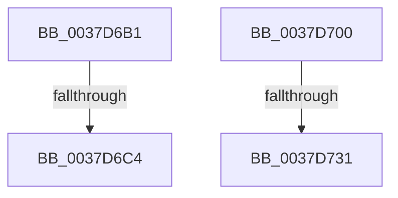

# sub_0037D6B1

- RVA: `0x0037D6B1`–`0x0037D73D` (길이 `140` bytes)
- VA: `0x000000014037D6B1`
- 실행 섹션: `.text`
- PDB 이름 있음: `아니요`; PDB Function 태그: `아니요`
- unwind 정보 RVA: `0x0007B39C`
- 디코드: `28`개 명령, `140/140` bytes 표시
- 미해석 바이트: `0` (있으면 어셈블리에 `.byte`로 보존)

> 이 문서는 커널 이미지의 기계어와 PDB 기호를 분석해 생성했습니다. 4번과 5번은 함수 원형과 자료형을 바이너리 사용 방식에서 추정한 C 해석이며 원본 소스 복구 결과는 아닙니다.

## 1. Dependencies

- 직접 호출 지점: **0**; 고유 호출 대상: **0**
- 직접 호출자로 확인된 함수: **0**
- RIP 상대 이미지 참조: **2**

### Outgoing calls
- 직접 디코드된 call 명령이 없습니다.

### Direct callers
- 이 함수 시작 RVA로 연결되는 직접 call은 확인되지 않았습니다. 간접 호출은 완전히 역산할 수 없습니다.

### Static image references
- `0x0037D6D9` → RVA `0x00FC537C` (`ALMOSTRO`; read)
- `0x0037D6E7` → RVA `0x00FC53E0` (`ALMOSTRO`; read)

## 2. Other-region calls and transfers

- 다른 실행 섹션으로 향하는 call: **0**
- call이 아닌 외부 분기/꼬리 이동: **4**
  - `0x0037D6BE` → [sub_0037CC84 + 0x30B](Unknown_function_0037CC84.md) (`tail-transfer`)
  - `0x0037D6FB` → [sub_0037CC84 + 0x30B](Unknown_function_0037CC84.md) (`tail-transfer`)
  - `0x0037D72B` → [sub_0037CFDC + 0x35](Unknown_function_0037CFDC.md) (`tail-transfer`)
  - `0x0037D738` → [sub_0037CFDC + 0x35](Unknown_function_0037CFDC.md) (`tail-transfer`)

## 3. Assembly (complete function range)

```asm
0037D6B1  41 0F B6 86 04 02 00 00         movzx eax, byte ptr [r14 + 0x204]
0037D6B9  8B D0                           mov edx, eax
0037D6BB  83 F8 07                        cmp eax, 7
0037D6BE  0F 83 CB F8 FF FF               jae 0x14037cf8f
0037D6C4  41 8B 46 54                     mov eax, dword ptr [r14 + 0x54]
0037D6C8  41 8B 4E 50                     mov ecx, dword ptr [r14 + 0x50]
0037D6CC  3B C8                           cmp ecx, eax
0037D6CE  0F 46 C8                        cmovbe ecx, eax
0037D6D1  41 0F B6 86 05 02 00 00         movzx eax, byte ptr [r14 + 0x205]
0037D6D9  3B 0D 9D 7C C4 00               cmp ecx, dword ptr [rip + 0xc47c9d]
0037D6DF  41 0F 93 C7                     setae r15b
0037D6E3  41 8D 0C 57                     lea ecx, [r15 + rdx*2]
0037D6E7  0F AF 0D F2 7C C4 00            imul ecx, dword ptr [rip + 0xc47cf2]
0037D6EE  03 C8                           add ecx, eax
0037D6F0  48 8B 86 B0 86 00 00            mov rax, qword ptr [rsi + 0x86b0]
0037D6F7  48 01 3C C8                     add qword ptr [rax + rcx*8], rdi
0037D6FB  E9 8F F8 FF FF                  jmp 0x14037cf8f
0037D700  4C 8B 86 C0 00 00 00            mov r8, qword ptr [rsi + 0xc0]
0037D707  49 8B 86 40 02 00 00            mov rax, qword ptr [r14 + 0x240]
0037D70E  41 0F B7 88 88 00 00 00         movzx ecx, word ptr [r8 + 0x88]
0037D716  48 8B 54 C8 08                  mov rdx, qword ptr [rax + rcx*8 + 8]
0037D71B  49 8B 88 80 00 00 00            mov rcx, qword ptr [r8 + 0x80]
0037D722  48 8B C1                        mov rax, rcx
0037D725  48 23 C2                        and rax, rdx
0037D728  48 3B C1                        cmp rax, rcx
0037D72B  0F 84 E0 F8 FF FF               je 0x14037d011
0037D731  48 01 BE A8 86 00 00            add qword ptr [rsi + 0x86a8], rdi
0037D738  E9 D4 F8 FF FF                  jmp 0x14037d011
```

## 4. C-style interpretation (structured pseudocode)

```c
__int64 __fastcall sub_0037D6B1(void)
{
    __int64 v_r15;

    a1 = (unsigned int)(*(unsigned int *)(v_r14 + 80));
    if (((unsigned int)((unsigned int)(*(unsigned int *)(v_r14 + 80)))) <= ((unsigned int)((unsigned int)(*(unsigned int *)(v_r14 + 84))))) { a1 = (unsigned int)((unsigned int)(*(unsigned int *)(v_r14 + 84))); }
    v_r15 = (((unsigned int)(a1)) >= (*(unsigned int *)(v_rip + 12876957))) ? 1 : 0;
    a1 = (unsigned int)((v_r15 + (unsigned int)((unsigned int)(*(unsigned __int8 *)(v_r14 + 516))) * 2) * (*(unsigned int *)(v_rip + 12877042)));
    a1 = (unsigned int)((a1) + ((unsigned int)(*(unsigned __int8 *)(v_r14 + 517))));
}
```

## 5. (Beta) C Style

```c
void sub_0037D6B1(void)
{
    int64_t local_r15;

    a1 = (uint32_t)(*(uint32_t *)(local_r14 + 0x50));
    if (((uint32_t)((uint32_t)(*(uint32_t *)(local_r14 + 0x50)))) <= ((uint32_t)((uint32_t)(*(uint32_t *)(local_r14 + 0x54))))) { a1 = (uint32_t)((uint32_t)(*(uint32_t *)(local_r14 + 0x54))); }
    local_r15 = (((uint32_t)(a1)) >= (*(uint32_t *)(v_rip + 0xC47C9D))) ? 1 : 0;
    a1 = (uint32_t)((local_r15 + (uint32_t)((uint32_t)(*(uint8_t *)(local_r14 + 0x204))) * 2) * (*(uint32_t *)(v_rip + 0xC47CF2)));
    a1 = (uint32_t)((a1) + ((uint32_t)(*(uint8_t *)(local_r14 + 0x205))));
}
```

## 6. Execution-region graph

[열기: 2D/3D 그래프와 함수 탐색 컨트롤 패널](../../../control-panel.html?section=text&rva=0x0037D6B1&view=graph)

- 2D 그래프는 위에서 아래로 흐르고, 3D 그래프는 빈 공간을 드래그해 회전합니다. Shift+드래그는 이동, 휠은 확대·축소, 함수 노드 선택은 대상 보고서 이동입니다.

### Static fallback


