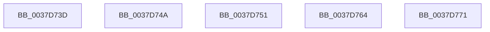

# sub_0037D73D

- RVA: `0x0037D73D`–`0x0037D778` (길이 `59` bytes)
- VA: `0x000000014037D73D`
- 실행 섹션: `.text`
- PDB 이름 있음: `아니요`; PDB Function 태그: `아니요`
- unwind 정보 RVA: `0x0007B3C4`
- 디코드: `14`개 명령, `59/59` bytes 표시
- 미해석 바이트: `0` (있으면 어셈블리에 `.byte`로 보존)

> 이 문서는 커널 이미지의 기계어와 PDB 기호를 분석해 생성했습니다. 4번과 5번은 함수 원형과 자료형을 바이너리 사용 방식에서 추정한 C 해석이며 원본 소스 복구 결과는 아닙니다.

## 1. Dependencies

- 직접 호출 지점: **3**; 고유 호출 대상: **1**
- 직접 호출자로 확인된 함수: **0**
- RIP 상대 이미지 참조: **0**

### Outgoing calls
- `0x0037D740` → [guard_dispatch_icall](../6B/guard_dispatch_icall_function_006BAAD0.md) (function, `0x006BAAD0`)
- `0x0037D751` → [guard_dispatch_icall](../6B/guard_dispatch_icall_function_006BAAD0.md) (function, `0x006BAAD0`)
- `0x0037D767` → [guard_dispatch_icall](../6B/guard_dispatch_icall_function_006BAAD0.md) (function, `0x006BAAD0`)

### Direct callers
- 이 함수 시작 RVA로 연결되는 직접 call은 확인되지 않았습니다. 간접 호출은 완전히 역산할 수 없습니다.

### Static image references
- 디코드된 RIP-relative 메모리 참조가 없습니다.

## 2. Other-region calls and transfers

- 다른 실행 섹션으로 향하는 call: **0**
- call이 아닌 외부 분기/꼬리 이동: **5**
  - `0x0037D745` → [sub_0037D3AC + 0x1CE](Unknown_function_0037D3AC.md) (`tail-transfer`)
  - `0x0037D74C` → [sub_0037D3AC + 0x2F8](Unknown_function_0037D3AC.md) (`tail-transfer`)
  - `0x0037D75F` → [sub_0037CBE4 + 0x6D](Unknown_function_0037CBE4.md) (`tail-transfer`)
  - `0x0037D76C` → [sub_0037D3AC + 0x36](Unknown_function_0037D3AC.md) (`tail-transfer`)
  - `0x0037D773` → [sub_0037D3AC + 0x28F](Unknown_function_0037D3AC.md) (`tail-transfer`)

## 3. Assembly (complete function range)

```asm
0037D73D  48 8B C2                        mov rax, rdx
0037D740  E8 8B D3 33 00                  call 0x1406baad0
0037D745  E9 30 FE FF FF                  jmp 0x14037d57a
0037D74A  33 C9                           xor ecx, ecx
0037D74C  E9 53 FF FF FF                  jmp 0x14037d6a4
0037D751  E8 7A D3 33 00                  call 0x1406baad0
0037D756  48 8B D0                        mov rdx, rax
0037D759  41 B9 80 96 98 00               mov r9d, 0x989680
0037D75F  E9 ED F4 FF FF                  jmp 0x14037cc51
0037D764  48 8B C2                        mov rax, rdx
0037D767  E8 64 D3 33 00                  call 0x1406baad0
0037D76C  E9 71 FC FF FF                  jmp 0x14037d3e2
0037D771  33 C9                           xor ecx, ecx
0037D773  E9 C3 FE FF FF                  jmp 0x14037d63b
```

## 4. C-style interpretation (structured pseudocode)

```c
__int64 __fastcall sub_0037D73D(int a1, __int64 a2)
{
    __int64 result;

    result = guard_dispatch_icall(a1, a2, a3, a4);
}
```

## 5. (Beta) C Style

```c
int64_t sub_0037D73D(int32_t Arg1, int64_t Arg2)
{
    int64_t result;

    result = guard_dispatch_icall(Arg1, Arg2, a3, a4);
}
```

## 6. Execution-region graph

[열기: 2D/3D 그래프와 함수 탐색 컨트롤 패널](../../../control-panel.html?section=text&rva=0x0037D73D&view=graph)

- 2D 그래프는 위에서 아래로 흐르고, 3D 그래프는 빈 공간을 드래그해 회전합니다. Shift+드래그는 이동, 휠은 확대·축소, 함수 노드 선택은 대상 보고서 이동입니다.

### Static fallback


