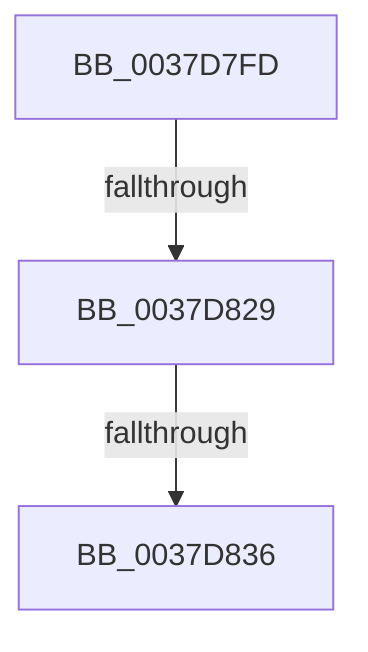

# sub_0037D7FD

- RVA: `0x0037D7FD`–`0x0037D841` (길이 `68` bytes)
- VA: `0x000000014037D7FD`
- 실행 섹션: `.text`
- PDB 이름 있음: `아니요`; PDB Function 태그: `아니요`
- unwind 정보 RVA: `0x0007B428`
- 디코드: `13`개 명령, `68/68` bytes 표시
- 미해석 바이트: `0` (있으면 어셈블리에 `.byte`로 보존)

> 이 문서는 커널 이미지의 기계어와 PDB 기호를 분석해 생성했습니다. 4번과 5번은 함수 원형과 자료형을 바이너리 사용 방식에서 추정한 C 해석이며 원본 소스 복구 결과는 아닙니다.

## 1. Dependencies

- 직접 호출 지점: **0**; 고유 호출 대상: **0**
- 직접 호출자로 확인된 함수: **0**
- RIP 상대 이미지 참조: **2**

### Outgoing calls
- 직접 디코드된 call 명령이 없습니다.

### Direct callers
- 이 함수 시작 RVA로 연결되는 직접 call은 확인되지 않았습니다. 간접 호출은 완전히 역산할 수 없습니다.

### Static image references
- `0x0037D81C` → RVA `0x00FC53E8` (`ALMOSTRO`; read)
- `0x0037D829` → RVA `0x00FC53F8` (`ALMOSTRO`; read)

## 2. Other-region calls and transfers

- 다른 실행 섹션으로 향하는 call: **0**
- call이 아닌 외부 분기/꼬리 이동: **2**
  - `0x0037D823` → [sub_0037D8B7](Unknown_function_0037D8B7.md) (`tail-transfer`)
  - `0x0037D830` → [sub_0037D8B7](Unknown_function_0037D8B7.md) (`tail-transfer`)

## 3. Assembly (complete function range)

```asm
0037D7FD  4C 89 7C 24 50                  mov qword ptr [rsp + 0x50], r15
0037D802  0F 31                           rdtsc
0037D804  48 C1 E2 20                     shl rdx, 0x20
0037D808  45 33 FF                        xor r15d, r15d
0037D80B  48 0B C2                        or rax, rdx
0037D80E  4C 89 BB 38 04 00 00            mov qword ptr [rbx + 0x438], r15
0037D815  48 89 83 30 04 00 00            mov qword ptr [rbx + 0x430], rax
0037D81C  48 3B 0D C5 7B C4 00            cmp rcx, qword ptr [rip + 0xc47bc5]
0037D823  0F 86 8E 00 00 00               jbe 0x14037d8b7
0037D829  4C 3B 0D C8 7B C4 00            cmp r9, qword ptr [rip + 0xc47bc8]
0037D830  0F 86 81 00 00 00               jbe 0x14037d8b7
0037D836  41 0F B6 86 8D 00 00 00         movzx eax, byte ptr [r14 + 0x8d]
0037D83E  45 8B C7                        mov r8d, r15d
```

## 4. C-style interpretation (structured pseudocode)

```c
__int64 __fastcall sub_0037D7FD(__int64 a1, __int64 a2, __int64 a3, __int64 a4)
{
    __int64 result;
    __int64 v_r15;
    unsigned __int64 v_stack_p50;

    v_stack_p50 = v_r15;
    a2 = (a2) << (32);
    v_r15 = 0;
    result = (result) | (a2);
    *(unsigned __int64 *)(v_rbx + 1080) = 0;
    *(unsigned __int64 *)(v_rbx + 1072) = result;
    return *(unsigned __int8 *)(v_r14 + 141);
}
```

## 5. (Beta) C Style

```c
int64_t sub_0037D7FD(int64_t Arg1, int64_t Arg2, int64_t Arg3, int64_t Arg4)
{
    int64_t result;
    int64_t local_r15;
    uint64_t v_stack_p50;

    v_stack_p50 = local_r15;
    Arg2 = (Arg2) << (32);
    local_r15 = 0;
    result = (result) | (Arg2);
    *(uint64_t *)(local_rbx + 0x438) = 0;
    *(uint64_t *)(local_rbx + 0x430) = result;
    return *(uint8_t *)(local_r14 + 0x8D);
}
```

## 6. Execution-region graph

[열기: 2D/3D 그래프와 함수 탐색 컨트롤 패널](../../../control-panel.html?section=text&rva=0x0037D7FD&view=graph)

- 2D 그래프는 위에서 아래로 흐르고, 3D 그래프는 빈 공간을 드래그해 회전합니다. Shift+드래그는 이동, 휠은 확대·축소, 함수 노드 선택은 대상 보고서 이동입니다.

### Static fallback


