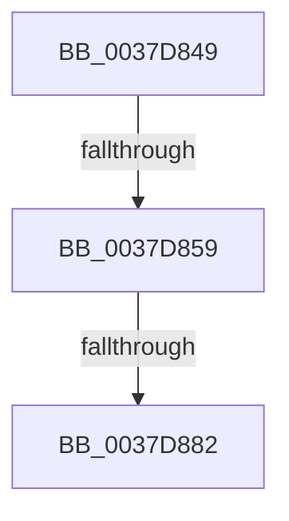

# sub_0037D849

- RVA: `0x0037D849`–`0x0037D88C` (길이 `67` bytes)
- VA: `0x000000014037D849`
- 실행 섹션: `.text`
- PDB 이름 있음: `아니요`; PDB Function 태그: `아니요`
- unwind 정보 RVA: `0x0007B450`
- 디코드: `18`개 명령, `67/67` bytes 표시
- 미해석 바이트: `0` (있으면 어셈블리에 `.byte`로 보존)

> 이 문서는 커널 이미지의 기계어와 PDB 기호를 분석해 생성했습니다. 4번과 5번은 함수 원형과 자료형을 바이너리 사용 방식에서 추정한 C 해석이며 원본 소스 복구 결과는 아닙니다.

## 1. Dependencies

- 직접 호출 지점: **0**; 고유 호출 대상: **0**
- 직접 호출자로 확인된 함수: **0**
- RIP 상대 이미지 참조: **1**

### Outgoing calls
- 직접 디코드된 call 명령이 없습니다.

### Direct callers
- 이 함수 시작 RVA로 연결되는 직접 call은 확인되지 않았습니다. 간접 호출은 완전히 역산할 수 없습니다.

### Static image references
- `0x0037D874` → RVA `0x00FC6B14` (`ALMOSTRO`; read)

## 2. Other-region calls and transfers

- 다른 실행 섹션으로 향하는 call: **0**
- call이 아닌 외부 분기/꼬리 이동: **3**
  - `0x0037D853` → [sub_0037D9CF](Unknown_function_0037D9CF.md) (`tail-transfer`)
  - `0x0037D87C` → [sub_0037D9CF + 0x29](Unknown_function_0037D9CF.md) (`tail-transfer`)
  - `0x0037D88A` → [sub_0037D8C1](Unknown_function_0037D8C1.md) (`tail-transfer`)

## 3. Assembly (complete function range)

```asm
0037D849  48 89 7C 24 48                  mov qword ptr [rsp + 0x48], rdi
0037D84E  40 32 FF                        xor dil, dil
0037D851  3C 02                           cmp al, 2
0037D853  0F 85 76 01 00 00               jne 0x14037d9cf
0037D859  B9 D2 17 00 00                  mov ecx, 0x17d2
0037D85E  0F 32                           rdmsr
0037D860  48 C1 E2 20                     shl rdx, 0x20
0037D864  48 0B C2                        or rax, rdx
0037D867  48 8B F8                        mov rdi, rax
0037D86A  0F B6 F0                        movzx esi, al
0037D86D  48 C1 EF 3F                     shr rdi, 0x3f
0037D871  4C 8B C0                        mov r8, rax
0037D874  8B 05 9A 92 C4 00               mov eax, dword ptr [rip + 0xc4929a]
0037D87A  84 C0                           test al, al
0037D87C  0F 88 76 01 00 00               js 0x14037d9f8
0037D882  40 84 FF                        test dil, dil
0037D885  48 8B 7C 24 48                  mov rdi, qword ptr [rsp + 0x48]
0037D88A  74 35                           je 0x14037d8c1
```

## 4. C-style interpretation (structured pseudocode)

```c
__int64 __fastcall sub_0037D849(__int64 a1, __int64 a2, __int64 a3, __int64 a4, __int64 a5, __int64 a6, __int64 a7, __int64 a8, __int64 a9)
{
    __int64 result;
    __int64 v_rdi;
    unsigned __int64 v_stack_p48;

    v_stack_p48 = v_rdi;
    v_rdi = 0;
    a2 = (a2) << (32);
    result = (result) | (a2);
    v_rdi = (result) >> (63);
}
```

## 5. (Beta) C Style

```c
int64_t sub_0037D849(int64_t Arg1, int64_t Arg2, int64_t Arg3, int64_t Arg4, uint64_t Arg5, uint64_t Arg6, uint64_t Arg7, uint64_t Arg8, int64_t Arg9)
{
    int64_t result;
    int64_t local_rdi;
    uint64_t v_stack_p48;

    v_stack_p48 = local_rdi;
    local_rdi = 0;
    Arg2 = (Arg2) << (32);
    result = (result) | (Arg2);
    local_rdi = (result) >> (63);
}
```

## 6. Execution-region graph

[열기: 2D/3D 그래프와 함수 탐색 컨트롤 패널](../../../control-panel.html?section=text&rva=0x0037D849&view=graph)

- 2D 그래프는 위에서 아래로 흐르고, 3D 그래프는 빈 공간을 드래그해 회전합니다. Shift+드래그는 이동, 휠은 확대·축소, 함수 노드 선택은 대상 보고서 이동입니다.

### Static fallback


