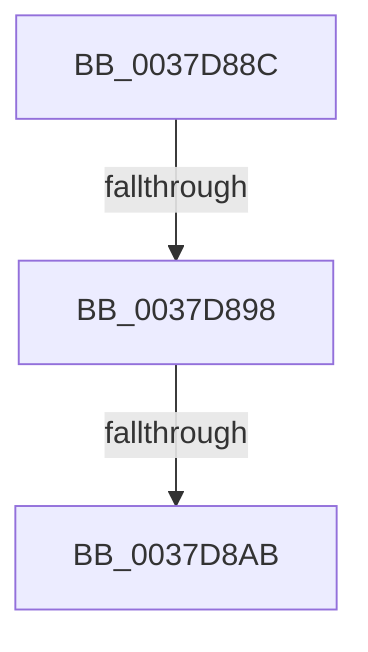

# sub_0037D88C

- RVA: `0x0037D88C`–`0x0037D8B7` (길이 `43` bytes)
- VA: `0x000000014037D88C`
- 실행 섹션: `.text`
- PDB 이름 있음: `아니요`; PDB Function 태그: `아니요`
- unwind 정보 RVA: `0x0007B464`
- 디코드: `9`개 명령, `43/43` bytes 표시
- 미해석 바이트: `0` (있으면 어셈블리에 `.byte`로 보존)

> 이 문서는 커널 이미지의 기계어와 PDB 기호를 분석해 생성했습니다. 4번과 5번은 함수 원형과 자료형을 바이너리 사용 방식에서 추정한 C 해석이며 원본 소스 복구 결과는 아닙니다.

## 1. Dependencies

- 직접 호출 지점: **0**; 고유 호출 대상: **0**
- 직접 호출자로 확인된 함수: **0**
- RIP 상대 이미지 참조: **1**

### Outgoing calls
- 직접 디코드된 call 명령이 없습니다.

### Direct callers
- 이 함수 시작 RVA로 연결되는 직접 call은 확인되지 않았습니다. 간접 호출은 완전히 역산할 수 없습니다.

### Static image references
- `0x0037D890` → RVA `0x00FC53E0` (`ALMOSTRO`; read)

## 2. Other-region calls and transfers

- 다른 실행 섹션으로 향하는 call: **0**
- call이 아닌 외부 분기/꼬리 이동: **2**
  - `0x0037D896` → [sub_0037D8C1](Unknown_function_0037D8C1.md) (`tail-transfer`)
  - `0x0037D8A9` → [sub_0037D8C1 + 0x55](Unknown_function_0037D8C1.md) (`tail-transfer`)

## 3. Assembly (complete function range)

```asm
0037D88C  40 0F B6 C6                     movzx eax, sil
0037D890  3B 05 4A 7B C4 00               cmp eax, dword ptr [rip + 0xc47b4a]
0037D896  73 29                           jae 0x14037d8c1
0037D898  0F B6 83 05 02 00 00            movzx eax, byte ptr [rbx + 0x205]
0037D89F  44 89 BB 40 04 00 00            mov dword ptr [rbx + 0x440], r15d
0037D8A6  40 3A C6                        cmp al, sil
0037D8A9  75 6B                           jne 0x14037d916
0037D8AB  4C 89 BB 44 04 00 00            mov qword ptr [rbx + 0x444], r15
0037D8B2  48 8B 74 24 40                  mov rsi, qword ptr [rsp + 0x40]
```

## 4. C-style interpretation (structured pseudocode)

```c
__int64 __fastcall sub_0037D88C(__int64 a1, __int64 a2, __int64 a3, __int64 a4, __int64 a5, __int64 a6, __int64 a7, __int64 a8)
{
    *(unsigned int *)(v_rbx + 1088) = (unsigned int)(v_r15);
    *(unsigned __int64 *)(v_rbx + 1092) = v_r15;
    return *(unsigned __int8 *)(v_rbx + 517);
}
```

## 5. (Beta) C Style

```c
int64_t sub_0037D88C(int64_t Arg1, int64_t Arg2, int64_t Arg3, int64_t Arg4, uint64_t Arg5, uint64_t Arg6, uint64_t Arg7, int64_t Arg8)
{
    *(uint32_t *)(local_rbx + 0x440) = (uint32_t)(local_r15);
    *(uint64_t *)(local_rbx + 0x444) = local_r15;
    return *(uint8_t *)(local_rbx + 0x205);
}
```

## 6. Execution-region graph

[열기: 2D/3D 그래프와 함수 탐색 컨트롤 패널](../../../control-panel.html?section=text&rva=0x0037D88C&view=graph)

- 2D 그래프는 위에서 아래로 흐르고, 3D 그래프는 빈 공간을 드래그해 회전합니다. Shift+드래그는 이동, 휠은 확대·축소, 함수 노드 선택은 대상 보고서 이동입니다.

### Static fallback


