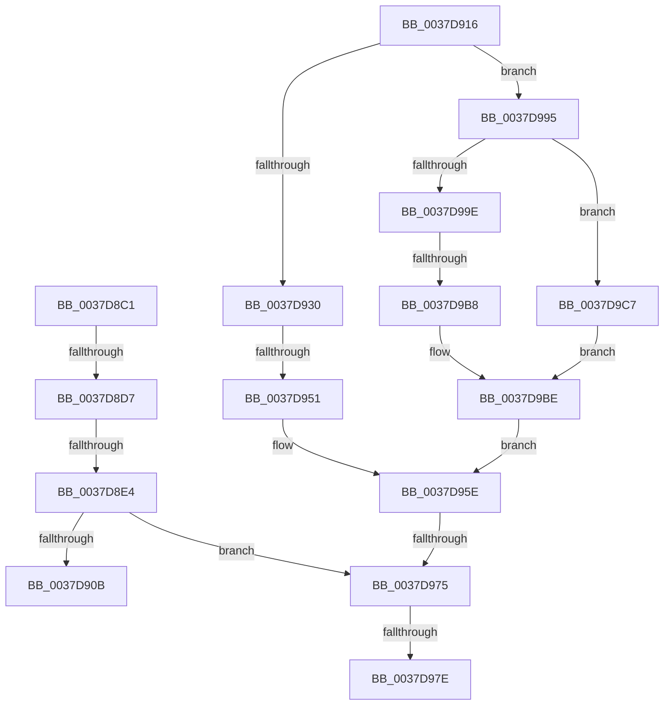

# sub_0037D8C1

- RVA: `0x0037D8C1`–`0x0037D9CF` (길이 `270` bytes)
- VA: `0x000000014037D8C1`
- 실행 섹션: `.text`
- PDB 이름 있음: `아니요`; PDB Function 태그: `아니요`
- unwind 정보 RVA: `0x0007B484`
- 디코드: `51`개 명령, `270/270` bytes 표시
- 미해석 바이트: `0` (있으면 어셈블리에 `.byte`로 보존)

> 이 문서는 커널 이미지의 기계어와 PDB 기호를 분석해 생성했습니다. 4번과 5번은 함수 원형과 자료형을 바이너리 사용 방식에서 추정한 C 해석이며 원본 소스 복구 결과는 아닙니다.

## 1. Dependencies

- 직접 호출 지점: **1**; 고유 호출 대상: **1**
- 직접 호출자로 확인된 함수: **0**
- RIP 상대 이미지 참조: **7**

### Outgoing calls
- `0x0037D98B` → [KiRequestSoftwareInterrupt](../25/KiRequestSoftwareInterrupt_function_00250950.md) (function, `0x00250950`)

### Direct callers
- 이 함수 시작 RVA로 연결되는 직접 call은 확인되지 않았습니다. 간접 호출은 완전히 역산할 수 없습니다.

### Static image references
- `0x0037D8CF` → RVA `0x00FC5400` (`ALMOSTRO`; read)
- `0x0037D8D7` → RVA `0x00FC5408` (`ALMOSTRO`; read)
- `0x0037D8E4` → RVA `0x00FC544C` (`ALMOSTRO`; read)
- `0x0037D8FF` → RVA `0x00FC6B14` (`ALMOSTRO`; read)
- `0x0037D916` → RVA `0x00FC53E0` (`ALMOSTRO`; read)
- `0x0037D945` → RVA `0x00FC540C` (`ALMOSTRO`; read)
- `0x0037D9AC` → RVA `0x00FC5410` (`ALMOSTRO`; read)

## 2. Other-region calls and transfers

- 다른 실행 섹션으로 향하는 call: **0**
- call이 아닌 외부 분기/꼬리 이동: **8**
  - `0x0037D8D5` → [sub_0037D88C + 0x26](Unknown_function_0037D88C.md) (`tail-transfer`)
  - `0x0037D8DE` → [sub_0037DA0E + 0x9](Unknown_function_0037DA0E.md) (`tail-transfer`)
  - `0x0037D911` → [sub_006E453A](../6E/Unknown_function_006E453A.md) (`tail-transfer`)
  - `0x0037D94B` → [sub_0037D88C + 0x26](Unknown_function_0037D88C.md) (`tail-transfer`)
  - `0x0037D96F` → [sub_0037DA0E](Unknown_function_0037DA0E.md) (`tail-transfer`)
  - `0x0037D978` → [sub_0037D88C + 0x26](Unknown_function_0037D88C.md) (`tail-transfer`)
  - `0x0037D990` → [sub_0037D88C + 0x26](Unknown_function_0037D88C.md) (`tail-transfer`)
  - `0x0037D9B2` → [sub_0037D88C + 0x26](Unknown_function_0037D88C.md) (`tail-transfer`)

## 3. Assembly (complete function range)

```asm
0037D8C1  8B 83 40 04 00 00               mov eax, dword ptr [rbx + 0x440]
0037D8C7  FF C0                           inc eax
0037D8C9  89 83 40 04 00 00               mov dword ptr [rbx + 0x440], eax
0037D8CF  3B 05 2B 7B C4 00               cmp eax, dword ptr [rip + 0xc47b2b]
0037D8D5  72 DB                           jb 0x14037d8b2
0037D8D7  44 39 3D 2A 7B C4 00            cmp dword ptr [rip + 0xc47b2a], r15d
0037D8DE  0F 85 33 01 00 00               jne 0x14037da17
0037D8E4  0F B6 15 61 7B C4 00            movzx edx, byte ptr [rip + 0xc47b61]
0037D8EB  88 93 05 02 00 00               mov byte ptr [rbx + 0x205], dl
0037D8F1  4C 89 BB 44 04 00 00            mov qword ptr [rbx + 0x444], r15
0037D8F8  44 89 BB 40 04 00 00            mov dword ptr [rbx + 0x440], r15d
0037D8FF  F7 05 0B 92 C4 00 00 01 00 00   test dword ptr [rip + 0xc4920b], 0x100
0037D909  74 6A                           je 0x14037d975
0037D90B  41 B8 10 00 00 00               mov r8d, 0x10
0037D911  E9 24 6C 36 00                  jmp 0x1406e453a
0037D916  48 8D 15 C3 7A C4 00            lea rdx, [rip + 0xc47ac3]
0037D91D  0F B7 4C 42 4C                  movzx ecx, word ptr [rdx + rax*2 + 0x4c]
0037D922  40 0F B6 C6                     movzx eax, sil
0037D926  0F B7 54 42 4C                  movzx edx, word ptr [rdx + rax*2 + 0x4c]
0037D92B  66 3B D1                        cmp dx, cx
0037D92E  73 65                           jae 0x14037d995
0037D930  8B 83 44 04 00 00               mov eax, dword ptr [rbx + 0x444]
0037D936  FF C0                           inc eax
0037D938  44 89 BB 48 04 00 00            mov dword ptr [rbx + 0x448], r15d
0037D93F  89 83 44 04 00 00               mov dword ptr [rbx + 0x444], eax
0037D945  3B 05 C1 7A C4 00               cmp eax, dword ptr [rip + 0xc47ac1]
0037D94B  0F 82 61 FF FF FF               jb 0x14037d8b2
0037D951  44 89 BB 44 04 00 00            mov dword ptr [rbx + 0x444], r15d
0037D958  41 B8 08 00 00 00               mov r8d, 8
0037D95E  40 88 B3 05 02 00 00            mov byte ptr [rbx + 0x205], sil
0037D965  F7 05 A5 91 C4 00 00 01 00 00   test dword ptr [rip + 0xc491a5], 0x100
0037D96F  0F 85 99 00 00 00               jne 0x14037da0e
0037D975  40 84 ED                        test bpl, bpl
0037D978  0F 85 34 FF FF FF               jne 0x14037d8b2
0037D97E  B2 02                           mov dl, 2
0037D980  41 C6 86 B9 38 00 00 01         mov byte ptr [r14 + 0x38b9], 1
0037D988  49 8B CE                        mov rcx, r14
0037D98B  E8 C0 2F ED FF                  call 0x140250950
0037D990  E9 1D FF FF FF                  jmp 0x14037d8b2
0037D995  44 89 BB 44 04 00 00            mov dword ptr [rbx + 0x444], r15d
0037D99C  76 29                           jbe 0x14037d9c7
0037D99E  8B 83 48 04 00 00               mov eax, dword ptr [rbx + 0x448]
0037D9A4  FF C0                           inc eax
0037D9A6  89 83 48 04 00 00               mov dword ptr [rbx + 0x448], eax
0037D9AC  3B 05 5E 7A C4 00               cmp eax, dword ptr [rip + 0xc47a5e]
0037D9B2  0F 82 FA FE FF FF               jb 0x14037d8b2
0037D9B8  41 B8 04 00 00 00               mov r8d, 4
0037D9BE  44 89 BB 48 04 00 00            mov dword ptr [rbx + 0x448], r15d
0037D9C5  EB 97                           jmp 0x14037d95e
0037D9C7  41 B8 02 00 00 00               mov r8d, 2
0037D9CD  EB EF                           jmp 0x14037d9be
```

## 4. C-style interpretation (structured pseudocode)

```c
__int64 __fastcall sub_0037D8C1(void)
{
    __int64 result;

    result = (unsigned int)(((unsigned int)(*(unsigned int *)(v_rbx + 1088))) + 1);
    *(unsigned int *)(v_rbx + 1088) = (unsigned int)(result);
    *(unsigned __int8 *)(v_rbx + 517) = (unsigned __int8)(*(unsigned __int8 *)(v_rip + 12876641));
    *(unsigned __int64 *)(v_rbx + 1092) = v_r15;
    *(unsigned int *)(v_rbx + 1088) = (unsigned int)(v_r15);
    if (((*(unsigned int *)(v_rip + 12882443)) & (256)) == 0) goto loc_0037D975;
loc_0037D975:
    *(unsigned __int8 *)(v_r14 + 14521) = 1;
    result = KiRequestSoftwareInterrupt(v_r14, 2, 16, a4);
}
```

## 5. (Beta) C Style

```c
void sub_0037D8C1(void)
{
    int64_t result;

    result = (uint32_t)(((uint32_t)(*(uint32_t *)(local_rbx + 0x440))) + 1);
    *(uint32_t *)(local_rbx + 0x440) = (uint32_t)(result);
    *(uint8_t *)(local_rbx + 0x205) = (uint8_t)(*(uint8_t *)(v_rip + 0xC47B61));
    *(uint64_t *)(local_rbx + 0x444) = local_r15;
    *(uint32_t *)(local_rbx + 0x440) = (uint32_t)(local_r15);
    if (((*(uint32_t *)(v_rip + 0xC4920B)) & (256)) == 0) goto loc_0037D975;
loc_0037D975:
    *(uint8_t *)(local_r14 + 0x38B9) = 1;
    result = KiRequestSoftwareInterrupt(local_r14, 2, 16, a4);
}
```

## 6. Execution-region graph

[열기: 2D/3D 그래프와 함수 탐색 컨트롤 패널](../../../control-panel.html?section=text&rva=0x0037D8C1&view=graph)

- 2D 그래프는 위에서 아래로 흐르고, 3D 그래프는 빈 공간을 드래그해 회전합니다. Shift+드래그는 이동, 휠은 확대·축소, 함수 노드 선택은 대상 보고서 이동입니다.

### Static fallback


