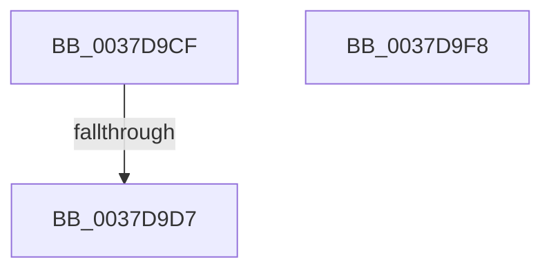

# sub_0037D9CF

- RVA: `0x0037D9CF`–`0x0037DA0E` (길이 `63` bytes)
- VA: `0x000000014037D9CF`
- 실행 섹션: `.text`
- PDB 이름 있음: `아니요`; PDB Function 태그: `아니요`
- unwind 정보 RVA: `0x0007B49C`
- 디코드: `15`개 명령, `63/63` bytes 표시
- 미해석 바이트: `0` (있으면 어셈블리에 `.byte`로 보존)

> 이 문서는 커널 이미지의 기계어와 PDB 기호를 분석해 생성했습니다. 4번과 5번은 함수 원형과 자료형을 바이너리 사용 방식에서 추정한 C 해석이며 원본 소스 복구 결과는 아닙니다.

## 1. Dependencies

- 직접 호출 지점: **1**; 고유 호출 대상: **1**
- 직접 호출자로 확인된 함수: **0**
- RIP 상대 이미지 참조: **0**

### Outgoing calls
- `0x0037DA04` → [EtwTraceThreadFeedbackRead](../65/EtwTraceThreadFeedbackRead_function_00650330.md) (function, `0x00650330`)

### Direct callers
- 이 함수 시작 RVA로 연결되는 직접 call은 확인되지 않았습니다. 간접 호출은 완전히 역산할 수 없습니다.

### Static image references
- 디코드된 RIP-relative 메모리 참조가 없습니다.

## 2. Other-region calls and transfers

- 다른 실행 섹션으로 향하는 call: **0**
- call이 아닌 외부 분기/꼬리 이동: **3**
  - `0x0037D9D1` → [sub_0037D849 + 0x2B](Unknown_function_0037D849.md) (`tail-transfer`)
  - `0x0037D9F3` → [sub_0037D849 + 0x28](Unknown_function_0037D849.md) (`tail-transfer`)
  - `0x0037DA09` → [sub_0037D849 + 0x39](Unknown_function_0037D849.md) (`tail-transfer`)

## 3. Assembly (complete function range)

```asm
0037D9CF  3C 01                           cmp al, 1
0037D9D1  0F 85 9D FE FF FF               jne 0x14037d874
0037D9D7  B9 01 05 00 C0                  mov ecx, 0xc0000501
0037D9DC  0F 32                           rdmsr
0037D9DE  48 C1 E2 20                     shl rdx, 0x20
0037D9E2  48 0B C2                        or rax, rdx
0037D9E5  0F B6 F0                        movzx esi, al
0037D9E8  40 80 E6 07                     and sil, 7
0037D9EC  48 85 C0                        test rax, rax
0037D9EF  40 0F 98 C7                     sets dil
0037D9F3  E9 79 FE FF FF                  jmp 0x14037d871
0037D9F8  65 48 8B 14 25 20 00 00 00      mov rdx, qword ptr gs:[0x20]
0037DA01  48 8B CB                        mov rcx, rbx
0037DA04  E8 27 29 2D 00                  call 0x140650330
0037DA09  E9 74 FE FF FF                  jmp 0x14037d882
```

## 4. C-style interpretation (structured pseudocode)

```c
__int64 __fastcall sub_0037D9CF(__int64 a1, __int64 a2)
{
    __int64 result;
    __int64 v_rdi;
    __int64 v_rsi;

    a2 = (a2) << (32);
    result = (result) | (a2);
    v_rsi = (unsigned __int8)(((unsigned __int8)(result)) & (7));
    v_rdi = (sign_flag) ? 1 : 0;
}
```

## 5. (Beta) C Style

```c
int64_t sub_0037D9CF(int64_t Arg1, int64_t Arg2)
{
    int64_t result;
    int64_t local_rdi;
    int64_t local_rsi;

    Arg2 = (Arg2) << (32);
    result = (result) | (Arg2);
    local_rsi = (uint8_t)(((uint8_t)(result)) & (7));
    local_rdi = (sign_flag) ? 1 : 0;
}
```

## 6. Execution-region graph

[열기: 2D/3D 그래프와 함수 탐색 컨트롤 패널](../../../control-panel.html?section=text&rva=0x0037D9CF&view=graph)

- 2D 그래프는 위에서 아래로 흐르고, 3D 그래프는 빈 공간을 드래그해 회전합니다. Shift+드래그는 이동, 휠은 확대·축소, 함수 노드 선택은 대상 보고서 이동입니다.

### Static fallback


