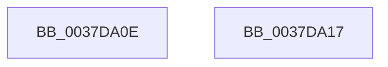

# sub_0037DA0E

- RVA: `0x0037DA0E`–`0x0037DA30` (길이 `34` bytes)
- VA: `0x000000014037DA0E`
- 실행 섹션: `.text`
- PDB 이름 있음: `아니요`; PDB Function 태그: `아니요`
- unwind 정보 RVA: `0x0007B4B8`
- 디코드: `6`개 명령, `34/34` bytes 표시
- 미해석 바이트: `0` (있으면 어셈블리에 `.byte`로 보존)

> 이 문서는 커널 이미지의 기계어와 PDB 기호를 분석해 생성했습니다. 4번과 5번은 함수 원형과 자료형을 바이너리 사용 방식에서 추정한 C 해석이며 원본 소스 복구 결과는 아닙니다.

## 1. Dependencies

- 직접 호출 지점: **0**; 고유 호출 대상: **0**
- 직접 호출자로 확인된 함수: **0**
- RIP 상대 이미지 참조: **1**

### Outgoing calls
- 직접 디코드된 call 명령이 없습니다.

### Direct callers
- 이 함수 시작 RVA로 연결되는 직접 call은 확인되지 않았습니다. 간접 호출은 완전히 역산할 수 없습니다.

### Static image references
- `0x0037DA17` → RVA `0x00FC5404` (`ALMOSTRO`; read)

## 2. Other-region calls and transfers

- 다른 실행 섹션으로 향하는 call: **0**
- call이 아닌 외부 분기/꼬리 이동: **2**
  - `0x0037DA12` → [sub_006E453A](../6E/Unknown_function_006E453A.md) (`tail-transfer`)
  - `0x0037DA2B` → [sub_0037D8C1 + 0x30](Unknown_function_0037D8C1.md) (`tail-transfer`)

## 3. Assembly (complete function range)

```asm
0037DA0E  40 0F B6 D6                     movzx edx, sil
0037DA12  E9 23 6B 36 00                  jmp 0x1406e453a
0037DA17  0F B6 05 E6 79 C4 00            movzx eax, byte ptr [rip + 0xc479e6]
0037DA1E  88 83 05 02 00 00               mov byte ptr [rbx + 0x205], al
0037DA24  0F B6 15 D9 79 C4 00            movzx edx, byte ptr [rip + 0xc479d9]
0037DA2B  E9 C1 FE FF FF                  jmp 0x14037d8f1
```

## 4. C-style interpretation (structured pseudocode)

```c
__int64 __fastcall sub_0037DA0E(void)
{
}
```

## 5. (Beta) C Style

```c
void sub_0037DA0E(void)
{
}
```

## 6. Execution-region graph

[열기: 2D/3D 그래프와 함수 탐색 컨트롤 패널](../../../control-panel.html?section=text&rva=0x0037DA0E&view=graph)

- 2D 그래프는 위에서 아래로 흐르고, 3D 그래프는 빈 공간을 드래그해 회전합니다. Shift+드래그는 이동, 휠은 확대·축소, 함수 노드 선택은 대상 보고서 이동입니다.

### Static fallback


