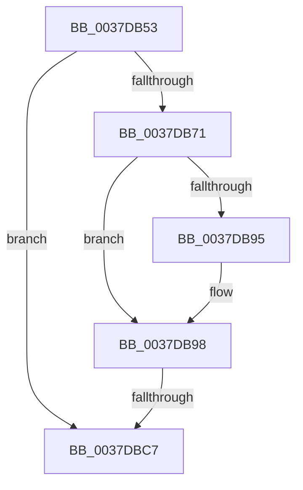

# sub_0037DB53

- RVA: `0x0037DB53`–`0x0037DBF8` (길이 `165` bytes)
- VA: `0x000000014037DB53`
- 실행 섹션: `.text`
- PDB 이름 있음: `아니요`; PDB Function 태그: `아니요`
- unwind 정보 RVA: `0x0007B530`
- 디코드: `37`개 명령, `165/165` bytes 표시
- 미해석 바이트: `0` (있으면 어셈블리에 `.byte`로 보존)

> 이 문서는 커널 이미지의 기계어와 PDB 기호를 분석해 생성했습니다. 4번과 5번은 함수 원형과 자료형을 바이너리 사용 방식에서 추정한 C 해석이며 원본 소스 복구 결과는 아닙니다.

## 1. Dependencies

- 직접 호출 지점: **1**; 고유 호출 대상: **1**
- 직접 호출자로 확인된 함수: **0**
- RIP 상대 이미지 참조: **1**

### Outgoing calls
- `0x0037DB73` → [KeQueryPerformanceCounter](KeQueryPerformanceCounter_function_0037E7E0.md) (function, `0x0037E7E0`)

### Direct callers
- 이 함수 시작 RVA로 연결되는 직접 call은 확인되지 않았습니다. 간접 호출은 완전히 역산할 수 없습니다.

### Static image references
- `0x0037DBBA` → RVA `0x00FC6A95` (`ALMOSTRO`; read)

## 2. Other-region calls and transfers

- 다른 실행 섹션으로 향하는 call: **0**
- call이 아닌 외부 분기/꼬리 이동: **2**
  - `0x0037DBC1` → [sub_0037DD18](Unknown_function_0037DD18.md) (`tail-transfer`)
  - `0x0037DBF2` → [sub_0037DBF8 + 0x83](Unknown_function_0037DBF8.md) (`tail-transfer`)

## 3. Assembly (complete function range)

```asm
0037DB53  4C 89 74 24 28                  mov qword ptr [rsp + 0x28], r14
0037DB58  8B EF                           mov ebp, edi
0037DB5A  4C 89 7C 24 20                  mov qword ptr [rsp + 0x20], r15
0037DB5F  44 8B FF                        mov r15d, edi
0037DB62  44 8B F7                        mov r14d, edi
0037DB65  44 8B DF                        mov r11d, edi
0037DB68  40 38 B9 DC 86 00 00            cmp byte ptr [rcx + 0x86dc], dil
0037DB6F  74 56                           je 0x14037dbc7
0037DB71  33 C9                           xor ecx, ecx
0037DB73  E8 68 0C 00 00                  call 0x14037e7e0
0037DB78  0F B6 8B AC 00 00 00            movzx ecx, byte ptr [rbx + 0xac]
0037DB7F  48 8B E8                        mov rbp, rax
0037DB82  48 8B 83 B0 00 00 00            mov rax, qword ptr [rbx + 0xb0]
0037DB89  48 8B D5                        mov rdx, rbp
0037DB8C  48 89 7C 24 78                  mov qword ptr [rsp + 0x78], rdi
0037DB91  84 C9                           test cl, cl
0037DB93  74 03                           je 0x14037db98
0037DB95  48 D3 E2                        shl rdx, cl
0037DB98  48 F7 E2                        mul rdx
0037DB9B  4C 8B F5                        mov r14, rbp
0037DB9E  4C 8B FA                        mov r15, rdx
0037DBA1  48 89 54 24 78                  mov qword ptr [rsp + 0x78], rdx
0037DBA6  48 8B 93 F8 86 00 00            mov rdx, qword ptr [rbx + 0x86f8]
0037DBAD  4D 8B DF                        mov r11, r15
0037DBB0  4C 2B 9B 80 86 00 00            sub r11, qword ptr [rbx + 0x8680]
0037DBB7  4C 2B F2                        sub r14, rdx
0037DBBA  40 38 3D D4 8E C4 00            cmp byte ptr [rip + 0xc48ed4], dil
0037DBC1  0F 85 51 01 00 00               jne 0x14037dd18
0037DBC7  48 8B 8B 00 87 00 00            mov rcx, qword ptr [rbx + 0x8700]
0037DBCE  49 03 CE                        add rcx, r14
0037DBD1  4C 8B 74 24 28                  mov r14, qword ptr [rsp + 0x28]
0037DBD6  48 89 8B 00 87 00 00            mov qword ptr [rbx + 0x8700], rcx
0037DBDD  48 8B 8B 78 87 00 00            mov rcx, qword ptr [rbx + 0x8778]
0037DBE4  49 03 CB                        add rcx, r11
0037DBE7  48 89 8B 78 87 00 00            mov qword ptr [rbx + 0x8778], rcx
0037DBEE  F6 46 02 20                     test byte ptr [rsi + 2], 0x20
0037DBF2  0F 84 83 00 00 00               je 0x14037dc7b
```

## 4. C-style interpretation (structured pseudocode)

```c
__int64 __fastcall sub_0037DB53(__int64 a1, __int64 a2, __int64 a3, __int64 a4, __int64 a5)
{
    __int64 result;
    __int64 v_r11;
    __int64 v_r14;
    unsigned __int64 v_stack_p20;
    unsigned __int64 v_stack_p28;
    unsigned __int64 v_stack_p78;

    v_stack_p28 = v_r14;
    v_stack_p20 = v_r15;
    if ((*(unsigned __int8 *)(a1 + 34524)) == ((unsigned __int8)(v_rdi))) goto loc_0037DBC7;
    a1 = 0;
    result = KeQueryPerformanceCounter(a1, a2, a3, a4);
    v_stack_p78 = v_rdi;
    if ((unsigned __int8)(*(unsigned __int8 *)(v_rbx + 172)) != 0) {
        a2 = (result) << ((unsigned __int8)(*(unsigned __int8 *)(v_rbx + 172)));
    }
    v_stack_p78 = a2;
    v_r11 = (a2) - (*(unsigned __int64 *)(v_rbx + 34432));
    v_r14 = (result) - (*(unsigned __int64 *)(v_rbx + 34552));
loc_0037DBC7:
    a1 = (*(unsigned __int64 *)(v_rbx + 34560)) + (v_r14);
    *(unsigned __int64 *)(v_rbx + 34560) = a1;
    a1 = (*(unsigned __int64 *)(v_rbx + 34680)) + (v_r11);
    *(unsigned __int64 *)(v_rbx + 34680) = a1;
}
```

## 5. (Beta) C Style

```c
int64_t sub_0037DB53(void *Arg1, int64_t Arg2, int64_t Arg3, int64_t Arg4, int64_t Arg5)
{
    uint8_t *arg1 = (uint8_t *)Arg1;

    int64_t result;
    int64_t local_r11;
    int64_t local_r14;
    uint64_t v_stack_p20;
    uint64_t v_stack_p28;
    uint64_t v_stack_p78;

    v_stack_p28 = local_r14;
    v_stack_p20 = local_r15;
    if ((*(uint8_t *)(arg1 + 0x86DC)) == ((uint8_t)(local_rdi))) goto loc_0037DBC7;
    Arg1 = 0;
    result = KeQueryPerformanceCounter(Arg1, Arg2, Arg3, Arg4);
    v_stack_p78 = local_rdi;
    if ((uint8_t)(*(uint8_t *)(local_rbx + 0xAC)) != 0) {
        Arg2 = (result) << ((uint8_t)(*(uint8_t *)(local_rbx + 0xAC)));
    }
    v_stack_p78 = Arg2;
    local_r11 = (Arg2) - (*(uint64_t *)(local_rbx + 0x8680));
    local_r14 = (result) - (*(uint64_t *)(local_rbx + 0x86F8));
loc_0037DBC7:
    Arg1 = (*(uint64_t *)(local_rbx + 0x8700)) + (local_r14);
    *(void **)(local_rbx + 0x8700) = Arg1;
    Arg1 = (*(uint64_t *)(local_rbx + 0x8778)) + (local_r11);
    *(void **)(local_rbx + 0x8778) = Arg1;
}
```

### 관측된 메모리 오프셋

구조체 형식이 확인되지 않은 접근은 인자 기준의 오프셋으로만 기록했습니다.

| 기준 인자 | 오프셋 표현 | 폭 (bit) | 접근 |
|---|---:|---:|---|
| `Arg1` | `+ 0x86DC` | `8` | `R` |

## 6. Execution-region graph

[열기: 2D/3D 그래프와 함수 탐색 컨트롤 패널](../../../control-panel.html?section=text&rva=0x0037DB53&view=graph)

- 2D 그래프는 위에서 아래로 흐르고, 3D 그래프는 빈 공간을 드래그해 회전합니다. Shift+드래그는 이동, 휠은 확대·축소, 함수 노드 선택은 대상 보고서 이동입니다.

### Static fallback


