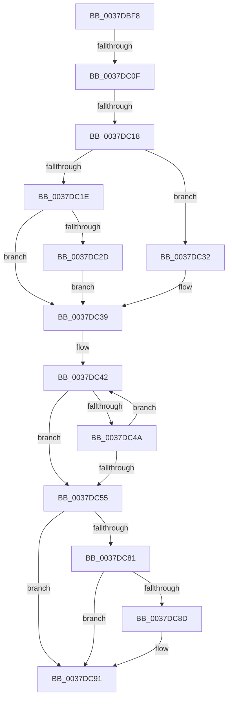

# sub_0037DBF8

- RVA: `0x0037DBF8`–`0x0037DCAF` (길이 `183` bytes)
- VA: `0x000000014037DBF8`
- 실행 섹션: `.text`
- PDB 이름 있음: `아니요`; PDB Function 태그: `아니요`
- unwind 정보 RVA: `0x0007B548`
- 디코드: `45`개 명령, `183/183` bytes 표시
- 미해석 바이트: `0` (있으면 어셈블리에 `.byte`로 보존)

> 이 문서는 커널 이미지의 기계어와 PDB 기호를 분석해 생성했습니다. 4번과 5번은 함수 원형과 자료형을 바이너리 사용 방식에서 추정한 C 해석이며 원본 소스 복구 결과는 아닙니다.

## 1. Dependencies

- 직접 호출 지점: **0**; 고유 호출 대상: **0**
- 직접 호출자로 확인된 함수: **0**
- RIP 상대 이미지 참조: **0**

### Outgoing calls
- 직접 디코드된 call 명령이 없습니다.

### Direct callers
- 이 함수 시작 RVA로 연결되는 직접 call은 확인되지 않았습니다. 간접 호출은 완전히 역산할 수 없습니다.

### Static image references
- 디코드된 RIP-relative 메모리 참조가 없습니다.

## 2. Other-region calls and transfers

- 다른 실행 섹션으로 향하는 call: **0**
- call이 아닌 외부 분기/꼬리 이동: **3**
  - `0x0037DC09` → [sub_0037DE15](Unknown_function_0037DE15.md) (`tail-transfer`)
  - `0x0037DC12` → [sub_0037DE15](Unknown_function_0037DE15.md) (`tail-transfer`)
  - `0x0037DCAD` → [sub_0037DCAF + 0x47](Unknown_function_0037DCAF.md) (`tail-transfer`)

## 3. Assembly (complete function range)

```asm
0037DBF8  48 8B 83 B0 89 00 00            mov rax, qword ptr [rbx + 0x89b0]
0037DBFF  4C 8B 83 B8 89 00 00            mov r8, qword ptr [rbx + 0x89b8]
0037DC06  48 85 C0                        test rax, rax
0037DC09  0F 84 06 02 00 00               je 0x14037de15
0037DC0F  4D 85 C0                        test r8, r8
0037DC12  0F 84 FD 01 00 00               je 0x14037de15
0037DC18  41 38 78 70                     cmp byte ptr [r8 + 0x70], dil
0037DC1C  75 14                           jne 0x14037dc32
0037DC1E  45 8B 40 50                     mov r8d, dword ptr [r8 + 0x50]
0037DC22  8B 88 10 02 00 00               mov ecx, dword ptr [rax + 0x210]
0037DC28  44 3B C1                        cmp r8d, ecx
0037DC2B  72 0C                           jb 0x14037dc39
0037DC2D  44 8B C1                        mov r8d, ecx
0037DC30  EB 07                           jmp 0x14037dc39
0037DC32  45 8B 80 84 00 00 00            mov r8d, dword ptr [r8 + 0x84]
0037DC39  8B CF                           mov ecx, edi
0037DC3B  48 8D 93 6A 8A 00 00            lea rdx, [rbx + 0x8a6a]
0037DC42  0F B7 02                        movzx eax, word ptr [rdx]
0037DC45  44 3B C0                        cmp r8d, eax
0037DC48  76 0B                           jbe 0x14037dc55
0037DC4A  FF C1                           inc ecx
0037DC4C  48 83 C2 02                     add rdx, 2
0037DC50  83 F9 03                        cmp ecx, 3
0037DC53  72 ED                           jb 0x14037dc42
0037DC55  40 38 BB 08 8A 00 00            cmp byte ptr [rbx + 0x8a08], dil
0037DC5C  8B C1                           mov eax, ecx
0037DC5E  40 0F 95 C7                     setne dil
0037DC62  48 81 C7 F0 10 00 00            add rdi, 0x10f0
0037DC69  48 8D 04 47                     lea rax, [rdi + rax*2]
0037DC6D  48 8B 0C C3                     mov rcx, qword ptr [rbx + rax*8]
0037DC71  48 8D 14 C3                     lea rdx, [rbx + rax*8]
0037DC75  49 03 CB                        add rcx, r11
0037DC78  48 89 0A                        mov qword ptr [rdx], rcx
0037DC7B  F6 46 02 40                     test byte ptr [rsi + 2], 0x40
0037DC7F  74 10                           je 0x14037dc91
0037DC81  48 8B 86 C8 03 00 00            mov rax, qword ptr [rsi + 0x3c8]
0037DC88  48 85 C0                        test rax, rax
0037DC8B  74 04                           je 0x14037dc91
0037DC8D  C6 40 40 01                     mov byte ptr [rax + 0x40], 1
0037DC91  48 89 AB F8 86 00 00            mov qword ptr [rbx + 0x86f8], rbp
0037DC98  48 8B 6C 24 70                  mov rbp, qword ptr [rsp + 0x70]
0037DC9D  4C 89 BB 80 86 00 00            mov qword ptr [rbx + 0x8680], r15
0037DCA4  F6 46 02 02                     test byte ptr [rsi + 2], 2
0037DCA8  4C 8B 7C 24 20                  mov r15, qword ptr [rsp + 0x20]
0037DCAD  74 47                           je 0x14037dcf6
```

## 4. C-style interpretation (structured pseudocode)

```c
__int64 __fastcall sub_0037DBF8(__int64 a1, __int64 a2, __int64 a3, __int64 a4, __int64 a5, __int64 a6, __int64 a7, __int64 a8, __int64 a9, __int64 a10, __int64 a11, __int64 a12, __int64 a13, __int64 a14)
{
    __int64 v_rdi;
    unsigned __int64 v_stack_p20;

    if ((*(unsigned __int8 *)(*(unsigned __int64 *)(v_rbx + 35256) + 112)) != ((unsigned __int8)(v_rdi))) goto loc_0037DC32;
    if (((unsigned int)((unsigned int)(*(unsigned int *)(*(unsigned __int64 *)(v_rbx + 35256) + 80)))) < ((unsigned int)((unsigned int)(*(unsigned int *)(*(unsigned __int64 *)(v_rbx + 35248) + 528))))) goto loc_0037DC39;
    goto loc_0037DC39;
loc_0037DC32:
loc_0037DC39:
loc_0037DC42:
    if (((unsigned int)((unsigned int)(*(unsigned int *)((unsigned int)((unsigned int)((unsigned int)(*(unsigned int *)(*(unsigned __int64 *)(v_rbx + 35248) + 528)))) + 132)))) <= ((unsigned int)(*(unsigned __int16 *)(v_rbx + 35434)))) goto loc_0037DC55;
    a1 = (unsigned int)(((unsigned int)((unsigned int)(v_rdi))) + 1);
    a2 = (v_rbx + 35434) + (2);
    if (((unsigned int)(a1)) < 3) goto loc_0037DC42;
loc_0037DC55:
    v_rdi = ((*(unsigned __int8 *)(v_rbx + 35336)) != ((unsigned __int8)(v_rdi))) ? 1 : 0;
    v_rdi = (v_rdi) + (0x10F0ULL);
    a1 = (*(unsigned __int64 *)(v_rbx + v_rdi + (unsigned int)((unsigned int)(a1)) * 2 * 8)) + (v_r11);
    *(unsigned __int64 *)(v_rbx + v_rdi + (unsigned int)((unsigned int)(a1)) * 2 * 8) = a1;
    if (((*(unsigned __int8 *)(v_rsi + 2)) & (64)) == 0) goto loc_0037DC91;
    if (*(unsigned __int64 *)(v_rsi + 968) != 0) {
        *(unsigned __int8 *)(*(unsigned __int64 *)(v_rsi + 968) + 64) = 1;
    }
    *(unsigned __int64 *)(v_rbx + 34552) = v_rbp;
    *(unsigned __int64 *)(v_rbx + 34432) = v_r15;
}
```

## 5. (Beta) C Style

```c
int64_t sub_0037DBF8(int64_t Arg1, int64_t Arg2, int64_t Arg3, int64_t Arg4, uint64_t Arg5, uint64_t Arg6, uint64_t Arg7, uint64_t Arg8, uint64_t Arg9, uint64_t Arg10, uint64_t Arg11, uint64_t Arg12, uint64_t Arg13, int64_t Arg14)
{
    int64_t local_rdi;
    uint64_t v_stack_p20;

    if ((*(uint8_t *)(*(uint64_t *)(local_rbx + 0x89B8) + 0x70)) != ((uint8_t)(local_rdi))) goto loc_0037DC32;
    if (((uint32_t)((uint32_t)(*(uint32_t *)(*(uint64_t *)(local_rbx + 0x89B8) + 0x50)))) < ((uint32_t)((uint32_t)(*(uint32_t *)(*(uint64_t *)(local_rbx + 0x89B0) + 0x210))))) goto loc_0037DC39;
    goto loc_0037DC39;
loc_0037DC32:
loc_0037DC39:
loc_0037DC42:
    if (((uint32_t)((uint32_t)(*(uint32_t *)((uint32_t)((uint32_t)((uint32_t)(*(uint32_t *)(*(uint64_t *)(local_rbx + 0x89B0) + 0x210)))) + 0x84)))) <= ((uint32_t)(*(uint16_t *)(local_rbx + 0x8A6A)))) goto loc_0037DC55;
    Arg1 = (uint32_t)(((uint32_t)((uint32_t)(local_rdi))) + 1);
    Arg2 = (local_rbx + 35434) + (2);
    if (((uint32_t)(Arg1)) < 3) goto loc_0037DC42;
loc_0037DC55:
    local_rdi = ((*(uint8_t *)(local_rbx + 0x8A08)) != ((uint8_t)(local_rdi))) ? 1 : 0;
    local_rdi = (local_rdi) + (0x10F0ULL);
    Arg1 = (*(uint64_t *)(local_rbx + local_rdi + (uint32_t)((uint32_t)(Arg1)) * 2 * 8)) + (local_r11);
    *(uint64_t *)(local_rbx + local_rdi + (uint32_t)((uint32_t)(Arg1)) * 2 * 8) = Arg1;
    if (((*(uint8_t *)(local_rsi + 0x2)) & (64)) == 0) goto loc_0037DC91;
    if (*(uint64_t *)(local_rsi + 0x3C8) != 0) {
        *(uint8_t *)(*(uint64_t *)(local_rsi + 0x3C8) + 0x40) = 1;
    }
    *(uint64_t *)(local_rbx + 0x86F8) = local_rbp;
    *(uint64_t *)(local_rbx + 0x8680) = local_r15;
}
```

## 6. Execution-region graph

[열기: 2D/3D 그래프와 함수 탐색 컨트롤 패널](../../../control-panel.html?section=text&rva=0x0037DBF8&view=graph)

- 2D 그래프는 위에서 아래로 흐르고, 3D 그래프는 빈 공간을 드래그해 회전합니다. Shift+드래그는 이동, 휠은 확대·축소, 함수 노드 선택은 대상 보고서 이동입니다.

### Static fallback


