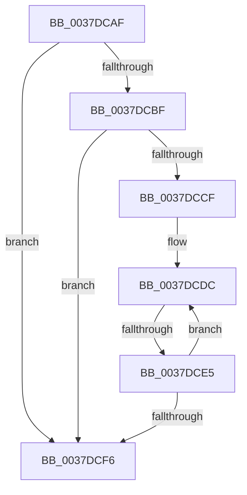

# sub_0037DCAF

- RVA: `0x0037DCAF`–`0x0037DD0F` (길이 `96` bytes)
- VA: `0x000000014037DCAF`
- 실행 섹션: `.text`
- PDB 이름 있음: `아니요`; PDB Function 태그: `아니요`
- unwind 정보 RVA: `0x0007B55C`
- 디코드: `24`개 명령, `96/96` bytes 표시
- 미해석 바이트: `0` (있으면 어셈블리에 `.byte`로 보존)

> 이 문서는 커널 이미지의 기계어와 PDB 기호를 분석해 생성했습니다. 4번과 5번은 함수 원형과 자료형을 바이너리 사용 방식에서 추정한 C 해석이며 원본 소스 복구 결과는 아닙니다.

## 1. Dependencies

- 직접 호출 지점: **0**; 고유 호출 대상: **0**
- 직접 호출자로 확인된 함수: **0**
- RIP 상대 이미지 참조: **2**

### Outgoing calls
- 직접 디코드된 call 명령이 없습니다.

### Direct callers
- 이 함수 시작 RVA로 연결되는 직접 call은 확인되지 않았습니다. 간접 호출은 완전히 역산할 수 없습니다.

### Static image references
- `0x0037DCBF` → RVA `0x00E66908` (`.data`; read)
- `0x0037DCCF` → RVA `0x00F10E80` (`.data`; read)

## 2. Other-region calls and transfers

- 다른 실행 섹션으로 향하는 call: **0**
- call이 아닌 외부 분기/꼬리 이동: **2**
  - `0x0037DCDF` → [sub_0037DE20](Unknown_function_0037DE20.md) (`tail-transfer`)
  - `0x0037DD09` → [sub_0037DDEC](Unknown_function_0037DDEC.md) (`tail-transfer`)

## 3. Assembly (complete function range)

```asm
0037DCAF  48 8B 86 68 01 00 00            mov rax, qword ptr [rsi + 0x168]
0037DCB6  4C 8B 48 20                     mov r9, qword ptr [rax + 0x20]
0037DCBA  4D 85 C9                        test r9, r9
0037DCBD  74 37                           je 0x14037dcf6
0037DCBF  8B 0D 43 8C AE 00               mov ecx, dword ptr [rip + 0xae8c43]
0037DCC5  41 B8 01 00 00 00               mov r8d, 1
0037DCCB  85 C9                           test ecx, ecx
0037DCCD  74 27                           je 0x14037dcf6
0037DCCF  4C 8D 15 AA 31 B9 00            lea r10, [rip + 0xb931aa]
0037DCD6  8B F9                           mov edi, ecx
0037DCD8  4C 8D 58 30                     lea r11, [rax + 0x30]
0037DCDC  4D 85 C8                        test r8, r9
0037DCDF  0F 85 3B 01 00 00               jne 0x14037de20
0037DCE5  4D 03 C0                        add r8, r8
0037DCE8  49 83 C3 18                     add r11, 0x18
0037DCEC  49 83 C2 04                     add r10, 4
0037DCF0  48 83 EF 01                     sub rdi, 1
0037DCF4  75 E6                           jne 0x14037dcdc
0037DCF6  48 8B 7C 24 38                  mov rdi, qword ptr [rsp + 0x38]
0037DCFB  90                              nop
0037DCFC  80 7B 06 00                     cmp byte ptr [rbx + 6], 0
0037DD00  48 8B 74 24 40                  mov rsi, qword ptr [rsp + 0x40]
0037DD05  C6 43 20 00                     mov byte ptr [rbx + 0x20], 0
0037DD09  0F 85 DD 00 00 00               jne 0x14037ddec
```

## 4. C-style interpretation (structured pseudocode)

```c
__int64 __fastcall sub_0037DCAF(__int64 a1, __int64 a2, __int64 a3, __int64 a4, __int64 a5, __int64 a6, __int64 a7, __int64 a8)
{
    __int64 v_r10;
    __int64 v_r11;
    __int64 v_rdi;

    if (*(unsigned __int64 *)(*(unsigned __int64 *)(v_rsi + 360) + 32) == 0) goto loc_0037DCF6;
    if ((unsigned int)((unsigned int)(*(unsigned int *)(v_rip + 11439171))) == 0) goto loc_0037DCF6;
loc_0037DCDC:
    a3 = (1) + (1);
    v_r11 = (*(unsigned __int64 *)(v_rsi + 360) + 48) + (24);
    v_r10 = (v_rip + 12136874) + (4);
    v_rdi = ((unsigned int)((unsigned int)((unsigned int)(*(unsigned int *)(v_rip + 11439171))))) - (1);
    if (condition_is_not_equal) goto loc_0037DCDC;
loc_0037DCF6:
    *(unsigned __int8 *)(v_rbx + 32) = 0;
}
```

## 5. (Beta) C Style

```c
int64_t sub_0037DCAF(int64_t Arg1, int64_t Arg2, int64_t Arg3, int64_t Arg4, uint64_t Arg5, uint64_t Arg6, int64_t Arg7, int64_t Arg8)
{
    int64_t local_r10;
    int64_t local_r11;
    int64_t local_rdi;

    if (*(uint64_t *)(*(uint64_t *)(local_rsi + 0x168) + 0x20) == 0) goto loc_0037DCF6;
    if ((uint32_t)((uint32_t)(*(uint32_t *)(v_rip + 0xAE8C43))) == 0) goto loc_0037DCF6;
loc_0037DCDC:
    Arg3 = (1) + (1);
    local_r11 = (*(uint64_t *)(local_rsi + 0x168) + 48) + (24);
    local_r10 = (v_rip + 12136874) + (4);
    local_rdi = ((uint32_t)((uint32_t)((uint32_t)(*(uint32_t *)(v_rip + 0xAE8C43))))) - (1);
    if (condition_is_not_equal) goto loc_0037DCDC;
loc_0037DCF6:
    *(uint8_t *)(local_rbx + 0x20) = 0;
}
```

## 6. Execution-region graph

[열기: 2D/3D 그래프와 함수 탐색 컨트롤 패널](../../../control-panel.html?section=text&rva=0x0037DCAF&view=graph)

- 2D 그래프는 위에서 아래로 흐르고, 3D 그래프는 빈 공간을 드래그해 회전합니다. Shift+드래그는 이동, 휠은 확대·축소, 함수 노드 선택은 대상 보고서 이동입니다.

### Static fallback


