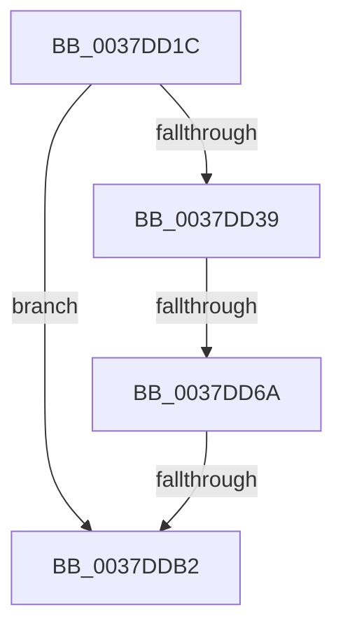

# sub_0037DD1C

- RVA: `0x0037DD1C`–`0x0037DDBC` (길이 `160` bytes)
- VA: `0x000000014037DD1C`
- 실행 섹션: `.text`
- PDB 이름 있음: `아니요`; PDB Function 태그: `아니요`
- unwind 정보 RVA: `0x0007B5AC`
- 디코드: `38`개 명령, `160/160` bytes 표시
- 미해석 바이트: `0` (있으면 어셈블리에 `.byte`로 보존)

> 이 문서는 커널 이미지의 기계어와 PDB 기호를 분석해 생성했습니다. 4번과 5번은 함수 원형과 자료형을 바이너리 사용 방식에서 추정한 C 해석이며 원본 소스 복구 결과는 아닙니다.

## 1. Dependencies

- 직접 호출 지점: **0**; 고유 호출 대상: **0**
- 직접 호출자로 확인된 함수: **0**
- RIP 상대 이미지 참조: **2**

### Outgoing calls
- 직접 디코드된 call 명령이 없습니다.

### Direct callers
- 이 함수 시작 RVA로 연결되는 직접 call은 확인되지 않았습니다. 간접 호출은 완전히 역산할 수 없습니다.

### Static image references
- `0x0037DD73` → RVA `0x00FC6BC6` (`ALMOSTRO`; read)
- `0x0037DD88` → RVA `0x00FC7318` (`ALMOSTRO`; read)

## 2. Other-region calls and transfers

- 다른 실행 섹션으로 향하는 call: **0**
- call이 아닌 외부 분기/꼬리 이동: **3**
  - `0x0037DD64` → [sub_0037DE05](Unknown_function_0037DE05.md) (`tail-transfer`)
  - `0x0037DDB0` → [sub_0037DDBC](Unknown_function_0037DDBC.md) (`tail-transfer`)
  - `0x0037DDB7` → [sub_0037DB53 + 0x74](Unknown_function_0037DB53.md) (`tail-transfer`)

## 3. Assembly (complete function range)

```asm
0037DD1C  4C 89 64 24 30                  mov qword ptr [rsp + 0x30], r12
0037DD21  F6 D8                           neg al
0037DD23  48 B8 00 03 00 00 80 F7 FF FF   movabs rax, 0xfffff78000000300
0037DD2D  45 1B E4                        sbb r12d, r12d
0037DD30  41 83 C4 02                     add r12d, 2
0037DD34  48 39 38                        cmp qword ptr [rax], rdi
0037DD37  74 79                           je 0x14037ddb2
0037DD39  A0 69 03 00 00 80 F7 FF FF      movabs al, byte ptr [0xfffff78000000369]
0037DD42  49 B9 60 03 00 00 80 F7 FF FF   movabs r9, 0xfffff78000000360
0037DD4C  0F B6 C8                        movzx ecx, al
0037DD4F  48 89 7C 24 60                  mov qword ptr [rsp + 0x60], rdi
0037DD54  84 C0                           test al, al
0037DD56  48 89 7C 24 68                  mov qword ptr [rsp + 0x68], rdi
0037DD5B  4C 8B C5                        mov r8, rbp
0037DD5E  4D 8B 09                        mov r9, qword ptr [r9]
0037DD61  49 8B C1                        mov rax, r9
0037DD64  0F 84 9B 00 00 00               je 0x14037de05
0037DD6A  48 D3 E2                        shl rdx, cl
0037DD6D  48 F7 E2                        mul rdx
0037DD70  49 D3 E0                        shl r8, cl
0037DD73  0F BE 0D 4C 8E C4 00            movsx ecx, byte ptr [rip + 0xc48e4c]
0037DD7A  4C 8B D2                        mov r10, rdx
0037DD7D  48 89 54 24 60                  mov qword ptr [rsp + 0x60], rdx
0037DD82  49 8B C1                        mov rax, r9
0037DD85  49 F7 E0                        mul r8
0037DD88  48 8B 05 89 95 C4 00            mov rax, qword ptr [rip + 0xc49589]
0037DD8F  4C 8B CA                        mov r9, rdx
0037DD92  48 89 54 24 68                  mov qword ptr [rsp + 0x68], rdx
0037DD97  49 F7 E2                        mul r10
0037DD9A  48 8B 05 77 95 C4 00            mov rax, qword ptr [rip + 0xc49577]
0037DDA1  4C 8B D2                        mov r10, rdx
0037DDA4  49 F7 E1                        mul r9
0037DDA7  49 D3 EA                        shr r10, cl
0037DDAA  48 D3 EA                        shr rdx, cl
0037DDAD  41 2B D2                        sub edx, r10d
0037DDB0  75 0A                           jne 0x14037ddbc
0037DDB2  4C 8B 64 24 30                  mov r12, qword ptr [rsp + 0x30]
0037DDB7  E9 0B FE FF FF                  jmp 0x14037dbc7
```

## 4. C-style interpretation (structured pseudocode)

```c
__int64 __fastcall sub_0037DD1C(__int64 a1, __int64 a2, __int64 a3, __int64 a4, __int64 a5, __int64 a6)
{
    __int64 result;
    __int64 v_r10;
    __int64 v_r12;
    unsigned __int64 v_stack_p30;
    unsigned __int64 v_stack_p60;
    unsigned __int64 v_stack_p68;

    v_stack_p30 = v_r12;
    result = (unsigned __int8)(-(result));
    v_r12 = (unsigned int)((v_r12) + (2));
    if ((*(unsigned __int64 *)(result)) == v_rdi) goto loc_0037DDB2;
    v_stack_p60 = v_rdi;
    v_stack_p68 = v_rdi;
    a2 = (a2) << ((unsigned __int8)((unsigned __int8)(result)));
    a3 = (v_rbp) << ((unsigned __int8)((unsigned __int8)(result)));
    v_stack_p60 = a2;
    v_stack_p68 = a2;
    v_r10 = (a2) >> ((unsigned __int8)((__int8)(*(unsigned __int8 *)(v_rip + 12881484))));
    a2 = (a2) >> ((unsigned __int8)((__int8)(*(unsigned __int8 *)(v_rip + 12881484))));
    a2 = (unsigned int)((a2) - ((unsigned int)(v_r10)));
loc_0037DDB2:
}
```

## 5. (Beta) C Style

```c
int64_t sub_0037DD1C(int64_t Arg1, int64_t Arg2, int64_t Arg3, int64_t Arg4, uint64_t Arg5, int64_t Arg6)
{
    int64_t result;
    int64_t local_r10;
    int64_t local_r12;
    uint64_t v_stack_p30;
    uint64_t v_stack_p60;
    uint64_t v_stack_p68;

    v_stack_p30 = local_r12;
    result = (uint8_t)(-(result));
    local_r12 = (uint32_t)((local_r12) + (2));
    if ((*(uint64_t *)(result)) == local_rdi) goto loc_0037DDB2;
    v_stack_p60 = local_rdi;
    v_stack_p68 = local_rdi;
    Arg2 = (Arg2) << ((uint8_t)((uint8_t)(result)));
    Arg3 = (local_rbp) << ((uint8_t)((uint8_t)(result)));
    v_stack_p60 = Arg2;
    v_stack_p68 = Arg2;
    local_r10 = (Arg2) >> ((uint8_t)((int8_t)(*(uint8_t *)(v_rip + 0xC48E4C))));
    Arg2 = (Arg2) >> ((uint8_t)((int8_t)(*(uint8_t *)(v_rip + 0xC48E4C))));
    Arg2 = (uint32_t)((Arg2) - ((uint32_t)(local_r10)));
loc_0037DDB2:
}
```

## 6. Execution-region graph

[열기: 2D/3D 그래프와 함수 탐색 컨트롤 패널](../../../control-panel.html?section=text&rva=0x0037DD1C&view=graph)

- 2D 그래프는 위에서 아래로 흐르고, 3D 그래프는 빈 공간을 드래그해 회전합니다. Shift+드래그는 이동, 휠은 확대·축소, 함수 노드 선택은 대상 보고서 이동입니다.

### Static fallback


