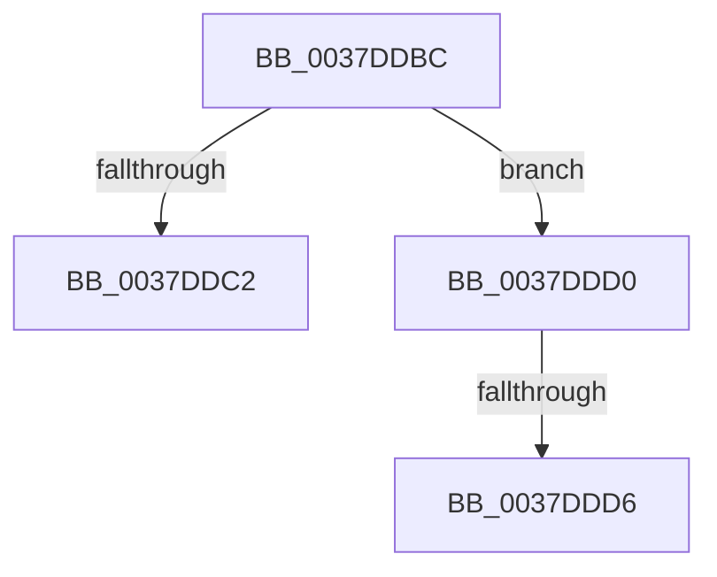

# sub_0037DDBC

- RVA: `0x0037DDBC`–`0x0037DDEC` (길이 `48` bytes)
- VA: `0x000000014037DDBC`
- 실행 섹션: `.text`
- PDB 이름 있음: `아니요`; PDB Function 태그: `아니요`
- unwind 정보 RVA: `0x0007B5C0`
- 디코드: `11`개 명령, `48/48` bytes 표시
- 미해석 바이트: `0` (있으면 어셈블리에 `.byte`로 보존)

> 이 문서는 커널 이미지의 기계어와 PDB 기호를 분석해 생성했습니다. 4번과 5번은 함수 원형과 자료형을 바이너리 사용 방식에서 추정한 C 해석이며 원본 소스 복구 결과는 아닙니다.

## 1. Dependencies

- 직접 호출 지점: **0**; 고유 호출 대상: **0**
- 직접 호출자로 확인된 함수: **0**
- RIP 상대 이미지 참조: **0**

### Outgoing calls
- 직접 디코드된 call 명령이 없습니다.

### Direct callers
- 이 함수 시작 RVA로 연결되는 직접 call은 확인되지 않았습니다. 간접 호출은 완전히 역산할 수 없습니다.

### Static image references
- 디코드된 RIP-relative 메모리 참조가 없습니다.

## 2. Other-region calls and transfers

- 다른 실행 섹션으로 향하는 call: **0**
- call이 아닌 외부 분기/꼬리 이동: **3**
  - `0x0037DDCE` → [sub_0037DD1C + 0x96](Unknown_function_0037DD1C.md) (`tail-transfer`)
  - `0x0037DDD4` → [sub_0037DE05 + 0x8](Unknown_function_0037DE05.md) (`tail-transfer`)
  - `0x0037DDE7` → [sub_0037DB53 + 0x74](Unknown_function_0037DB53.md) (`tail-transfer`)

## 3. Assembly (complete function range)

```asm
0037DDBC  41 83 EC 01                     sub r12d, 1
0037DDC0  75 0E                           jne 0x14037ddd0
0037DDC2  01 93 44 86 00 00               add dword ptr [rbx + 0x8644], edx
0037DDC8  01 93 4C 86 00 00               add dword ptr [rbx + 0x864c], edx
0037DDCE  EB E2                           jmp 0x14037ddb2
0037DDD0  41 83 EC 01                     sub r12d, 1
0037DDD4  75 37                           jne 0x14037de0d
0037DDD6  01 93 44 86 00 00               add dword ptr [rbx + 0x8644], edx
0037DDDC  01 93 50 86 00 00               add dword ptr [rbx + 0x8650], edx
0037DDE2  4C 8B 64 24 30                  mov r12, qword ptr [rsp + 0x30]
0037DDE7  E9 DB FD FF FF                  jmp 0x14037dbc7
```

## 4. C-style interpretation (structured pseudocode)

```c
void __fastcall sub_0037DDBC(__int64 a1, int a2, __int64 a3, __int64 a4, __int64 a5, __int64 a6)
{
    __int64 v_r12;

    v_r12 = (unsigned int)((v_r12) - (1));
    if (condition_is_not_equal) goto loc_0037DDD0;
loc_0037DDD0:
    v_r12 = (unsigned int)((v_r12) - (1));
}
```

## 5. (Beta) C Style

```c
void sub_0037DDBC(int64_t Arg1, int32_t Arg2, int64_t Arg3, int64_t Arg4, uint64_t Arg5, int64_t Arg6)
{
    int64_t local_r12;

    local_r12 = (uint32_t)((local_r12) - (1));
    if (condition_is_not_equal) goto loc_0037DDD0;
loc_0037DDD0:
    local_r12 = (uint32_t)((local_r12) - (1));
}
```

## 6. Execution-region graph

[열기: 2D/3D 그래프와 함수 탐색 컨트롤 패널](../../../control-panel.html?section=text&rva=0x0037DDBC&view=graph)

- 2D 그래프는 위에서 아래로 흐르고, 3D 그래프는 빈 공간을 드래그해 회전합니다. Shift+드래그는 이동, 휠은 확대·축소, 함수 노드 선택은 대상 보고서 이동입니다.

### Static fallback


